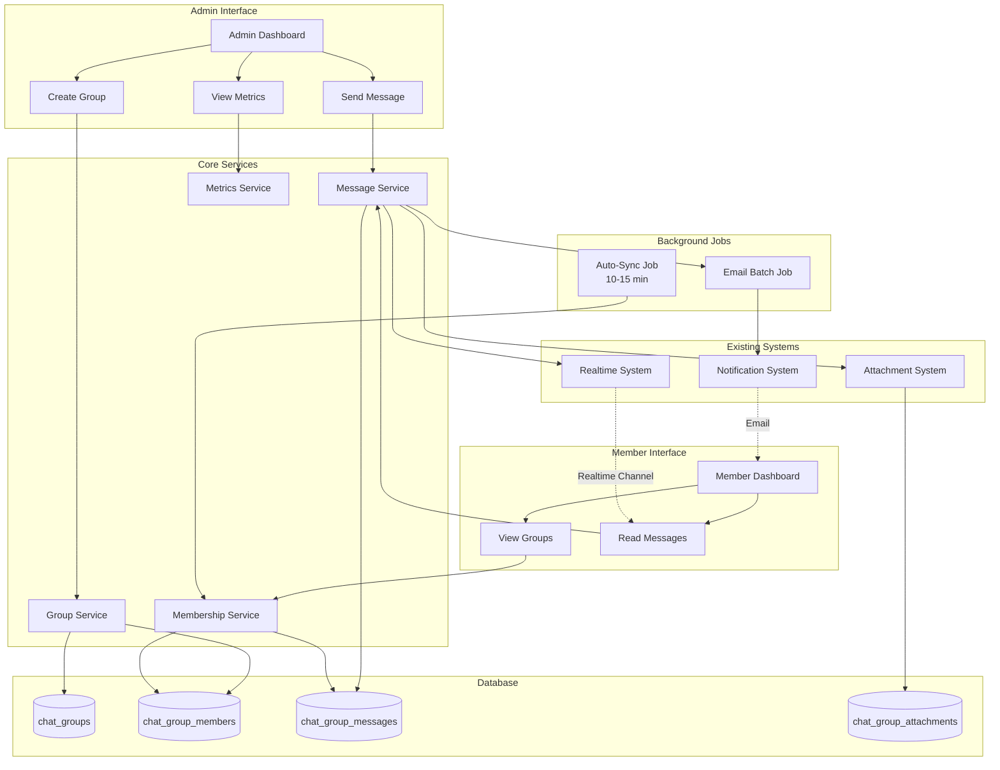
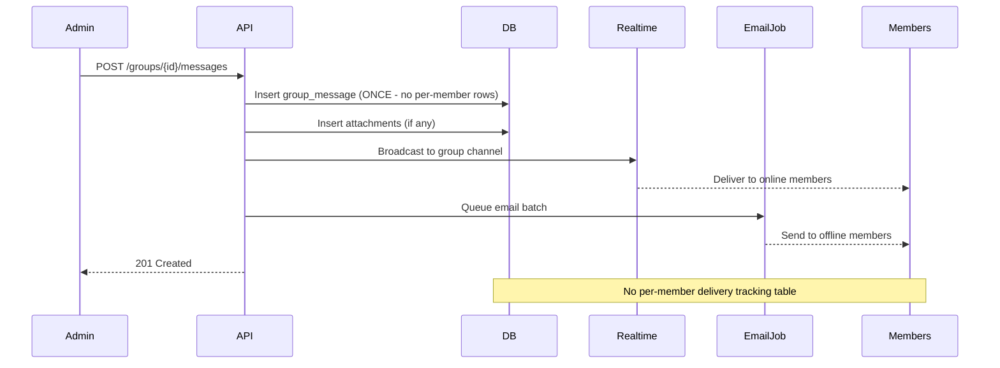
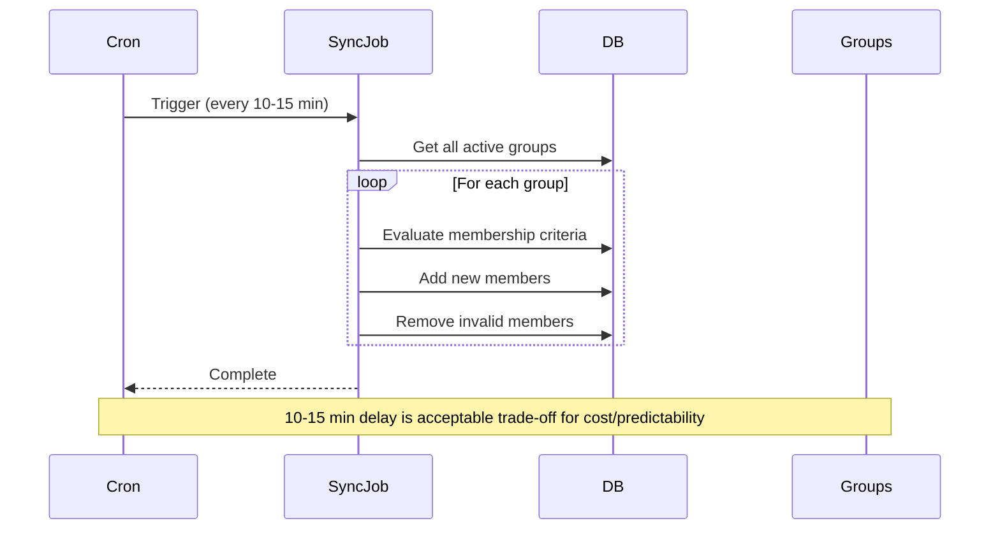

# Design Document - Sistema de Broadcast para E-commerce

## Overview

This document specifies the technical design for a minimalist broadcast messaging system for an e-commerce platform selling action figures. The system enables administrators to send one-way broadcast messages to automatically segmented customer groups based on subscriptions, collections, orders, and launches.

**Strategic Business Context**: This system enables strategic customer segmentation for targeted communication. Use cases include:
- "Compradores 2025" group for year-specific campaigns
- "Assinantes Ativos" group for subscriber-exclusive content
- "Coleção X" group for collection-specific announcements
- Pre-sales notifications, exclusive discounts, and launch announcements

This is more powerful than traditional newsletters because groups are behavior-based and automatically synchronized with customer actions (subscriptions, purchases, etc.).

### Key Design Principles

1. **Broadcast-Only Communication**: Members receive messages but cannot reply (V1 scope)
2. **Scalable Message Delivery**: Single message storage with Realtime channel per group (not per member)
3. **Async Synchronization**: Auto-sync job runs every 10-15 minutes (not real-time triggers)
4. **Simple Unread Tracking**: Uses `last_viewed_at` timestamp (not per-message read receipts)
5. **Reuse Existing Infrastructure**: Leverages attachment, notification, and Realtime systems
6. **Soft Delete**: Preserves historical data for audit while hiding from users

### Architecture Simplification - What We DON'T Have

To maintain simplicity and scalability, this system explicitly DOES NOT include:
- ❌ No `read_receipts` table (uses `last_viewed_at` timestamp instead)
- ❌ No `delivery_status` table (delivery happens via Realtime broadcast + email batch)
- ❌ No per-message tracking rows (one message row serves all members)
- ❌ No per-member notification rows (notifications sent via channels, not stored)
- ✅ Only 4 tables: `chat_groups`, `chat_group_members`, `chat_group_messages`, `chat_group_attachments`

### System Boundaries

**In Scope:**
- Admin creates groups (manual, subscribers, collection, launches, orders)
- Admin sends broadcast messages with attachments
- Members receive messages via Realtime and email
- Simple unread counter per group
- Basic metrics (total members, messages, estimated open rate)
- Soft delete for groups

**Out of Scope (V1):**
- Member replies to broadcast messages
- Real-time membership synchronization (uses async job)
- Per-message read receipts
- Full-text search
- Edit/archive groups
- Complex analytics dashboard
- Notification when added to group

## Architecture

### High-Level Architecture



### Data Flow

#### Message Broadcast Flow

**CRITICAL: Message Delivery Architecture**

Messages are delivered through TWO channels, but stored ONCE:

1. **Realtime Broadcast** (for online members): Message broadcast to group channel via Supabase Realtime
2. **Email Batch Job** (for offline members): Async job sends emails to members who haven't viewed recently

**What we DO NOT do:**
- ❌ We do NOT create delivery rows per member
- ❌ We do NOT track per-member delivery status
- ❌ We persist only the message once in `chat_group_messages`

**What "viewed" means:**
- "Viewed" = User opened the group page (updated `last_viewed_at`)
- NOT "read the message completely"
- NOT "scrolled to the bottom"
- This is an estimated metric for engagement, not precise read tracking



#### Auto-Sync Membership Flow

**Business Context**: Auto-sync runs every 10-15 minutes (configurable). This is a deliberate trade-off:
- **Lower cost**: Reduces database load compared to real-time triggers
- **Predictability**: Scheduled execution is easier to monitor and debug
- **Acceptable delay**: If a user cancels their subscription, they leave the group within 10-15 minutes (not real-time, but acceptable for broadcast use case)



### Technology Stack

- **Database**: PostgreSQL (Supabase)
- **Realtime**: Supabase Realtime (broadcast channels)
- **Storage**: Supabase Storage (for attachments)
- **Email**: Supabase Edge Functions (send-email)
- **Background Jobs**: pg_cron or Supabase Edge Functions with cron
- **Frontend**: React + TypeScript
- **API**: Supabase RPC functions + REST API

## Components and Interfaces

### Database Schema

#### Table: chat_groups

Stores group definitions and membership criteria.

```sql
CREATE TABLE chat_groups (
  id UUID PRIMARY KEY DEFAULT gen_random_uuid(),
  name TEXT NOT NULL CHECK (char_length(name) >= 3 AND char_length(name) <= 100),
  type TEXT NOT NULL CHECK (type IN ('manual', 'assinantes', 'colecao', 'lancamentos', 'pedidos')),
  
  -- Membership criteria (JSONB for flexibility)
  membership_criteria JSONB,
  -- Examples:
  -- Manual: null
  -- Assinantes: {"subscription_status": "active", "collection_id": "uuid", "plan": "premium"}
  -- Coleção: {"collection_id": "uuid"}
  -- Lançamentos: {"criteria": "all_users" | "previous_buyers"}
  -- Pedidos: {"status": ["pending", "processing"], "date_from": "2024-01-01", "date_to": "2024-12-31"}
  
  created_by UUID NOT NULL REFERENCES auth.users(id),
  created_at TIMESTAMPTZ NOT NULL DEFAULT now(),
  updated_at TIMESTAMPTZ NOT NULL DEFAULT now(),
  
  -- Soft delete
  deleted_at TIMESTAMPTZ,
  deleted_by UUID REFERENCES auth.users(id),
  
  -- Note: Soft delete preserves historical communication data for audit/compliance
  -- Deleted groups are hidden from UI but data remains in database
  
  -- Indexes
  CONSTRAINT chat_groups_name_key UNIQUE (name) WHERE deleted_at IS NULL
);

CREATE INDEX idx_chat_groups_type ON chat_groups(type) WHERE deleted_at IS NULL;
CREATE INDEX idx_chat_groups_deleted ON chat_groups(deleted_at);
CREATE INDEX idx_chat_groups_created_by ON chat_groups(created_by);
```

#### Table: chat_group_members

Stores group membership and view tracking.

```sql
CREATE TABLE chat_group_members (
  id UUID PRIMARY KEY DEFAULT gen_random_uuid(),
  group_id UUID NOT NULL REFERENCES chat_groups(id) ON DELETE CASCADE,
  user_id UUID NOT NULL REFERENCES auth.users(id) ON DELETE CASCADE,
  
  -- View tracking for unread counter
  last_viewed_at TIMESTAMPTZ,
  
  joined_at TIMESTAMPTZ NOT NULL DEFAULT now(),
  
  -- Prevent duplicate memberships
  CONSTRAINT chat_group_members_unique UNIQUE (group_id, user_id)
);

CREATE INDEX idx_chat_group_members_group ON chat_group_members(group_id);
CREATE INDEX idx_chat_group_members_user ON chat_group_members(user_id);
CREATE INDEX idx_chat_group_members_last_viewed ON chat_group_members(group_id, last_viewed_at);
```

#### Table: chat_group_messages

Stores broadcast messages (one row per message, not per member).

```sql
CREATE TABLE chat_group_messages (
  id UUID PRIMARY KEY DEFAULT gen_random_uuid(),
  group_id UUID NOT NULL REFERENCES chat_groups(id) ON DELETE CASCADE,
  sender_id UUID NOT NULL REFERENCES auth.users(id),
  
  message TEXT NOT NULL CHECK (char_length(message) >= 1 AND char_length(message) <= 5000),
  
  created_at TIMESTAMPTZ NOT NULL DEFAULT now(),
  updated_at TIMESTAMPTZ NOT NULL DEFAULT now()
);

CREATE INDEX idx_chat_group_messages_group ON chat_group_messages(group_id, created_at DESC);
CREATE INDEX idx_chat_group_messages_sender ON chat_group_messages(sender_id);
```

#### Table: chat_group_attachments

Reuses existing attachment pattern for group messages.

```sql
CREATE TABLE chat_group_attachments (
  id UUID PRIMARY KEY DEFAULT gen_random_uuid(),
  message_id UUID NOT NULL REFERENCES chat_group_messages(id) ON DELETE CASCADE,
  file_name TEXT NOT NULL,
  file_path TEXT NOT NULL,
  file_size INTEGER NOT NULL,
  file_type TEXT NOT NULL,
  thumbnail_path TEXT,
  uploaded_by UUID NOT NULL REFERENCES auth.users(id),
  created_at TIMESTAMPTZ NOT NULL DEFAULT now()
);

CREATE INDEX idx_chat_group_attachments_message ON chat_group_attachments(message_id);
CREATE INDEX idx_chat_group_attachments_uploaded_by ON chat_group_attachments(uploaded_by);
```

### API Design

#### Group Management Endpoints

**Create Group**

```typescript
POST /api/groups

Request:
{
  name: string;           // 3-100 chars
  type: 'manual' | 'assinantes' | 'colecao' | 'lancamentos' | 'pedidos';
  membershipCriteria?: {
    // For 'assinantes'
    subscriptionStatus?: 'active';
    collectionId?: string;
    plan?: string;
    
    // For 'colecao'
    collectionId?: string;
    
    // For 'lancamentos'
    criteria?: 'all_users' | 'previous_buyers';
    
    // For 'pedidos'
    status?: string[];
    dateFrom?: string;
    dateTo?: string;
  };
}

Response: 201 Created
{
  id: string;
  name: string;
  type: string;
  membershipCriteria: object | null;
  createdBy: string;
  createdAt: string;
  memberCount: number;
}

Errors:
- 400: Invalid name length or type
- 401: Unauthorized (not admin)
- 409: Group name already exists
```

**List Groups**

```typescript
GET /api/groups?includeDeleted=false

Response: 200 OK
{
  groups: [
    {
      id: string;
      name: string;
      type: string;
      memberCount: number;
      messageCount: number;
      lastMessageAt: string | null;
      createdAt: string;
    }
  ]
}
```

**Get Group Details**

```typescript
GET /api/groups/{id}

Response: 200 OK
{
  id: string;
  name: string;
  type: string;
  memberCount: number;
  messageCount: number;
  estimatedViewRate: number;  // 0-100
  createdBy: string;
  createdAt: string;
  lastMessageAt: string | null;
}

Errors:
- 404: Group not found or deleted
- 403: Forbidden (not admin or member)
```

**Delete Group (Soft)**

```typescript
DELETE /api/groups/{id}

Response: 204 No Content

Errors:
- 404: Group not found
- 403: Forbidden (not admin)
```

#### Member Management Endpoints

**Add Member to Manual Group**

```typescript
POST /api/groups/{id}/members

Request:
{
  userId: string;
}

Response: 201 Created
{
  id: string;
  groupId: string;
  userId: string;
  joinedAt: string;
}

Errors:
- 400: Invalid userId or group is not manual
- 404: User or group not found
- 409: User already member
- 403: Forbidden (not admin)
```

**Remove Member from Manual Group**

```typescript
DELETE /api/groups/{id}/members/{userId}

Response: 204 No Content

Errors:
- 404: Member or group not found
- 400: Group is not manual
- 403: Forbidden (not admin)
```

**List Group Members**

```typescript
GET /api/groups/{id}/members?page=1&limit=50

Response: 200 OK
{
  members: [
    {
      userId: string;
      userName: string;
      userEmail: string;
      joinedAt: string;
      lastViewedAt: string | null;
    }
  ],
  pagination: {
    page: number;
    limit: number;
    total: number;
    totalPages: number;
  }
}

Errors:
- 404: Group not found
- 403: Forbidden (not admin)
```

#### Message Endpoints

**Send Broadcast Message**

```typescript
POST /api/groups/{id}/messages

Request:
{
  message: string;        // 1-5000 chars
  attachments?: [
    {
      fileName: string;
      filePath: string;
      fileSize: number;
      fileType: string;
      thumbnailPath?: string;
    }
  ];
}

Response: 201 Created
{
  id: string;
  groupId: string;
  senderId: string;
  message: string;
  attachments: [...];
  createdAt: string;
}

Errors:
- 400: Invalid message length
- 404: Group not found or deleted
- 403: Forbidden (not admin)
```

**List Group Messages**

```typescript
GET /api/groups/{id}/messages?page=1&limit=50

Response: 200 OK
{
  messages: [
    {
      id: string;
      senderId: string;
      senderName: string;
      senderAvatar: string | null;
      message: string;
      attachments: [...];
      createdAt: string;
    }
  ],
  pagination: {
    page: number;
    limit: number;
    total: number;
    totalPages: number;
  }
}

Errors:
- 404: Group not found
- 403: Forbidden (not member)
```

**Update Last Viewed**

```typescript
POST /api/groups/{id}/view

Response: 204 No Content

Side Effect: Updates last_viewed_at to current timestamp

Errors:
- 404: Group not found or user not member
- 403: Forbidden (not member)
```

#### Member Interface Endpoints

**List My Groups**

```typescript
GET /api/my-groups

Response: 200 OK
{
  groups: [
    {
      id: string;
      name: string;
      type: string;
      unreadCount: number;
      lastMessage: {
        message: string;
        senderName: string;
        createdAt: string;
      } | null;
      lastViewedAt: string | null;
    }
  ]
}
```

### Service Layer

#### GroupService

```typescript
interface GroupService {
  // Admin operations
  createGroup(data: CreateGroupInput): Promise<Group>;
  deleteGroup(groupId: string, adminId: string): Promise<void>;
  getGroupDetails(groupId: string): Promise<GroupDetails>;
  listGroups(includeDeleted: boolean): Promise<Group[]>;
  
  // Member operations
  addMember(groupId: string, userId: string): Promise<GroupMember>;
  removeMember(groupId: string, userId: string): Promise<void>;
  listMembers(groupId: string, pagination: Pagination): Promise<PaginatedMembers>;
  
  // Metrics
  getGroupMetrics(groupId: string): Promise<GroupMetrics>;
}
```

#### MessageService

```typescript
interface MessageService {
  // Send message
  sendBroadcastMessage(
    groupId: string,
    senderId: string,
    message: string,
    attachments?: AttachmentInput[]
  ): Promise<GroupMessage>;
  
  // Retrieve messages
  listMessages(
    groupId: string,
    userId: string,
    pagination: Pagination
  ): Promise<PaginatedMessages>;
  
  // View tracking
  updateLastViewed(groupId: string, userId: string): Promise<void>;
  getUnreadCount(groupId: string, userId: string): Promise<number>;
}
```

#### MembershipService

```typescript
interface MembershipService {
  // Auto-sync
  syncGroupMembership(groupId: string): Promise<SyncResult>;
  syncAllGroups(): Promise<SyncResult[]>;
  
  // Criteria evaluation
  evaluateMembershipCriteria(
    criteria: MembershipCriteria,
    userId: string
  ): Promise<boolean>;
  
  getUsersMatchingCriteria(
    criteria: MembershipCriteria
  ): Promise<string[]>;
}
```

#### MetricsService

```typescript
interface MetricsService {
  getTotalMembers(groupId: string): Promise<number>;
  getTotalMessages(groupId: string): Promise<number>;
  getEstimatedViewRate(groupId: string): Promise<number>;
  
  // CRITICAL CLARIFICATION - Estimated View Rate Calculation:
  // 
  // "Viewed" means: User opened the group page (last_viewed_at updated)
  // NOT "read the message" or "scrolled to bottom"
  // This is an estimated metric for engagement, not precise read tracking
  // 
  // Formula: COUNT(members where last_viewed_at > last_message.created_at) / COUNT(members) * 100
  // 
  // "last_message" = the MOST RECENT message in the group
  // If multiple messages exist after last_viewed_at, still counts as "not viewed"
  // This is intentionally simple to avoid complexity
  //
  // Example:
  // - Group has 100 members
  // - Last message created at 2024-01-15 10:00:00
  // - 60 members have last_viewed_at > 2024-01-15 10:00:00
  // - Estimated view rate = 60 / 100 * 100 = 60%
}
```

### Integration with Existing Systems

#### Attachment System Integration

The group messaging system reuses the existing attachment infrastructure:

```typescript
// Reuse existing fileUploadService
import { fileUploadService } from '@/lib/services/fileUploadService';

async function uploadGroupAttachment(
  file: File,
  messageId: string,
  userId: string
): Promise<Attachment> {
  // Upload to Supabase Storage
  const filePath = await fileUploadService.uploadFile(file, 'group-attachments');
  
  // Create attachment record
  const attachment = await supabase
    .from('chat_group_attachments')
    .insert({
      message_id: messageId,
      file_name: file.name,
      file_path: filePath,
      file_size: file.size,
      file_type: file.type,
      uploaded_by: userId,
    })
    .select()
    .single();
  
  return attachment;
}
```

#### Notification System Integration

Email notifications are sent via the existing notification system:

```typescript
// Reuse existing notificationService
import { notificationService } from '@/lib/services/notificationService';

async function sendGroupMessageEmails(
  groupId: string,
  messageId: string,
  message: string
): Promise<void> {
  // Get offline members (those who haven't viewed recently)
  const offlineMembers = await getOfflineMembers(groupId);
  
  // Queue batch email job
  await supabase.rpc('queue_group_message_emails', {
    p_group_id: groupId,
    p_message_id: messageId,
    p_member_ids: offlineMembers.map(m => m.userId),
  });
}

// Edge Function: send-group-email
async function sendGroupEmail(
  recipientEmail: string,
  groupName: string,
  senderName: string,
  messagePreview: string,
  groupUrl: string
): Promise<void> {
  // Reuse existing email template structure
  const emailHtml = `
    <h2>Nova mensagem em ${groupName}</h2>
    <p><strong>De:</strong> ${senderName}</p>
    <p>${messagePreview}</p>
    <a href="${groupUrl}">Ver mensagem completa</a>
  `;
  
  await sendEmail({
    to: recipientEmail,
    subject: `Nova mensagem em ${groupName}`,
    html: emailHtml,
  });
}
```

#### Realtime System Integration

Messages are delivered via Supabase Realtime broadcast channels:

```typescript
// Frontend: Subscribe to group channel
function useGroupMessages(groupId: string) {
  useEffect(() => {
    const channel = supabase.channel(`group:${groupId}`, {
      config: {
        broadcast: {
          self: false,  // Don't receive own messages
          ack: false,   // Don't wait for acknowledgment
        },
      },
    });
    
    channel
      .on('broadcast', { event: 'new_message' }, ({ payload }) => {
        // Add message to local state
        addMessage(payload.message);
      })
      .subscribe();
    
    return () => {
      supabase.removeChannel(channel);
    };
  }, [groupId]);
}

// Backend: Broadcast message after insert
async function broadcastGroupMessage(
  groupId: string,
  message: GroupMessage
): Promise<void> {
  await supabase.channel(`group:${groupId}`).send({
    type: 'broadcast',
    event: 'new_message',
    payload: { message },
  });
}
```

#### Realtime Channel Security (CRITICAL)

**Security Risk**: Without proper security, users could manually subscribe to any channel and leak messages.

**Channel Naming Convention**: `group:{group_id}`

**Security Implementation**:

1. **RLS Policy**: Only active members can read messages from their groups
2. **Backend Validation**: Check membership before allowing channel subscription
3. **Channel Access Control**: Verify user is member via RLS before broadcasting

```typescript
// Backend: Validate channel subscription
supabase.channel(`group:${groupId}`)
  .on('postgres_changes', {
    event: '*',
    schema: 'public',
    table: 'chat_group_messages',
    filter: `group_id=eq.${groupId}`
  }, (payload) => {
    // Broadcast to channel
  })
  .subscribe(async (status) => {
    if (status === 'SUBSCRIBED') {
      // Verify user is member via RLS
      const { data: membership } = await supabase
        .from('chat_group_members')
        .select('id')
        .eq('group_id', groupId)
        .eq('user_id', auth.uid())
        .single();
      
      if (!membership) {
        throw new Error('Unauthorized: Not a member of this group');
      }
    }
  });
```

**Required RLS Policies**:

```sql
-- Only members can read group messages
CREATE POLICY "Members can read group messages"
ON chat_group_messages FOR SELECT
USING (
  EXISTS (
    SELECT 1 FROM chat_group_members
    WHERE group_id = chat_group_messages.group_id
    AND user_id = auth.uid()
  )
);

-- Only admins can insert messages
CREATE POLICY "Admins can send messages"
ON chat_group_messages FOR INSERT
WITH CHECK (
  EXISTS (
    SELECT 1 FROM admin_users
    WHERE user_id = auth.uid()
  )
);

-- Only members can read their membership
CREATE POLICY "Members can read their own membership"
ON chat_group_members FOR SELECT
USING (user_id = auth.uid());

-- Only admins can manage memberships
CREATE POLICY "Admins can manage memberships"
ON chat_group_members FOR ALL
USING (
  EXISTS (
    SELECT 1 FROM admin_users
    WHERE user_id = auth.uid()
  )
);
```

**Without these policies**: A malicious user could subscribe to `group:{any_uuid}` and receive all messages, causing a critical security breach.

### Background Jobs

#### Auto-Sync Job

Runs every 10-15 minutes to synchronize group memberships.

**IMPORTANT - Auto-Sync Member Removal UX**:

**V1 Behavior**: Removed members lose access to group entirely (including history).

- **Security boundary**: When a member is removed (e.g., subscription canceled), they immediately lose all access
- **No historical access**: Cannot view old messages or group information
- **Rationale**: Simpler implementation, clearer security boundary
- **Business impact**: If user cancels subscription, they can't see old announcements
- **Future consideration**: Could allow read-only access to historical messages (V2 feature)

**Example Scenario**:
- User subscribes to "Assinantes Ativos" group
- Receives 10 messages over 2 months
- User cancels subscription
- Auto-sync job removes user from group (within 10-15 minutes)
- User can no longer view any of the 10 messages (including historical ones)

This is acceptable for V1 but documented clearly for business stakeholders.

```typescript
// Supabase Edge Function: auto-sync-groups
export async function autoSyncGroups() {
  const groups = await supabase
    .from('chat_groups')
    .select('*')
    .is('deleted_at', null)
    .neq('type', 'manual');  // Skip manual groups
  
  for (const group of groups.data) {
    await syncGroupMembership(group);
  }
}

async function syncGroupMembership(group: Group) {
  const currentMemberIds = await getCurrentMemberIds(group.id);
  const expectedMemberIds = await getUsersMatchingCriteria(group.membership_criteria);
  
  // Add new members
  const toAdd = expectedMemberIds.filter(id => !currentMemberIds.includes(id));
  if (toAdd.length > 0) {
    await supabase.from('chat_group_members').insert(
      toAdd.map(userId => ({ group_id: group.id, user_id: userId }))
    );
  }
  
  // Remove invalid members (they lose ALL access including history)
  const toRemove = currentMemberIds.filter(id => !expectedMemberIds.includes(id));
  if (toRemove.length > 0) {
    await supabase
      .from('chat_group_members')
      .delete()
      .eq('group_id', group.id)
      .in('user_id', toRemove);
  }
  
  console.log(`Synced group ${group.name}: +${toAdd.length} -${toRemove.length}`);
}
```

**Cron Configuration:**

```sql
-- Using pg_cron extension
SELECT cron.schedule(
  'auto-sync-groups',
  '*/15 * * * *',  -- Every 15 minutes
  $$ SELECT net.http_post(
    url := 'https://[project-ref].supabase.co/functions/v1/auto-sync-groups',
    headers := '{"Authorization": "Bearer [service-role-key]"}'::jsonb
  ) $$
);
```

#### Email Batch Job

Sends emails in batches to avoid overwhelming the email service.

**CRITICAL CLARIFICATION - "Offline" Definition**:

**V1 Simple Approach**: Always send email to all members (respecting notification preferences).

- **No complex "offline" detection logic**: Simpler implementation, fewer edge cases
- **Rationale**: Users can filter emails themselves, reduces system complexity
- **Respects preferences**: Only sends to members with email notifications enabled
- **Business impact**: Members receive all messages via email, can choose to read in-app or via email

**Alternative (Future V2)**: "Offline = hasn't opened group in last 24 hours"
- Would require tracking `last_viewed_at` and comparing to current time
- Adds complexity and potential edge cases (timezone handling, etc.)
- Not recommended for V1

```typescript
// Supabase Edge Function: send-group-emails-batch
export async function sendGroupEmailsBatch() {
  // Get pending email notifications (max 100 per batch)
  const pending = await supabase
    .from('group_email_queue')
    .select('*')
    .eq('status', 'pending')
    .limit(100);
  
  for (const email of pending.data) {
    try {
      await sendGroupEmail(email);
      
      // Mark as sent
      await supabase
        .from('group_email_queue')
        .update({ status: 'sent', sent_at: new Date().toISOString() })
        .eq('id', email.id);
    } catch (error) {
      // Mark as failed
      await supabase
        .from('group_email_queue')
        .update({
          status: 'failed',
          error_message: error.message,
          retry_count: email.retry_count + 1,
        })
        .eq('id', email.id);
    }
  }
}
```

**Cron Configuration:**

```sql
-- Run every 2 minutes
SELECT cron.schedule(
  'send-group-emails-batch',
  '*/2 * * * *',
  $$ SELECT net.http_post(
    url := 'https://[project-ref].supabase.co/functions/v1/send-group-emails-batch',
    headers := '{"Authorization": "Bearer [service-role-key]"}'::jsonb
  ) $$
);
```

### Row Level Security (RLS) Policies

**CRITICAL SECURITY REQUIREMENT**: All tables must have RLS enabled with appropriate policies to prevent unauthorized access.

#### chat_groups Policies

```sql
-- Enable RLS
ALTER TABLE chat_groups ENABLE ROW LEVEL SECURITY;

-- Admins can view all groups (including deleted)
CREATE POLICY "Admins can view all groups"
ON chat_groups FOR SELECT
USING (
  EXISTS (
    SELECT 1 FROM admin_users
    WHERE user_id = auth.uid()
  )
);

-- Members can view their groups (excluding deleted)
CREATE POLICY "Members can view their groups"
ON chat_groups FOR SELECT
USING (
  deleted_at IS NULL
  AND EXISTS (
    SELECT 1 FROM chat_group_members
    WHERE group_id = chat_groups.id
    AND user_id = auth.uid()
  )
);

-- Only admins can create groups
CREATE POLICY "Admins can create groups"
ON chat_groups FOR INSERT
WITH CHECK (
  EXISTS (
    SELECT 1 FROM admin_users
    WHERE user_id = auth.uid()
  )
);

-- Only admins can update groups
CREATE POLICY "Admins can update groups"
ON chat_groups FOR UPDATE
USING (
  EXISTS (
    SELECT 1 FROM admin_users
    WHERE user_id = auth.uid()
  )
);

-- Only admins can delete groups (soft delete)
CREATE POLICY "Admins can delete groups"
ON chat_groups FOR DELETE
USING (
  EXISTS (
    SELECT 1 FROM admin_users
    WHERE user_id = auth.uid()
  )
);
```

#### chat_group_members Policies

```sql
-- Enable RLS
ALTER TABLE chat_group_members ENABLE ROW LEVEL SECURITY;

-- Members can view their own membership
CREATE POLICY "Members can view their own membership"
ON chat_group_members FOR SELECT
USING (user_id = auth.uid());

-- Admins can view all memberships
CREATE POLICY "Admins can view all memberships"
ON chat_group_members FOR SELECT
USING (
  EXISTS (
    SELECT 1 FROM admin_users
    WHERE user_id = auth.uid()
  )
);

-- Only admins can manage memberships
CREATE POLICY "Admins can manage memberships"
ON chat_group_members FOR ALL
USING (
  EXISTS (
    SELECT 1 FROM admin_users
    WHERE user_id = auth.uid()
  )
);
```

#### chat_group_messages Policies

```sql
-- Enable RLS
ALTER TABLE chat_group_messages ENABLE ROW LEVEL SECURITY;

-- Only members can read group messages
CREATE POLICY "Members can read group messages"
ON chat_group_messages FOR SELECT
USING (
  EXISTS (
    SELECT 1 FROM chat_group_members
    WHERE group_id = chat_group_messages.group_id
    AND user_id = auth.uid()
  )
);

-- Only admins can insert messages
CREATE POLICY "Admins can send messages"
ON chat_group_messages FOR INSERT
WITH CHECK (
  EXISTS (
    SELECT 1 FROM admin_users
    WHERE user_id = auth.uid()
  )
);

-- Only admins can update messages (for future edit feature)
CREATE POLICY "Admins can update messages"
ON chat_group_messages FOR UPDATE
USING (
  EXISTS (
    SELECT 1 FROM admin_users
    WHERE user_id = auth.uid()
  )
);

-- Only admins can delete messages
CREATE POLICY "Admins can delete messages"
ON chat_group_messages FOR DELETE
USING (
  EXISTS (
    SELECT 1 FROM admin_users
    WHERE user_id = auth.uid()
  )
);
```

#### chat_group_attachments Policies

```sql
-- Enable RLS
ALTER TABLE chat_group_attachments ENABLE ROW LEVEL SECURITY;

-- Members can view attachments for messages in their groups
CREATE POLICY "Members can view group attachments"
ON chat_group_attachments FOR SELECT
USING (
  EXISTS (
    SELECT 1 FROM chat_group_messages m
    JOIN chat_group_members mem ON mem.group_id = m.group_id
    WHERE m.id = chat_group_attachments.message_id
    AND mem.user_id = auth.uid()
  )
);

-- Only admins can insert attachments
CREATE POLICY "Admins can insert attachments"
ON chat_group_attachments FOR INSERT
WITH CHECK (
  EXISTS (
    SELECT 1 FROM admin_users
    WHERE user_id = auth.uid()
  )
);

-- Only admins can delete attachments
CREATE POLICY "Admins can delete attachments"
ON chat_group_attachments FOR DELETE
USING (
  EXISTS (
    SELECT 1 FROM admin_users
    WHERE user_id = auth.uid()
  )
);
```

**Security Notes**:
- All policies assume an `admin_users` table exists with `user_id` column
- RLS policies prevent unauthorized channel subscriptions (critical for Realtime security)
- Soft-deleted groups are hidden from members but visible to admins
- Members can only view messages from groups they belong to
- Only admins can send messages (V1 broadcast-only constraint)

## Data Models

### Core Types

```typescript
// Group
interface Group {
  id: string;
  name: string;
  type: 'manual' | 'assinantes' | 'colecao' | 'lancamentos' | 'pedidos';
  membershipCriteria: MembershipCriteria | null;
  createdBy: string;
  createdAt: string;
  updatedAt: string;
  deletedAt: string | null;
  deletedBy: string | null;
}

// Membership Criteria
type MembershipCriteria =
  | { type: 'assinantes'; subscriptionStatus: 'active'; collectionId?: string; plan?: string }
  | { type: 'colecao'; collectionId: string }
  | { type: 'lancamentos'; criteria: 'all_users' | 'previous_buyers' }
  | { type: 'pedidos'; status?: string[]; dateFrom?: string; dateTo?: string };

// Group Member
interface GroupMember {
  id: string;
  groupId: string;
  userId: string;
  lastViewedAt: string | null;
  joinedAt: string;
}

// Group Message
interface GroupMessage {
  id: string;
  groupId: string;
  senderId: string;
  message: string;
  createdAt: string;
  updatedAt: string;
}

// Group Attachment
interface GroupAttachment {
  id: string;
  messageId: string;
  fileName: string;
  filePath: string;
  fileSize: number;
  fileType: string;
  thumbnailPath: string | null;
  uploadedBy: string;
  createdAt: string;
}

// Group Metrics
interface GroupMetrics {
  totalMembers: number;
  totalMessages: number;
  estimatedViewRate: number;  // 0-100, based on last_viewed_at > last_message.created_at
}

// Group with Details
interface GroupDetails extends Group {
  memberCount: number;
  messageCount: number;
  lastMessageAt: string | null;
  metrics: GroupMetrics;
}

// Member's Group View
interface MemberGroupView {
  id: string;
  name: string;
  type: string;
  unreadCount: number;
  lastMessage: {
    message: string;
    senderName: string;
    createdAt: string;
  } | null;
  lastViewedAt: string | null;
}
```

### Validation Rules

```typescript
// Group validation
const groupValidation = {
  name: {
    minLength: 3,
    maxLength: 100,
    pattern: /^[a-zA-Z0-9\s\-_]+$/,
  },
  type: {
    enum: ['manual', 'assinantes', 'colecao', 'lancamentos', 'pedidos'],
  },
};

// Message validation
const messageValidation = {
  message: {
    minLength: 1,
    maxLength: 5000,
  },
};

// Attachment validation (reuse existing)
const attachmentValidation = {
  fileSize: {
    max: 10 * 1024 * 1024,  // 10MB
  },
  fileType: {
    allowed: ['image/jpeg', 'image/png', 'image/gif', 'application/pdf'],
  },
};
```


## Correctness Properties

*A property is a characteristic or behavior that should hold true across all valid executions of a system-essentially, a formal statement about what the system should do. Properties serve as the bridge between human-readable specifications and machine-verifiable correctness guarantees.*

### Property 1: Group Creation Completeness

*For any* valid group creation request with name, type, and optional membership criteria, the created group should have all specified attributes correctly stored, including the admin as creator and appropriate membership criteria for the group type.

**Validates: Requirements 1.1, 1.3, 4.1, 5.1, 6.1, 7.1**

### Property 2: Input Validation Boundaries

*For any* input string (group name or message), the system should accept strings within valid length ranges (3-100 for names, 1-5000 for messages) and reject strings outside these ranges with descriptive errors.

**Validates: Requirements 1.2, 1.4, 8.2**

### Property 3: Membership Criteria Consistency

*For any* automatic group (assinantes, coleção, lançamentos, pedidos), all members should satisfy the group's membership criteria, and all users satisfying the criteria should be members (after sync).

**Validates: Requirements 4.3, 5.3, 6.2, 6.3, 7.4**

### Property 4: Membership Idempotence

*For any* user and group, adding the same user multiple times should result in exactly one membership record, and subsequent additions should not create duplicates or errors.

**Validates: Requirements 2.1, 2.3, 2.4**

### Property 5: Member Removal Completeness

*For any* member removed from a group, the membership record should be deleted, the user should not receive new messages, and the group's message history should remain unchanged.

**Validates: Requirements 3.1, 3.2, 3.3**

### Property 6: Message Persistence Singularity

*For any* broadcast message sent to a group, exactly one message row should be created in `chat_group_messages` (not per-member rows), with the admin recorded as sender.

**Validates: Requirements 8.1, 8.3, 8.4**

### Property 7: Attachment Integration

*For any* message with attachments, the attachments should be created using the existing attachment system, linked to the message, validated according to attachment rules, and accessible to all group members.

**Validates: Requirements 9.1, 9.2, 9.3, 9.4**

### Property 8: View Tracking Accuracy

*For any* member in a group, the unread count should equal the number of messages created after their `last_viewed_at` timestamp, and viewing the group should update `last_viewed_at` to the current time, resulting in zero unread messages.

**Validates: Requirements 12.1, 12.2, 12.3**

### Property 9: Message Chronological Ordering

*For any* two messages in a group, if message A was created before message B, then message A should appear before message B in the message history for all members.

**Validates: Requirements 14.1**

### Property 10: Soft Delete Completeness

*For any* group that is soft deleted, the group should have `deleted_at` timestamp and `deleted_by` admin recorded, should be invisible in all user queries (admin and member), and all associated members and messages should be preserved in the database.

**Validates: Requirements 15.1, 15.2, 15.3, 15.4**

### Property 11: Metrics Accuracy

*For any* group, the total member count should equal the number of active memberships, the total message count should equal the number of messages, and the estimated view rate should equal the percentage of members whose `last_viewed_at` is after the last message's `created_at`.

**Validates: Requirements 16.1, 16.2, 16.3**

### Property 12: Auto-Sync Idempotence

*For any* automatic group, running the sync job multiple times without data changes should produce the same membership state as running it once (adding matching users and removing non-matching users).

**Validates: Requirements 17.2, 17.3, 17.4**

### Property 13: Admin-Only Broadcast

*For any* message in any group, the sender must be an admin (members cannot send messages in V1).

**Validates: Requirements 18.2**

### Property 14: Access Control Enforcement

*For any* operation on a group, admin operations (create, delete, send message) should only succeed for admin users, and member operations (view messages) should only succeed for active group members, with 403 errors returned for unauthorized attempts.

**Validates: Requirements 18.1, 18.2, 18.3, 18.4**

### Property 15: Notification Payload Completeness

*For any* message notification (Realtime or email), the payload should include sender information, message content, timestamp, and attachment URLs (if present).

**Validates: Requirements 10.2, 10.3, 10.4, 11.2, 11.3**

### Property 16: Email Notification Preferences

*For any* member with notification preferences disabled, no email should be sent when new messages are broadcast to their groups.

**Validates: Requirements 11.4**

### Property 17: Member Group List Completeness

*For any* member requesting their group list, the response should include all groups where they are active members, with each group showing name, unread count, last message, and groups sorted by most recent message first.

**Validates: Requirements 13.1, 13.2, 13.3, 13.4**

### Property 18: Message Response Completeness

*For any* message in a group, the message response should include sender information (name, avatar), message content, timestamp, and all linked attachments.

**Validates: Requirements 14.2, 14.3**

### Property 19: Pagination Consistency

*For any* paginated message list request, the system should return exactly 50 messages per page (or fewer on the last page), with consistent ordering across pages.

**Validates: Requirements 14.4**

### Property 20: Collection Validation

*For any* collection-based group creation, the system should validate that the collection exists before creating the group, rejecting requests with non-existent collections.

**Validates: Requirements 5.2**

### Property 21: User Existence Validation

*For any* manual member addition, the system should validate that the user exists before creating the membership, rejecting requests with non-existent users.

**Validates: Requirements 2.2**

## Error Handling

### Error Categories

#### Validation Errors (400 Bad Request)

- Invalid group name length (< 3 or > 100 characters)
- Invalid message length (< 1 or > 5000 characters)
- Invalid group type (not in allowed enum)
- Invalid membership criteria for group type
- Non-existent collection ID for collection groups
- Non-existent user ID for manual member addition
- Invalid file type or size for attachments
- Attempting to add/remove members from non-manual groups

#### Authentication Errors (401 Unauthorized)

- Missing or invalid authentication token
- Expired session

#### Authorization Errors (403 Forbidden)

- Non-admin attempting to create groups
- Non-admin attempting to send messages
- Non-admin attempting to delete groups
- Non-member attempting to view group messages
- Non-member attempting to view group details

#### Not Found Errors (404 Not Found)

- Group ID does not exist or is soft deleted
- Message ID does not exist
- User ID does not exist
- Collection ID does not exist

#### Conflict Errors (409 Conflict)

- Group name already exists (for non-deleted groups)
- User already member of group (informative, not error in some cases)

#### Server Errors (500 Internal Server Error)

- Database connection failures
- Realtime channel creation failures
- Email service failures (logged, not blocking)
- Storage service failures for attachments

### Error Response Format

All errors follow a consistent JSON format:

```typescript
interface ErrorResponse {
  error: {
    code: string;           // Machine-readable error code
    message: string;        // Human-readable error message
    details?: object;       // Optional additional context
    field?: string;         // Field that caused validation error
  };
}
```

### Error Handling Strategies

#### Graceful Degradation

- If Realtime broadcast fails, log error but continue (email will still be sent)
- If email batch job fails, retry up to 3 times with exponential backoff
- If attachment thumbnail generation fails, store attachment without thumbnail

#### Transactional Integrity

- Group creation with initial members: rollback if member addition fails
- Message creation with attachments: rollback if attachment storage fails
- Soft delete: ensure both `deleted_at` and `deleted_by` are set atomically

#### Retry Logic

- Email batch job: retry failed emails up to 3 times
- Auto-sync job: if sync fails for one group, continue with other groups
- Attachment uploads: client-side retry with exponential backoff

## Testing Strategy

### Dual Testing Approach

This system requires both unit tests and property-based tests for comprehensive coverage:

- **Unit tests**: Verify specific examples, edge cases, and error conditions
- **Property tests**: Verify universal properties across all inputs

Both approaches are complementary and necessary. Unit tests catch concrete bugs in specific scenarios, while property tests verify general correctness across a wide range of inputs.

### Unit Testing Focus

Unit tests should focus on:

- Specific examples that demonstrate correct behavior (e.g., creating a manual group with 3 members)
- Integration points between components (e.g., attachment system integration)
- Edge cases and error conditions (e.g., empty group name, message too long)
- Boundary conditions (e.g., exactly 3 characters, exactly 100 characters)

Avoid writing too many unit tests for scenarios that property tests will cover. For example, don't write 10 unit tests for different message lengths when a property test can verify the entire range.

### Property-Based Testing

**Library Selection**: Use `fast-check` for TypeScript/JavaScript property-based testing.

**Configuration**: Each property test must run a minimum of 100 iterations to ensure adequate randomization coverage.

**Test Tagging**: Each property test must include a comment referencing the design document property:

```typescript
// Feature: chat-groups-system, Property 1: Group Creation Completeness
test('group creation stores all attributes correctly', async () => {
  await fc.assert(
    fc.asyncProperty(
      fc.record({
        name: fc.string({ minLength: 3, maxLength: 100 }),
        type: fc.constantFrom('manual', 'assinantes', 'colecao', 'lancamentos', 'pedidos'),
        adminId: fc.uuid(),
      }),
      async (input) => {
        const group = await groupService.createGroup(input);
        expect(group.name).toBe(input.name);
        expect(group.type).toBe(input.type);
        expect(group.createdBy).toBe(input.adminId);
      }
    ),
    { numRuns: 100 }
  );
});
```

### Property Test Implementation

Each correctness property must be implemented by a SINGLE property-based test. The test should:

1. Generate random valid inputs using `fast-check` generators
2. Execute the operation under test
3. Verify the property holds for all generated inputs
4. Run at least 100 iterations

### Test Coverage Requirements

- All 21 correctness properties must have corresponding property tests
- All error conditions must have unit tests
- All integration points must have integration tests
- Critical paths (message broadcast, member sync) must have end-to-end tests

### Test Data Generators

Create reusable generators for common data types:

```typescript
// Group name generator (3-100 chars)
const groupNameGen = fc.string({ minLength: 3, maxLength: 100 });

// Message generator (1-5000 chars)
const messageGen = fc.string({ minLength: 1, maxLength: 5000 });

// Group type generator
const groupTypeGen = fc.constantFrom('manual', 'assinantes', 'colecao', 'lancamentos', 'pedidos');

// Membership criteria generator
const membershipCriteriaGen = fc.oneof(
  fc.constant(null), // manual groups
  fc.record({ type: fc.constant('assinantes'), subscriptionStatus: fc.constant('active') }),
  fc.record({ type: fc.constant('colecao'), collectionId: fc.uuid() }),
  fc.record({ type: fc.constant('lancamentos'), criteria: fc.constantFrom('all_users', 'previous_buyers') }),
  fc.record({ type: fc.constant('pedidos'), status: fc.array(fc.string()) })
);
```

### Integration Testing

Test integration with existing systems:

- **Attachment System**: Verify attachments are created and linked correctly
- **Notification System**: Verify emails are queued and sent
- **Realtime System**: Verify messages are broadcast to channels
- **Authentication System**: Verify permission checks work correctly

### Performance Testing

- Test message broadcast with 1000+ members
- Test auto-sync with 100+ groups
- Test pagination with 10,000+ messages
- Verify database query performance with indexes

### Manual Testing Checklist

- Create each type of group (manual, assinantes, coleção, lançamentos, pedidos)
- Send messages with and without attachments
- Verify Realtime delivery to online members
- Verify email delivery to offline members
- Test unread counter updates
- Test soft delete and data preservation
- Verify metrics calculations
- Test permission enforcement for admin and member roles
