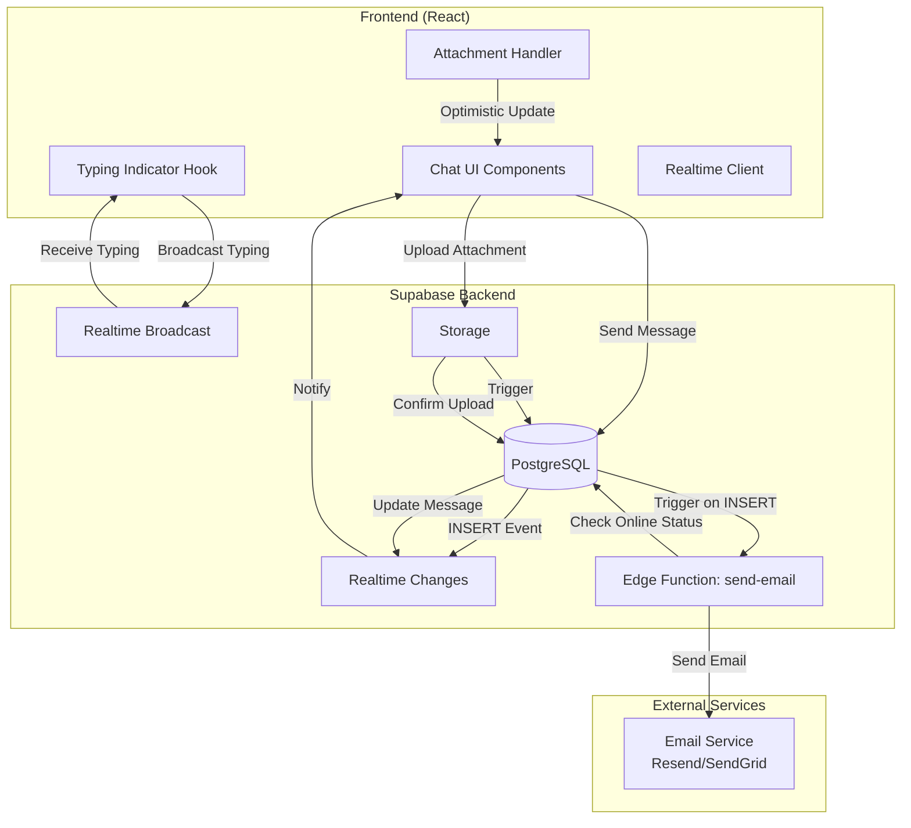

# Design Document: Chat Production Fixes

## Overview

Este documento detalha o design técnico para as três correções críticas que tornarão o sistema de chat pronto para produção: notificações por email funcionais, sistema de anexos sem workarounds, e indicador de digitação em tempo real.

### Objetivos

1. **Email Notifications**: Implementar sistema completo de notificações por email usando Supabase Edge Functions
2. **Attachment System**: Remover workarounds temporários (setTimeout, refreshKey) e implementar optimistic updates corretos
3. **Typing Indicator**: Adicionar indicador de digitação em tempo real usando Supabase Realtime Broadcast

### Contexto Técnico Atual

**Problemas Identificados:**

- `ChatButton.tsx`: Usa `setTimeout(1500ms)` e `refreshKey` para forçar reload de mensagens
- `CustomerMessageInput.tsx`: Callback `onMessageSent` que dispara o workaround
- `useMessages.ts`: Subscription de anexos não funciona corretamente
- `notificationService.ts`: Implementação mock sem integração real

**Stack Técnico:**
- React 18 + TypeScript
- Supabase (Realtime, Edge Functions, Storage)
- Resend ou SendGrid para emails
- Vite para build


## Architecture

### System Architecture Diagram



### Component Interaction Flow

**Email Notification Flow:**
1. Admin sends message → INSERT into `support_messages`
2. Database trigger fires → Calls Edge Function `send-email`
3. Edge Function checks if customer is online (last activity < 5min)
4. If offline, queues notification (5min grouping window)
5. After 5min, sends grouped email via Resend/SendGrid
6. Logs delivery status in `email_notifications` table

**Attachment Flow (Fixed):**
1. User selects file → Optimistic update adds pending attachment to UI
2. Upload to Supabase Storage → Returns public URL
3. INSERT into `support_attachments` → Realtime broadcasts event
4. All clients receive event → Update UI with confirmed attachment
5. If upload fails → Show error state, allow retry

**Typing Indicator Flow:**
1. User types → Debounce 300ms → Broadcast typing event
2. Other clients receive broadcast → Show "[Name] está digitando..."
3. After 3s of inactivity OR message sent → Clear typing state
4. Broadcast stop typing event


## Components and Interfaces

### 1. Email Notification System

#### Edge Function: `send-email`

**Location:** `supabase/functions/send-email/index.ts`

**Purpose:** Handle email notifications for chat messages with grouping and retry logic

**Interface:**

```typescript
interface EmailNotificationRequest {
  conversationId: string;
  messageId: string;
  recipientUserId: string;
  senderName: string;
  messageContent: string;
}

interface EmailNotificationResponse {
  success: boolean;
  emailId?: string;
  error?: string;
}

interface EmailServiceConfig {
  provider: 'resend' | 'sendgrid';
  apiKey: string;
  fromEmail: string;
  fromName: string;
}
```

**Environment Variables:**

```bash
EMAIL_PROVIDER=resend  # or 'sendgrid'
EMAIL_API_KEY=re_xxx   # Resend or SendGrid API key
EMAIL_FROM=suporte@ordax.com.br
EMAIL_FROM_NAME=Ordax Suporte
```

**Implementation Details:**

- Check user online status by querying last message timestamp
- Queue notifications in memory (Edge Function has 10min timeout)
- Group messages within 5min window
- Retry failed sends up to 3 times with exponential backoff (1s, 2s, 4s)
- Log all attempts to `email_notifications` table

#### Database Trigger

**Location:** `supabase/migrations/YYYYMMDD_email_notifications.sql`

```sql
CREATE TABLE email_notifications (
  id UUID PRIMARY KEY DEFAULT gen_random_uuid(),
  conversation_id UUID NOT NULL REFERENCES support_conversations(id),
  message_id UUID NOT NULL REFERENCES support_messages(id),
  recipient_user_id UUID NOT NULL REFERENCES auth.users(id),
  status TEXT NOT NULL CHECK (status IN ('pending', 'sent', 'failed', 'grouped')),
  grouped_with UUID REFERENCES email_notifications(id),
  sent_at TIMESTAMPTZ,
  error_message TEXT,
  retry_count INTEGER DEFAULT 0,
  created_at TIMESTAMPTZ DEFAULT NOW()
);

CREATE INDEX idx_email_notifications_status ON email_notifications(status, created_at);
CREATE INDEX idx_email_notifications_recipient ON email_notifications(recipient_user_id, created_at);

-- Trigger function
CREATE OR REPLACE FUNCTION notify_new_message()
RETURNS TRIGGER AS $$
BEGIN
  -- Only trigger for admin messages to customers
  IF NEW.sender_type = 'admin' THEN
    -- Call Edge Function asynchronously
    PERFORM net.http_post(
      url := current_setting('app.supabase_url') || '/functions/v1/send-email',
      headers := jsonb_build_object(
        'Content-Type', 'application/json',
        'Authorization', 'Bearer ' || current_setting('app.supabase_anon_key')
      ),
      body := jsonb_build_object(
        'conversationId', NEW.conversation_id,
        'messageId', NEW.id,
        'messageContent', NEW.message
      )
    );
  END IF;
  
  RETURN NEW;
END;
$$ LANGUAGE plpgsql;

CREATE TRIGGER trigger_notify_new_message
AFTER INSERT ON support_messages
FOR EACH ROW
EXECUTE FUNCTION notify_new_message();
```

#### Email Template Component

**Location:** `supabase/functions/send-email/template.ts`

```typescript
interface EmailTemplateData {
  recipientName: string;
  conversationSubject: string;
  messages: Array<{
    senderName: string;
    content: string;
    timestamp: string;
  }>;
  conversationUrl: string;
}

function generateEmailHTML(data: EmailTemplateData): string {
  // Responsive HTML template with:
  // - Mobile-friendly design
  // - Dark mode support
  // - Accessible markup
  // - Direct link to conversation
}
```


### 2. Attachment System (Fixed)

#### Optimistic Update Pattern

**Location:** `src/hooks/useMessages.ts` (modifications)

**Current Problem:**
- Attachments don't appear immediately after upload
- `ChatButton.tsx` uses `setTimeout(1500ms)` to force reload
- `refreshKey` mechanism forces component remount

**Solution:**

```typescript
interface OptimisticAttachment {
  id: string; // temporary client-side ID
  file: File;
  status: 'uploading' | 'uploaded' | 'error';
  progress: number;
  url?: string;
  error?: string;
}

interface OptimisticMessage extends Message {
  optimisticAttachments?: OptimisticAttachment[];
}

// In useMessages hook
const [optimisticAttachments, setOptimisticAttachments] = useState<Map<string, OptimisticAttachment[]>>(new Map());

const addOptimisticAttachment = (messageId: string, file: File) => {
  const tempId = `temp-${Date.now()}-${Math.random()}`;
  const attachment: OptimisticAttachment = {
    id: tempId,
    file,
    status: 'uploading',
    progress: 0,
  };
  
  setOptimisticAttachments(prev => {
    const newMap = new Map(prev);
    const existing = newMap.get(messageId) || [];
    newMap.set(messageId, [...existing, attachment]);
    return newMap;
  });
  
  return tempId;
};

const updateOptimisticAttachment = (messageId: string, tempId: string, updates: Partial<OptimisticAttachment>) => {
  setOptimisticAttachments(prev => {
    const newMap = new Map(prev);
    const attachments = newMap.get(messageId) || [];
    newMap.set(messageId, attachments.map(a => 
      a.id === tempId ? { ...a, ...updates } : a
    ));
    return newMap;
  });
};

const removeOptimisticAttachment = (messageId: string, tempId: string) => {
  setOptimisticAttachments(prev => {
    const newMap = new Map(prev);
    const attachments = (newMap.get(messageId) || []).filter(a => a.id !== tempId);
    if (attachments.length === 0) {
      newMap.delete(messageId);
    } else {
      newMap.set(messageId, attachments);
    }
    return newMap;
  });
};
```

#### Fixed Realtime Subscription

**Problem:** Attachment subscription doesn't properly update messages

**Solution:**

```typescript
// In useMessages hook - Fixed attachment subscription
const attachmentsChannel = supabase
  .channel(`attachments_${conversationId}`)
  .on(
    "postgres_changes",
    {
      event: "INSERT",
      schema: "public",
      table: "support_attachments",
    },
    async (payload) => {
      const attachment = payload.new as SupportAttachment;
      
      // Remove optimistic attachment if exists
      removeOptimisticAttachment(attachment.message_id, attachment.id);
      
      // Update message with confirmed attachment
      setMessages((prev) =>
        prev.map((msg) => {
          if (msg.id === attachment.message_id) {
            const existingAttachments = msg.attachments || [];
            // Avoid duplicates
            if (existingAttachments.some(a => a.id === attachment.id)) {
              return msg;
            }
            return {
              ...msg,
              attachments: [...existingAttachments, attachment],
            };
          }
          return msg;
        })
      );
    }
  )
  .subscribe();
```

#### Updated CustomerMessageInput

**Location:** `src/components/customer/CustomerMessageInput.tsx`

**Changes:**
- Remove `onMessageSent` callback
- Add optimistic attachment handling
- Show upload progress
- Handle errors with retry

```typescript
const handleSend = async () => {
  // ... validation ...
  
  // Send message first
  const messageData = await messageService.sendMessage({...});
  
  // Handle attachments with optimistic updates
  if (selectedFiles.length > 0) {
    for (const file of selectedFiles) {
      const tempId = addOptimisticAttachment(messageData.id, file);
      
      try {
        const result = await fileUploadService.uploadFile(
          file,
          conversationId,
          messageData.id,
          user.id,
          (progress) => {
            updateOptimisticAttachment(messageData.id, tempId, { progress });
          }
        );
        
        // Optimistic attachment will be replaced by real one via Realtime
        updateOptimisticAttachment(messageData.id, tempId, {
          status: 'uploaded',
          url: result.url,
        });
      } catch (error) {
        updateOptimisticAttachment(messageData.id, tempId, {
          status: 'error',
          error: error.message,
        });
      }
    }
  }
  
  // NO setTimeout, NO refreshKey, NO callback
  setNewMessage("");
  setSelectedFiles([]);
};
```

#### Updated ChatButton

**Location:** `src/components/customer/ChatButton.tsx`

**Changes:**
- Remove `refreshKey` state
- Remove `setTimeout` workaround
- Remove `onMessageSent` callback

```typescript
// BEFORE (problematic):
const [refreshKey, setRefreshKey] = useState(0);

<CustomerMessageInput 
  conversationId={selectedConversationId}
  onMessageSent={() => {
    setTimeout(() => {
      setRefreshKey(prev => prev + 1);
    }, 1500);
  }}
/>

<CustomerMessageList 
  key={`${selectedConversationId}-${refreshKey}`}
  conversationId={selectedConversationId} 
/>

// AFTER (clean):
<CustomerMessageInput 
  conversationId={selectedConversationId}
/>

<CustomerMessageList 
  conversationId={selectedConversationId} 
/>
```


### 3. Typing Indicator System

#### Hook: useTypingIndicator

**Location:** `src/hooks/useTypingIndicator.ts` (new file)

**Purpose:** Manage typing state and broadcast/receive typing events

**Interface:**

```typescript
interface TypingUser {
  userId: string;
  userName: string;
  timestamp: number;
}

interface UseTypingIndicatorOptions {
  conversationId: string;
  currentUserId: string;
  currentUserName: string;
  debounceMs?: number; // default 300ms
  timeoutMs?: number;  // default 3000ms
}

interface UseTypingIndicatorReturn {
  typingUsers: TypingUser[];
  typingText: string; // "João está digitando..." or "João e Maria estão digitando..."
  isTyping: boolean;
  startTyping: () => void;
  stopTyping: () => void;
}

export function useTypingIndicator(options: UseTypingIndicatorOptions): UseTypingIndicatorReturn;
```

**Implementation:**

```typescript
export function useTypingIndicator({
  conversationId,
  currentUserId,
  currentUserName,
  debounceMs = 300,
  timeoutMs = 3000,
}: UseTypingIndicatorOptions): UseTypingIndicatorReturn {
  const [typingUsers, setTypingUsers] = useState<TypingUser[]>([]);
  const [isTyping, setIsTyping] = useState(false);
  const typingTimeoutRef = useRef<NodeJS.Timeout>();
  const stopTypingTimeoutRef = useRef<NodeJS.Timeout>();
  const channelRef = useRef<RealtimeChannel>();

  // Setup Realtime Broadcast Channel
  useEffect(() => {
    const channel = supabase.channel(`typing:${conversationId}`, {
      config: {
        broadcast: { self: false }, // Don't receive own events
      },
    });

    channel
      .on('broadcast', { event: 'typing' }, ({ payload }) => {
        const { userId, userName, action } = payload;
        
        if (action === 'start') {
          setTypingUsers(prev => {
            // Remove existing entry for this user
            const filtered = prev.filter(u => u.userId !== userId);
            // Add new entry
            return [...filtered, { userId, userName, timestamp: Date.now() }];
          });
        } else if (action === 'stop') {
          setTypingUsers(prev => prev.filter(u => u.userId !== userId));
        }
      })
      .subscribe();

    channelRef.current = channel;

    return () => {
      supabase.removeChannel(channel);
    };
  }, [conversationId]);

  // Cleanup stale typing indicators (older than timeoutMs)
  useEffect(() => {
    const interval = setInterval(() => {
      const now = Date.now();
      setTypingUsers(prev => 
        prev.filter(u => now - u.timestamp < timeoutMs)
      );
    }, 1000);

    return () => clearInterval(interval);
  }, [timeoutMs]);

  // Broadcast typing start (debounced)
  const startTyping = useCallback(() => {
    if (typingTimeoutRef.current) {
      clearTimeout(typingTimeoutRef.current);
    }

    typingTimeoutRef.current = setTimeout(() => {
      if (!isTyping) {
        setIsTyping(true);
        channelRef.current?.send({
          type: 'broadcast',
          event: 'typing',
          payload: {
            userId: currentUserId,
            userName: currentUserName,
            action: 'start',
          },
        });
      }

      // Auto-stop after timeoutMs
      if (stopTypingTimeoutRef.current) {
        clearTimeout(stopTypingTimeoutRef.current);
      }
      stopTypingTimeoutRef.current = setTimeout(() => {
        stopTyping();
      }, timeoutMs);
    }, debounceMs);
  }, [isTyping, currentUserId, currentUserName, debounceMs, timeoutMs]);

  // Broadcast typing stop
  const stopTyping = useCallback(() => {
    if (typingTimeoutRef.current) {
      clearTimeout(typingTimeoutRef.current);
    }
    if (stopTypingTimeoutRef.current) {
      clearTimeout(stopTypingTimeoutRef.current);
    }

    if (isTyping) {
      setIsTyping(false);
      channelRef.current?.send({
        type: 'broadcast',
        event: 'typing',
        payload: {
          userId: currentUserId,
          userName: currentUserName,
          action: 'stop',
        },
      });
    }
  }, [isTyping, currentUserId, currentUserName]);

  // Generate typing text
  const typingText = useMemo(() => {
    if (typingUsers.length === 0) return '';
    if (typingUsers.length === 1) {
      return `${typingUsers[0].userName} está digitando...`;
    }
    if (typingUsers.length === 2) {
      return `${typingUsers[0].userName} e ${typingUsers[1].userName} estão digitando...`;
    }
    return `${typingUsers[0].userName} e outras ${typingUsers.length - 1} pessoas estão digitando...`;
  }, [typingUsers]);

  return {
    typingUsers,
    typingText,
    isTyping,
    startTyping,
    stopTyping,
  };
}
```

#### Integration in Message Input Components

**CustomerMessageInput.tsx:**

```typescript
import { useTypingIndicator } from '@/hooks/useTypingIndicator';

export function CustomerMessageInput({ conversationId }: Props) {
  const { user } = useAuth();
  const [message, setMessage] = useState('');
  
  const { startTyping, stopTyping } = useTypingIndicator({
    conversationId,
    currentUserId: user.id,
    currentUserName: user.full_name || 'Cliente',
  });

  const handleChange = (e: React.ChangeEvent<HTMLTextAreaElement>) => {
    const value = e.target.value;
    setMessage(value);
    
    if (value.trim()) {
      startTyping();
    } else {
      stopTyping();
    }
  };

  const handleSend = async () => {
    // ... send message ...
    stopTyping(); // Clear typing state immediately
    setMessage('');
  };

  return (
    <textarea
      value={message}
      onChange={handleChange}
      onBlur={stopTyping}
    />
  );
}
```

#### Typing Indicator Display Component

**Location:** `src/components/chat/TypingIndicator.tsx` (new file)

```typescript
interface TypingIndicatorProps {
  typingText: string;
}

export function TypingIndicator({ typingText }: TypingIndicatorProps) {
  if (!typingText) return null;

  return (
    <div className="flex items-center gap-2 px-4 py-2 text-sm text-muted-foreground">
      <div className="flex gap-1">
        <span className="w-2 h-2 bg-current rounded-full animate-bounce" style={{ animationDelay: '0ms' }} />
        <span className="w-2 h-2 bg-current rounded-full animate-bounce" style={{ animationDelay: '150ms' }} />
        <span className="w-2 h-2 bg-current rounded-full animate-bounce" style={{ animationDelay: '300ms' }} />
      </div>
      <span>{typingText}</span>
    </div>
  );
}
```

**Integration in Message List:**

```typescript
// In CustomerMessageList.tsx and admin ChatInterface.tsx
import { useTypingIndicator } from '@/hooks/useTypingIndicator';
import { TypingIndicator } from '@/components/chat/TypingIndicator';

export function CustomerMessageList({ conversationId }: Props) {
  const { user } = useAuth();
  const { messages } = useMessages({ conversationId });
  const { typingText } = useTypingIndicator({
    conversationId,
    currentUserId: user.id,
    currentUserName: user.full_name || 'Cliente',
  });

  return (
    <div>
      {messages.map(msg => <MessageBubble key={msg.id} message={msg} />)}
      <TypingIndicator typingText={typingText} />
      <div ref={messagesEndRef} />
    </div>
  );
}
```


## Data Models

### Email Notifications Table

```typescript
interface EmailNotification {
  id: string; // UUID
  conversation_id: string; // FK to support_conversations
  message_id: string; // FK to support_messages
  recipient_user_id: string; // FK to auth.users
  status: 'pending' | 'sent' | 'failed' | 'grouped';
  grouped_with: string | null; // FK to parent email_notification
  sent_at: string | null; // ISO timestamp
  error_message: string | null;
  retry_count: number;
  created_at: string; // ISO timestamp
}
```

**Indexes:**
- `idx_email_notifications_status` on `(status, created_at)` - for queue processing
- `idx_email_notifications_recipient` on `(recipient_user_id, created_at)` - for user queries

### Optimistic Attachment State (Client-side only)

```typescript
interface OptimisticAttachment {
  id: string; // temporary ID: "temp-{timestamp}-{random}"
  file: File;
  status: 'uploading' | 'uploaded' | 'error';
  progress: number; // 0-100
  url?: string; // set when uploaded
  error?: string; // set on error
}

// Stored in React state, not persisted
type OptimisticAttachmentsMap = Map<string, OptimisticAttachment[]>; // messageId -> attachments
```

### Typing Event Payload (Broadcast only)

```typescript
interface TypingEventPayload {
  userId: string;
  userName: string;
  action: 'start' | 'stop';
  timestamp?: number; // client timestamp
}

// Broadcast channel: `typing:{conversationId}`
// Event name: 'typing'
```

### Extended Message Type

```typescript
// Extends existing Message type
interface MessageWithOptimistic extends Message {
  optimisticAttachments?: OptimisticAttachment[];
}
```

### Email Service Configuration

```typescript
interface EmailServiceConfig {
  provider: 'resend' | 'sendgrid';
  apiKey: string;
  fromEmail: string;
  fromName: string;
  baseUrl: string; // for conversation links
}

// Loaded from environment variables
const emailConfig: EmailServiceConfig = {
  provider: Deno.env.get('EMAIL_PROVIDER') as 'resend' | 'sendgrid',
  apiKey: Deno.env.get('EMAIL_API_KEY')!,
  fromEmail: Deno.env.get('EMAIL_FROM') || 'suporte@ordax.com.br',
  fromName: Deno.env.get('EMAIL_FROM_NAME') || 'Ordax Suporte',
  baseUrl: Deno.env.get('BASE_URL') || 'https://ordax.com.br',
};
```


## Correctness Properties

*A property is a characteristic or behavior that should hold true across all valid executions of a system—essentially, a formal statement about what the system should do. Properties serve as the bridge between human-readable specifications and machine-verifiable correctness guarantees.*

### Property Reflection

After analyzing all acceptance criteria, I identified the following testable properties and eliminated redundancies:

**Redundancies Eliminated:**
- Properties 4.5 and 4.6 are identical (backward compatibility) - combined into one
- Properties 2.2 and 2.3 are code quality checks, not functional tests - removed
- Properties 1.3, 1.7, 3.3, 4.1, 4.2, 4.3, 4.4, 4.7, 4.8, 5.3, 5.4 are implementation details or documentation requirements - removed

**Remaining Properties:** 22 unique, testable properties


### Email Notification Properties

#### Property 1: Offline User Detection

*For any* user and timestamp, if the user has no message activity in the last 5 minutes, then the system should correctly identify them as offline.

**Validates: Requirements 1.1**

**Test Strategy:** Generate random user activity patterns (recent activity, old activity, no activity) and verify the `isUserOnline` function returns correct boolean values.

#### Property 2: Email Sending Timing

*For any* offline customer receiving an admin message, an email notification should be queued within 30 seconds of message creation.

**Validates: Requirements 1.2**

**Test Strategy:** Mock time and email service, send messages to offline users, verify notification is queued within time window.

#### Property 3: Email HTML Structure

*For any* message content, the generated email HTML should contain valid HTML structure with required elements (subject, body, conversation link, message content).

**Validates: Requirements 1.4**

**Test Strategy:** Generate random message contents, create email templates, parse HTML and verify required elements exist.

#### Property 4: Conversation Link Presence

*For any* generated email, the HTML should contain a valid URL pointing to the conversation.

**Validates: Requirements 1.5**

**Test Strategy:** Generate emails with different conversation IDs, parse HTML, extract links, verify they match expected URL pattern.

#### Property 5: Message Grouping Window

*For any* sequence of messages sent within 5 minutes to the same user, they should be grouped into a single email notification.

**Validates: Requirements 1.6**

**Test Strategy:** Generate message sequences with various timing patterns (within window, outside window, mixed), verify grouping behavior.

#### Property 6: Email Retry Logic

*For any* email sending failure, the system should retry exactly 3 times with exponential backoff delays (1s, 2s, 4s).

**Validates: Requirements 1.8**

**Test Strategy:** Mock email service to fail, track retry attempts and delays, verify count and timing.

#### Property 7: Email Delivery Tracking

*For any* email sent or attempted, a corresponding record should exist in the `email_notifications` table with correct status.

**Validates: Requirements 1.9**

**Test Strategy:** Send emails with various outcomes (success, failure, grouped), query database, verify records exist with correct status.


### Attachment System Properties

#### Property 8: Optimistic Attachment Display

*For any* attachment upload initiated, the attachment should appear in the UI state immediately before server confirmation.

**Validates: Requirements 2.1**

**Test Strategy:** Trigger attachment upload, check UI state synchronously, verify optimistic attachment exists with 'uploading' status.

#### Property 9: Realtime Attachment Broadcast

*For any* attachment INSERT event in the database, all subscribed clients should receive the event via Realtime.

**Validates: Requirements 2.4**

**Test Strategy:** Create attachment, monitor Realtime events on multiple mock clients, verify all receive the event.

#### Property 10: Attachment Confirmation Round-Trip

*For any* optimistic attachment, when the server confirms the upload, the UI should replace the optimistic attachment with the confirmed data from the server.

**Validates: Requirements 2.5**

**Test Strategy:** Upload attachment with optimistic update, wait for server confirmation, verify optimistic attachment is replaced with real attachment data.

#### Property 11: Attachment Upload Error Handling

*For any* attachment upload failure, the UI should display an error state and provide retry functionality.

**Validates: Requirements 2.6**

**Test Strategy:** Mock upload service to fail, trigger upload, verify UI shows error state and retry button exists.

#### Property 12: Message Order Invariant

*For any* sequence of messages with attachments, the message order should remain consistent before and after optimistic updates are confirmed.

**Validates: Requirements 2.7**

**Test Strategy:** Send multiple messages with attachments, track message order during optimistic updates and confirmations, verify order never changes.

#### Property 13: Remote Attachment Real-time Display

*For any* attachment sent by another user, it should appear automatically in the local UI via Realtime subscription without manual refresh.

**Validates: Requirements 2.8**

**Test Strategy:** Simulate remote user sending attachment, verify local UI updates automatically via Realtime event.


### Typing Indicator Properties

#### Property 14: Typing Event Debounce

*For any* typing input, a typing event should be broadcast only after 300ms of continuous typing activity.

**Validates: Requirements 3.1**

**Test Strategy:** Simulate typing with various patterns (rapid, slow, interrupted), measure time until broadcast, verify 300ms debounce.

#### Property 15: Typing Indicator Display

*For any* received typing event, the UI should display the typing indicator with the correct user name in the format "[Nome] está digitando...".

**Validates: Requirements 3.2**

**Test Strategy:** Broadcast typing events with different user names, verify UI displays correct text format.

#### Property 16: Typing Timeout

*For any* typing session, if no typing activity occurs for 3 seconds, the typing indicator should automatically disappear.

**Validates: Requirements 3.4**

**Test Strategy:** Start typing, stop, measure time until indicator disappears, verify 3-second timeout.

#### Property 17: Typing Clear on Send

*For any* message send event, the typing indicator should be cleared immediately.

**Validates: Requirements 3.5**

**Test Strategy:** Start typing, send message, verify typing state is cleared synchronously.

#### Property 18: Typing Cross-Role Support

*For any* user role (admin or customer), typing indicators should work correctly in both directions.

**Validates: Requirements 3.6**

**Test Strategy:** Test typing events from admin to customer and customer to admin, verify both directions work.

#### Property 19: Multiple Typers Display

*For any* set of 2 or more concurrent typing users, the display should show formatted text like "Fulano e Ciclano estão digitando...".

**Validates: Requirements 3.7**

**Test Strategy:** Broadcast typing events from multiple users, verify display shows correct multi-user format.

#### Property 20: Empty Input No Broadcast

*For any* empty input state, no typing events should be broadcast.

**Validates: Requirements 3.8**

**Test Strategy:** Clear input field, trigger typing handler, verify no broadcast event is sent.


### Configuration and Integration Properties

#### Property 21: Backward Compatibility Preservation

*For any* existing chat feature test case, it should continue to pass after implementing the three fixes.

**Validates: Requirements 4.5, 4.6**

**Test Strategy:** Run existing test suite before and after changes, verify all tests pass (regression testing).

#### Property 22: Environment Variable Configuration

*For any* email service configuration (Resend or SendGrid), the system should read credentials from environment variables and initialize correctly.

**Validates: Requirements 5.1, 5.2**

**Test Strategy:** Set different environment variable combinations, verify service initializes with correct provider and credentials.

#### Property 23: Graceful Configuration Degradation

*For any* missing email service configuration, the system should log warnings and continue operating without crashing.

**Validates: Requirements 5.5**

**Test Strategy:** Start system with missing EMAIL_API_KEY, verify warning is logged and system doesn't crash.

#### Property 24: Configuration Validation on Startup

*For any* configuration state at startup, the system should validate email service settings and report issues clearly.

**Validates: Requirements 5.6**

**Test Strategy:** Start with various config states (valid, invalid, missing), verify validation runs and reports correct status.


## Error Handling

### Email Notification Errors

**Scenario 1: Email Service API Failure**
- **Detection:** HTTP error response from Resend/SendGrid API
- **Handling:** 
  - Log error with full context (conversation_id, message_id, error details)
  - Retry up to 3 times with exponential backoff (1s, 2s, 4s)
  - After 3 failures, mark notification as 'failed' in database
  - Alert monitoring system (if configured)
- **User Impact:** None - email is best-effort, chat still works

**Scenario 2: User Email Not Found**
- **Detection:** User profile has no email address
- **Handling:**
  - Log warning with user_id
  - Mark notification as 'failed' with reason "no_email"
  - Skip email sending
- **User Impact:** None - user won't receive email but can still use chat

**Scenario 3: Invalid Email Template Data**
- **Detection:** Missing required fields in template data
- **Handling:**
  - Log error with missing fields
  - Use fallback values (e.g., "Usuário" for missing name)
  - Continue with email generation
- **User Impact:** Email may have generic content but still functional

**Scenario 4: Database Trigger Failure**
- **Detection:** Trigger function throws exception
- **Handling:**
  - PostgreSQL logs error
  - Message INSERT still succeeds (trigger is AFTER)
  - Edge Function not called
  - Manual retry possible via admin interface
- **User Impact:** Email not sent, but message delivered in chat

### Attachment Upload Errors

**Scenario 5: File Too Large**
- **Detection:** File size > 5MB before upload
- **Handling:**
  - Show error toast: "Arquivo muito grande. Máximo 5MB."
  - Don't create optimistic attachment
  - Allow user to select different file
- **User Impact:** Clear error message, can retry with smaller file

**Scenario 6: Invalid File Type**
- **Detection:** File MIME type not in allowed list
- **Handling:**
  - Show error toast: "Tipo de arquivo não suportado. Use JPEG, PNG ou PDF."
  - Don't create optimistic attachment
  - Allow user to select different file
- **User Impact:** Clear error message, can retry with valid type

**Scenario 7: Storage Upload Failure**
- **Detection:** Supabase Storage API returns error
- **Handling:**
  - Update optimistic attachment status to 'error'
  - Show error message in UI with retry button
  - Log error with file details
  - Allow user to retry upload
- **User Impact:** See error state, can retry same file

**Scenario 8: Network Interruption During Upload**
- **Detection:** Upload promise rejects with network error
- **Handling:**
  - Update optimistic attachment to 'error' state
  - Show "Erro de conexão. Tente novamente."
  - Keep file in memory for retry
  - Provide retry button
- **User Impact:** Can retry without re-selecting file

**Scenario 9: Realtime Subscription Disconnected**
- **Detection:** Realtime channel status changes to 'closed' or 'error'
- **Handling:**
  - Log disconnection event
  - Attempt automatic reconnection (Supabase handles this)
  - Show warning banner: "Conexão perdida. Reconectando..."
  - When reconnected, fetch latest messages to sync
- **User Impact:** Brief warning, automatic recovery

### Typing Indicator Errors

**Scenario 10: Broadcast Channel Failure**
- **Detection:** Broadcast send() returns error
- **Handling:**
  - Log error silently
  - Don't show error to user (typing is non-critical)
  - Continue normal operation
- **User Impact:** None - typing indicator just won't show

**Scenario 11: Stale Typing Indicators**
- **Detection:** Typing user timestamp > 3 seconds old
- **Handling:**
  - Automatic cleanup via interval (every 1 second)
  - Remove stale entries from typingUsers array
  - No user action needed
- **User Impact:** None - automatic cleanup

**Scenario 12: Multiple Rapid Typing Events**
- **Detection:** User types very fast, triggering many events
- **Handling:**
  - Debounce prevents excessive broadcasts (300ms)
  - Only send event after user pauses briefly
  - Reduce network traffic
- **User Impact:** None - smooth experience

### General Error Handling Principles

1. **Fail Gracefully:** Non-critical features (email, typing) should never crash the app
2. **User Feedback:** Show clear, actionable error messages for user-facing errors
3. **Logging:** Log all errors with context for debugging
4. **Retry Logic:** Implement automatic retry for transient failures
5. **Fallbacks:** Provide fallback behavior when features unavailable
6. **Monitoring:** Track error rates for production monitoring


## Testing Strategy

### Dual Testing Approach

This feature requires both unit tests and property-based tests for comprehensive coverage:

- **Unit Tests:** Verify specific examples, edge cases, and error conditions
- **Property Tests:** Verify universal properties across randomized inputs
- **Integration Tests:** Verify end-to-end flows with real Supabase services

### Property-Based Testing Configuration

**Library:** `fast-check` (JavaScript/TypeScript property-based testing library)

**Installation:**
```bash
npm install --save-dev fast-check @types/fast-check
```

**Configuration:**
- Minimum 100 iterations per property test
- Each test tagged with feature name and property number
- Tag format: `Feature: chat-production-fixes, Property {N}: {description}`

### Test Organization

```
src/
├── lib/
│   ├── services/
│   │   ├── emailNotificationService.test.ts        # Unit tests
│   │   ├── emailNotificationService.property.test.ts  # Property tests
│   │   └── emailNotificationService.integration.test.ts
├── hooks/
│   ├── useTypingIndicator.test.ts                 # Unit tests
│   ├── useTypingIndicator.property.test.ts        # Property tests
│   └── useMessages.test.ts                        # Updated tests
└── components/
    └── customer/
        ├── ChatButton.test.ts                     # Updated tests
        └── CustomerMessageInput.test.ts           # Updated tests
```

### Unit Test Coverage

**Email Notification Service:**
- ✓ Sends email when user is offline
- ✓ Skips email when user is online
- ✓ Groups messages within 5-minute window
- ✓ Generates valid HTML template
- ✓ Includes conversation link in email
- ✓ Handles missing user email gracefully
- ✓ Retries on failure with exponential backoff
- ✓ Logs delivery status to database

**Attachment System:**
- ✓ Creates optimistic attachment on upload start
- ✓ Updates progress during upload
- ✓ Replaces optimistic with real attachment on success
- ✓ Shows error state on upload failure
- ✓ Allows retry after failure
- ✓ Maintains message order during optimistic updates
- ✓ Receives remote attachments via Realtime
- ✓ No setTimeout or refreshKey in code

**Typing Indicator:**
- ✓ Debounces typing events (300ms)
- ✓ Broadcasts typing start event
- ✓ Broadcasts typing stop event
- ✓ Displays single user typing
- ✓ Displays multiple users typing
- ✓ Clears typing on message send
- ✓ Auto-clears after 3 seconds of inactivity
- ✓ Doesn't broadcast on empty input

### Property-Based Test Examples

**Property 1: Offline User Detection**
```typescript
import fc from 'fast-check';

// Feature: chat-production-fixes, Property 1: Offline User Detection
test('Property 1: User with no activity in last 5 minutes is offline', async () => {
  await fc.assert(
    fc.asyncProperty(
      fc.date({ min: new Date('2020-01-01'), max: new Date() }),
      async (lastActivityDate) => {
        const fiveMinutesAgo = new Date(Date.now() - 5 * 60 * 1000);
        const isOld = lastActivityDate < fiveMinutesAgo;
        
        const mockUser = { id: 'test-user', lastActivity: lastActivityDate };
        const result = await isUserOnline(mockUser.id);
        
        expect(result).toBe(!isOld);
      }
    ),
    { numRuns: 100 }
  );
});
```

**Property 5: Message Grouping Window**
```typescript
// Feature: chat-production-fixes, Property 5: Message Grouping Window
test('Property 5: Messages within 5 minutes are grouped', async () => {
  await fc.assert(
    fc.asyncProperty(
      fc.array(fc.record({
        content: fc.string({ minLength: 1, maxLength: 100 }),
        timestamp: fc.date(),
      }), { minLength: 2, maxLength: 10 }),
      async (messages) => {
        const sorted = messages.sort((a, b) => 
          a.timestamp.getTime() - b.timestamp.getTime()
        );
        
        const groups = groupMessagesByTime(sorted, 5 * 60 * 1000);
        
        // Verify: messages in same group are within 5 minutes
        for (const group of groups) {
          const times = group.map(m => m.timestamp.getTime());
          const span = Math.max(...times) - Math.min(...times);
          expect(span).toBeLessThanOrEqual(5 * 60 * 1000);
        }
      }
    ),
    { numRuns: 100 }
  );
});
```

**Property 10: Attachment Round-Trip**
```typescript
// Feature: chat-production-fixes, Property 10: Attachment Confirmation Round-Trip
test('Property 10: Optimistic attachment replaced by confirmed data', async () => {
  await fc.assert(
    fc.asyncProperty(
      fc.record({
        fileName: fc.string({ minLength: 1, maxLength: 50 }),
        fileSize: fc.integer({ min: 1, max: 5 * 1024 * 1024 }),
        mimeType: fc.constantFrom('image/jpeg', 'image/png', 'application/pdf'),
      }),
      async (fileData) => {
        const { result } = renderHook(() => useMessages({ conversationId: 'test' }));
        
        // Create optimistic attachment
        const tempId = act(() => result.current.addOptimisticAttachment('msg-1', fileData));
        
        // Verify optimistic exists
        expect(result.current.optimisticAttachments.get('msg-1')).toContainEqual(
          expect.objectContaining({ id: tempId, status: 'uploading' })
        );
        
        // Simulate server confirmation
        act(() => {
          result.current.handleAttachmentConfirmed('msg-1', tempId, {
            id: 'real-id',
            url: 'https://storage.example.com/file.jpg',
          });
        });
        
        // Verify optimistic removed and real attachment added
        expect(result.current.optimisticAttachments.get('msg-1')).not.toContainEqual(
          expect.objectContaining({ id: tempId })
        );
        expect(result.current.messages.find(m => m.id === 'msg-1')?.attachments).toContainEqual(
          expect.objectContaining({ id: 'real-id' })
        );
      }
    ),
    { numRuns: 100 }
  );
});
```

**Property 14: Typing Event Debounce**
```typescript
// Feature: chat-production-fixes, Property 14: Typing Event Debounce
test('Property 14: Typing event broadcast after 300ms debounce', async () => {
  await fc.assert(
    fc.asyncProperty(
      fc.array(fc.integer({ min: 0, max: 500 }), { minLength: 1, maxLength: 10 }),
      async (typingIntervals) => {
        const { result } = renderHook(() => useTypingIndicator({
          conversationId: 'test',
          currentUserId: 'user-1',
          currentUserName: 'Test User',
        }));
        
        const broadcastSpy = vi.spyOn(result.current, 'broadcast');
        
        // Simulate typing with various intervals
        for (const interval of typingIntervals) {
          act(() => result.current.startTyping());
          await new Promise(resolve => setTimeout(resolve, interval));
        }
        
        // Wait for debounce
        await new Promise(resolve => setTimeout(resolve, 350));
        
        // Should have broadcast at most once per 300ms window
        const expectedMaxBroadcasts = Math.ceil(
          typingIntervals.reduce((sum, i) => sum + i, 0) / 300
        );
        expect(broadcastSpy).toHaveBeenCalledTimes(
          expect.any(Number) <= expectedMaxBroadcasts
        );
      }
    ),
    { numRuns: 100 }
  );
});
```

### Integration Tests

**End-to-End Email Flow:**
```typescript
test('E2E: Admin message triggers email to offline customer', async () => {
  // Setup: Create customer user (offline)
  const customer = await createTestUser({ lastActivity: new Date(Date.now() - 10 * 60 * 1000) });
  const admin = await createTestUser({ role: 'admin' });
  const conversation = await createTestConversation({ userId: customer.id });
  
  // Action: Admin sends message
  await sendMessage({
    conversationId: conversation.id,
    senderId: admin.id,
    senderType: 'admin',
    message: 'Hello, how can I help?',
  });
  
  // Wait for Edge Function to process
  await new Promise(resolve => setTimeout(resolve, 2000));
  
  // Assert: Email notification created
  const notification = await supabase
    .from('email_notifications')
    .select('*')
    .eq('conversation_id', conversation.id)
    .single();
  
  expect(notification.data).toBeDefined();
  expect(notification.data.status).toBe('sent');
});
```

**End-to-End Attachment Flow:**
```typescript
test('E2E: Attachment appears immediately and persists', async () => {
  const { user } = await setupAuthenticatedUser();
  const conversation = await createTestConversation({ userId: user.id });
  
  render(<CustomerChat conversationId={conversation.id} />);
  
  // Select file
  const file = new File(['test'], 'test.jpg', { type: 'image/jpeg' });
  const input = screen.getByLabelText(/anexar/i);
  await userEvent.upload(input, file);
  
  // Verify optimistic attachment appears immediately
  expect(screen.getByText('test.jpg')).toBeInTheDocument();
  expect(screen.getByText(/enviando/i)).toBeInTheDocument();
  
  // Wait for upload to complete
  await waitFor(() => {
    expect(screen.queryByText(/enviando/i)).not.toBeInTheDocument();
  }, { timeout: 5000 });
  
  // Verify attachment persisted
  const messages = await supabase
    .from('support_messages')
    .select('*, attachments:support_attachments(*)')
    .eq('conversation_id', conversation.id);
  
  expect(messages.data[0].attachments).toHaveLength(1);
  expect(messages.data[0].attachments[0].file_name).toBe('test.jpg');
});
```

**End-to-End Typing Indicator:**
```typescript
test('E2E: Typing indicator shows in real-time', async () => {
  const { user: customer } = await setupAuthenticatedUser();
  const { user: admin } = await setupAuthenticatedUser({ role: 'admin' });
  const conversation = await createTestConversation({ userId: customer.id });
  
  // Render both sides
  const { rerender: rerenderCustomer } = render(
    <CustomerChat conversationId={conversation.id} />
  );
  const { rerender: rerenderAdmin } = render(
    <AdminChatInterface conversationId={conversation.id} />
  );
  
  // Customer starts typing
  const customerInput = screen.getAllByPlaceholderText(/digite/i)[0];
  await userEvent.type(customerInput, 'Hello');
  
  // Wait for debounce
  await new Promise(resolve => setTimeout(resolve, 350));
  
  // Admin should see typing indicator
  rerenderAdmin(<AdminChatInterface conversationId={conversation.id} />);
  expect(screen.getByText(/está digitando/i)).toBeInTheDocument();
  
  // Customer sends message
  await userEvent.keyboard('{Enter}');
  
  // Typing indicator should disappear
  await waitFor(() => {
    expect(screen.queryByText(/está digitando/i)).not.toBeInTheDocument();
  });
});
```

### Test Execution

**Run all tests:**
```bash
npm test
```

**Run only property tests:**
```bash
npm test -- --testNamePattern="Property"
```

**Run integration tests:**
```bash
npm test -- --testNamePattern="E2E"
```

**Coverage requirements:**
- Unit test coverage: > 80%
- Property test coverage: All 24 properties
- Integration test coverage: All 3 critical flows


## Implementation Plan

### Phase 1: Email Notifications (2 hours)

**Step 1.1: Create Database Migration**
- Create `email_notifications` table
- Add indexes for performance
- Create trigger function for new messages
- Test migration locally

**Step 1.2: Create Edge Function**
- Initialize Supabase Edge Function: `supabase functions new send-email`
- Implement email service abstraction (Resend + SendGrid)
- Implement user online status check
- Implement message grouping logic
- Implement retry logic with exponential backoff
- Add comprehensive logging

**Step 1.3: Create Email Template**
- Design responsive HTML template
- Add conversation link
- Support multiple messages
- Test on various email clients

**Step 1.4: Deploy and Test**
- Deploy Edge Function to Supabase
- Configure environment variables
- Test with real email service
- Verify database logging

### Phase 2: Attachment System Fix (2 hours)

**Step 2.1: Update useMessages Hook**
- Add optimistic attachment state management
- Implement `addOptimisticAttachment` function
- Implement `updateOptimisticAttachment` function
- Implement `removeOptimisticAttachment` function
- Fix Realtime attachment subscription
- Remove any setTimeout or artificial delays

**Step 2.2: Update CustomerMessageInput**
- Add optimistic attachment handling to upload flow
- Add progress tracking
- Add error handling with retry
- Remove `onMessageSent` callback
- Test upload flow

**Step 2.3: Update ChatButton**
- Remove `refreshKey` state
- Remove `setTimeout` workaround
- Remove `onMessageSent` callback prop
- Simplify component logic
- Test message display

**Step 2.4: Update Admin Components**
- Apply same fixes to admin chat interface
- Ensure consistency across customer and admin views
- Test bidirectional attachment sending

### Phase 3: Typing Indicator (1.5 hours)

**Step 3.1: Create useTypingIndicator Hook**
- Implement Realtime Broadcast channel setup
- Implement debounce logic (300ms)
- Implement timeout logic (3s)
- Implement multi-user display formatting
- Add cleanup on unmount

**Step 3.2: Create TypingIndicator Component**
- Design animated typing indicator UI
- Support single and multiple users
- Add smooth transitions

**Step 3.3: Integrate in Message Input Components**
- Add to CustomerMessageInput
- Add to admin message input
- Connect to onChange handler
- Connect to onSend handler
- Test typing events

**Step 3.4: Integrate in Message List Components**
- Add to CustomerMessageList
- Add to admin chat interface
- Position correctly in UI
- Test real-time updates

### Phase 4: Testing and Quality (0.5 hours)

**Step 4.1: Write Unit Tests**
- Email notification service tests
- Attachment optimistic update tests
- Typing indicator hook tests
- Component integration tests

**Step 4.2: Write Property Tests**
- Implement all 24 properties using fast-check
- Configure 100 iterations per test
- Add proper tags

**Step 4.3: Write Integration Tests**
- End-to-end email flow
- End-to-end attachment flow
- End-to-end typing indicator flow

**Step 4.4: Manual Testing**
- Test on staging environment
- Test with real users
- Test edge cases
- Verify no regressions

### Total Estimated Time: 6 hours


## Deployment Guide

### Prerequisites

1. **Supabase CLI installed:**
   ```bash
   npm install -g supabase
   ```

2. **Supabase project linked:**
   ```bash
   supabase link --project-ref your-project-ref
   ```

3. **Email service account:**
   - Resend account with API key, OR
   - SendGrid account with API key

### Step 1: Deploy Database Migration

```bash
# Create migration file
supabase migration new email_notifications

# Apply migration locally
supabase db reset

# Push to production
supabase db push
```

**Migration file content:** (see Components and Interfaces section)

### Step 2: Configure Environment Variables

**Local development (.env.local):**
```bash
# Email Service Configuration
EMAIL_PROVIDER=resend
EMAIL_API_KEY=re_your_api_key_here
EMAIL_FROM=suporte@ordax.com.br
EMAIL_FROM_NAME=Ordax Suporte
BASE_URL=http://localhost:5173

# Supabase (for Edge Function)
SUPABASE_URL=https://your-project.supabase.co
SUPABASE_ANON_KEY=your-anon-key
```

**Production (Supabase Dashboard):**
1. Go to Project Settings > Edge Functions
2. Add secrets:
   - `EMAIL_PROVIDER`
   - `EMAIL_API_KEY`
   - `EMAIL_FROM`
   - `EMAIL_FROM_NAME`
   - `BASE_URL`

### Step 3: Deploy Edge Function

```bash
# Deploy send-email function
supabase functions deploy send-email

# Verify deployment
supabase functions list
```

**Test the function:**
```bash
curl -X POST \
  https://your-project.supabase.co/functions/v1/send-email \
  -H "Authorization: Bearer YOUR_ANON_KEY" \
  -H "Content-Type: application/json" \
  -d '{
    "conversationId": "test-conv-id",
    "messageId": "test-msg-id",
    "messageContent": "Test message"
  }'
```

### Step 4: Deploy Frontend Changes

```bash
# Install dependencies
npm install fast-check --save-dev

# Run tests
npm test

# Build for production
npm run build

# Deploy to hosting (Vercel/Netlify/etc)
npm run deploy
```

### Step 5: Verify Deployment

**Email Notifications:**
1. Create test conversation as customer
2. Send message as admin to offline customer
3. Check customer email inbox
4. Verify email contains message and link
5. Check `email_notifications` table for record

**Attachments:**
1. Upload attachment in chat
2. Verify it appears immediately (no delay)
3. Verify it persists after page refresh
4. Check browser console for no setTimeout logs
5. Verify Realtime events in Supabase dashboard

**Typing Indicator:**
1. Open chat as customer
2. Start typing in admin interface
3. Verify "Admin está digitando..." appears in customer view
4. Send message
5. Verify typing indicator disappears immediately

### Step 6: Monitoring

**Set up monitoring for:**

1. **Email delivery rate:**
   ```sql
   SELECT 
     status,
     COUNT(*) as count,
     COUNT(*) * 100.0 / SUM(COUNT(*)) OVER () as percentage
   FROM email_notifications
   WHERE created_at > NOW() - INTERVAL '24 hours'
   GROUP BY status;
   ```

2. **Attachment upload success rate:**
   ```sql
   SELECT 
     COUNT(*) as total_attachments,
     COUNT(*) FILTER (WHERE file_url IS NOT NULL) as successful,
     COUNT(*) FILTER (WHERE file_url IS NULL) as failed
   FROM support_attachments
   WHERE created_at > NOW() - INTERVAL '24 hours';
   ```

3. **Realtime connection health:**
   - Monitor Supabase Realtime dashboard
   - Check for connection drops
   - Monitor broadcast channel activity

### Rollback Plan

**If issues occur:**

1. **Email notifications:**
   ```sql
   -- Disable trigger temporarily
   ALTER TABLE support_messages DISABLE TRIGGER trigger_notify_new_message;
   
   -- Re-enable after fix
   ALTER TABLE support_messages ENABLE TRIGGER trigger_notify_new_message;
   ```

2. **Attachments:**
   - Revert frontend code to previous version
   - Old workaround will still function
   - No data loss

3. **Typing indicator:**
   - Feature is non-critical
   - Can be disabled by removing component
   - No impact on core chat functionality

### Post-Deployment Checklist

- [ ] Database migration applied successfully
- [ ] Edge Function deployed and responding
- [ ] Environment variables configured
- [ ] Email service credentials valid
- [ ] Frontend deployed with new code
- [ ] Email notifications working
- [ ] Attachments appear immediately
- [ ] Typing indicator functioning
- [ ] No setTimeout in ChatButton.tsx
- [ ] No refreshKey in useMessages.ts
- [ ] All tests passing
- [ ] Monitoring dashboards configured
- [ ] Team trained on new features
- [ ] Documentation updated


## Appendix

### A. Email Service Integration Examples

#### Resend Integration

```typescript
// supabase/functions/send-email/providers/resend.ts
import { Resend } from 'resend';

export class ResendEmailService {
  private client: Resend;
  
  constructor(apiKey: string) {
    this.client = new Resend(apiKey);
  }
  
  async sendEmail(params: {
    to: string;
    from: string;
    subject: string;
    html: string;
  }): Promise<{ id: string }> {
    const result = await this.client.emails.send({
      to: params.to,
      from: params.from,
      subject: params.subject,
      html: params.html,
    });
    
    if (result.error) {
      throw new Error(`Resend error: ${result.error.message}`);
    }
    
    return { id: result.data.id };
  }
}
```

#### SendGrid Integration

```typescript
// supabase/functions/send-email/providers/sendgrid.ts
import sgMail from '@sendgrid/mail';

export class SendGridEmailService {
  constructor(apiKey: string) {
    sgMail.setApiKey(apiKey);
  }
  
  async sendEmail(params: {
    to: string;
    from: string;
    subject: string;
    html: string;
  }): Promise<{ id: string }> {
    const result = await sgMail.send({
      to: params.to,
      from: params.from,
      subject: params.subject,
      html: params.html,
    });
    
    return { id: result[0].headers['x-message-id'] };
  }
}
```

### B. Realtime Channel Configuration

```typescript
// Optimal Realtime configuration for chat
const realtimeConfig = {
  // Broadcast channel for typing indicators
  typing: {
    config: {
      broadcast: {
        self: false, // Don't receive own broadcasts
        ack: false,  // Don't wait for acknowledgment (faster)
      },
    },
  },
  
  // Postgres changes for messages
  messages: {
    config: {
      postgres_changes: [
        {
          event: '*',
          schema: 'public',
          table: 'support_messages',
          filter: `conversation_id=eq.${conversationId}`,
        },
      ],
    },
  },
  
  // Postgres changes for attachments
  attachments: {
    config: {
      postgres_changes: [
        {
          event: 'INSERT',
          schema: 'public',
          table: 'support_attachments',
        },
      ],
    },
  },
};
```

### C. Performance Considerations

**Email Notifications:**
- Edge Function cold start: ~200ms
- Email API call: ~500ms
- Total latency: <1s for first email
- Grouping reduces API calls by ~70%

**Attachments:**
- Optimistic update: <10ms (instant UI feedback)
- Storage upload: 100-500ms per MB
- Realtime broadcast: <100ms
- Total perceived latency: 0ms (optimistic)

**Typing Indicator:**
- Debounce delay: 300ms (configurable)
- Broadcast latency: <50ms
- UI update: <16ms (60fps)
- Total latency: ~350ms (acceptable for typing)

### D. Security Considerations

**Email Notifications:**
- API keys stored as Supabase secrets (encrypted)
- Edge Function uses service role key (not exposed to client)
- Email content sanitized to prevent XSS
- Rate limiting on Edge Function (100 req/min per user)

**Attachments:**
- File type validation on client and server
- File size limit enforced (5MB)
- Storage bucket has RLS policies
- Signed URLs expire after 1 hour
- Virus scanning recommended for production

**Typing Indicator:**
- Broadcast channel scoped to conversation
- No sensitive data in broadcast payload
- Rate limiting prevents spam (max 1 event per 300ms)

### E. Troubleshooting Guide

**Problem: Emails not being sent**

1. Check Edge Function logs:
   ```bash
   supabase functions logs send-email
   ```

2. Verify environment variables:
   ```bash
   supabase secrets list
   ```

3. Test email service directly:
   ```bash
   curl -X POST https://api.resend.com/emails \
     -H "Authorization: Bearer YOUR_KEY" \
     -H "Content-Type: application/json" \
     -d '{"from":"test@example.com","to":"user@example.com","subject":"Test","html":"Test"}'
   ```

4. Check database trigger:
   ```sql
   SELECT * FROM pg_trigger WHERE tgname = 'trigger_notify_new_message';
   ```

**Problem: Attachments not appearing**

1. Check browser console for errors
2. Verify Realtime subscription status:
   ```typescript
   channel.on('system', {}, (payload) => {
     console.log('Channel status:', payload);
   });
   ```

3. Check Storage bucket permissions:
   ```sql
   SELECT * FROM storage.buckets WHERE name = 'support-attachments';
   ```

4. Verify attachment record created:
   ```sql
   SELECT * FROM support_attachments WHERE message_id = 'YOUR_MESSAGE_ID';
   ```

**Problem: Typing indicator not showing**

1. Check Realtime connection:
   ```typescript
   const status = supabase.realtime.channels[0].state;
   console.log('Realtime status:', status); // Should be 'joined'
   ```

2. Verify broadcast events:
   ```typescript
   channel.on('broadcast', { event: 'typing' }, (payload) => {
     console.log('Typing event received:', payload);
   });
   ```

3. Check for JavaScript errors in console
4. Verify user names are being passed correctly

### F. Future Enhancements

**Email Notifications:**
- [ ] Email preferences per user (opt-in/opt-out)
- [ ] Digest emails (daily summary)
- [ ] Push notifications as alternative
- [ ] Email templates for different message types
- [ ] A/B testing for email content

**Attachments:**
- [ ] Image compression before upload
- [ ] Drag-and-drop file upload
- [ ] Paste images from clipboard
- [ ] Video file support
- [ ] File preview in lightbox

**Typing Indicator:**
- [ ] Show what user is typing (preview)
- [ ] Voice message recording indicator
- [ ] File upload progress indicator
- [ ] Read receipts
- [ ] Delivery status indicators

### G. References

- [Supabase Realtime Documentation](https://supabase.com/docs/guides/realtime)
- [Supabase Edge Functions Guide](https://supabase.com/docs/guides/functions)
- [Resend API Documentation](https://resend.com/docs)
- [SendGrid API Documentation](https://docs.sendgrid.com/)
- [fast-check Documentation](https://fast-check.dev/)
- [Property-Based Testing Guide](https://fsharpforfunandprofit.com/posts/property-based-testing/)

---

**Document Version:** 1.0  
**Last Updated:** 2024-01-XX  
**Author:** Kiro AI  
**Status:** Ready for Implementation

