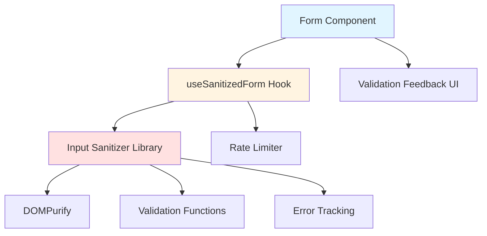
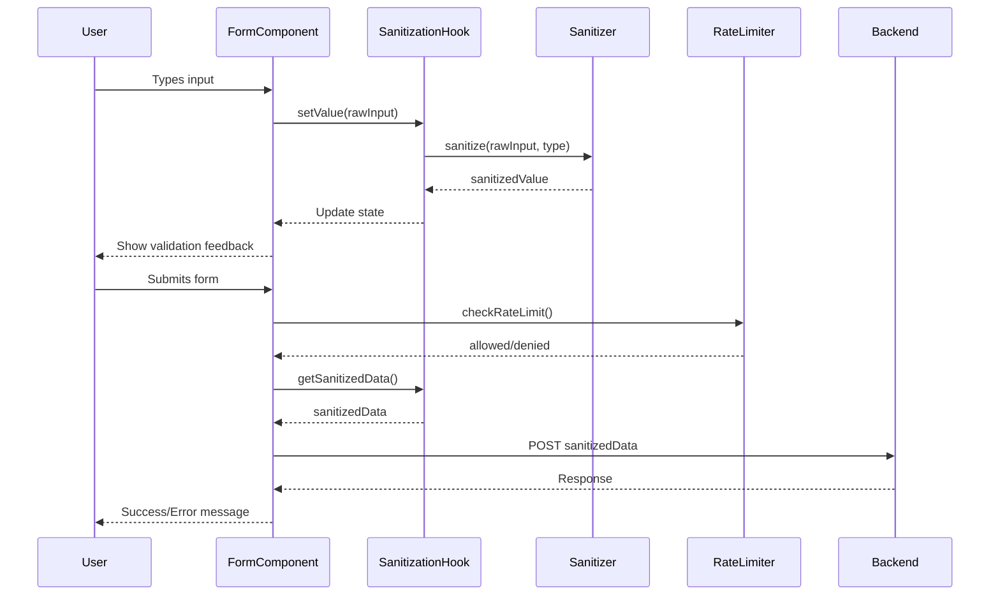

# Design Document: Form Sanitization System

## Overview

The Form Sanitization System provides comprehensive XSS protection and input sanitization across all user-facing forms in the application. The system builds upon existing infrastructure (input-sanitizer.ts, useSanitizedInput hook, SecureUserForm example) to systematically apply sanitization to admin forms, public forms, and chat interfaces.

### Goals

- Apply consistent sanitization across all form inputs in the application
- Prevent XSS, SQL injection, and other input-based attacks
- Provide clear validation feedback when input is sanitized or rejected
- Maintain usability while enforcing security policies
- Enable easy integration of sanitization into new forms

### Non-Goals

- Server-side validation (this is client-side sanitization only)
- Authentication or authorization logic
- Database query parameterization (handled separately)
- Network-level security (handled by CSP and other mechanisms)

### Key Design Decisions

1. **Client-side sanitization as first defense**: Sanitize inputs immediately in the UI before submission, providing instant feedback
2. **Hook-based architecture**: Use React hooks (useSanitizedInput, useSanitizedForm) for declarative sanitization
3. **Type-specific sanitization**: Different sanitization strategies for text, HTML, email, phone, URL, and search inputs
4. **Idempotent sanitization**: Applying sanitization multiple times produces the same result
5. **Rate limiting integration**: Combine sanitization with rate limiting to prevent abuse

## Architecture

### System Components



### Component Responsibilities

**Input Sanitizer Library** (`src/lib/security/input-sanitizer.ts`)
- Core sanitization functions for each input type
- File upload validation
- SQL injection pattern detection
- Filename sanitization
- Token generation

**useSanitizedInput Hook** (`src/hooks/useSanitizedInput.ts`)
- React hook for single input sanitization
- Manages raw and sanitized values
- Applies type-specific sanitization

**useSanitizedForm Hook** (`src/hooks/useSanitizedInput.ts`)
- React hook for entire form sanitization
- Manages form state with sanitization map
- Provides getSanitizedData() for submission
- Integrates with react-hook-form

**Form Components**
- Use sanitization hooks
- Display validation feedback
- Check rate limits before submission
- Handle sanitization errors gracefully

**Rate Limiter** (`src/lib/security/rate-limiter.ts`)
- Prevents automated abuse
- Different limits for different form types
- Per-user and per-IP tracking

### Data Flow



## Components and Interfaces

### Core Sanitization Functions

```typescript
// Text sanitization - removes all HTML and encodes special characters
function sanitizeText(text: string): string

// HTML sanitization - allows safe HTML tags, removes dangerous content
function sanitizeHTML(html: string, allowedTags?: string[]): string

// Email validation and sanitization
function sanitizeEmail(email: string): string

// URL validation and sanitization
function sanitizeURL(url: string, allowedProtocols?: string[]): string

// Phone number sanitization (Brazilian format)
function sanitizePhoneNumber(phone: string): string

// Search query sanitization - prevents SQL injection
function sanitizeSearchQuery(query: string): string

// Path sanitization - prevents path traversal
function sanitizePath(path: string): string

// Filename sanitization for safe storage
function sanitizeFilename(filename: string): string

// File upload validation
function validateFileUpload(
  file: File,
  allowedTypes: readonly string[],
  maxSize: number
): { valid: boolean; error?: string }
```

### Sanitization Hooks

```typescript
// Single input sanitization
type SanitizationType = 'text' | 'html' | 'email' | 'phone' | 'url' | 'search' | 'none'

function useSanitizedInput(
  initialValue: string,
  type: SanitizationType
): [rawValue: string, setValue: (v: string) => void, sanitizedValue: string]

// Form-level sanitization
function useSanitizedForm<T extends Record<string, any>>(
  initialData: T,
  sanitizationMap: Partial<Record<keyof T, SanitizationType>>
): {
  formData: T
  setValue: (field: keyof T, value: any) => void
  getSanitizedValue: (field: keyof T) => any
  getSanitizedData: () => T
  reset: () => void
  setFormData: (data: T) => void
}
```

### Form Component Pattern

```typescript
// Standard pattern for sanitized forms
function MyForm({ onSubmit }: { onSubmit: (data: FormData) => Promise<void> }) {
  const { toast } = useToast()
  const [isSubmitting, setIsSubmitting] = useState(false)
  
  // Setup sanitization
  const {
    formData,
    setValue,
    getSanitizedData
  } = useSanitizedForm<FormData>(
    initialData,
    {
      name: 'text',
      email: 'email',
      bio: 'html',
      website: 'url'
    }
  )
  
  // Setup validation
  const {
    register,
    handleSubmit,
    formState: { errors }
  } = useForm<FormData>({
    resolver: zodResolver(schema),
    values: formData
  })
  
  const onSubmitForm = async (data: FormData) => {
    // Check rate limit
    const rateLimit = checkRateLimit(rateLimitKey, RATE_LIMITS.api)
    if (!rateLimit.allowed) {
      toast({
        title: 'Rate limit exceeded',
        description: `Wait ${rateLimit.retryAfter}s`,
        variant: 'destructive'
      })
      return
    }
    
    setIsSubmitting(true)
    try {
      // Get sanitized data
      const sanitizedData = getSanitizedData()
      
      // Submit
      await onSubmit(sanitizedData)
      
      toast({ title: 'Success' })
    } catch (error) {
      toast({ title: 'Error', variant: 'destructive' })
    } finally {
      setIsSubmitting(false)
    }
  }
  
  return (
    <form onSubmit={handleSubmit(onSubmitForm)}>
      {/* Form fields */}
    </form>
  )
}
```

### Validation Feedback Component

```typescript
interface ValidationFeedbackProps {
  error?: string
  warning?: string
  info?: string
  className?: string
}

function ValidationFeedback({ error, warning, info, className }: ValidationFeedbackProps) {
  if (!error && !warning && !info) return null
  
  return (
    <div className={cn('text-sm mt-1', className)}>
      {error && <p className="text-red-500">{error}</p>}
      {warning && <p className="text-amber-500">{warning}</p>}
      {info && <p className="text-blue-500">{info}</p>}
    </div>
  )
}
```

## Data Models

### Sanitization Configuration

```typescript
interface SanitizationConfig {
  // Field-level configuration
  fields: Record<string, FieldSanitizationConfig>
  
  // Global settings
  maxInputLength: number
  maxFileSize: number
  allowedFileTypes: string[]
  allowedHTMLTags: string[]
}

interface FieldSanitizationConfig {
  type: SanitizationType
  required: boolean
  maxLength?: number
  pattern?: RegExp
  customSanitizer?: (value: string) => string
}
```

### Rate Limit Configuration

```typescript
interface RateLimitConfig {
  maxRequests: number
  windowMs: number
  message?: string
}

// Predefined limits for different form types
const FORM_RATE_LIMITS = {
  profileUpdate: { maxRequests: 10, windowMs: 3600000 }, // 10/hour
  contactForm: { maxRequests: 5, windowMs: 3600000 },    // 5/hour
  chatMessage: { maxRequests: 60, windowMs: 60000 },     // 60/minute
  search: { maxRequests: 30, windowMs: 60000 },          // 30/minute
  fileUpload: { maxRequests: 10, windowMs: 3600000 }     // 10/hour
}
```

### Form State

```typescript
interface FormState<T> {
  // Raw user input
  rawData: T
  
  // Sanitized data ready for submission
  sanitizedData: T
  
  // Validation errors
  errors: Partial<Record<keyof T, string>>
  
  // Submission state
  isSubmitting: boolean
  isValid: boolean
  
  // Rate limit state
  rateLimitRemaining: number
  rateLimitResetTime: number
}
```

### Sanitization Result

```typescript
interface SanitizationResult {
  // Sanitized value
  value: string
  
  // Whether sanitization modified the input
  wasModified: boolean
  
  // What was removed/changed
  modifications?: string[]
  
  // Validation errors
  errors?: string[]
}
```

## Form Inventory and Sanitization Strategy

### Admin Forms

| Form | Location | Fields Requiring Sanitization | Sanitization Types |
|------|----------|------------------------------|-------------------|
| User Management | `/admin/users` | name, email, phone, notes | text, email, phone, html |
| Product Management | `/admin/products` | name, description, category | text, html, text |
| Order Management | `/admin/orders` | notes, customer_notes | html, html |
| Payment Keys | `/admin/payment-keys` | pix_key, api_keys | text, text |
| Bonus Pieces | `/admin/bonus-pieces` | name, description | text, html |

### Public Forms

| Form | Location | Fields Requiring Sanitization | Sanitization Types |
|------|----------|------------------------------|-------------------|
| Contact Form | `/contact` | name, email, message | text, email, html |
| Login | `/login` | email, password | email, none |
| Registration | `/register` | name, email, phone, password | text, email, phone, none |
| Search | Multiple pages | query | search |
| Payment Forms | `/purchase`, `/pay-balance` | name, email, notes | text, email, html |

### Chat Forms

| Form | Location | Fields Requiring Sanitization | Sanitization Types |
|------|----------|------------------------------|-------------------|
| Customer Chat | `/customer/chat` | message, attachments | text, file |
| Admin Chat | `/admin/chat` | message, quick_replies | text, text |
| Group Messages | `/groups/:id` | message, attachments | text, file |

