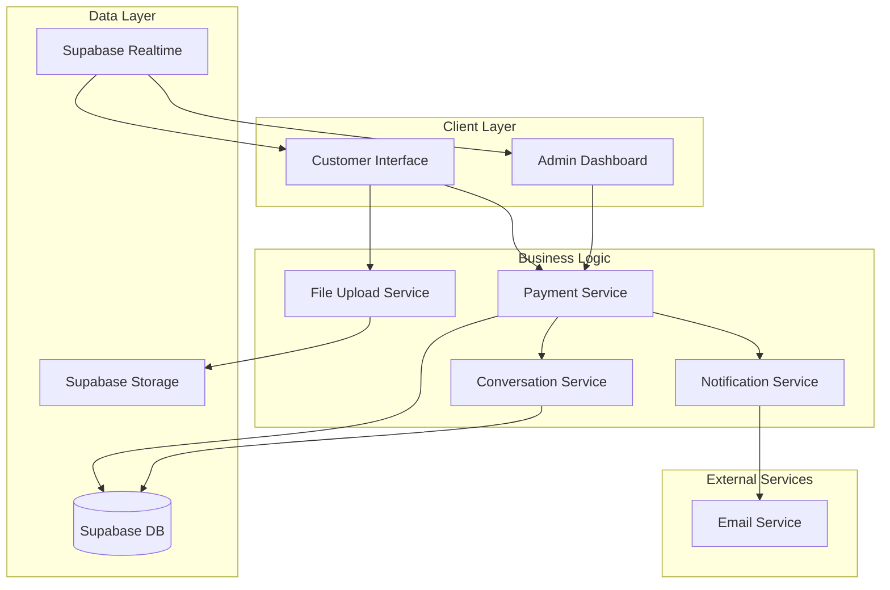
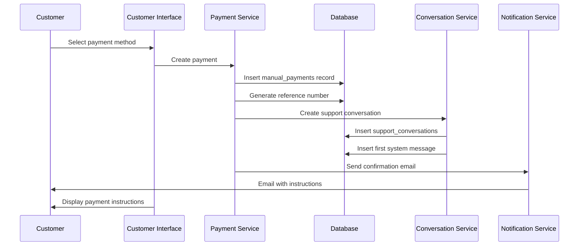
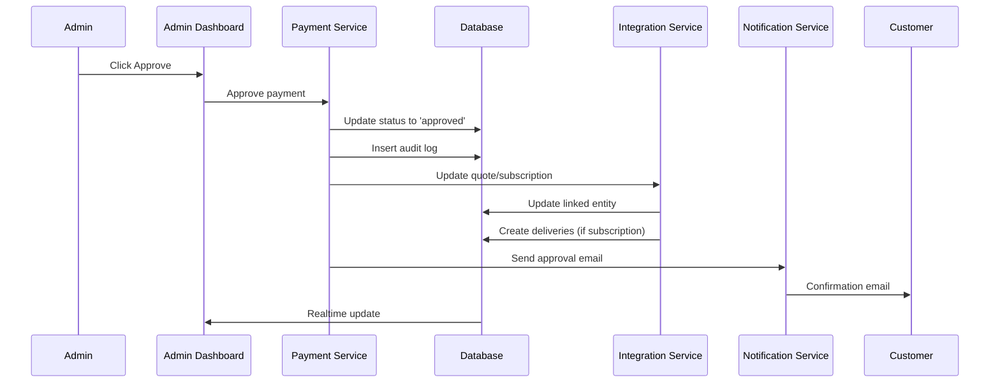

# Design Document: Manual Payment System

## Overview

The Manual Payment System is a comprehensive payment verification solution that enables Ordax administrators to manually process payments from multiple payment providers. The system integrates seamlessly with the existing support conversation infrastructure, providing a unified communication channel for payment-related discussions.

The architecture follows a three-tier approach:
1. **Data Layer**: Supabase PostgreSQL with RLS policies for secure data access
2. **Business Logic Layer**: React Query mutations and Supabase Edge Functions for complex operations
3. **Presentation Layer**: React components using shadcn/ui with real-time updates via Supabase Realtime

This design prioritizes security, user experience, and maintainability while providing a clear migration path to automated payment gateways in the future.

## Architecture

### System Components



### Data Flow

#### Payment Creation Flow


#### Payment Approval Flow


## Components and Interfaces

### 1. Payment Method Management

#### PaymentMethodForm Component
```typescript
interface PaymentMethod {
  id: string;
  name: string;
  type: 'pix' | 'pagseguro' | 'picpay' | 'paypal' | 'bank_transfer' | 'other';
  instructions: string;
  payment_link?: string;
  pix_key?: string;
  account_details?: Record<string, any>;
  is_active: boolean;
  is_default: boolean;
  display_order: number;
}

interface PaymentMethodFormProps {
  method?: PaymentMethod;
  onSave: (method: Partial<PaymentMethod>) => Promise<void>;
  onCancel: () => void;
}
```

#### PaymentMethodService
```typescript
class PaymentMethodService {
  async listActive(): Promise<PaymentMethod[]>
  async getById(id: string): Promise<PaymentMethod>
  async create(data: Partial<PaymentMethod>): Promise<PaymentMethod>
  async update(id: string, data: Partial<PaymentMethod>): Promise<PaymentMethod>
  async setDefault(id: string): Promise<void>
  async toggleActive(id: string, isActive: boolean): Promise<void>
}
```

### 2. Payment Creation

#### PaymentInitiationFlow Component
```typescript
interface PaymentInitiationProps {
  quoteId?: string;
  subscriptionId?: string;
  amount: number;
  onComplete: (paymentId: string) => void;
}

interface PaymentCreationData {
  payment_method_id: string;
  quote_id?: string;
  subscription_id?: string;
  amount: number;
  currency: string;
  payment_type: 'one_time' | 'recurring';
}
```

#### PaymentService
```typescript
class PaymentService {
  async create(data: PaymentCreationData): Promise<ManualPayment>
  async getById(id: string): Promise<ManualPayment>
  async listByUser(userId: string, filters?: PaymentFilters): Promise<ManualPayment[]>
  async updateStatus(id: string, status: PaymentStatus, notes?: string): Promise<void>
  async approve(id: string, adminId: string): Promise<void>
  async reject(id: string, adminId: string, reason: string): Promise<void>
  async requestInfo(id: string, adminId: string, message: string): Promise<void>
}
```

### 3. File Upload System

#### FileUploadComponent
```typescript
interface FileUploadProps {
  paymentId: string;
  maxFiles: number;
  maxSizeBytes: number;
  acceptedTypes: string[];
  onUploadComplete: (files: PaymentFile[]) => void;
  onError: (error: Error) => void;
}

interface PaymentFile {
  id: string;
  payment_id: string;
  file_name: string;
  file_path: string;
  file_size: number;
  file_type: string;
  thumbnail_path?: string;
  uploaded_by: string;
  created_at: string;
}
```

#### FileUploadService
```typescript
class FileUploadService {
  async upload(
    paymentId: string,
    file: File,
    onProgress?: (progress: number) => void
  ): Promise<PaymentFile>
  
  async validateFile(file: File): Promise<ValidationResult>
  async generateThumbnail(file: File): Promise<Blob>
  async getSignedUrl(filePath: string, expiresIn: number): Promise<string>
  async listByPayment(paymentId: string): Promise<PaymentFile[]>
  async delete(fileId: string): Promise<void>
}

interface ValidationResult {
  valid: boolean;
  errors: string[];
}
```

### 4. Support Conversation Integration

#### PaymentConversationView Component
```typescript
interface PaymentConversationProps {
  paymentId: string;
  conversationId: string;
  currentUserId: string;
  isAdmin: boolean;
}

interface ConversationMessage {
  id: string;
  conversation_id: string;
  sender_id: string;
  message: string;
  is_internal: boolean;
  attachments: string[];
  read_by_customer: boolean;
  read_by_admin: boolean;
  created_at: string;
}
```

#### ConversationService
```typescript
class ConversationService {
  async createForPayment(paymentId: string, userId: string): Promise<SupportConversation>
  async sendMessage(conversationId: string, message: string, attachments?: string[]): Promise<ConversationMessage>
  async markAsRead(conversationId: string, isAdmin: boolean): Promise<void>
  async getMessages(conversationId: string): Promise<ConversationMessage[]>
  async subscribeToMessages(conversationId: string, callback: (message: ConversationMessage) => void): () => void
}
```

### 5. Admin Dashboard

#### PaymentDashboard Component
```typescript
interface PaymentDashboardProps {
  initialFilters?: PaymentFilters;
}

interface PaymentFilters {
  status?: PaymentStatus[];
  payment_method_id?: string;
  date_from?: string;
  date_to?: string;
  search?: string;
}

interface PaymentListItem {
  id: string;
  reference_number: string;
  customer_name: string;
  customer_email: string;
  amount: number;
  currency: string;
  payment_method_name: string;
  status: PaymentStatus;
  created_at: string;
  file_count: number;
  unread_messages: number;
}
```

#### AdminPaymentService
```typescript
class AdminPaymentService {
  async listPending(filters?: PaymentFilters): Promise<PaymentListItem[]>
  async getStats(): Promise<PaymentStats>
  async bulkApprove(paymentIds: string[], adminId: string): Promise<BulkOperationResult>
  async bulkExport(paymentIds: string[]): Promise<Blob>
  async bulkMessage(paymentIds: string[], message: string, adminId: string): Promise<BulkOperationResult>
}

interface PaymentStats {
  pending_count: number;
  under_review_count: number;
  requires_info_count: number;
  total_pending_amount: number;
  avg_processing_time_hours: number;
}

interface BulkOperationResult {
  success_count: number;
  failure_count: number;
  errors: Array<{ payment_id: string; error: string }>;
}
```

### 6. Notification System

#### NotificationService
```typescript
class NotificationService {
  async sendPaymentCreated(paymentId: string): Promise<void>
  async sendPaymentUnderReview(paymentId: string): Promise<void>
  async sendPaymentApproved(paymentId: string): Promise<void>
  async sendPaymentRejected(paymentId: string, reason: string): Promise<void>
  async sendInfoRequested(paymentId: string, message: string): Promise<void>
  async sendNewMessage(conversationId: string, messageId: string): Promise<void>
  
  async getUnreadCount(userId: string, isAdmin: boolean): Promise<number>
  async markAsRead(notificationIds: string[]): Promise<void>
}

interface EmailTemplate {
  subject: string;
  html: string;
  text: string;
}
```

### 7. Integration Service

#### IntegrationService
```typescript
class IntegrationService {
  async handlePaymentApproval(paymentId: string): Promise<void>
  async updateQuoteStatus(quoteId: string, status: string): Promise<void>
  async activateSubscription(subscriptionId: string, paymentId: string): Promise<void>
  async createSubscriptionDeliveries(subscriptionId: string): Promise<void>
  async calculateNextDeliveryDate(planType: string): Promise<Date>
}
```

## Data Models

### Database Tables

#### payment_methods
```sql
CREATE TABLE payment_methods (
  id UUID PRIMARY KEY DEFAULT gen_random_uuid(),
  name TEXT NOT NULL,
  type TEXT NOT NULL CHECK (type IN ('pix', 'pagseguro', 'picpay', 'paypal', 'bank_transfer', 'other')),
  instructions TEXT NOT NULL,
  payment_link TEXT,
  pix_key TEXT,
  account_details JSONB,
  is_active BOOLEAN NOT NULL DEFAULT true,
  is_default BOOLEAN NOT NULL DEFAULT false,
  display_order INTEGER NOT NULL DEFAULT 0,
  created_at TIMESTAMPTZ NOT NULL DEFAULT now(),
  updated_at TIMESTAMPTZ NOT NULL DEFAULT now()
);

CREATE INDEX idx_payment_methods_active ON payment_methods(is_active);
CREATE INDEX idx_payment_methods_default ON payment_methods(is_default) WHERE is_default = true;
CREATE INDEX idx_payment_methods_display_order ON payment_methods(display_order);
```

#### manual_payments
```sql
CREATE TABLE manual_payments (
  id UUID PRIMARY KEY DEFAULT gen_random_uuid(),
  reference_number TEXT NOT NULL UNIQUE,
  user_id UUID NOT NULL REFERENCES auth.users(id) ON DELETE CASCADE,
  payment_method_id UUID NOT NULL REFERENCES payment_methods(id),
  
  quote_id UUID REFERENCES quotes(id) ON DELETE SET NULL,
  subscription_id UUID REFERENCES subscriptions(id) ON DELETE SET NULL,
  
  amount DECIMAL(10,2) NOT NULL,
  currency TEXT NOT NULL DEFAULT 'BRL',
  payment_type TEXT NOT NULL CHECK (payment_type IN ('one_time', 'recurring')),
  
  status TEXT NOT NULL DEFAULT 'pending' CHECK (status IN ('pending', 'under_review', 'requires_info', 'approved', 'rejected')),
  rejection_reason TEXT,
  
  created_at TIMESTAMPTZ NOT NULL DEFAULT now(),
  updated_at TIMESTAMPTZ NOT NULL DEFAULT now(),
  approved_at TIMESTAMPTZ,
  approved_by UUID REFERENCES auth.users(id),
  
  CONSTRAINT payment_link_check CHECK (
    (quote_id IS NOT NULL AND subscription_id IS NULL) OR
    (quote_id IS NULL AND subscription_id IS NOT NULL)
  )
);

CREATE INDEX idx_manual_payments_user ON manual_payments(user_id);
CREATE INDEX idx_manual_payments_status ON manual_payments(status);
CREATE INDEX idx_manual_payments_reference ON manual_payments(reference_number);
CREATE INDEX idx_manual_payments_quote ON manual_payments(quote_id);
CREATE INDEX idx_manual_payments_subscription ON manual_payments(subscription_id);
CREATE INDEX idx_manual_payments_created ON manual_payments(created_at DESC);
```

#### payment_files
```sql
CREATE TABLE payment_files (
  id UUID PRIMARY KEY DEFAULT gen_random_uuid(),
  payment_id UUID NOT NULL REFERENCES manual_payments(id) ON DELETE CASCADE,
  file_name TEXT NOT NULL,
  file_path TEXT NOT NULL,
  file_size INTEGER NOT NULL,
  file_type TEXT NOT NULL,
  thumbnail_path TEXT,
  uploaded_by UUID NOT NULL REFERENCES auth.users(id),
  created_at TIMESTAMPTZ NOT NULL DEFAULT now()
);

CREATE INDEX idx_payment_files_payment ON payment_files(payment_id);
CREATE INDEX idx_payment_files_uploaded_by ON payment_files(uploaded_by);
```

#### payment_audit_log
```sql
CREATE TABLE payment_audit_log (
  id UUID PRIMARY KEY DEFAULT gen_random_uuid(),
  payment_id UUID NOT NULL REFERENCES manual_payments(id) ON DELETE CASCADE,
  action_type TEXT NOT NULL CHECK (action_type IN ('created', 'status_changed', 'file_uploaded', 'approved', 'rejected', 'info_requested')),
  admin_id UUID REFERENCES auth.users(id),
  old_status TEXT,
  new_status TEXT,
  notes TEXT,
  created_at TIMESTAMPTZ NOT NULL DEFAULT now()
);

CREATE INDEX idx_payment_audit_payment ON payment_audit_log(payment_id, created_at DESC);
CREATE INDEX idx_payment_audit_admin ON payment_audit_log(admin_id);
```

#### support_conversations (modified)
```sql
ALTER TABLE support_conversations 
ADD COLUMN payment_id UUID REFERENCES manual_payments(id) ON DELETE CASCADE;

CREATE INDEX idx_support_conversations_payment ON support_conversations(payment_id);
```

### RLS Policies

#### payment_methods
```sql
-- Anyone can view active payment methods
CREATE POLICY "Anyone can view active payment methods"
  ON payment_methods FOR SELECT
  USING (is_active = true);

-- Admins can manage all payment methods
CREATE POLICY "Admins can manage payment methods"
  ON payment_methods FOR ALL
  USING (has_role(auth.uid(), 'admin'::app_role));
```

#### manual_payments
```sql
-- Users can view their own payments
CREATE POLICY "Users can view own payments"
  ON manual_payments FOR SELECT
  USING (auth.uid() = user_id);

-- Users can create their own payments
CREATE POLICY "Users can create own payments"
  ON manual_payments FOR INSERT
  WITH CHECK (auth.uid() = user_id);

-- Admins can view all payments
CREATE POLICY "Admins can view all payments"
  ON manual_payments FOR SELECT
  USING (has_role(auth.uid(), 'admin'::app_role));

-- Admins can update all payments
CREATE POLICY "Admins can update all payments"
  ON manual_payments FOR UPDATE
  USING (has_role(auth.uid(), 'admin'::app_role));
```

#### payment_files
```sql
-- Users can view files from their own payments
CREATE POLICY "Users can view own payment files"
  ON payment_files FOR SELECT
  USING (
    EXISTS (
      SELECT 1 FROM manual_payments
      WHERE manual_payments.id = payment_files.payment_id
      AND manual_payments.user_id = auth.uid()
    )
  );

-- Users can upload files to their own payments
CREATE POLICY "Users can upload to own payments"
  ON payment_files FOR INSERT
  WITH CHECK (
    auth.uid() = uploaded_by
    AND EXISTS (
      SELECT 1 FROM manual_payments
      WHERE manual_payments.id = payment_files.payment_id
      AND manual_payments.user_id = auth.uid()
    )
  );

-- Admins can view all payment files
CREATE POLICY "Admins can view all payment files"
  ON payment_files FOR SELECT
  USING (has_role(auth.uid(), 'admin'::app_role));
```

#### payment_audit_log
```sql
-- Only admins can view audit logs
CREATE POLICY "Admins can view audit logs"
  ON payment_audit_log FOR SELECT
  USING (has_role(auth.uid(), 'admin'::app_role));

-- System can insert audit logs
CREATE POLICY "System can insert audit logs"
  ON payment_audit_log FOR INSERT
  WITH CHECK (true);
```

### Database Functions

#### generate_payment_reference
```sql
CREATE OR REPLACE FUNCTION generate_payment_reference()
RETURNS TEXT
LANGUAGE plpgsql
AS $
DECLARE
  v_reference TEXT;
  v_exists BOOLEAN;
BEGIN
  LOOP
    -- Generate reference: PAY-YYYYMMDD-XXXX (XXXX = random 4 digits)
    v_reference := 'PAY-' || 
                   to_char(now(), 'YYYYMMDD') || '-' || 
                   lpad(floor(random() * 10000)::text, 4, '0');
    
    -- Check if exists
    SELECT EXISTS(
      SELECT 1 FROM manual_payments WHERE reference_number = v_reference
    ) INTO v_exists;
    
    EXIT WHEN NOT v_exists;
  END LOOP;
  
  RETURN v_reference;
END;
$;
```

#### trigger_payment_status_change
```sql
CREATE OR REPLACE FUNCTION trigger_payment_status_change()
RETURNS TRIGGER
LANGUAGE plpgsql
AS $
BEGIN
  -- Log status change
  IF OLD.status IS DISTINCT FROM NEW.status THEN
    INSERT INTO payment_audit_log (
      payment_id,
      action_type,
      old_status,
      new_status,
      admin_id
    ) VALUES (
      NEW.id,
      'status_changed',
      OLD.status,
      NEW.status,
      NEW.approved_by
    );
    
    -- Update conversation status
    IF NEW.status = 'requires_info' THEN
      UPDATE support_conversations
      SET status = 'waiting_customer'
      WHERE payment_id = NEW.id;
    ELSIF NEW.status IN ('approved', 'rejected') THEN
      UPDATE support_conversations
      SET status = 'resolved',
          resolved_at = now()
      WHERE payment_id = NEW.id;
    END IF;
  END IF;
  
  RETURN NEW;
END;
$;

CREATE TRIGGER payment_status_change
  AFTER UPDATE ON manual_payments
  FOR EACH ROW
  EXECUTE FUNCTION trigger_payment_status_change();
```

#### trigger_first_file_upload
```sql
CREATE OR REPLACE FUNCTION trigger_first_file_upload()
RETURNS TRIGGER
LANGUAGE plpgsql
AS $
DECLARE
  v_file_count INTEGER;
BEGIN
  -- Count files for this payment
  SELECT COUNT(*) INTO v_file_count
  FROM payment_files
  WHERE payment_id = NEW.payment_id;
  
  -- If this is the first file, update payment status
  IF v_file_count = 1 THEN
    UPDATE manual_payments
    SET status = 'under_review'
    WHERE id = NEW.payment_id
      AND status = 'pending';
  END IF;
  
  -- Log file upload
  INSERT INTO payment_audit_log (
    payment_id,
    action_type,
    admin_id
  ) VALUES (
    NEW.payment_id,
    'file_uploaded',
    NEW.uploaded_by
  );
  
  RETURN NEW;
END;
$;

CREATE TRIGGER first_file_upload
  AFTER INSERT ON payment_files
  FOR EACH ROW
  EXECUTE FUNCTION trigger_first_file_upload();
```

## Correctness Properties

*A property is a characteristic or behavior that should hold true across all valid executions of a system—essentially, a formal statement about what the system should do. Properties serve as the bridge between human-readable specifications and machine-verifiable correctness guarantees.*


### Property Reflection

After analyzing all acceptance criteria, I identified the following redundancies:

**Redundant Properties:**
- Criteria 8.3 (first file upload transitions to under_review) is identical to 3.11 - consolidate into one property
- Criteria 15.1 (quote status update on approval) is identical to 7.5 - consolidate into one property
- Criteria 15.3 (subscription status update on approval) is identical to 7.6 - consolidate into one property

**Combined Properties:**
- Criteria 2.1 and 2.2 (display active payment methods for quotes/subscriptions) can be combined into one property about displaying active methods
- Criteria 14.9 and 6.10 (RLS policies for customers and admins) can be combined into one comprehensive authorization property
- Criteria 9.1 and other email notifications can be consolidated into a general "notification on status change" property

The following properties represent the unique, non-redundant validation requirements:

### Correctness Properties

**Property 1: Payment Method Validation**
*For any* payment method creation attempt, if required fields (name, type, instructions, is_active) are missing, the system should reject the creation and return a validation error.
**Validates: Requirements 1.2**

**Property 2: Optional Fields Acceptance**
*For any* payment method creation with valid required fields, the system should accept the creation regardless of whether optional fields (payment_link, pix_key, account_details) are provided.
**Validates: Requirements 1.3**

**Property 3: Single Default Payment Method**
*For any* sequence of payment method default assignments, exactly one payment method should have is_default = true at any point in time.
**Validates: Requirements 1.8**

**Property 4: Active Payment Methods Display**
*For any* payment initiation (quote or subscription), the system should return only payment methods where is_active = true.
**Validates: Requirements 2.1, 2.2**

**Property 5: Initial Payment Status**
*For any* newly created payment record, the initial status should be 'pending'.
**Validates: Requirements 2.5, 8.2**

**Property 6: Payment Entity Reference Exclusivity**
*For any* payment record, exactly one of quote_id or subscription_id should be non-null (XOR constraint).
**Validates: Requirements 2.6**

**Property 7: Unique Payment Reference Numbers**
*For any* set of payment records, all reference_number values should be unique.
**Validates: Requirements 2.8**

**Property 8: File Type Validation**
*For any* file upload attempt, if the file type is not in the allowed list (JPG, PNG, PDF), the system should reject the upload.
**Validates: Requirements 3.2**

**Property 9: File Size Validation**
*For any* file upload attempt, if the file size exceeds 5MB, the system should reject the upload.
**Validates: Requirements 3.3**

**Property 10: Maximum Files Per Payment**
*For any* payment record with 5 existing files, attempting to upload a 6th file should be rejected.
**Validates: Requirements 3.6**

**Property 11: First File Upload Status Transition**
*For any* payment record with status 'pending', uploading the first file should transition the status to 'under_review'.
**Validates: Requirements 3.11, 8.3**

**Property 12: Automatic Conversation Creation**
*For any* payment record created, a support_conversations record with payment_id referencing the payment should exist.
**Validates: Requirements 4.1, 4.3**

**Property 13: Conversation Subject Format**
*For any* payment record, the associated conversation subject should match the format "Pagamento - Pedido #[reference_number]".
**Validates: Requirements 4.2**

**Property 14: Admin Dashboard Filtering**
*For any* set of payment records, the admin dashboard should display only those with status in ('pending', 'under_review', 'requires_info').
**Validates: Requirements 5.1**

**Property 15: Filter Application Correctness**
*For any* applied filter criteria (status, payment_method, date_range), all returned payments should match the filter criteria.
**Validates: Requirements 5.4**

**Property 16: Payment Approval Status Transition**
*For any* payment record being approved by an admin, the status should transition to 'approved' and approved_at timestamp should be set.
**Validates: Requirements 7.3**

**Property 17: Quote Status Update on Approval**
*For any* payment record with non-null quote_id that transitions to 'approved', the referenced quote status should be updated to 'paid'.
**Validates: Requirements 7.5, 15.1**

**Property 18: Subscription Activation on Approval**
*For any* payment record with non-null subscription_id that transitions to 'approved', the referenced subscription status should be updated to 'active'.
**Validates: Requirements 7.6, 15.3**

**Property 19: Subscription Deliveries Creation**
*For any* subscription that transitions to 'active' status, subscription_deliveries records should be created according to the plan's deliveries_total.
**Validates: Requirements 15.4**

**Property 20: Audit Log Completeness**
*For any* admin action (approve, reject, request_info), a corresponding entry should exist in payment_audit_log with action_type, admin_id, and timestamp.
**Validates: Requirements 7.14, 11.2**

**Property 21: Approved Status Immutability**
*For any* payment record with status 'approved', no status transition to any other status should be allowed.
**Validates: Requirements 8.8**

**Property 22: Rejected Status Transition Constraint**
*For any* payment record with status 'rejected', only transition to 'under_review' should be allowed (for re-submission).
**Validates: Requirements 8.9**

**Property 23: Email Notification on Payment Creation**
*For any* newly created payment record, a transactional email should be sent to the customer's email address.
**Validates: Requirements 9.1**

**Property 24: Real-time Notification Badge Update**
*For any* notification event (new message, status change), the notification badge count should update without page refresh.
**Validates: Requirements 10.6, 16.2**

**Property 25: Payment File Persistence**
*For any* uploaded payment file, the file should remain in storage and be accessible unless explicitly deleted by an admin.
**Validates: Requirements 11.5**

**Property 26: Bulk Approval Status Filter**
*For any* bulk approval operation, only payments with status 'under_review' should be approved; others should be skipped and reported.
**Validates: Requirements 12.6, 12.7**

**Property 27: File Upload Permission for Rejected Payments**
*For any* payment record with status 'rejected', the customer who created the payment should be able to upload new files.
**Validates: Requirements 13.9**

**Property 28: MIME Type and Extension Matching**
*For any* file upload, if the MIME type does not match the file extension, the upload should be rejected.
**Validates: Requirements 14.1**

**Property 29: Malware Detection and Logging**
*For any* file that fails malware scanning, the upload should be rejected and an incident log entry should be created.
**Validates: Requirements 14.4**

**Property 30: File Upload Rate Limiting**
*For any* user, if 10 files have been uploaded within the past hour, the 11th upload attempt should be rejected.
**Validates: Requirements 14.5**

**Property 31: File Access Authorization**
*For any* payment file, customers should only access files from their own payments, while admins should access all files.
**Validates: Requirements 14.9, 6.10**

**Property 32: Dashboard Load Performance**
*For any* admin dashboard load with 100 pending payments, the page should render in ≤ 2 seconds.
**Validates: Requirements 18.1**

**Property 33: Pagination Limit**
*For any* payment list query, the number of returned items should not exceed 25 per page.
**Validates: Requirements 18.5**

**Property 34: Error Message Specificity**
*For any* failed operation (upload, validation, etc.), the error response should include a specific message explaining the failure reason.
**Validates: Requirements 19.1**

**Property 35: Invalid Field Highlighting**
*For any* form submission with validation errors, all invalid fields should be marked with error indicators.
**Validates: Requirements 19.5**

**Property 36: Keyboard Navigation Support**
*For any* interactive element in the interface, it should be accessible and operable via keyboard alone.
**Validates: Requirements 20.4**

**Property 37: Color Contrast Compliance**
*For any* text element in the interface, the color contrast ratio should meet WCAG AA standards (4.5:1 for normal text).
**Validates: Requirements 20.7**

## Error Handling

### Error Categories

#### 1. Validation Errors
- **File Type Invalid**: Return 400 with message "File type not supported. Please upload JPG, PNG, or PDF files."
- **File Size Exceeded**: Return 400 with message "File size exceeds 5MB limit. Please upload a smaller file."
- **Required Fields Missing**: Return 400 with field-specific messages
- **Invalid Status Transition**: Return 400 with message "Cannot transition from [old_status] to [new_status]"

#### 2. Authorization Errors
- **Unauthorized Access**: Return 403 with message "You don't have permission to access this resource"
- **Rate Limit Exceeded**: Return 429 with message "Upload limit exceeded. Please try again in [X] minutes"

#### 3. Business Logic Errors
- **Payment Already Approved**: Return 409 with message "Payment has already been approved and cannot be modified"
- **Maximum Files Reached**: Return 400 with message "Maximum of 5 files per payment reached"
- **No Default Payment Method**: Return 400 with message "Please configure a default payment method first"

#### 4. Integration Errors
- **Quote Not Found**: Return 404 with message "Quote not found"
- **Subscription Not Found**: Return 404 with message "Subscription not found"
- **Email Send Failure**: Log error, return 200 (don't block payment creation), queue retry

#### 5. System Errors
- **Database Connection Error**: Return 503 with message "Service temporarily unavailable. Please try again"
- **Storage Upload Error**: Return 500 with message "File upload failed. Please try again"
- **Malware Scan Error**: Return 500 with message "File security scan failed. Please try again"

### Error Handling Strategy

```typescript
class PaymentError extends Error {
  constructor(
    public code: string,
    public message: string,
    public statusCode: number,
    public details?: Record<string, any>
  ) {
    super(message);
  }
}

// Usage
throw new PaymentError(
  'FILE_SIZE_EXCEEDED',
  'File size exceeds 5MB limit',
  400,
  { maxSize: 5242880, actualSize: file.size }
);
```

### Retry Logic

```typescript
interface RetryConfig {
  maxAttempts: number;
  backoffMs: number;
  backoffMultiplier: number;
}

async function withRetry<T>(
  operation: () => Promise<T>,
  config: RetryConfig
): Promise<T> {
  let lastError: Error;
  let delay = config.backoffMs;
  
  for (let attempt = 1; attempt <= config.maxAttempts; attempt++) {
    try {
      return await operation();
    } catch (error) {
      lastError = error;
      if (attempt < config.maxAttempts) {
        await sleep(delay);
        delay *= config.backoffMultiplier;
      }
    }
  }
  
  throw lastError;
}
```

## Testing Strategy

### Dual Testing Approach

The manual payment system requires both unit tests and property-based tests to ensure comprehensive coverage:

**Unit Tests** focus on:
- Specific examples of payment creation, approval, rejection
- Edge cases like boundary values (exactly 5MB file, exactly 5 files)
- Error conditions and error message content
- Integration points with quotes and subscriptions
- UI component rendering and user interactions

**Property-Based Tests** focus on:
- Universal properties that hold for all inputs
- Validation logic across random valid and invalid inputs
- State machine transitions across all possible state combinations
- Authorization rules across different user roles
- Data integrity constraints across random data sets

Together, these approaches provide comprehensive coverage: unit tests catch concrete bugs in specific scenarios, while property tests verify general correctness across the input space.

### Property-Based Testing Configuration

**Testing Library**: Use `fast-check` for TypeScript/JavaScript property-based testing

**Test Configuration**:
- Minimum 100 iterations per property test (due to randomization)
- Each property test must reference its design document property
- Tag format: `Feature: manual-payment-system, Property {number}: {property_text}`

**Example Property Test**:
```typescript
import fc from 'fast-check';

// Feature: manual-payment-system, Property 7: Unique Payment Reference Numbers
test('all generated payment reference numbers are unique', async () => {
  await fc.assert(
    fc.asyncProperty(
      fc.array(fc.record({
        user_id: fc.uuid(),
        payment_method_id: fc.uuid(),
        amount: fc.float({ min: 0.01, max: 10000 }),
        quote_id: fc.uuid()
      }), { minLength: 10, maxLength: 100 }),
      async (paymentData) => {
        const payments = await Promise.all(
          paymentData.map(data => paymentService.create(data))
        );
        
        const referenceNumbers = payments.map(p => p.reference_number);
        const uniqueReferences = new Set(referenceNumbers);
        
        expect(uniqueReferences.size).toBe(referenceNumbers.length);
      }
    ),
    { numRuns: 100 }
  );
});
```

### Unit Test Examples

```typescript
// Unit test for specific approval scenario
test('approving a quote payment updates quote status to paid', async () => {
  const quote = await createTestQuote();
  const payment = await createTestPayment({ quote_id: quote.id });
  
  await paymentService.approve(payment.id, adminUser.id);
  
  const updatedQuote = await quoteService.getById(quote.id);
  expect(updatedQuote.status).toBe('paid');
});

// Unit test for edge case
test('uploading exactly 5MB file succeeds', async () => {
  const payment = await createTestPayment();
  const file = createTestFile(5 * 1024 * 1024); // Exactly 5MB
  
  const result = await fileUploadService.upload(payment.id, file);
  
  expect(result).toBeDefined();
  expect(result.file_size).toBe(5 * 1024 * 1024);
});

// Unit test for error message
test('uploading oversized file returns specific error message', async () => {
  const payment = await createTestPayment();
  const file = createTestFile(6 * 1024 * 1024); // 6MB
  
  await expect(
    fileUploadService.upload(payment.id, file)
  ).rejects.toThrow('File size exceeds 5MB limit');
});
```

### Integration Tests

```typescript
// Integration test for complete payment flow
test('complete payment flow from creation to approval', async () => {
  // Create payment
  const payment = await paymentService.create({
    user_id: customer.id,
    payment_method_id: pixMethod.id,
    quote_id: quote.id,
    amount: 100.00
  });
  
  // Verify conversation created
  const conversation = await conversationService.getByPaymentId(payment.id);
  expect(conversation).toBeDefined();
  expect(conversation.subject).toContain(payment.reference_number);
  
  // Upload proof
  const file = createTestFile(1024 * 1024); // 1MB
  await fileUploadService.upload(payment.id, file);
  
  // Verify status changed
  const updatedPayment = await paymentService.getById(payment.id);
  expect(updatedPayment.status).toBe('under_review');
  
  // Admin approves
  await paymentService.approve(payment.id, admin.id);
  
  // Verify quote updated
  const updatedQuote = await quoteService.getById(quote.id);
  expect(updatedQuote.status).toBe('paid');
  
  // Verify audit log
  const auditLogs = await auditService.getByPaymentId(payment.id);
  expect(auditLogs).toContainEqual(
    expect.objectContaining({
      action_type: 'approved',
      admin_id: admin.id
    })
  );
});
```

### Test Data Generators

```typescript
// Generators for property-based tests
const paymentMethodArbitrary = fc.record({
  name: fc.string({ minLength: 1, maxLength: 100 }),
  type: fc.constantFrom('pix', 'pagseguro', 'picpay', 'paypal', 'bank_transfer'),
  instructions: fc.string({ minLength: 10, maxLength: 500 }),
  is_active: fc.boolean(),
  payment_link: fc.option(fc.webUrl()),
  pix_key: fc.option(fc.string())
});

const paymentArbitrary = fc.record({
  user_id: fc.uuid(),
  payment_method_id: fc.uuid(),
  amount: fc.float({ min: 0.01, max: 100000, noNaN: true }),
  currency: fc.constant('BRL'),
  payment_type: fc.constantFrom('one_time', 'recurring'),
  quote_id: fc.option(fc.uuid()),
  subscription_id: fc.option(fc.uuid())
}).filter(p => 
  (p.quote_id !== null && p.subscription_id === null) ||
  (p.quote_id === null && p.subscription_id !== null)
);

const fileArbitrary = fc.record({
  name: fc.string({ minLength: 1, maxLength: 255 }),
  size: fc.integer({ min: 1, max: 5 * 1024 * 1024 }),
  type: fc.constantFrom('image/jpeg', 'image/png', 'application/pdf')
});
```

## Implementation Notes

### Migration Strategy

1. **Phase 1: Database Setup**
   - Create new tables (payment_methods, manual_payments, payment_files, payment_audit_log)
   - Add payment_id column to support_conversations
   - Create indexes and RLS policies
   - Create database functions and triggers

2. **Phase 2: Core Services**
   - Implement PaymentMethodService
   - Implement PaymentService
   - Implement FileUploadService
   - Implement ConversationService integration

3. **Phase 3: Admin Interface**
   - Build payment method configuration UI
   - Build admin dashboard
   - Build payment details view
   - Implement bulk operations

4. **Phase 4: Customer Interface**
   - Build payment initiation flow
   - Build file upload UI
   - Build "My Payments" page
   - Integrate with existing quote/subscription flows

5. **Phase 5: Notifications**
   - Implement email templates
   - Implement notification service
   - Add real-time updates
   - Add in-app notification badges

6. **Phase 6: Testing & Polish**
   - Write unit tests
   - Write property-based tests
   - Write integration tests
   - Performance optimization
   - Accessibility audit

### Future Migration Path

When transitioning to an automated payment gateway:

1. **Keep the manual_payments table** as a historical record
2. **Add new automated_payments table** for gateway transactions
3. **Create unified payment_view** that combines both types
4. **Gradually migrate** payment methods to automated processing
5. **Maintain manual override** capability for edge cases
6. **Preserve audit trail** across both systems

### Security Considerations

1. **File Upload Security**
   - Validate MIME types server-side (don't trust client)
   - Scan files for malware using ClamAV or similar
   - Generate unique file names to prevent overwrites
   - Store files in private bucket (not public URLs)
   - Use signed URLs with short expiration

2. **Authorization**
   - Enforce RLS policies at database level
   - Double-check permissions in application code
   - Log all admin actions for audit trail
   - Implement rate limiting on sensitive operations

3. **Data Privacy**
   - Strip EXIF data from uploaded images
   - Encrypt sensitive payment details at rest
   - Implement GDPR-compliant data retention
   - Provide data export for customers

4. **Input Validation**
   - Validate all inputs server-side
   - Sanitize user-provided text to prevent XSS
   - Use parameterized queries to prevent SQL injection
   - Implement CSRF protection on all mutations

### Performance Optimization

1. **Database Queries**
   - Use indexes on frequently queried columns
   - Implement query result caching with React Query
   - Use database connection pooling
   - Optimize N+1 queries with proper joins

2. **File Operations**
   - Generate thumbnails asynchronously
   - Compress images before storage
   - Use CDN for file delivery
   - Implement lazy loading for images

3. **Real-time Updates**
   - Subscribe only to relevant payment records
   - Debounce rapid updates to prevent UI thrashing
   - Unsubscribe when components unmount
   - Use connection pooling for Realtime

4. **Frontend Performance**
   - Code-split admin and customer interfaces
   - Lazy load heavy components
   - Implement virtual scrolling for long lists
   - Optimize bundle size with tree-shaking

## Deployment Checklist

- [ ] Run database migrations
- [ ] Create Supabase Storage bucket 'payment-proofs'
- [ ] Configure bucket RLS policies
- [ ] Set up email templates in email service
- [ ] Configure environment variables
- [ ] Set up monitoring and alerting
- [ ] Configure backup strategy for payment data
- [ ] Test file upload with various file types
- [ ] Test email delivery
- [ ] Test real-time updates
- [ ] Verify RLS policies work correctly
- [ ] Load test with 100+ concurrent users
- [ ] Accessibility audit with screen reader
- [ ] Security audit of file upload
- [ ] GDPR compliance review
- [ ] Create admin documentation
- [ ] Create customer help documentation
