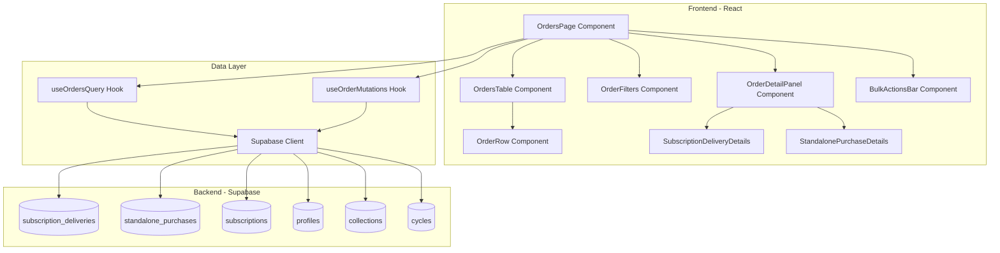
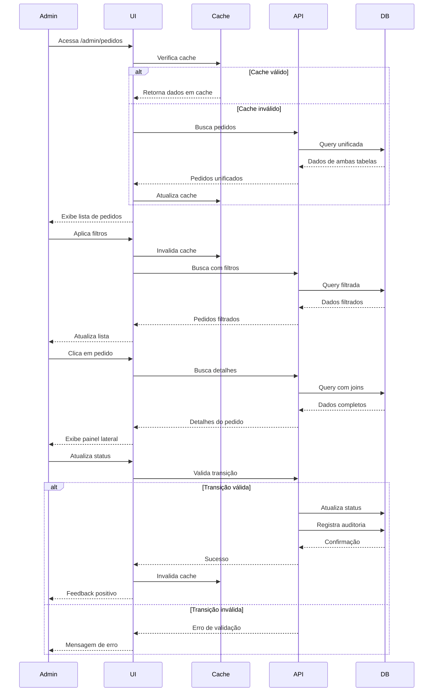
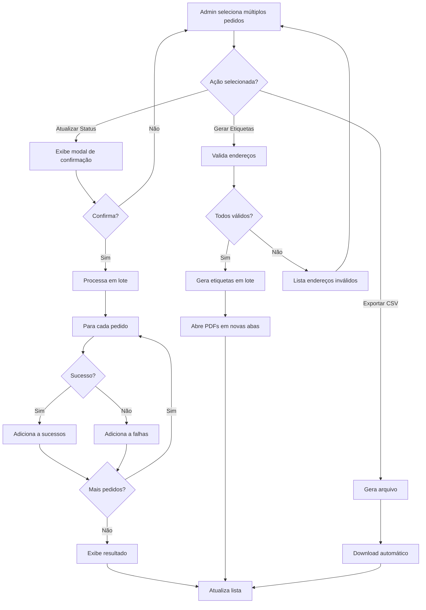
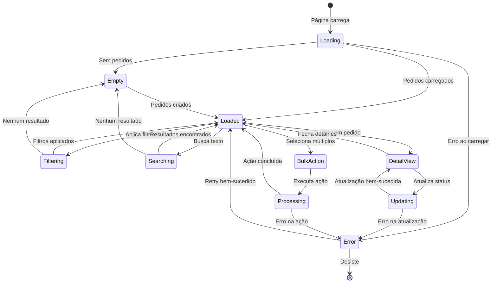

# Documento de Design - Página Consolidada de Pedidos

## Overview

Este documento descreve o design técnico para a consolidação das três páginas administrativas existentes (`/admin/assinaturas`, `/admin/entregas`, `/admin/compras-avulsas`) em uma única página unificada `/admin/pedidos`. A solução elimina redundância de código, melhora a experiência do usuário e fornece uma visão holística de todos os pedidos do sistema.

### Objetivos

- Unificar visualização de entregas de assinaturas e compras avulsas
- Reduzir fragmentação e duplicação de código
- Melhorar performance com paginação server-side
- Manter compatibilidade com URLs antigas via redirecionamento
- Fornecer funcionalidades avançadas (filtros, busca, ações em massa, exportação)

### Escopo

**Incluído:**
- Página unificada `/admin/pedidos` com visualização de ambos os tipos de pedidos
- Sistema de filtros por tipo, status e data
- Busca por cliente, ID e código de rastreamento
- Painel de detalhes com informações completas
- Ações em massa (atualização de status, geração de etiquetas)
- Exportação CSV
- Redirecionamentos das URLs antigas

**Não Incluído:**
- Modificações no schema do banco de dados
- Novas funcionalidades de pagamento
- Alterações no fluxo de criação de pedidos
- Modificações nas APIs existentes


## Architecture

### Arquitetura de Alto Nível



### Camadas da Aplicação

1. **Camada de Apresentação (UI Components)**
   - Componentes React responsáveis pela renderização
   - Gerenciamento de estado local (filtros, seleções, modais)
   - Feedback visual e interações do usuário

2. **Camada de Lógica de Negócio (Hooks & Services)**
   - Custom hooks para data fetching (TanStack Query)
   - Transformação e normalização de dados
   - Validações e regras de negócio

3. **Camada de Dados (Supabase)**
   - Queries otimizadas com joins
   - Paginação server-side
   - Row Level Security (RLS)


## Components and Interfaces

### Estrutura de Componentes

```
src/pages/admin/
  └── OrdersPage.tsx                    # Página principal consolidada

src/components/admin/orders/
  ├── OrdersTable.tsx                   # Tabela de pedidos
  ├── OrderRow.tsx                      # Linha individual da tabela
  ├── OrderFilters.tsx                  # Controles de filtro
  ├── OrderSearchBar.tsx                # Barra de busca
  ├── OrderDetailPanel.tsx              # Painel lateral de detalhes
  ├── SubscriptionDeliveryDetails.tsx   # Detalhes de entrega de assinatura
  ├── StandalonePurchaseDetails.tsx     # Detalhes de compra avulsa
  ├── BulkActionsBar.tsx                # Barra de ações em massa
  ├── OrderStatusBadge.tsx              # Badge de status
  └── OrderTypeIndicator.tsx            # Indicador de tipo de pedido

src/hooks/admin/
  ├── useOrdersQuery.ts                 # Hook para buscar pedidos
  ├── useOrderMutations.ts              # Hook para mutações
  └── useOrderFilters.ts                # Hook para gerenciar filtros

src/services/admin/
  └── orders-service.ts                 # Serviço de pedidos
```

### Interfaces TypeScript

```typescript
// Tipo unificado de pedido
export type UnifiedOrder = {
  id: string;
  type: 'subscription_delivery' | 'standalone_purchase';
  status: OrderStatus;
  createdAt: string;
  updatedAt: string;
  
  // Dados do cliente
  customer: {
    id: string;
    name: string;
    email: string;
  };
  
  // Dados do produto/coleção
  collection: {
    id: string;
    name: string;
    slug: string;
  };
  
  // Dados financeiros
  amount: number;
  
  // Dados de entrega
  trackingCode: string | null;
  expectedDeliveryDate: string | null;
  actualDeliveryDate: string | null;
  
  // Dados específicos por tipo
  subscriptionDelivery?: SubscriptionDeliveryData;
  standalonePurchase?: StandalonePurchaseData;
};

// Dados específicos de entrega de assinatura
export interface SubscriptionDeliveryData {
  subscriptionId: string;
  deliveryNumber: number;
  cycleId: string | null;
  characterId: string | null;
  revealDate: string | null;
  
  // Dados relacionados
  subscription?: {
    id: string;
    planType: string;
    deliveriesCompleted: number;
    deliveriesTotal: number;
    status: string;
  };
  
  cycle?: {
    id: string;
    cycleNumber: number;
    month: number;
    year: number;
  };
  
  character?: {
    id: string;
    name: string;
    imageUrl: string | null;
  };
}

// Dados específicos de compra avulsa
export interface StandalonePurchaseData {
  cycleId: string;
  characterId: string | null;
  priceDeposit: number;
  priceBalance: number;
  priceFull: number;
  depositPaidAt: string | null;
  balancePaidAt: string | null;
  balanceDueDate: string | null;
  depositVoucherUrl: string | null;
  balanceVoucherUrl: string | null;
  
  // Dados relacionados
  cycle?: {
    id: string;
    cycleNumber: number;
    month: number;
    year: number;
  };
  
  character?: {
    id: string;
    name: string;
    imageUrl: string | null;
  };
}

// Status possíveis de pedidos
export type OrderStatus = 
  // Status de entregas de assinatura
  | 'scheduled'
  | 'pending_choice'
  | 'confirmed'
  | 'in_production'
  | 'shipped'
  | 'delivered'
  | 'revealed'
  | 'cancelled'
  // Status de compras avulsas
  | 'awaiting_deposit'
  | 'deposit_paid'
  | 'awaiting_balance'
  | 'balance_paid'
  | 'completed';

// Filtros de pedidos
export interface OrderFilters {
  type: 'all' | 'subscription_delivery' | 'standalone_purchase';
  status: OrderStatus[];
  dateFrom: string | null;
  dateTo: string | null;
  searchQuery: string;
}

// Parâmetros de paginação
export interface PaginationParams {
  page: number;
  pageSize: number;
}

// Resposta paginada
export interface PaginatedResponse<T> {
  data: T[];
  total: number;
  page: number;
  pageSize: number;
  totalPages: number;
}

// Resultado de ação em massa
export interface BulkActionResult {
  successful: string[];
  failed: Array<{
    id: string;
    error: string;
  }>;
}
```


## Data Models

### Modelo de Dados Unificado

O sistema trabalha com duas tabelas principais que são unificadas em tempo de execução:

#### Tabela: subscription_deliveries

```sql
CREATE TABLE subscription_deliveries (
  id UUID PRIMARY KEY,
  subscription_id UUID NOT NULL REFERENCES subscriptions(id),
  delivery_number INTEGER NOT NULL,
  status TEXT NOT NULL,
  character_id UUID REFERENCES collection_characters(id),
  expected_delivery_date TIMESTAMPTZ,
  actual_delivery_date TIMESTAMPTZ,
  reveal_date TIMESTAMPTZ,
  tracking_code TEXT,
  created_at TIMESTAMPTZ DEFAULT NOW(),
  updated_at TIMESTAMPTZ DEFAULT NOW()
);
```

#### Tabela: standalone_purchases

```sql
CREATE TABLE standalone_purchases (
  id UUID PRIMARY KEY,
  user_id UUID NOT NULL REFERENCES profiles(id),
  collection_id UUID NOT NULL REFERENCES collections(id),
  cycle_id UUID NOT NULL REFERENCES cycles(id),
  character_id UUID REFERENCES collection_characters(id),
  status TEXT NOT NULL,
  price_deposit DECIMAL(10,2) NOT NULL,
  price_balance DECIMAL(10,2) NOT NULL,
  price_full DECIMAL(10,2) NOT NULL,
  deposit_paid_at TIMESTAMPTZ,
  balance_paid_at TIMESTAMPTZ,
  balance_due_date TIMESTAMPTZ,
  deposit_voucher_url TEXT,
  balance_voucher_url TEXT,
  tracking_code TEXT,
  expected_delivery_date TIMESTAMPTZ,
  actual_delivery_date TIMESTAMPTZ,
  created_at TIMESTAMPTZ DEFAULT NOW(),
  updated_at TIMESTAMPTZ DEFAULT NOW()
);
```

### Queries Supabase

#### Query Principal: Buscar Pedidos Unificados

```typescript
async function fetchUnifiedOrders(
  filters: OrderFilters,
  pagination: PaginationParams
): Promise<PaginatedResponse<UnifiedOrder>> {
  const { page, pageSize } = pagination;
  const offset = (page - 1) * pageSize;
  
  // Buscar entregas de assinatura
  let deliveriesQuery = supabase
    .from('subscription_deliveries')
    .select(`
      id,
      status,
      delivery_number,
      tracking_code,
      expected_delivery_date,
      actual_delivery_date,
      reveal_date,
      created_at,
      updated_at,
      subscription_id,
      character_id,
      subscriptions!inner (
        id,
        user_id,
        collection_id,
        plan_type,
        deliveries_completed,
        deliveries_total,
        status,
        collections (
          id,
          name,
          slug
        )
      ),
      collection_characters (
        id,
        name,
        image_url
      )
    `, { count: 'exact' });
  
  // Buscar compras avulsas
  let purchasesQuery = supabase
    .from('standalone_purchases')
    .select(`
      id,
      status,
      user_id,
      collection_id,
      cycle_id,
      character_id,
      price_deposit,
      price_balance,
      price_full,
      deposit_paid_at,
      balance_paid_at,
      balance_due_date,
      tracking_code,
      expected_delivery_date,
      actual_delivery_date,
      created_at,
      updated_at,
      collections (
        id,
        name,
        slug
      ),
      cycles (
        id,
        cycle_number,
        month,
        year
      ),
      collection_characters (
        id,
        name,
        image_url
      )
    `, { count: 'exact' });
  
  // Aplicar filtros de tipo
  if (filters.type === 'subscription_delivery') {
    purchasesQuery = null;
  } else if (filters.type === 'standalone_purchase') {
    deliveriesQuery = null;
  }
  
  // Aplicar filtros de status
  if (filters.status.length > 0) {
    if (deliveriesQuery) {
      deliveriesQuery = deliveriesQuery.in('status', filters.status);
    }
    if (purchasesQuery) {
      purchasesQuery = purchasesQuery.in('status', filters.status);
    }
  }
  
  // Aplicar filtros de data
  if (filters.dateFrom) {
    if (deliveriesQuery) {
      deliveriesQuery = deliveriesQuery.gte('created_at', filters.dateFrom);
    }
    if (purchasesQuery) {
      purchasesQuery = purchasesQuery.gte('created_at', filters.dateFrom);
    }
  }
  
  if (filters.dateTo) {
    if (deliveriesQuery) {
      deliveriesQuery = deliveriesQuery.lte('created_at', filters.dateTo);
    }
    if (purchasesQuery) {
      purchasesQuery = purchasesQuery.lte('created_at', filters.dateTo);
    }
  }
  
  // Executar queries em paralelo
  const [deliveriesResult, purchasesResult, profilesResult] = await Promise.all([
    deliveriesQuery ? deliveriesQuery : Promise.resolve({ data: [], count: 0 }),
    purchasesQuery ? purchasesQuery : Promise.resolve({ data: [], count: 0 }),
    // Buscar profiles para ambos os tipos
    supabase.from('profiles').select('id, full_name, email')
  ]);
  
  // Transformar e unificar dados
  const unifiedOrders = [
    ...transformDeliveries(deliveriesResult.data, profilesResult.data),
    ...transformPurchases(purchasesResult.data, profilesResult.data)
  ];
  
  // Aplicar busca em memória (ou usar full-text search do Postgres)
  let filteredOrders = unifiedOrders;
  if (filters.searchQuery) {
    const query = filters.searchQuery.toLowerCase();
    filteredOrders = unifiedOrders.filter(order =>
      order.customer.name.toLowerCase().includes(query) ||
      order.customer.email.toLowerCase().includes(query) ||
      order.id.toLowerCase().includes(query) ||
      (order.trackingCode && order.trackingCode.toLowerCase().includes(query))
    );
  }
  
  // Ordenar por data de criação (mais recente primeiro)
  filteredOrders.sort((a, b) => 
    new Date(b.createdAt).getTime() - new Date(a.createdAt).getTime()
  );
  
  // Aplicar paginação
  const paginatedOrders = filteredOrders.slice(offset, offset + pageSize);
  
  return {
    data: paginatedOrders,
    total: filteredOrders.length,
    page,
    pageSize,
    totalPages: Math.ceil(filteredOrders.length / pageSize)
  };
}
```

#### Funções de Transformação

```typescript
function transformDeliveries(
  deliveries: any[],
  profiles: any[]
): UnifiedOrder[] {
  const profilesMap = new Map(profiles.map(p => [p.id, p]));
  
  return deliveries.map(delivery => {
    const profile = profilesMap.get(delivery.subscriptions.user_id);
    
    return {
      id: delivery.id,
      type: 'subscription_delivery' as const,
      status: delivery.status,
      createdAt: delivery.created_at,
      updatedAt: delivery.updated_at,
      customer: {
        id: delivery.subscriptions.user_id,
        name: profile?.full_name || 'Nome não disponível',
        email: profile?.email || 'Email não disponível'
      },
      collection: {
        id: delivery.subscriptions.collection_id,
        name: delivery.subscriptions.collections.name,
        slug: delivery.subscriptions.collections.slug
      },
      amount: 0, // Calculado a partir da assinatura
      trackingCode: delivery.tracking_code,
      expectedDeliveryDate: delivery.expected_delivery_date,
      actualDeliveryDate: delivery.actual_delivery_date,
      subscriptionDelivery: {
        subscriptionId: delivery.subscription_id,
        deliveryNumber: delivery.delivery_number,
        cycleId: null,
        characterId: delivery.character_id,
        revealDate: delivery.reveal_date,
        subscription: {
          id: delivery.subscriptions.id,
          planType: delivery.subscriptions.plan_type,
          deliveriesCompleted: delivery.subscriptions.deliveries_completed,
          deliveriesTotal: delivery.subscriptions.deliveries_total,
          status: delivery.subscriptions.status
        },
        character: delivery.collection_characters ? {
          id: delivery.collection_characters.id,
          name: delivery.collection_characters.name,
          imageUrl: delivery.collection_characters.image_url
        } : undefined
      }
    };
  });
}

function transformPurchases(
  purchases: any[],
  profiles: any[]
): UnifiedOrder[] {
  const profilesMap = new Map(profiles.map(p => [p.id, p]));
  
  return purchases.map(purchase => {
    const profile = profilesMap.get(purchase.user_id);
    
    return {
      id: purchase.id,
      type: 'standalone_purchase' as const,
      status: purchase.status,
      createdAt: purchase.created_at,
      updatedAt: purchase.updated_at,
      customer: {
        id: purchase.user_id,
        name: profile?.full_name || 'Nome não disponível',
        email: profile?.email || 'Email não disponível'
      },
      collection: {
        id: purchase.collection_id,
        name: purchase.collections.name,
        slug: purchase.collections.slug
      },
      amount: purchase.price_full,
      trackingCode: purchase.tracking_code,
      expectedDeliveryDate: purchase.expected_delivery_date,
      actualDeliveryDate: purchase.actual_delivery_date,
      standalonePurchase: {
        cycleId: purchase.cycle_id,
        characterId: purchase.character_id,
        priceDeposit: purchase.price_deposit,
        priceBalance: purchase.price_balance,
        priceFull: purchase.price_full,
        depositPaidAt: purchase.deposit_paid_at,
        balancePaidAt: purchase.balance_paid_at,
        balanceDueDate: purchase.balance_due_date,
        depositVoucherUrl: purchase.deposit_voucher_url,
        balanceVoucherUrl: purchase.balance_voucher_url,
        cycle: purchase.cycles ? {
          id: purchase.cycles.id,
          cycleNumber: purchase.cycles.cycle_number,
          month: purchase.cycles.month,
          year: purchase.cycles.year
        } : undefined,
        character: purchase.collection_characters ? {
          id: purchase.collection_characters.id,
          name: purchase.collection_characters.name,
          imageUrl: purchase.collection_characters.image_url
        } : undefined
      }
    };
  });
}
```


## Correctness Properties

*A property is a characteristic or behavior that should hold true across all valid executions of a system-essentially, a formal statement about what the system should do. Properties serve as the bridge between human-readable specifications and machine-verifiable correctness guarantees.*

### Property 1: Unified List Contains Both Types

*For any* set of subscription deliveries and standalone purchases in the database, the unified orders list should contain entries from both tables when the "all" filter is selected.

**Validates: Requirements 1.1, 2.4**

### Property 2: Required Fields Present

*For any* order displayed in the list, the rendered output should contain order type, ID, customer name, status, creation date, and amount.

**Validates: Requirements 1.2**

### Property 3: Default Sort Order

*For any* list of orders, the orders should be sorted by creation date in descending order (most recent first) when no custom sort is applied.

**Validates: Requirements 1.3**

### Property 4: Pagination Limit

*For any* page of results, the number of orders returned should not exceed the configured page size (minimum 20).

**Validates: Requirements 1.4, 11.4**

### Property 5: Type Filter - Subscription Deliveries Only

*For any* dataset containing both types of orders, when the "Entregas de Assinatura" filter is selected, all returned orders should have type 'subscription_delivery'.

**Validates: Requirements 2.2**

### Property 6: Type Filter - Standalone Purchases Only

*For any* dataset containing both types of orders, when the "Compras Avulsas" filter is selected, all returned orders should have type 'standalone_purchase'.

**Validates: Requirements 2.3**

### Property 7: Filter State Persistence

*For any* filter selection, navigating between pages should maintain the same filter state.

**Validates: Requirements 2.5**

### Property 8: Status Filter Correctness

*For any* selected status and dataset, all returned orders should have a status matching one of the selected status values.

**Validates: Requirements 3.2**

### Property 9: Multiple Status Selection

*For any* set of selected statuses, the results should include orders matching any of the selected statuses (OR logic).

**Validates: Requirements 3.3**

### Property 10: Status Count Accuracy

*For any* dataset of orders, the count displayed for each status should equal the number of orders with that status.

**Validates: Requirements 3.4**

### Property 11: Search Across Fields

*For any* search query, the results should include orders where the query matches customer name, customer email, order ID, or tracking code.

**Validates: Requirements 4.2**

### Property 12: Subscription Delivery Details Completeness

*For any* subscription delivery order, the detail panel should display subscription information, cycle information, collection information, and customer data.

**Validates: Requirements 5.2, 10.1, 10.2, 10.3, 10.4**

### Property 13: Standalone Purchase Details Completeness

*For any* standalone purchase order, the detail panel should display product information, quantity, amount, and customer data.

**Validates: Requirements 5.3, 10.2, 10.3**

### Property 14: Status History Completeness

*For any* order with status changes, the history should include timestamp and admin ID for each change.

**Validates: Requirements 5.4**

### Property 15: Tracking Link Generation

*For any* order with a tracking code, the detail panel should include a clickable link to external tracking.

**Validates: Requirements 5.5**

### Property 16: Status Transition Validation

*For any* status change request, if the transition is invalid according to business rules, the system should reject it with an error message.

**Validates: Requirements 6.2, 6.3**

### Property 17: Status Update Persistence

*For any* valid status transition, the new status should be saved with current timestamp and admin ID.

**Validates: Requirements 6.4, 12.3, 12.4**

### Property 18: Bulk Action Success Tracking

*For any* bulk action on multiple orders, the result should accurately report which orders succeeded and which failed with specific error messages.

**Validates: Requirements 7.5, 15.3**

### Property 19: Label Generation Address Validation

*For any* order selected for label generation, if the delivery address is incomplete, the system should reject the request and identify missing fields.

**Validates: Requirements 8.3, 8.4**

### Property 20: CSV Export Filtered Data

*For any* active filter configuration, the exported CSV should contain only the orders matching the current filters.

**Validates: Requirements 9.2**

### Property 21: CSV Export Column Completeness

*For any* exported CSV file, it should include columns for ID, type, customer, status, date, amount, and tracking code.

**Validates: Requirements 9.3**

### Property 22: CSV Filename Format

*For any* CSV export, the filename should follow the format `pedidos_YYYYMMDD_HHMMSS.csv` with current timestamp.

**Validates: Requirements 9.5**

### Property 23: Single Query Optimization

*For any* page load, the system should fetch all related data (subscriptions, profiles, collections, cycles) in a single database operation using joins.

**Validates: Requirements 10.5**

### Property 24: Server-Side Pagination

*For any* large dataset, the system should implement server-side pagination to limit data transfer.

**Validates: Requirements 11.2**

### Property 25: Admin Permission Check

*For any* user accessing the orders page, if they lack admin permissions, they should be redirected to an access denied page.

**Validates: Requirements 12.1, 12.2**

### Property 26: Input Sanitization

*For any* search or filter input, the system should sanitize the input to prevent SQL injection attacks.

**Validates: Requirements 12.5**

### Property 27: URL Redirection with Filters

*For any* access to legacy URLs (`/admin/assinaturas`, `/admin/entregas`, `/admin/compras-avulsas`), the system should redirect to `/admin/pedidos` with appropriate filters applied.

**Validates: Requirements 14.1, 14.2**

### Property 28: Error Logging Completeness

*For any* error that occurs, the system should log the error with full stack trace to the logging system.

**Validates: Requirements 15.4**

### Property 29: Partial Failure Resilience

*For any* operation that partially fails, the UI should remain functional and display appropriate error messages without crashing.

**Validates: Requirements 15.5**


## Error Handling

### Estratégia de Tratamento de Erros

O sistema implementa uma abordagem em camadas para tratamento de erros:

1. **Camada de Validação**: Validação de inputs antes de enviar ao servidor
2. **Camada de Rede**: Tratamento de erros de conexão e timeout
3. **Camada de Negócio**: Validação de regras de negócio
4. **Camada de UI**: Feedback visual apropriado ao usuário

### Tipos de Erros

#### 1. Erros de Conexão

```typescript
interface ConnectionError {
  type: 'connection_error';
  message: string;
  retryable: boolean;
}

// Tratamento
try {
  const orders = await fetchOrders();
} catch (error) {
  if (isConnectionError(error)) {
    toast({
      title: 'Erro ao carregar pedidos',
      description: 'Verifique sua conexão e tente novamente.',
      variant: 'destructive',
      action: <Button onClick={retry}>Tentar Novamente</Button>
    });
  }
}
```

#### 2. Erros de Validação

```typescript
interface ValidationError {
  type: 'validation_error';
  field: string;
  message: string;
}

// Exemplo: Transição de status inválida
function validateStatusTransition(
  currentStatus: OrderStatus,
  newStatus: OrderStatus
): ValidationError | null {
  const validTransitions: Record<OrderStatus, OrderStatus[]> = {
    'scheduled': ['pending_choice', 'cancelled'],
    'pending_choice': ['confirmed', 'cancelled'],
    'confirmed': ['in_production', 'cancelled'],
    'in_production': ['shipped', 'cancelled'],
    'shipped': ['delivered'],
    'delivered': [],
    // ... outros status
  };
  
  if (!validTransitions[currentStatus]?.includes(newStatus)) {
    return {
      type: 'validation_error',
      field: 'status',
      message: `Transição de ${currentStatus} para ${newStatus} não é permitida`
    };
  }
  
  return null;
}
```

#### 3. Erros de Permissão

```typescript
interface PermissionError {
  type: 'permission_error';
  requiredPermission: string;
  message: string;
}

// Middleware de verificação
async function checkAdminPermission(userId: string): Promise<boolean> {
  const { data: profile } = await supabase
    .from('profiles')
    .select('role')
    .eq('id', userId)
    .single();
  
  return profile?.role === 'admin';
}

// Uso no componente
useEffect(() => {
  const checkPermissions = async () => {
    const hasPermission = await checkAdminPermission(user.id);
    if (!hasPermission) {
      navigate('/access-denied');
    }
  };
  
  checkPermissions();
}, [user.id]);
```

#### 4. Erros de Ações em Massa

```typescript
interface BulkActionError {
  orderId: string;
  error: string;
  retryable: boolean;
}

async function bulkUpdateStatus(
  orderIds: string[],
  newStatus: OrderStatus
): Promise<BulkActionResult> {
  const results: BulkActionResult = {
    successful: [],
    failed: []
  };
  
  for (const orderId of orderIds) {
    try {
      await updateOrderStatus(orderId, newStatus);
      results.successful.push(orderId);
    } catch (error) {
      results.failed.push({
        id: orderId,
        error: error.message
      });
    }
  }
  
  // Exibir resultado
  if (results.failed.length > 0) {
    toast({
      title: 'Ação em massa concluída com erros',
      description: `${results.successful.length} sucesso(s), ${results.failed.length} falha(s)`,
      variant: 'default'
    });
    
    // Mostrar detalhes dos erros
    console.error('Failed orders:', results.failed);
  } else {
    toast({
      title: 'Ação em massa concluída',
      description: `${results.successful.length} pedido(s) atualizado(s)`,
      variant: 'default'
    });
  }
  
  return results;
}
```

### Logging de Erros

```typescript
interface ErrorLog {
  timestamp: string;
  userId: string;
  action: string;
  error: Error;
  context: Record<string, any>;
}

function logError(
  action: string,
  error: Error,
  context: Record<string, any> = {}
): void {
  const errorLog: ErrorLog = {
    timestamp: new Date().toISOString(),
    userId: getCurrentUserId(),
    action,
    error: {
      name: error.name,
      message: error.message,
      stack: error.stack
    },
    context
  };
  
  // Enviar para serviço de logging (ex: Sentry, LogRocket)
  console.error('[ERROR]', errorLog);
  
  // Opcional: Salvar no banco de dados
  supabase.from('error_logs').insert(errorLog);
}
```

### Mensagens de Erro Amigáveis

```typescript
const ERROR_MESSAGES: Record<string, string> = {
  'connection_error': 'Erro ao carregar pedidos. Tente novamente.',
  'timeout_error': 'A operação demorou muito. Tente novamente.',
  'permission_denied': 'Você não tem permissão para realizar esta ação.',
  'invalid_status_transition': 'Esta mudança de status não é permitida.',
  'incomplete_address': 'Endereço de entrega incompleto. Verifique os campos obrigatórios.',
  'bulk_action_partial_failure': 'Alguns pedidos não puderam ser atualizados. Verifique os detalhes.',
  'export_failed': 'Erro ao exportar dados. Tente novamente.',
  'label_generation_failed': 'Erro ao gerar etiqueta. Verifique os dados do pedido.'
};

function getErrorMessage(errorType: string): string {
  return ERROR_MESSAGES[errorType] || 'Ocorreu um erro inesperado.';
}
```


## Testing Strategy

### Abordagem Dual de Testes

O sistema utiliza uma combinação de testes unitários e testes baseados em propriedades para garantir cobertura abrangente:

- **Testes Unitários**: Verificam exemplos específicos, casos extremos e condições de erro
- **Testes de Propriedade**: Verificam propriedades universais através de múltiplas entradas geradas aleatoriamente

### Configuração de Testes de Propriedade

**Biblioteca**: fast-check (para TypeScript/JavaScript)

**Configuração Mínima**: 100 iterações por teste de propriedade

**Formato de Tag**: `Feature: orders-consolidation-page, Property {number}: {property_text}`

### Exemplos de Testes

#### Teste de Propriedade 1: Lista Unificada

```typescript
import fc from 'fast-check';
import { describe, it, expect } from 'vitest';

/**
 * Feature: orders-consolidation-page, Property 1: Unified List Contains Both Types
 * 
 * For any set of subscription deliveries and standalone purchases in the database,
 * the unified orders list should contain entries from both tables when the "all" filter is selected.
 */
describe('Property 1: Unified List Contains Both Types', () => {
  it('should include both subscription deliveries and standalone purchases', async () => {
    await fc.assert(
      fc.asyncProperty(
        fc.array(subscriptionDeliveryArbitrary(), { minLength: 1, maxLength: 10 }),
        fc.array(standalonePurchaseArbitrary(), { minLength: 1, maxLength: 10 }),
        async (deliveries, purchases) => {
          // Setup: Insert test data
          await insertTestDeliveries(deliveries);
          await insertTestPurchases(purchases);
          
          // Execute: Fetch unified orders with "all" filter
          const result = await fetchUnifiedOrders(
            { type: 'all', status: [], dateFrom: null, dateTo: null, searchQuery: '' },
            { page: 1, pageSize: 100 }
          );
          
          // Verify: Both types are present
          const hasDeliveries = result.data.some(o => o.type === 'subscription_delivery');
          const hasPurchases = result.data.some(o => o.type === 'standalone_purchase');
          
          expect(hasDeliveries).toBe(true);
          expect(hasPurchases).toBe(true);
          expect(result.data.length).toBe(deliveries.length + purchases.length);
          
          // Cleanup
          await cleanupTestData();
        }
      ),
      { numRuns: 100 }
    );
  });
});

// Arbitrary generators
function subscriptionDeliveryArbitrary() {
  return fc.record({
    id: fc.uuid(),
    subscription_id: fc.uuid(),
    delivery_number: fc.integer({ min: 1, max: 12 }),
    status: fc.constantFrom('scheduled', 'confirmed', 'shipped', 'delivered'),
    created_at: fc.date(),
    tracking_code: fc.option(fc.string({ minLength: 10, maxLength: 20 }))
  });
}

function standalonePurchaseArbitrary() {
  return fc.record({
    id: fc.uuid(),
    user_id: fc.uuid(),
    collection_id: fc.uuid(),
    cycle_id: fc.uuid(),
    status: fc.constantFrom('awaiting_deposit', 'deposit_paid', 'balance_paid'),
    price_full: fc.float({ min: 50, max: 500 }),
    created_at: fc.date()
  });
}
```

#### Teste de Propriedade 8: Filtro de Status

```typescript
/**
 * Feature: orders-consolidation-page, Property 8: Status Filter Correctness
 * 
 * For any selected status and dataset, all returned orders should have
 * a status matching one of the selected status values.
 */
describe('Property 8: Status Filter Correctness', () => {
  it('should return only orders with selected status', async () => {
    await fc.assert(
      fc.asyncProperty(
        fc.array(unifiedOrderArbitrary(), { minLength: 10, maxLength: 50 }),
        fc.array(
          fc.constantFrom<OrderStatus>(
            'scheduled', 'confirmed', 'shipped', 'delivered',
            'awaiting_deposit', 'deposit_paid', 'balance_paid'
          ),
          { minLength: 1, maxLength: 3 }
        ),
        async (orders, selectedStatuses) => {
          // Setup
          await insertTestOrders(orders);
          
          // Execute
          const result = await fetchUnifiedOrders(
            {
              type: 'all',
              status: selectedStatuses,
              dateFrom: null,
              dateTo: null,
              searchQuery: ''
            },
            { page: 1, pageSize: 100 }
          );
          
          // Verify: All returned orders have one of the selected statuses
          const allMatchStatus = result.data.every(order =>
            selectedStatuses.includes(order.status)
          );
          
          expect(allMatchStatus).toBe(true);
          
          // Cleanup
          await cleanupTestData();
        }
      ),
      { numRuns: 100 }
    );
  });
});
```

#### Teste de Propriedade 11: Busca em Múltiplos Campos

```typescript
/**
 * Feature: orders-consolidation-page, Property 11: Search Across Fields
 * 
 * For any search query, the results should include orders where the query
 * matches customer name, customer email, order ID, or tracking code.
 */
describe('Property 11: Search Across Fields', () => {
  it('should find orders by any searchable field', async () => {
    await fc.assert(
      fc.asyncProperty(
        fc.array(unifiedOrderArbitrary(), { minLength: 20, maxLength: 50 }),
        fc.constantFrom('name', 'email', 'id', 'tracking'),
        async (orders, searchField) => {
          // Setup
          await insertTestOrders(orders);
          
          // Pick a random order and extract search term based on field
          const targetOrder = orders[Math.floor(Math.random() * orders.length)];
          let searchQuery: string;
          
          switch (searchField) {
            case 'name':
              searchQuery = targetOrder.customer.name.substring(0, 5);
              break;
            case 'email':
              searchQuery = targetOrder.customer.email.split('@')[0];
              break;
            case 'id':
              searchQuery = targetOrder.id.substring(0, 8);
              break;
            case 'tracking':
              searchQuery = targetOrder.trackingCode?.substring(0, 6) || '';
              break;
          }
          
          // Execute
          const result = await fetchUnifiedOrders(
            {
              type: 'all',
              status: [],
              dateFrom: null,
              dateTo: null,
              searchQuery
            },
            { page: 1, pageSize: 100 }
          );
          
          // Verify: Target order is in results
          const foundTarget = result.data.some(o => o.id === targetOrder.id);
          expect(foundTarget).toBe(true);
          
          // Cleanup
          await cleanupTestData();
        }
      ),
      { numRuns: 100 }
    );
  });
});
```

#### Teste Unitário: Validação de Transição de Status

```typescript
describe('Status Transition Validation', () => {
  it('should reject invalid status transitions', () => {
    const invalidTransitions = [
      { from: 'delivered', to: 'shipped' },
      { from: 'cancelled', to: 'confirmed' },
      { from: 'scheduled', to: 'delivered' }
    ];
    
    invalidTransitions.forEach(({ from, to }) => {
      const error = validateStatusTransition(from as OrderStatus, to as OrderStatus);
      expect(error).not.toBeNull();
      expect(error?.type).toBe('validation_error');
    });
  });
  
  it('should allow valid status transitions', () => {
    const validTransitions = [
      { from: 'scheduled', to: 'pending_choice' },
      { from: 'confirmed', to: 'in_production' },
      { from: 'shipped', to: 'delivered' }
    ];
    
    validTransitions.forEach(({ from, to }) => {
      const error = validateStatusTransition(from as OrderStatus, to as OrderStatus);
      expect(error).toBeNull();
    });
  });
});
```

#### Teste Unitário: Exportação CSV

```typescript
describe('CSV Export', () => {
  it('should export only filtered orders', async () => {
    // Setup: Create mixed dataset
    const deliveries = createTestDeliveries(10);
    const purchases = createTestPurchases(10);
    await insertTestOrders([...deliveries, ...purchases]);
    
    // Execute: Export with filter
    const csvData = await exportOrdersToCSV({
      type: 'subscription_delivery',
      status: [],
      dateFrom: null,
      dateTo: null,
      searchQuery: ''
    });
    
    // Verify: Only deliveries in CSV
    const rows = csvData.split('\n');
    expect(rows.length).toBe(11); // 10 data rows + 1 header
    
    // Cleanup
    await cleanupTestData();
  });
  
  it('should include all required columns', async () => {
    const orders = createTestOrders(5);
    await insertTestOrders(orders);
    
    const csvData = await exportOrdersToCSV({
      type: 'all',
      status: [],
      dateFrom: null,
      dateTo: null,
      searchQuery: ''
    });
    
    const [header] = csvData.split('\n');
    const columns = header.split(',');
    
    expect(columns).toContain('ID');
    expect(columns).toContain('Tipo');
    expect(columns).toContain('Cliente');
    expect(columns).toContain('Status');
    expect(columns).toContain('Data');
    expect(columns).toContain('Valor');
    expect(columns).toContain('Rastreamento');
    
    await cleanupTestData();
  });
  
  it('should format filename with timestamp', () => {
    const filename = generateCSVFilename();
    const pattern = /^pedidos_\d{8}_\d{6}\.csv$/;
    
    expect(filename).toMatch(pattern);
  });
});
```

### Cobertura de Testes

**Meta de Cobertura**: 80% para código crítico

**Áreas Prioritárias**:
- Lógica de unificação de dados (90%+)
- Validações de negócio (90%+)
- Transformações de dados (85%+)
- Componentes de UI (70%+)

**Ferramentas**:
- Vitest para testes unitários e de integração
- fast-check para testes baseados em propriedades
- React Testing Library para testes de componentes
- MSW (Mock Service Worker) para mock de APIs


## Migration Strategy

### Estratégia de Migração das Páginas Antigas

A migração será feita de forma incremental para minimizar riscos e permitir rollback se necessário.

#### Fase 1: Criação da Nova Página (Paralela)

1. **Criar nova página `/admin/pedidos`** sem remover as antigas
2. **Implementar toda funcionalidade** conforme design
3. **Testar extensivamente** em ambiente de staging
4. **Adicionar feature flag** para controlar acesso

```typescript
// Feature flag configuration
const FEATURE_FLAGS = {
  UNIFIED_ORDERS_PAGE: process.env.VITE_ENABLE_UNIFIED_ORDERS === 'true'
};

// Conditional routing
function AdminRoutes() {
  return (
    <Routes>
      {FEATURE_FLAGS.UNIFIED_ORDERS_PAGE ? (
        <Route path="/admin/pedidos" element={<OrdersPage />} />
      ) : (
        <>
          <Route path="/admin/assinaturas" element={<AdminSubscriptions />} />
          <Route path="/admin/entregas" element={<DeliveryManagement />} />
          <Route path="/admin/compras-avulsas" element={<StandalonePurchases />} />
        </>
      )}
    </Routes>
  );
}
```

#### Fase 2: Redirecionamentos

Implementar redirecionamentos das URLs antigas para a nova página com filtros apropriados:

```typescript
// src/pages/admin/RedirectToOrders.tsx
import { useEffect } from 'react';
import { useNavigate } from 'react-router-dom';

interface RedirectConfig {
  path: string;
  filterType: 'subscription_delivery' | 'standalone_purchase' | 'all';
}

const REDIRECT_CONFIGS: Record<string, RedirectConfig> = {
  '/admin/assinaturas': {
    path: '/admin/pedidos',
    filterType: 'subscription_delivery'
  },
  '/admin/entregas': {
    path: '/admin/pedidos',
    filterType: 'subscription_delivery'
  },
  '/admin/compras-avulsas': {
    path: '/admin/pedidos',
    filterType: 'standalone_purchase'
  }
};

export function RedirectToOrders({ from }: { from: string }) {
  const navigate = useNavigate();
  
  useEffect(() => {
    const config = REDIRECT_CONFIGS[from];
    if (config) {
      const params = new URLSearchParams({
        type: config.filterType
      });
      navigate(`${config.path}?${params.toString()}`, { replace: true });
    }
  }, [from, navigate]);
  
  return (
    <div className="flex items-center justify-center min-h-screen">
      <div className="text-center">
        <p className="text-lg">Redirecionando...</p>
      </div>
    </div>
  );
}

// Atualizar rotas
<Routes>
  <Route path="/admin/pedidos" element={<OrdersPage />} />
  <Route path="/admin/assinaturas" element={<RedirectToOrders from="/admin/assinaturas" />} />
  <Route path="/admin/entregas" element={<RedirectToOrders from="/admin/entregas" />} />
  <Route path="/admin/compras-avulsas" element={<RedirectToOrders from="/admin/compras-avulsas" />} />
</Routes>
```

#### Fase 3: Período de Transição

1. **Manter ambas as versões** por 2 semanas
2. **Monitorar uso** das páginas antigas
3. **Coletar feedback** dos administradores
4. **Ajustar conforme necessário**

```typescript
// Analytics tracking
function trackPageUsage(page: string) {
  // Track which page is being used
  analytics.track('admin_page_view', {
    page,
    timestamp: new Date().toISOString(),
    userId: getCurrentUserId()
  });
}
```

#### Fase 4: Remoção das Páginas Antigas

Após período de transição bem-sucedido:

1. **Remover componentes antigos**:
   - `src/pages/admin/AdminSubscriptions.tsx`
   - `src/pages/admin/DeliveryManagement.tsx`
   - `src/pages/admin/StandalonePurchases.tsx`

2. **Remover componentes específicos não mais necessários**:
   - `src/components/admin/DeliveryDetailModal.tsx` (se não usado em outro lugar)
   - `src/components/admin/BulkUpdateModal.tsx` (se não usado em outro lugar)

3. **Atualizar navegação**:
   - Remover links para páginas antigas do menu admin
   - Atualizar breadcrumbs

4. **Atualizar documentação**:
   - Atualizar guias de usuário
   - Atualizar documentação técnica

### Checklist de Migração

- [ ] Nova página `/admin/pedidos` implementada e testada
- [ ] Testes unitários e de propriedade passando
- [ ] Feature flag configurada
- [ ] Redirecionamentos implementados
- [ ] Analytics configurado
- [ ] Período de transição iniciado (2 semanas)
- [ ] Feedback coletado e ajustes feitos
- [ ] Páginas antigas removidas
- [ ] Navegação atualizada
- [ ] Documentação atualizada
- [ ] Deploy em produção

### Rollback Plan

Se problemas críticos forem encontrados:

1. **Desabilitar feature flag** imediatamente
2. **Reverter para páginas antigas** via configuração
3. **Investigar e corrigir** problemas
4. **Re-testar** em staging
5. **Re-deploy** quando estável

```typescript
// Emergency rollback
if (CRITICAL_ERROR_DETECTED) {
  // Disable feature flag
  process.env.VITE_ENABLE_UNIFIED_ORDERS = 'false';
  
  // Log incident
  logger.error('Critical error in unified orders page, rolling back', {
    error: CRITICAL_ERROR_DETECTED,
    timestamp: new Date().toISOString()
  });
  
  // Notify team
  notifyTeam('Unified orders page rolled back due to critical error');
}
```


## Performance Considerations

### Otimizações de Performance

#### 1. Paginação Server-Side

```typescript
// Implementar paginação no nível do banco de dados
async function fetchOrdersWithPagination(
  filters: OrderFilters,
  pagination: PaginationParams
): Promise<PaginatedResponse<UnifiedOrder>> {
  const { page, pageSize } = pagination;
  const offset = (page - 1) * pageSize;
  
  // Usar .range() do Supabase para paginação eficiente
  const query = supabase
    .from('subscription_deliveries')
    .select('*', { count: 'exact' })
    .range(offset, offset + pageSize - 1);
  
  return query;
}
```

#### 2. Índices de Banco de Dados

```sql
-- Índices para melhorar performance de queries
CREATE INDEX idx_subscription_deliveries_status ON subscription_deliveries(status);
CREATE INDEX idx_subscription_deliveries_created_at ON subscription_deliveries(created_at DESC);
CREATE INDEX idx_subscription_deliveries_tracking_code ON subscription_deliveries(tracking_code);

CREATE INDEX idx_standalone_purchases_status ON standalone_purchases(status);
CREATE INDEX idx_standalone_purchases_created_at ON standalone_purchases(created_at DESC);
CREATE INDEX idx_standalone_purchases_user_id ON standalone_purchases(user_id);

-- Índice composto para filtros comuns
CREATE INDEX idx_subscription_deliveries_status_created 
  ON subscription_deliveries(status, created_at DESC);

-- Full-text search index para busca
CREATE INDEX idx_profiles_search ON profiles USING gin(
  to_tsvector('portuguese', coalesce(full_name, '') || ' ' || coalesce(email, ''))
);
```

#### 3. Caching com TanStack Query

```typescript
// Configuração de cache otimizada
const queryClient = new QueryClient({
  defaultOptions: {
    queries: {
      staleTime: 30000, // 30 segundos
      cacheTime: 300000, // 5 minutos
      refetchOnWindowFocus: false,
      retry: 2
    }
  }
});

// Hook com cache inteligente
function useOrdersQuery(filters: OrderFilters, pagination: PaginationParams) {
  return useQuery({
    queryKey: ['orders', filters, pagination],
    queryFn: () => fetchUnifiedOrders(filters, pagination),
    staleTime: 30000,
    // Prefetch próxima página
    onSuccess: (data) => {
      if (pagination.page < data.totalPages) {
        queryClient.prefetchQuery({
          queryKey: ['orders', filters, { ...pagination, page: pagination.page + 1 }],
          queryFn: () => fetchUnifiedOrders(filters, { ...pagination, page: pagination.page + 1 })
        });
      }
    }
  });
}
```

#### 4. Debounce em Busca

```typescript
import { useDebouncedValue } from '@/hooks/useDebouncedValue';

function OrderSearchBar() {
  const [searchInput, setSearchInput] = useState('');
  const debouncedSearch = useDebouncedValue(searchInput, 300);
  
  // Apenas busca após 300ms de inatividade
  useEffect(() => {
    if (debouncedSearch) {
      performSearch(debouncedSearch);
    }
  }, [debouncedSearch]);
  
  return (
    <Input
      value={searchInput}
      onChange={(e) => setSearchInput(e.target.value)}
      placeholder="Buscar pedidos..."
    />
  );
}
```

#### 5. Virtualização de Lista (Opcional)

Para datasets muito grandes, considerar virtualização:

```typescript
import { useVirtualizer } from '@tanstack/react-virtual';

function VirtualizedOrdersTable({ orders }: { orders: UnifiedOrder[] }) {
  const parentRef = useRef<HTMLDivElement>(null);
  
  const virtualizer = useVirtualizer({
    count: orders.length,
    getScrollElement: () => parentRef.current,
    estimateSize: () => 60, // Altura estimada de cada linha
    overscan: 5 // Renderizar 5 itens extras fora da viewport
  });
  
  return (
    <div ref={parentRef} style={{ height: '600px', overflow: 'auto' }}>
      <div style={{ height: `${virtualizer.getTotalSize()}px`, position: 'relative' }}>
        {virtualizer.getVirtualItems().map((virtualRow) => {
          const order = orders[virtualRow.index];
          return (
            <div
              key={order.id}
              style={{
                position: 'absolute',
                top: 0,
                left: 0,
                width: '100%',
                height: `${virtualRow.size}px`,
                transform: `translateY(${virtualRow.start}px)`
              }}
            >
              <OrderRow order={order} />
            </div>
          );
        })}
      </div>
    </div>
  );
}
```

#### 6. Lazy Loading de Componentes

```typescript
import { lazy, Suspense } from 'react';

// Lazy load componentes pesados
const OrderDetailPanel = lazy(() => import('./OrderDetailPanel'));
const BulkActionsBar = lazy(() => import('./BulkActionsBar'));

function OrdersPage() {
  return (
    <div>
      <OrdersTable />
      
      <Suspense fallback={<LoadingSpinner />}>
        {selectedOrder && <OrderDetailPanel order={selectedOrder} />}
      </Suspense>
      
      <Suspense fallback={null}>
        {selectedOrders.length > 0 && <BulkActionsBar orders={selectedOrders} />}
      </Suspense>
    </div>
  );
}
```

### Métricas de Performance

**Metas**:
- Tempo de carregamento inicial: < 2 segundos
- Tempo de aplicação de filtros: < 1 segundo
- Tempo de exportação CSV (1000 pedidos): < 5 segundos
- Tempo de ação em massa (100 pedidos): < 10 segundos

**Monitoramento**:
```typescript
// Performance monitoring
function measurePerformance(operation: string, fn: () => Promise<any>) {
  const start = performance.now();
  
  return fn().finally(() => {
    const duration = performance.now() - start;
    
    // Log performance metrics
    analytics.track('performance_metric', {
      operation,
      duration,
      timestamp: new Date().toISOString()
    });
    
    // Alert if too slow
    if (duration > PERFORMANCE_THRESHOLDS[operation]) {
      logger.warn(`Slow operation detected: ${operation} took ${duration}ms`);
    }
  });
}
```

## Security Considerations

### Medidas de Segurança

#### 1. Autenticação e Autorização

```typescript
// Middleware de autenticação
async function requireAdmin(req: Request, res: Response, next: NextFunction) {
  const { user } = await supabase.auth.getUser();
  
  if (!user) {
    return res.status(401).json({ error: 'Não autenticado' });
  }
  
  const { data: profile } = await supabase
    .from('profiles')
    .select('role')
    .eq('id', user.id)
    .single();
  
  if (profile?.role !== 'admin') {
    return res.status(403).json({ error: 'Acesso negado' });
  }
  
  next();
}

// Row Level Security (RLS) no Supabase
-- Apenas admins podem ver todos os pedidos
CREATE POLICY "Admins can view all orders"
  ON subscription_deliveries
  FOR SELECT
  USING (
    EXISTS (
      SELECT 1 FROM profiles
      WHERE profiles.id = auth.uid()
      AND profiles.role = 'admin'
    )
  );
```

#### 2. Sanitização de Inputs

```typescript
import DOMPurify from 'dompurify';

function sanitizeSearchInput(input: string): string {
  // Remove caracteres perigosos
  const sanitized = DOMPurify.sanitize(input, {
    ALLOWED_TAGS: [],
    ALLOWED_ATTR: []
  });
  
  // Remove SQL injection patterns
  const sqlPatterns = [
    /(\b(SELECT|INSERT|UPDATE|DELETE|DROP|CREATE|ALTER|EXEC|EXECUTE)\b)/gi,
    /(--|;|\/\*|\*\/)/g,
    /(\bOR\b.*=.*)/gi,
    /(\bAND\b.*=.*)/gi
  ];
  
  let cleaned = sanitized;
  sqlPatterns.forEach(pattern => {
    cleaned = cleaned.replace(pattern, '');
  });
  
  return cleaned.trim();
}

// Uso
const searchQuery = sanitizeSearchInput(userInput);
```

#### 3. Rate Limiting

```typescript
import { RateLimiter } from '@/lib/rate-limiter';

const searchRateLimiter = new RateLimiter({
  windowMs: 60000, // 1 minuto
  maxRequests: 30 // 30 requisições por minuto
});

async function handleSearch(userId: string, query: string) {
  const allowed = await searchRateLimiter.checkLimit(userId);
  
  if (!allowed) {
    throw new Error('Limite de busca excedido. Aguarde 1 minuto.');
  }
  
  return performSearch(query);
}
```

#### 4. Auditoria de Ações

```typescript
interface AuditLog {
  id: string;
  userId: string;
  action: string;
  resourceType: string;
  resourceId: string;
  changes: Record<string, any>;
  timestamp: string;
  ipAddress: string;
  userAgent: string;
}

async function logAuditAction(
  action: string,
  resourceType: string,
  resourceId: string,
  changes: Record<string, any>
): Promise<void> {
  const auditLog: AuditLog = {
    id: generateUUID(),
    userId: getCurrentUserId(),
    action,
    resourceType,
    resourceId,
    changes,
    timestamp: new Date().toISOString(),
    ipAddress: getClientIP(),
    userAgent: getUserAgent()
  };
  
  await supabase.from('audit_logs').insert(auditLog);
}

// Uso
async function updateOrderStatus(orderId: string, newStatus: OrderStatus) {
  const oldOrder = await getOrder(orderId);
  
  await supabase
    .from('subscription_deliveries')
    .update({ status: newStatus })
    .eq('id', orderId);
  
  await logAuditAction('update_status', 'order', orderId, {
    oldStatus: oldOrder.status,
    newStatus
  });
}
```

#### 5. Proteção contra CSRF

```typescript
// Usar tokens CSRF em todas as mutações
import { generateCSRFToken, validateCSRFToken } from '@/lib/csrf';

// No componente
function OrdersPage() {
  const [csrfToken] = useState(() => generateCSRFToken());
  
  const updateMutation = useMutation({
    mutationFn: async (data: UpdateOrderData) => {
      return fetch('/api/orders/update', {
        method: 'POST',
        headers: {
          'Content-Type': 'application/json',
          'X-CSRF-Token': csrfToken
        },
        body: JSON.stringify(data)
      });
    }
  });
}

// No servidor
app.post('/api/orders/update', async (req, res) => {
  const csrfToken = req.headers['x-csrf-token'];
  
  if (!validateCSRFToken(csrfToken)) {
    return res.status(403).json({ error: 'Token CSRF inválido' });
  }
  
  // Processar atualização
});
```

#### 6. Validação de Dados

```typescript
import { z } from 'zod';

// Schema de validação
const OrderFiltersSchema = z.object({
  type: z.enum(['all', 'subscription_delivery', 'standalone_purchase']),
  status: z.array(z.string()),
  dateFrom: z.string().datetime().nullable(),
  dateTo: z.string().datetime().nullable(),
  searchQuery: z.string().max(100)
});

const UpdateOrderStatusSchema = z.object({
  orderId: z.string().uuid(),
  newStatus: z.enum([
    'scheduled', 'pending_choice', 'confirmed',
    'in_production', 'shipped', 'delivered'
  ])
});

// Uso
function validateFilters(filters: unknown): OrderFilters {
  try {
    return OrderFiltersSchema.parse(filters);
  } catch (error) {
    throw new ValidationError('Filtros inválidos', error);
  }
}
```

### Checklist de Segurança

- [ ] Autenticação implementada (Supabase Auth)
- [ ] Autorização baseada em roles (RLS)
- [ ] Sanitização de todos os inputs
- [ ] Rate limiting em endpoints sensíveis
- [ ] Auditoria de ações administrativas
- [ ] Proteção CSRF
- [ ] Validação de dados com schemas
- [ ] HTTPS obrigatório em produção
- [ ] Secrets em variáveis de ambiente
- [ ] Logs de segurança configurados


## User Experience Flow

### Fluxo Principal de Uso



### Fluxo de Ações em Massa



### Estados da Interface



## Implementation Guidelines

### Estrutura de Pastas Recomendada

```
src/
├── pages/
│   └── admin/
│       └── OrdersPage.tsx                 # Página principal
│
├── components/
│   └── admin/
│       └── orders/
│           ├── OrdersTable.tsx            # Tabela principal
│           ├── OrderRow.tsx               # Linha da tabela
│           ├── OrderFilters.tsx           # Controles de filtro
│           ├── OrderSearchBar.tsx         # Barra de busca
│           ├── OrderDetailPanel.tsx       # Painel de detalhes
│           ├── SubscriptionDeliveryDetails.tsx
│           ├── StandalonePurchaseDetails.tsx
│           ├── BulkActionsBar.tsx         # Ações em massa
│           ├── OrderStatusBadge.tsx       # Badge de status
│           ├── OrderTypeIndicator.tsx     # Indicador de tipo
│           └── OrderExportButton.tsx      # Botão de exportação
│
├── hooks/
│   └── admin/
│       ├── useOrdersQuery.ts              # Query de pedidos
│       ├── useOrderMutations.ts           # Mutações
│       ├── useOrderFilters.ts             # Gerenciamento de filtros
│       └── useOrderSelection.ts           # Seleção múltipla
│
├── services/
│   └── admin/
│       ├── orders-service.ts              # Serviço principal
│       ├── orders-transformer.ts          # Transformação de dados
│       ├── orders-validator.ts            # Validações
│       └── orders-export.ts               # Exportação CSV
│
├── types/
│   └── admin/
│       └── orders.ts                      # Tipos TypeScript
│
└── lib/
    ├── rate-limiter.ts                    # Rate limiting
    ├── csrf.ts                            # Proteção CSRF
    └── sanitizer.ts                       # Sanitização de inputs
```

### Ordem de Implementação Recomendada

1. **Fase 1: Fundação** (1-2 dias)
   - [ ] Criar tipos TypeScript
   - [ ] Implementar serviço de dados básico
   - [ ] Configurar queries do Supabase
   - [ ] Criar hooks básicos

2. **Fase 2: UI Core** (2-3 dias)
   - [ ] Implementar OrdersPage
   - [ ] Criar OrdersTable
   - [ ] Implementar OrderRow
   - [ ] Adicionar paginação

3. **Fase 3: Filtros e Busca** (1-2 dias)
   - [ ] Implementar OrderFilters
   - [ ] Criar OrderSearchBar
   - [ ] Adicionar lógica de filtragem
   - [ ] Implementar debounce

4. **Fase 4: Detalhes** (2 dias)
   - [ ] Criar OrderDetailPanel
   - [ ] Implementar SubscriptionDeliveryDetails
   - [ ] Implementar StandalonePurchaseDetails
   - [ ] Adicionar histórico de status

5. **Fase 5: Ações** (2-3 dias)
   - [ ] Implementar atualização de status
   - [ ] Criar BulkActionsBar
   - [ ] Adicionar geração de etiquetas
   - [ ] Implementar exportação CSV

6. **Fase 6: Segurança** (1-2 dias)
   - [ ] Adicionar autenticação
   - [ ] Implementar autorização
   - [ ] Adicionar sanitização
   - [ ] Configurar rate limiting

7. **Fase 7: Testes** (2-3 dias)
   - [ ] Escrever testes unitários
   - [ ] Implementar testes de propriedade
   - [ ] Testes de integração
   - [ ] Testes E2E

8. **Fase 8: Migração** (1 dia)
   - [ ] Implementar redirecionamentos
   - [ ] Configurar feature flag
   - [ ] Atualizar navegação
   - [ ] Documentar mudanças

**Total Estimado**: 12-18 dias de desenvolvimento

### Boas Práticas

#### 1. Componentização

```typescript
// ✅ BOM: Componentes pequenos e focados
function OrderStatusBadge({ status }: { status: OrderStatus }) {
  const config = STATUS_CONFIG[status];
  return <Badge className={config.className}>{config.label}</Badge>;
}

// ❌ RUIM: Componente monolítico
function OrderRow({ order }) {
  // 500 linhas de código...
}
```

#### 2. Separação de Responsabilidades

```typescript
// ✅ BOM: Lógica separada da apresentação
function useOrdersLogic() {
  const [filters, setFilters] = useState<OrderFilters>(DEFAULT_FILTERS);
  const { data, isLoading } = useOrdersQuery(filters);
  
  return { filters, setFilters, orders: data, isLoading };
}

function OrdersPage() {
  const { filters, setFilters, orders, isLoading } = useOrdersLogic();
  return <OrdersTable orders={orders} isLoading={isLoading} />;
}

// ❌ RUIM: Tudo misturado
function OrdersPage() {
  // Lógica + UI + queries tudo junto
}
```

#### 3. Tratamento de Erros

```typescript
// ✅ BOM: Tratamento específico por tipo de erro
try {
  await updateOrderStatus(orderId, newStatus);
} catch (error) {
  if (error instanceof ValidationError) {
    showValidationError(error.message);
  } else if (error instanceof PermissionError) {
    showPermissionError();
  } else {
    showGenericError();
    logError(error);
  }
}

// ❌ RUIM: Tratamento genérico
try {
  await updateOrderStatus(orderId, newStatus);
} catch (error) {
  alert('Erro!');
}
```

#### 4. Performance

```typescript
// ✅ BOM: Memoização apropriada
const filteredOrders = useMemo(
  () => orders.filter(o => o.status === selectedStatus),
  [orders, selectedStatus]
);

// ❌ RUIM: Recalcula a cada render
const filteredOrders = orders.filter(o => o.status === selectedStatus);
```

### Considerações de Acessibilidade

- Usar elementos semânticos HTML (`<table>`, `<button>`, etc.)
- Adicionar labels ARIA apropriados
- Garantir navegação por teclado
- Manter contraste de cores adequado (WCAG AA)
- Fornecer feedback para leitores de tela

```typescript
// Exemplo de acessibilidade
<button
  onClick={handleAction}
  aria-label="Atualizar status do pedido"
  aria-describedby="status-help-text"
>
  Atualizar
</button>
<span id="status-help-text" className="sr-only">
  Isso irá mudar o status do pedido para "Em Produção"
</span>
```

## Conclusion

Este design fornece uma solução completa e robusta para consolidar as três páginas administrativas em uma única interface unificada. A implementação seguirá as melhores práticas de desenvolvimento, com foco em:

- **Performance**: Paginação server-side, caching inteligente, índices otimizados
- **Segurança**: Autenticação, autorização, sanitização, auditoria
- **Manutenibilidade**: Código modular, bem testado e documentado
- **Experiência do Usuário**: Interface intuitiva, feedback claro, ações eficientes

A estratégia de migração incremental minimiza riscos e permite ajustes baseados em feedback real dos usuários.

