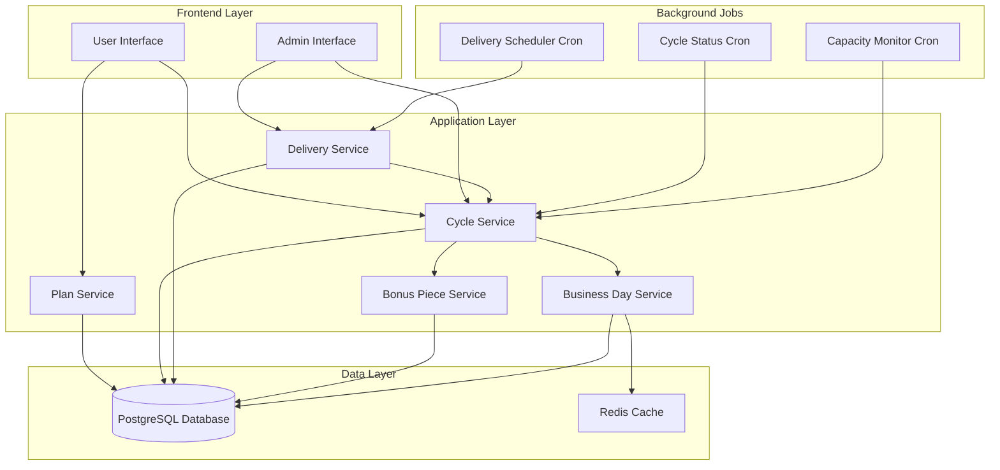
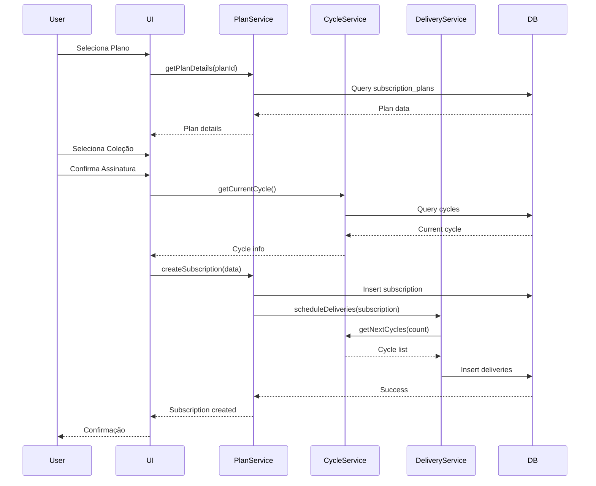
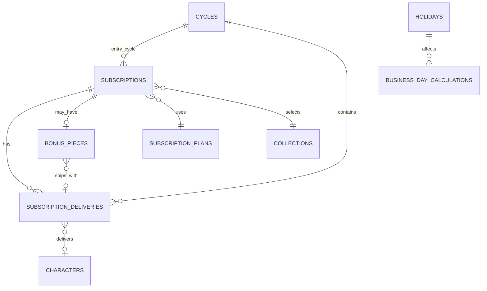
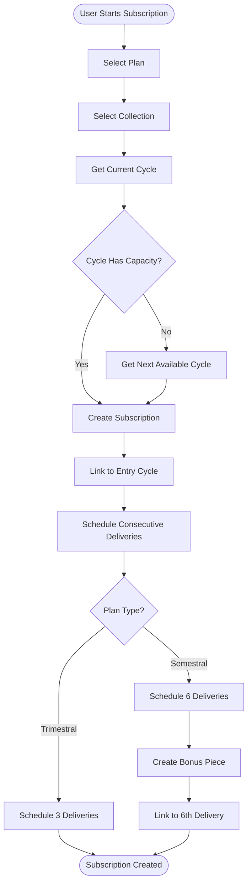
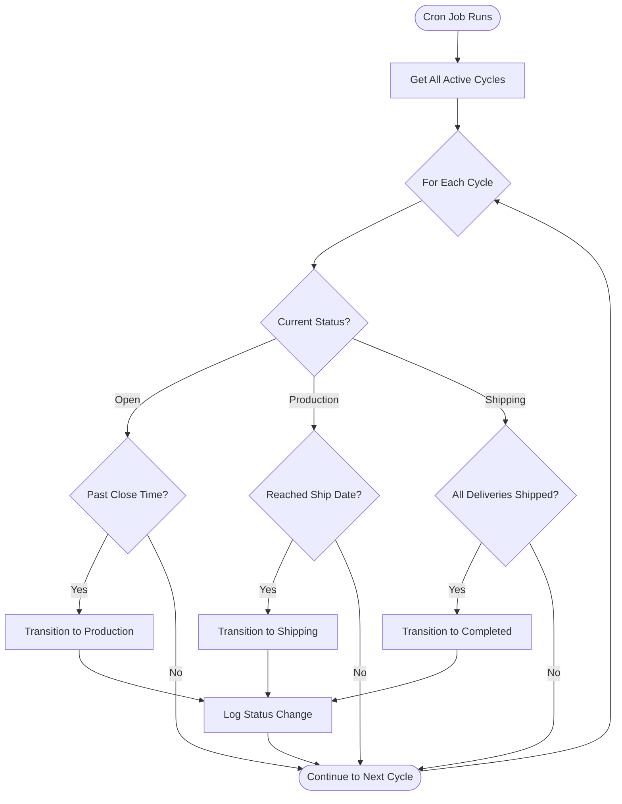

# Design Document - Clube Premium v2.0 (Fixed-Price Model)

## Overview

Este documento especifica o design técnico completo para implementação do novo modelo de Clube Premium com preço fixo no sistema de assinaturas Ordax. O design transforma o modelo atual (baseado em preços por coleção) em um sistema de clube premium onde clientes escolhem planos com preço fixo e depois selecionam coleções, com ciclos quinzenais automáticos de produção e envio.

**Feature Name**: premium-club-fixed-price-model  
**Workflow Type**: Requirements-First  
**Timezone Oficial**: America/Bahia (UTC-3)  
**Versão**: 2.0  
**Data**: 2026-02-28

### Objetivos Principais

1. Implementar sistema de ciclos quinzenais automáticos (Ciclo 1: dias 1-15, Ciclo 2: dias 16-fim do mês)
2. Criar planos com preço fixo (Trimestral R$ 1.350 / Semestral R$ 2.700)
3. Implementar cálculo de dias úteis considerando feriados nacionais e da Bahia
4. Gerenciar entregas consecutivas automáticas
5. Implementar peça bônus para plano semestral
6. Criar sistema de gestão de capacidade por ciclo
7. Remover código legado do modelo antigo

### Escopo

**Incluído**:
- Novo modelo de dados para ciclos, entregas e feriados
- Serviços de cálculo de ciclos e dias úteis
- Refatoração completa do frontend de assinatura
- Admin panel para gestão de ciclos e feriados
- Cron jobs para transições automáticas de status
- Sistema de entregas consecutivas
- Gestão de peças bônus
- Migração de dados existentes

**Excluído**:
- Integração com gateway de pagamento (usa sistema existente)
- Sistema de notificações (usa sistema existente)
- Sistema de chat/suporte (usa sistema existente)


## Architecture

### System Architecture Diagram



### Component Interaction Flow



### Technology Stack

**Frontend**:
- React 18 + TypeScript
- Vite (build tool)
- TanStack Query (data fetching)
- Shadcn/ui (component library)
- date-fns-tz (timezone handling)

**Backend**:
- Supabase (PostgreSQL + Edge Functions)
- PostgreSQL 15
- pg_cron (scheduled jobs)
- PostgREST (API layer)

**Infrastructure**:
- Supabase Cloud
- Edge Functions (Deno runtime)
- Redis (caching - opcional)


## Components and Interfaces

### Frontend Components

#### 1. PlanSelector Component

**Localização**: `src/components/subscription/PlanSelector.tsx`

**Responsabilidade**: Exibir planos disponíveis e permitir seleção

**Props**:
```typescript
interface PlanSelectorProps {
  selectedPlanId?: string;
  onPlanSelect: (planId: string) => void;
  disabled?: boolean;
}
```

**Estado**:
```typescript
interface PlanSelectorState {
  plans: SubscriptionPlan[];
  isLoading: boolean;
  error: Error | null;
}
```

**Comportamento**:
- Busca planos ativos do banco de dados
- Exibe preço fixo de cada plano (não preço de coleção)
- Destaca benefícios (peça bônus no semestral)
- Permite seleção de apenas um plano por vez

#### 2. CollectionSelector Component

**Localização**: `src/components/subscription/CollectionSelector.tsx`

**Responsabilidade**: Exibir coleções disponíveis para seleção

**Props**:
```typescript
interface CollectionSelectorProps {
  planId: string;
  selectedCollectionId?: string;
  onCollectionSelect: (collectionId: string) => void;
  disabled?: boolean;
}
```

**Estado**:
```typescript
interface CollectionSelectorState {
  collections: Collection[];
  isLoading: boolean;
  error: Error | null;
}
```

**Comportamento**:
- Busca coleções ativas e disponíveis para o plano selecionado
- Não exibe preços individuais de coleções
- Apresenta coleções como universos temáticos
- Permite seleção de apenas uma coleção
- Filtra coleções exclusivas de semestral se plano for trimestral

#### 3. CycleInfo Component

**Localização**: `src/components/subscription/CycleInfo.tsx`

**Responsabilidade**: Exibir informações do ciclo atual

**Props**:
```typescript
interface CycleInfoProps {
  cycleId?: string;
  showCountdown?: boolean;
}
```

**Estado**:
```typescript
interface CycleInfoState {
  cycle: Cycle | null;
  timeUntilClose: number; // milliseconds
  shippingDate: Date | null;
}
```

**Comportamento**:
- Exibe ciclo atual (1 ou 2)
- Mostra data de fechamento do ciclo
- Exibe countdown para fechamento (opcional)
- Calcula e exibe data prevista de envio
- Formata datas em pt-BR usando timezone America/Bahia


#### 4. SubscriptionFlow Component (Refatorado)

**Localização**: `src/pages/SubscribeCollection.tsx`

**Responsabilidade**: Orquestrar fluxo completo de assinatura

**Estado**:
```typescript
interface SubscriptionFlowState {
  step: 'plan' | 'collection' | 'payment' | 'confirmation';
  selectedPlanId: string | null;
  selectedCollectionId: string | null;
  paymentMethod: 'pix' | 'credit_card' | 'boleto';
  currentCycle: Cycle | null;
}
```

**Fluxo**:
1. Usuário seleciona plano (PlanSelector)
2. Usuário seleciona coleção (CollectionSelector)
3. Usuário escolhe forma de pagamento
4. Sistema exibe resumo e confirmação
5. Sistema cria assinatura e associa ao ciclo atual
6. Sistema agenda entregas consecutivas

#### 5. AdminCycleManager Component

**Localização**: `src/pages/admin/AdminCycleManager.tsx`

**Responsabilidade**: Gerenciar ciclos no admin panel

**Features**:
- Visualizar ciclos atuais e futuros
- Ver assinaturas por ciclo
- Monitorar capacidade de cada ciclo
- Visualizar status de ciclos (open, production, shipping, completed)
- Filtrar por ciclo, plano, status
- Exportar dados de ciclo

**Estado**:
```typescript
interface AdminCycleManagerState {
  cycles: Cycle[];
  selectedCycleId: string | null;
  filters: {
    status?: CycleStatus;
    planType?: PlanType;
    month?: string;
  };
  subscriptions: SubscriptionWithDetails[];
}
```

#### 6. AdminHolidayManager Component

**Localização**: `src/pages/admin/AdminHolidayManager.tsx`

**Responsabilidade**: Gerenciar feriados

**Features**:
- Listar feriados cadastrados
- Adicionar novo feriado (data, nome, tipo)
- Editar feriado existente
- Excluir feriado
- Filtrar por ano e tipo (nacional/estadual)

**Estado**:
```typescript
interface AdminHolidayManagerState {
  holidays: Holiday[];
  isEditing: boolean;
  editingHoliday: Holiday | null;
  filters: {
    year?: number;
    type?: 'national' | 'state';
  };
}
```


### Backend Services

#### 1. CycleService

**Localização**: `src/lib/services/cycleService.ts`

**Responsabilidades**:
- Identificar ciclo atual baseado em data
- Criar novos ciclos automaticamente
- Transicionar status de ciclos
- Calcular datas de produção e envio
- Gerenciar capacidade de ciclos

**Interface**:
```typescript
interface CycleService {
  // Identificação de ciclo
  getCurrentCycle(date?: Date): Promise<Cycle>;
  identifyCycleNumber(date: Date): 1 | 2;
  
  // Criação e gestão
  createCycleIfNotExists(month: number, year: number): Promise<Cycle>;
  getOrCreateCurrentCycle(): Promise<Cycle>;
  
  // Cálculo de datas
  calculateProductionDates(cycle: Cycle): { start: Date; end: Date };
  calculateShippingDate(cycle: Cycle): Promise<Date>;
  
  // Status
  transitionCycleStatus(cycleId: string, newStatus: CycleStatus): Promise<void>;
  checkAndTransitionCycles(): Promise<void>; // Para cron job
  
  // Capacidade
  checkCapacity(cycleId: string): Promise<{ current: number; max: number; available: number }>;
  incrementCapacity(cycleId: string): Promise<void>;
  decrementCapacity(cycleId: string): Promise<void>;
  
  // Consultas
  getCycleById(cycleId: string): Promise<Cycle>;
  getCyclesByMonth(month: number, year: number): Promise<Cycle[]>;
  getNextCycles(count: number, startDate?: Date): Promise<Cycle[]>;
}
```

**Algoritmos Chave**:
- `identifyCycleNumber`: Determina se data está em Ciclo 1 (1-15) ou Ciclo 2 (16-fim)
- `calculateShippingDate`: Calcula 5º dia útil usando BusinessDayService
- `checkAndTransitionCycles`: Verifica todos os ciclos e transiciona status conforme horário

#### 2. BusinessDayService

**Localização**: `src/lib/services/businessDayService.ts`

**Responsabilidades**:
- Calcular dias úteis considerando feriados
- Gerenciar calendário de feriados
- Verificar se data é dia útil

**Interface**:
```typescript
interface BusinessDayService {
  // Cálculo de dias úteis
  calculateNthBusinessDay(month: number, year: number, n: number): Promise<Date>;
  countBusinessDays(startDate: Date, endDate: Date): Promise<number>;
  isBusinessDay(date: Date): Promise<boolean>;
  
  // Gestão de feriados
  getHolidays(year: number): Promise<Holiday[]>;
  addHoliday(holiday: HolidayInput): Promise<Holiday>;
  updateHoliday(id: string, holiday: HolidayInput): Promise<Holiday>;
  deleteHoliday(id: string): Promise<void>;
  isHoliday(date: Date): Promise<boolean>;
  
  // Cache
  clearHolidayCache(): void;
}
```

**Algoritmos Chave**:
- `calculateNthBusinessDay`: Itera dias do mês, pulando fins de semana e feriados até encontrar o N-ésimo dia útil
- `isBusinessDay`: Verifica se não é sábado, domingo ou feriado


#### 3. DeliveryService

**Localização**: `src/lib/services/deliveryService.ts`

**Responsabilidades**:
- Agendar entregas consecutivas
- Gerenciar status de entregas
- Associar entregas a ciclos

**Interface**:
```typescript
interface DeliveryService {
  // Agendamento
  scheduleConsecutiveDeliveries(
    subscriptionId: string,
    planType: PlanType,
    startCycleId: string
  ): Promise<Delivery[]>;
  
  // Gestão
  updateDeliveryStatus(deliveryId: string, status: DeliveryStatus): Promise<void>;
  assignDeliveryToCycle(deliveryId: string, cycleId: string): Promise<void>;
  
  // Consultas
  getDeliveriesBySubscription(subscriptionId: string): Promise<Delivery[]>;
  getDeliveriesByCycle(cycleId: string): Promise<Delivery[]>;
  getCurrentDelivery(subscriptionId: string): Promise<Delivery | null>;
  
  // Trocas
  canChangeCharacter(deliveryId: string): Promise<boolean>;
  changeCharacter(deliveryId: string, newCharacterId: string): Promise<void>;
}
```

**Algoritmos Chave**:
- `scheduleConsecutiveDeliveries`: Cria N entregas (3 ou 6) nos próximos N ciclos consecutivos após o ciclo de entrada
- `canChangeCharacter`: Verifica se ciclo da entrega está com status "open"

#### 4. BonusPieceService

**Localização**: `src/lib/services/bonusPieceService.ts`

**Responsabilidades**:
- Criar peças bônus para planos semestrais
- Gerenciar status de peças bônus
- Associar bônus à última entrega

**Interface**:
```typescript
interface BonusPieceService {
  // Criação
  createBonusPiece(subscriptionId: string): Promise<BonusPiece>;
  
  // Gestão
  updateBonusStatus(bonusId: string, status: BonusStatus): Promise<void>;
  linkBonusToDelivery(bonusId: string, deliveryId: string): Promise<void>;
  
  // Consultas
  getBonusBySubscription(subscriptionId: string): Promise<BonusPiece | null>;
  getBonusesByCycle(cycleId: string): Promise<BonusPiece[]>;
  getPendingBonuses(): Promise<BonusPiece[]>;
}
```

#### 5. TimezoneService

**Localização**: `src/lib/services/timezoneService.ts`

**Responsabilidades**:
- Centralizar operações de timezone
- Garantir uso consistente de America/Bahia
- Fornecer utilitários de conversão

**Interface**:
```typescript
interface TimezoneService {
  // Constantes
  readonly TIMEZONE: 'America/Bahia';
  readonly UTC_OFFSET: -3;
  
  // Conversão
  toSystemTimezone(date: Date): Date;
  fromSystemTimezone(date: Date): Date;
  
  // Formatação
  formatDate(date: Date, format: string): string;
  formatDateTime(date: Date): string;
  
  // Utilitários
  getCurrentTime(): Date;
  startOfDay(date: Date): Date;
  endOfDay(date: Date): Date;
  
  // Comparação
  isSameDay(date1: Date, date2: Date): boolean;
  isAfter(date1: Date, date2: Date): boolean;
  isBefore(date1: Date, date2: Date): boolean;
}
```


## Data Models

### Database Schema

#### New Tables

##### 1. cycles

Tabela para gerenciar ciclos quinzenais de produção.

```sql
CREATE TYPE cycle_status AS ENUM ('open', 'production', 'shipping', 'completed');

CREATE TABLE cycles (
  id uuid PRIMARY KEY DEFAULT gen_random_uuid(),
  created_at timestamptz DEFAULT now(),
  updated_at timestamptz DEFAULT now(),
  
  -- Identificação
  cycle_number integer NOT NULL CHECK (cycle_number IN (1, 2)),
  month integer NOT NULL CHECK (month BETWEEN 1 AND 12),
  year integer NOT NULL CHECK (year >= 2026),
  
  -- Datas (todas em America/Bahia timezone)
  open_start timestamptz NOT NULL,
  open_end timestamptz NOT NULL,
  production_start timestamptz NOT NULL,
  production_end timestamptz NOT NULL,
  shipping_date date NOT NULL,
  
  -- Status
  status cycle_status DEFAULT 'open',
  status_changed_at timestamptz,
  
  -- Capacidade
  capacity_max integer DEFAULT 100,
  capacity_current integer DEFAULT 0,
  
  -- Constraint: apenas um ciclo por número/mês/ano
  UNIQUE(cycle_number, month, year)
);

CREATE INDEX idx_cycles_status ON cycles(status);
CREATE INDEX idx_cycles_month_year ON cycles(month, year);
CREATE INDEX idx_cycles_shipping_date ON cycles(shipping_date);
```

##### 2. holidays

Tabela para gerenciar feriados nacionais e estaduais.

```sql
CREATE TYPE holiday_type AS ENUM ('national', 'state');

CREATE TABLE holidays (
  id uuid PRIMARY KEY DEFAULT gen_random_uuid(),
  created_at timestamptz DEFAULT now(),
  updated_at timestamptz DEFAULT now(),
  
  -- Data do feriado
  holiday_date date NOT NULL,
  
  -- Informações
  name text NOT NULL,
  description text,
  type holiday_type NOT NULL,
  
  -- Estado (apenas para feriados estaduais)
  state_code text CHECK (
    (type = 'national' AND state_code IS NULL) OR
    (type = 'state' AND state_code IS NOT NULL)
  ),
  
  -- Recorrência
  is_recurring boolean DEFAULT false,
  
  UNIQUE(holiday_date, type, state_code)
);

CREATE INDEX idx_holidays_date ON holidays(holiday_date);
CREATE INDEX idx_holidays_type ON holidays(type);
```


##### 3. subscription_deliveries (Modificada)

Tabela para gerenciar entregas individuais de assinaturas.

```sql
CREATE TYPE delivery_status AS ENUM (
  'scheduled',
  'pending_production',
  'in_production',
  'ready',
  'shipped',
  'delivered'
);

CREATE TABLE subscription_deliveries (
  id uuid PRIMARY KEY DEFAULT gen_random_uuid(),
  created_at timestamptz DEFAULT now(),
  updated_at timestamptz DEFAULT now(),
  
  -- Relacionamentos
  subscription_id uuid NOT NULL REFERENCES subscriptions(id) ON DELETE CASCADE,
  cycle_id uuid NOT NULL REFERENCES cycles(id),
  character_id uuid REFERENCES characters(id),
  
  -- Sequência
  delivery_number integer NOT NULL CHECK (delivery_number >= 1),
  
  -- Status
  status delivery_status DEFAULT 'scheduled',
  status_changed_at timestamptz,
  
  -- Datas
  scheduled_date date,
  shipped_at timestamptz,
  delivered_at timestamptz,
  
  -- Rastreamento
  tracking_code text,
  
  -- Constraint: apenas uma entrega por número/assinatura
  UNIQUE(subscription_id, delivery_number)
);

CREATE INDEX idx_deliveries_subscription ON subscription_deliveries(subscription_id);
CREATE INDEX idx_deliveries_cycle ON subscription_deliveries(cycle_id);
CREATE INDEX idx_deliveries_status ON subscription_deliveries(status);
```

##### 4. bonus_pieces

Tabela para gerenciar peças bônus do plano semestral.

```sql
CREATE TYPE bonus_status AS ENUM ('pending', 'prepared', 'shipped');

CREATE TABLE bonus_pieces (
  id uuid PRIMARY KEY DEFAULT gen_random_uuid(),
  created_at timestamptz DEFAULT now(),
  updated_at timestamptz DEFAULT now(),
  
  -- Relacionamentos
  subscription_id uuid NOT NULL REFERENCES subscriptions(id) ON DELETE CASCADE,
  delivery_id uuid REFERENCES subscription_deliveries(id),
  
  -- Informações
  description text,
  status bonus_status DEFAULT 'pending',
  
  -- Datas
  prepared_at timestamptz,
  shipped_at timestamptz,
  
  -- Constraint: apenas um bônus por assinatura
  UNIQUE(subscription_id)
);

CREATE INDEX idx_bonus_subscription ON bonus_pieces(subscription_id);
CREATE INDEX idx_bonus_status ON bonus_pieces(status);
```


#### Modified Tables

##### subscriptions (Modificações)

Adicionar campos para suportar ciclos e novo modelo.

```sql
ALTER TABLE subscriptions
  ADD COLUMN entry_cycle_id uuid REFERENCES cycles(id),
  ADD COLUMN current_delivery_number integer DEFAULT 1,
  ADD COLUMN total_deliveries integer NOT NULL,
  ADD COLUMN is_legacy_model boolean DEFAULT false;

CREATE INDEX idx_subscriptions_entry_cycle ON subscriptions(entry_cycle_id);
```

##### subscription_plans (Modificações)

Ajustar para suportar preços fixos e configurações de ciclo.

```sql
ALTER TABLE subscription_plans
  ADD COLUMN deliveries_total integer NOT NULL DEFAULT 3,
  ADD COLUMN includes_bonus boolean DEFAULT false,
  ADD COLUMN collections_count integer DEFAULT 1 CHECK (collections_count >= 1);

-- Atualizar planos existentes
UPDATE subscription_plans 
SET deliveries_total = 3, includes_bonus = false, collections_count = 1
WHERE plan_type = 'trimestral';

UPDATE subscription_plans 
SET deliveries_total = 6, includes_bonus = true, collections_count = 1
WHERE plan_type = 'semestral';
```

##### collections (Modificações)

Adicionar campos para controlar disponibilidade por plano.

```sql
ALTER TABLE collections
  ADD COLUMN available_for_plans text[] DEFAULT ARRAY['trimestral', 'semestral'],
  ADD COLUMN is_semestral_exclusive boolean DEFAULT false,
  ADD COLUMN is_special_edition boolean DEFAULT false,
  ADD COLUMN is_limited_availability boolean DEFAULT false;

CREATE INDEX idx_collections_availability ON collections USING GIN(available_for_plans);
```

### Entity Relationships




### Data Flow Diagrams

#### Subscription Creation Flow



#### Cycle Status Transition Flow




## Correctness Properties

*A property is a characteristic or behavior that should hold true across all valid executions of a system-essentially, a formal statement about what the system should do. Properties serve as the bridge between human-readable specifications and machine-verifiable correctness guarantees.*

### Property 1: Timezone Consistency in Cycle Calculations

*For any* cycle closure calculation, the system should use America/Bahia timezone (UTC-3) consistently, ensuring that a subscription created at 23:59:59 on day 15 goes to Cycle 1 and one created at 00:00:00 on day 16 goes to Cycle 2.

**Validates: Requirements 0.2, 0.3, 0.4**

### Property 2: Timestamp Storage with Timezone

*For any* timestamp stored in the database, it should include timezone information and be stored as timestamptz type.

**Validates: Requirements 0.6**

### Property 3: Date Formatting in Brazilian Portuguese

*For any* date displayed in the user interface, it should be formatted in Brazilian Portuguese (DD/MM/AAAA) using America/Bahia timezone.

**Validates: Requirements 0.7**

### Property 4: Semestral Plan Includes Bonus Piece

*For any* subscription created with a Semestral plan, the system should create exactly one bonus piece record linked to that subscription.

**Validates: Requirements 1.4**

### Property 5: Trimestral Plan Excludes Bonus Piece

*For any* subscription created with a Trimestral plan, the system should not create any bonus piece records.

**Validates: Requirements 1.5**

### Property 6: Single Collection Per Subscription

*For any* active subscription, exactly one collection should be linked to it at any given time.

**Validates: Requirements 2.2, 2.5**

### Property 7: Cycle 1 Assignment

*For any* subscription created between day 1 at 00:00:00 and day 15 at 23:59:59 (America/Bahia timezone), it should be assigned to Cycle 1 of that month.

**Validates: Requirements 3.1, 3.6**

### Property 8: Cycle 2 Assignment

*For any* subscription created between day 16 at 00:00:00 and the last day of the month at 23:59:59 (America/Bahia timezone), it should be assigned to Cycle 2 of that month.

**Validates: Requirements 3.2, 3.6**

### Property 9: Cycle 1 Production Dates

*For any* Cycle 1, the production period should start on day 16 at 00:00:00 and end on the last day of the same month at 23:59:59 (America/Bahia timezone).

**Validates: Requirements 3.3**

### Property 10: Cycle 2 Production Dates

*For any* Cycle 2, the production period should start on day 1 of the following month at 00:00:00 and end on the last day of that following month at 23:59:59 (America/Bahia timezone).

**Validates: Requirements 3.4**

### Property 11: Shipping Date Calculation

*For any* cycle, the shipping date should be calculated as the 5th business day of the month following the production period, excluding weekends and holidays.

**Validates: Requirements 3.5**


### Property 12: Cycle Status Transition Timing (Cycle 1)

*For any* Cycle 1, when the system time reaches day 16 at 00:00:00 (America/Bahia timezone), the cycle status should automatically transition from "open" to "production".

**Validates: Requirements 3.8, 14.2**

### Property 13: Cycle Status Transition Timing (Cycle 2)

*For any* Cycle 2, when the system time reaches day 1 of the following month at 00:00:00 (America/Bahia timezone), the cycle status should automatically transition from "open" to "production".

**Validates: Requirements 3.9, 14.3**

### Property 14: Weekend Exclusion from Business Days

*For any* date range, Saturdays and Sundays should not be counted as business days in any calculation.

**Validates: Requirements 4.1, 4.2, 4.5**

### Property 15: Holiday Exclusion from Business Days

*For any* date range containing national or Bahia state holidays, those holidays should not be counted as business days.

**Validates: Requirements 4.3, 4.4, 4.5**

### Property 16: Business Day Counting Start Point

*For any* calculation of the Nth business day of a month, the counting should start from day 1 of that month at 00:00:00.

**Validates: Requirements 4.6**

### Property 17: Character Changes Allowed in Open Cycle

*For any* subscription in a cycle with status "open", character changes should be allowed.

**Validates: Requirements 5.1**

### Property 18: Collection Changes Allowed in Open Cycle

*For any* subscription in a cycle with status "open", collection changes should be allowed.

**Validates: Requirements 5.2**

### Property 19: Changes Blocked in Production Cycle

*For any* subscription in a cycle with status "production", "shipping", or "completed", both character and collection changes should be blocked.

**Validates: Requirements 5.3, 5.4**

### Property 20: Trimestral Consecutive Deliveries

*For any* Trimestral plan subscription created in a cycle, exactly 3 deliveries should be scheduled in the next 3 consecutive cycles immediately following the entry cycle.

**Validates: Requirements 11.1, 11.3**

### Property 21: Semestral Consecutive Deliveries

*For any* Semestral plan subscription created in a cycle, exactly 6 deliveries should be scheduled in the next 6 consecutive cycles immediately following the entry cycle.

**Validates: Requirements 11.2, 11.3**

### Property 22: Delivery Cycle Assignment

*For any* delivery in a subscription, it should be assigned to the appropriate cycle based on its sequence number (1st delivery in next cycle after entry, 2nd in cycle after that, etc.).

**Validates: Requirements 11.3**

### Property 23: Subscription Completion

*For any* subscription where all deliveries have status "delivered", the subscription status should be marked as "completed".

**Validates: Requirements 11.4**


### Property 24: Bonus Piece Linked to Last Delivery

*For any* bonus piece created for a Semestral subscription, it should be linked to the 6th (last) delivery of that subscription.

**Validates: Requirements 12.2, 12.3**

### Property 25: Cycle Capacity Enforcement

*For any* cycle that has reached its maximum capacity, new subscriptions should not be assigned to that cycle and should be automatically assigned to the next available cycle.

**Validates: Requirements 16.2, 16.3**

### Property 26: Collection Availability Filtering

*For any* Trimestral plan subscription flow, collections marked as "semestral_exclusive" should not be displayed as available options.

**Validates: Requirements 15.5, 15.6**

### Property 27: Automatic Cycle Creation

*For any* month, when the first subscription is created for that month, the system should automatically create both Cycle 1 and Cycle 2 for that month if they don't already exist.

**Validates: Requirements 10.1**

### Property 28: Cycle Status History

*For any* cycle status transition, a log entry should be created with the old status, new status, and timestamp of the transition.

**Validates: Requirements 14.6**

## Error Handling

### Error Categories

#### 1. Validation Errors

**Scenarios**:
- User selects plan but no collection
- User tries to create subscription without authentication
- User tries to change character after cycle closes
- Admin tries to set invalid holiday date

**Handling**:
- Return clear error messages to user
- Log validation failures
- Do not create partial records
- Rollback any database changes

**Example**:
```typescript
if (!selectedCollectionId) {
  throw new ValidationError(
    'Selecione uma coleção antes de continuar',
    'COLLECTION_REQUIRED'
  );
}
```

#### 2. Business Logic Errors

**Scenarios**:
- Cycle capacity exceeded
- Subscription created for inactive plan
- Delivery scheduled for non-existent cycle
- Bonus piece created for Trimestral plan

**Handling**:
- Prevent operation from completing
- Return specific error code
- Log business rule violation
- Suggest corrective action

**Example**:
```typescript
const capacity = await cycleService.checkCapacity(cycleId);
if (capacity.available === 0) {
  throw new BusinessLogicError(
    'Ciclo sem capacidade disponível. Você será alocado no próximo ciclo.',
    'CYCLE_FULL'
  );
}
```


#### 3. System Errors

**Scenarios**:
- Database connection failure
- Timezone conversion error
- Cron job execution failure
- External service unavailable

**Handling**:
- Retry with exponential backoff (for transient errors)
- Log full error details
- Send alert to administrators
- Return generic error to user
- Maintain system in consistent state

**Example**:
```typescript
try {
  await cycleService.transitionCycleStatus(cycleId, 'production');
} catch (error) {
  logger.error('Failed to transition cycle status', {
    cycleId,
    error,
    timestamp: new Date()
  });
  
  await notificationService.alertAdmins({
    type: 'CYCLE_TRANSITION_FAILED',
    cycleId,
    error: error.message
  });
  
  throw new SystemError(
    'Erro ao processar operação. Nossa equipe foi notificada.',
    'SYSTEM_ERROR'
  );
}
```

#### 4. Timezone Errors

**Scenarios**:
- Invalid timezone conversion
- Daylight saving time edge cases
- Date parsing in wrong timezone

**Handling**:
- Always use TimezoneService for date operations
- Validate timezone before operations
- Log timezone-related errors with full context
- Use UTC internally, convert only at boundaries

**Example**:
```typescript
try {
  const systemTime = timezoneService.toSystemTimezone(userInputDate);
  const cycleNumber = cycleService.identifyCycleNumber(systemTime);
} catch (error) {
  logger.error('Timezone conversion failed', {
    inputDate: userInputDate,
    error
  });
  throw new TimezoneError(
    'Erro ao processar data. Tente novamente.',
    'TIMEZONE_ERROR'
  );
}
```

### Error Recovery Strategies

#### Database Transaction Rollback

All multi-step operations should use database transactions:

```typescript
const { data, error } = await supabase.rpc('create_subscription_with_deliveries', {
  p_user_id: userId,
  p_plan_id: planId,
  p_collection_id: collectionId,
  p_cycle_id: cycleId
});

// RPC function handles transaction internally
// If any step fails, all changes are rolled back
```

#### Idempotent Operations

Critical operations should be idempotent:

```typescript
async function getOrCreateCurrentCycle(): Promise<Cycle> {
  const existing = await getCycleForCurrentDate();
  if (existing) return existing;
  
  // Use UPSERT to handle race conditions
  const { data } = await supabase
    .from('cycles')
    .upsert({
      cycle_number: currentCycleNumber,
      month: currentMonth,
      year: currentYear,
      // ... other fields
    }, {
      onConflict: 'cycle_number,month,year'
    })
    .select()
    .single();
    
  return data;
}
```


## Testing Strategy

### Dual Testing Approach

This feature requires both unit tests and property-based tests for comprehensive coverage:

- **Unit tests**: Verify specific examples, edge cases, and error conditions
- **Property tests**: Verify universal properties across all inputs through randomization
- Both approaches are complementary and necessary

### Unit Testing

Unit tests focus on specific scenarios and integration points:

**Test Categories**:

1. **Component Tests** (React Testing Library + Vitest)
   - PlanSelector renders plans correctly
   - CollectionSelector filters by plan type
   - CycleInfo displays countdown correctly
   - Admin panels render data tables

2. **Service Tests** (Vitest)
   - CycleService creates cycles correctly
   - BusinessDayService handles specific holidays
   - DeliveryService schedules correct number of deliveries
   - TimezoneService converts dates correctly

3. **Integration Tests**
   - Subscription creation flow end-to-end
   - Cycle status transitions
   - Delivery scheduling with cycles
   - Bonus piece creation for semestral plans

4. **Edge Cases**
   - Subscription created at exactly 23:59:59 on day 15
   - Subscription created at exactly 00:00:00 on day 16
   - Month with 28, 29, 30, or 31 days
   - February in leap year
   - Month starting on Saturday or Sunday
   - 5th business day calculation when first week has holidays

**Example Unit Test**:
```typescript
describe('CycleService', () => {
  it('should assign subscription to Cycle 1 when created on day 15', async () => {
    const date = new Date('2026-03-15T23:59:59-03:00');
    const cycle = await cycleService.getCurrentCycle(date);
    
    expect(cycle.cycle_number).toBe(1);
    expect(cycle.month).toBe(3);
    expect(cycle.year).toBe(2026);
  });
  
  it('should assign subscription to Cycle 2 when created on day 16', async () => {
    const date = new Date('2026-03-16T00:00:00-03:00');
    const cycle = await cycleService.getCurrentCycle(date);
    
    expect(cycle.cycle_number).toBe(2);
    expect(cycle.month).toBe(3);
    expect(cycle.year).toBe(2026);
  });
});
```


### Property-Based Testing

Property-based tests verify universal properties across many randomly generated inputs.

**Library**: fast-check (JavaScript/TypeScript property-based testing library)

**Configuration**:
- Minimum 100 iterations per property test
- Each test tagged with reference to design document property
- Tag format: `Feature: premium-club-fixed-price-model, Property {number}: {property_text}`

**Property Test Examples**:

```typescript
import fc from 'fast-check';

describe('Property Tests - Cycle Assignment', () => {
  it('Property 7: Cycle 1 Assignment', () => {
    // Feature: premium-club-fixed-price-model, Property 7: Cycle 1 Assignment
    fc.assert(
      fc.property(
        fc.integer({ min: 1, max: 15 }), // day
        fc.integer({ min: 1, max: 12 }), // month
        fc.integer({ min: 2026, max: 2030 }), // year
        fc.integer({ min: 0, max: 23 }), // hour
        fc.integer({ min: 0, max: 59 }), // minute
        async (day, month, year, hour, minute) => {
          const date = new Date(year, month - 1, day, hour, minute, 0);
          const cycle = await cycleService.identifyCycleNumber(date);
          
          expect(cycle).toBe(1);
        }
      ),
      { numRuns: 100 }
    );
  });
  
  it('Property 8: Cycle 2 Assignment', () => {
    // Feature: premium-club-fixed-price-model, Property 8: Cycle 2 Assignment
    fc.assert(
      fc.property(
        fc.integer({ min: 16, max: 31 }), // day
        fc.integer({ min: 1, max: 12 }), // month
        fc.integer({ min: 2026, max: 2030 }), // year
        async (day, month, year) => {
          // Handle months with fewer than 31 days
          const lastDay = new Date(year, month, 0).getDate();
          if (day > lastDay) return; // Skip invalid dates
          
          const date = new Date(year, month - 1, day, 12, 0, 0);
          const cycle = await cycleService.identifyCycleNumber(date);
          
          expect(cycle).toBe(2);
        }
      ),
      { numRuns: 100 }
    );
  });
});

describe('Property Tests - Business Days', () => {
  it('Property 14: Weekend Exclusion', () => {
    // Feature: premium-club-fixed-price-model, Property 14: Weekend Exclusion
    fc.assert(
      fc.property(
        fc.date({ min: new Date('2026-01-01'), max: new Date('2030-12-31') }),
        async (date) => {
          const dayOfWeek = date.getDay();
          const isWeekend = dayOfWeek === 0 || dayOfWeek === 6;
          const isBusinessDay = await businessDayService.isBusinessDay(date);
          
          if (isWeekend) {
            expect(isBusinessDay).toBe(false);
          }
        }
      ),
      { numRuns: 100 }
    );
  });
});

describe('Property Tests - Deliveries', () => {
  it('Property 20: Trimestral Consecutive Deliveries', () => {
    // Feature: premium-club-fixed-price-model, Property 20: Trimestral Consecutive Deliveries
    fc.assert(
      fc.property(
        fc.uuid(), // subscriptionId
        fc.uuid(), // entryCycleId
        async (subscriptionId, entryCycleId) => {
          const deliveries = await deliveryService.scheduleConsecutiveDeliveries(
            subscriptionId,
            'trimestral',
            entryCycleId
          );
          
          expect(deliveries).toHaveLength(3);
          
          // Verify consecutive cycles
          const cycles = await Promise.all(
            deliveries.map(d => cycleService.getCycleById(d.cycle_id))
          );
          
          // Check that cycles are consecutive
          for (let i = 1; i < cycles.length; i++) {
            const prevCycle = cycles[i - 1];
            const currCycle = cycles[i];
            
            // Next cycle should be either next cycle number in same month
            // or first cycle of next month
            const isConsecutive = 
              (currCycle.month === prevCycle.month && 
               currCycle.cycle_number === prevCycle.cycle_number + 1) ||
              (currCycle.month === prevCycle.month + 1 && 
               currCycle.cycle_number === 1);
               
            expect(isConsecutive).toBe(true);
          }
        }
      ),
      { numRuns: 100 }
    );
  });
});
```


### Test Coverage Goals

**Minimum Coverage**: 70% for critical paths

**Critical Paths**:
- Cycle identification and assignment (90%+)
- Business day calculations (90%+)
- Delivery scheduling (85%+)
- Status transitions (85%+)
- Timezone conversions (90%+)

**Testing Tools**:
- Vitest (test runner)
- React Testing Library (component tests)
- fast-check (property-based testing)
- Supabase Test Helpers (database mocking)

### Test Data Management

**Fixtures**:
```typescript
// test/fixtures/cycles.ts
export const cycle1March2026 = {
  id: 'cycle-1-march-2026',
  cycle_number: 1,
  month: 3,
  year: 2026,
  open_start: '2026-03-01T00:00:00-03:00',
  open_end: '2026-03-15T23:59:59-03:00',
  production_start: '2026-03-16T00:00:00-03:00',
  production_end: '2026-03-31T23:59:59-03:00',
  shipping_date: '2026-04-07',
  status: 'open'
};

// test/fixtures/holidays.ts
export const brazilianHolidays2026 = [
  { date: '2026-01-01', name: 'Ano Novo', type: 'national' },
  { date: '2026-04-21', name: 'Tiradentes', type: 'national' },
  { date: '2026-05-01', name: 'Dia do Trabalho', type: 'national' },
  { date: '2026-07-02', name: 'Independência da Bahia', type: 'state' },
  // ... more holidays
];
```

**Mocking Strategy**:
```typescript
// Mock Supabase client for tests
vi.mock('@/integrations/supabase/client', () => ({
  supabase: {
    from: vi.fn(),
    rpc: vi.fn(),
    auth: {
      getUser: vi.fn()
    }
  }
}));

// Mock timezone service to control time in tests
vi.mock('@/lib/services/timezoneService', () => ({
  timezoneService: {
    getCurrentTime: vi.fn(() => new Date('2026-03-10T12:00:00-03:00')),
    toSystemTimezone: vi.fn(date => date),
    // ... other methods
  }
}));
```


## Critical Algorithms

### Algorithm 1: Cycle Identification

**Purpose**: Determine which cycle (1 or 2) a given date belongs to

**Input**: Date in America/Bahia timezone

**Output**: Cycle number (1 or 2)

**Pseudocode**:
```
function identifyCycleNumber(date: Date): 1 | 2 {
  // Ensure date is in America/Bahia timezone
  localDate = convertToSystemTimezone(date)
  
  // Extract day of month
  day = getDayOfMonth(localDate)
  
  // Cycle 1: days 1-15
  // Cycle 2: days 16-end of month
  if (day >= 1 AND day <= 15) {
    return 1
  } else {
    return 2
  }
}
```

**Complexity**: O(1)

**Edge Cases**:
- Day 15 at 23:59:59 → Cycle 1
- Day 16 at 00:00:00 → Cycle 2
- February 29 in leap year → Cycle 2
- Timezone boundary (e.g., UTC midnight vs Bahia midnight)

### Algorithm 2: Calculate Nth Business Day

**Purpose**: Find the Nth business day of a given month, excluding weekends and holidays

**Input**: 
- month: integer (1-12)
- year: integer
- n: integer (which business day to find)

**Output**: Date of the Nth business day

**Pseudocode**:
```
function calculateNthBusinessDay(month: int, year: int, n: int): Date {
  // Get holidays for the year
  holidays = getHolidays(year)
  holidayDates = holidays.map(h => h.date)
  
  // Start from first day of month
  currentDate = new Date(year, month, 1)
  businessDayCount = 0
  
  // Iterate through days of the month
  while (businessDayCount < n) {
    dayOfWeek = currentDate.getDayOfWeek()
    
    // Check if it's a business day
    isWeekend = (dayOfWeek == SATURDAY OR dayOfWeek == SUNDAY)
    isHoliday = holidayDates.includes(currentDate)
    
    if (NOT isWeekend AND NOT isHoliday) {
      businessDayCount++
      
      if (businessDayCount == n) {
        return currentDate
      }
    }
    
    // Move to next day
    currentDate = addDays(currentDate, 1)
    
    // Safety check: don't go past end of month
    if (currentDate.month != month) {
      throw Error("Not enough business days in month")
    }
  }
}
```

**Complexity**: O(n) where n is the number of days to check (max 31)

**Edge Cases**:
- Month starts on Saturday (first business day is Monday)
- Multiple consecutive holidays
- Holiday on Monday after weekend
- Not enough business days in month (should not happen for n=5)


### Algorithm 3: Schedule Consecutive Deliveries

**Purpose**: Create delivery records for consecutive cycles after subscription entry

**Input**:
- subscriptionId: UUID
- planType: 'trimestral' | 'semestral'
- entryCycleId: UUID

**Output**: Array of created delivery records

**Pseudocode**:
```
function scheduleConsecutiveDeliveries(
  subscriptionId: UUID,
  planType: PlanType,
  entryCycleId: UUID
): Delivery[] {
  // Determine number of deliveries
  deliveryCount = (planType == 'trimestral') ? 3 : 6
  
  // Get entry cycle details
  entryCycle = getCycleById(entryCycleId)
  
  // Get next N consecutive cycles
  nextCycles = getNextConsecutiveCycles(entryCycle, deliveryCount)
  
  deliveries = []
  
  // Create delivery for each cycle
  for (i = 0; i < deliveryCount; i++) {
    targetCycle = nextCycles[i]
    
    delivery = {
      subscription_id: subscriptionId,
      cycle_id: targetCycle.id,
      delivery_number: i + 1,
      status: 'scheduled',
      scheduled_date: targetCycle.shipping_date
    }
    
    createdDelivery = insertDelivery(delivery)
    deliveries.push(createdDelivery)
  }
  
  // If semestral, create bonus piece linked to last delivery
  if (planType == 'semestral') {
    lastDelivery = deliveries[deliveries.length - 1]
    
    bonusPiece = {
      subscription_id: subscriptionId,
      delivery_id: lastDelivery.id,
      status: 'pending'
    }
    
    insertBonusPiece(bonusPiece)
  }
  
  return deliveries
}
```

**Helper Function**:
```
function getNextConsecutiveCycles(startCycle: Cycle, count: int): Cycle[] {
  cycles = []
  currentMonth = startCycle.month
  currentYear = startCycle.year
  currentCycleNumber = startCycle.cycle_number
  
  for (i = 0; i < count; i++) {
    // Move to next cycle
    if (currentCycleNumber == 1) {
      currentCycleNumber = 2
      // Stay in same month
    } else {
      currentCycleNumber = 1
      // Move to next month
      currentMonth++
      if (currentMonth > 12) {
        currentMonth = 1
        currentYear++
      }
    }
    
    // Get or create cycle
    cycle = getOrCreateCycle(currentCycleNumber, currentMonth, currentYear)
    cycles.push(cycle)
  }
  
  return cycles
}
```

**Complexity**: O(n) where n is the number of deliveries (3 or 6)

**Edge Cases**:
- Entry cycle is Cycle 2 of December (next is Cycle 1 of January next year)
- Cycles don't exist yet (must be created)
- Subscription created near end of year (deliveries span into next year)


### Algorithm 4: Cycle Status Transition

**Purpose**: Automatically transition cycle statuses based on current time

**Input**: None (runs as cron job)

**Output**: Number of cycles transitioned

**Pseudocode**:
```
function checkAndTransitionCycles(): int {
  currentTime = getCurrentTimeInSystemTimezone()
  transitionCount = 0
  
  // Get all non-completed cycles
  activeCycles = getCyclesWithStatus(['open', 'production', 'shipping'])
  
  for each cycle in activeCycles {
    oldStatus = cycle.status
    newStatus = determineCorrectStatus(cycle, currentTime)
    
    if (newStatus != oldStatus) {
      // Transition status
      updateCycleStatus(cycle.id, newStatus)
      
      // Log transition
      logStatusTransition(cycle.id, oldStatus, newStatus, currentTime)
      
      // Send notifications if needed
      if (newStatus == 'production') {
        notifyProductionStart(cycle)
      } else if (newStatus == 'shipping') {
        notifyShippingStart(cycle)
      }
      
      transitionCount++
    }
  }
  
  return transitionCount
}

function determineCorrectStatus(cycle: Cycle, currentTime: Date): CycleStatus {
  // Check if should be completed
  if (allDeliveriesShipped(cycle.id)) {
    return 'completed'
  }
  
  // Check if should be shipping
  if (currentTime >= cycle.shipping_date) {
    return 'shipping'
  }
  
  // Check if should be production
  if (currentTime >= cycle.production_start) {
    return 'production'
  }
  
  // Otherwise should be open
  return 'open'
}
```

**Complexity**: O(n) where n is the number of active cycles (typically small, ~2-4)

**Cron Schedule**: Every hour at :00

**Edge Cases**:
- Multiple cycles need transition at same time
- Cycle transitions during daylight saving time change
- System clock skew
- Database transaction failures during transition

### Algorithm 5: Capacity Check and Assignment

**Purpose**: Check if cycle has capacity and assign subscription to appropriate cycle

**Input**:
- preferredCycleId: UUID
- subscriptionId: UUID

**Output**: Assigned cycle ID

**Pseudocode**:
```
function assignSubscriptionToCycle(
  preferredCycleId: UUID,
  subscriptionId: UUID
): UUID {
  // Start transaction
  beginTransaction()
  
  try {
    // Lock cycle row for update
    cycle = getCycleByIdForUpdate(preferredCycleId)
    
    // Check capacity
    if (cycle.capacity_current < cycle.capacity_max) {
      // Has capacity, assign to this cycle
      cycle.capacity_current++
      updateCycle(cycle)
      
      // Link subscription to cycle
      updateSubscription(subscriptionId, { entry_cycle_id: cycle.id })
      
      // Check if reached 80% capacity
      capacityPercent = (cycle.capacity_current / cycle.capacity_max) * 100
      if (capacityPercent >= 80 AND capacityPercent < 100) {
        notifyAdmins('CYCLE_80_PERCENT', cycle)
      } else if (capacityPercent >= 100) {
        notifyAdmins('CYCLE_FULL', cycle)
      }
      
      commitTransaction()
      return cycle.id
      
    } else {
      // No capacity, find next available cycle
      nextCycle = getNextAvailableCycle(cycle)
      
      // Recursive call with next cycle
      rollbackTransaction()
      return assignSubscriptionToCycle(nextCycle.id, subscriptionId)
    }
    
  } catch (error) {
    rollbackTransaction()
    throw error
  }
}

function getNextAvailableCycle(currentCycle: Cycle): Cycle {
  // Calculate next cycle
  nextCycleNumber = (currentCycle.cycle_number == 1) ? 2 : 1
  nextMonth = currentCycle.month
  nextYear = currentCycle.year
  
  if (nextCycleNumber == 1) {
    nextMonth++
    if (nextMonth > 12) {
      nextMonth = 1
      nextYear++
    }
  }
  
  // Get or create next cycle
  nextCycle = getOrCreateCycle(nextCycleNumber, nextMonth, nextYear)
  
  return nextCycle
}
```

**Complexity**: O(1) average case, O(k) worst case where k is number of full cycles

**Concurrency**: Uses row-level locking to prevent race conditions

**Edge Cases**:
- Multiple subscriptions created simultaneously
- All cycles in current month are full
- Capacity limit reached exactly at same time as another subscription


## Migration Strategy

### Phase 1: Database Schema Migration

**Objective**: Add new tables and modify existing ones without breaking current functionality

**Steps**:

1. **Create New Tables** (Zero Downtime)
   ```sql
   -- Create cycles table
   CREATE TABLE cycles (...);
   
   -- Create holidays table
   CREATE TABLE holidays (...);
   
   -- Create bonus_pieces table
   CREATE TABLE bonus_pieces (...);
   ```

2. **Modify Existing Tables** (Zero Downtime)
   ```sql
   -- Add new columns to subscriptions
   ALTER TABLE subscriptions
     ADD COLUMN entry_cycle_id uuid REFERENCES cycles(id),
     ADD COLUMN current_delivery_number integer DEFAULT 1,
     ADD COLUMN total_deliveries integer,
     ADD COLUMN is_legacy_model boolean DEFAULT false;
   
   -- Add new columns to subscription_plans
   ALTER TABLE subscription_plans
     ADD COLUMN deliveries_total integer DEFAULT 3,
     ADD COLUMN includes_bonus boolean DEFAULT false,
     ADD COLUMN collections_count integer DEFAULT 1;
   
   -- Add new columns to collections
   ALTER TABLE collections
     ADD COLUMN available_for_plans text[] DEFAULT ARRAY['trimestral', 'semestral'],
     ADD COLUMN is_semestral_exclusive boolean DEFAULT false,
     ADD COLUMN is_special_edition boolean DEFAULT false,
     ADD COLUMN is_limited_availability boolean DEFAULT false;
   ```

3. **Modify subscription_deliveries Table**
   ```sql
   -- Add cycle_id column
   ALTER TABLE subscription_deliveries
     ADD COLUMN cycle_id uuid REFERENCES cycles(id);
   
   -- Add new status values
   ALTER TYPE delivery_status ADD VALUE 'scheduled';
   ALTER TYPE delivery_status ADD VALUE 'pending_production';
   ```

4. **Seed Initial Data**
   ```sql
   -- Insert Brazilian holidays for 2026-2030
   INSERT INTO holidays (holiday_date, name, type) VALUES
     ('2026-01-01', 'Ano Novo', 'national'),
     ('2026-04-21', 'Tiradentes', 'national'),
     -- ... more holidays
     ('2026-07-02', 'Independência da Bahia', 'state');
   
   -- Update existing plans with new fields
   UPDATE subscription_plans 
   SET deliveries_total = 3, includes_bonus = false
   WHERE plan_type = 'trimestral';
   
   UPDATE subscription_plans 
   SET deliveries_total = 6, includes_bonus = true
   WHERE plan_type = 'semestral';
   ```

**Rollback Plan**: 
- Keep migration scripts reversible
- Test rollback in staging environment
- Have backup before migration


### Phase 2: Backend Services Implementation

**Objective**: Implement new services while maintaining backward compatibility

**Steps**:

1. **Implement Core Services**
   - TimezoneService (no dependencies)
   - BusinessDayService (depends on holidays table)
   - CycleService (depends on TimezoneService, BusinessDayService)
   - DeliveryService (depends on CycleService)
   - BonusPieceService (standalone)

2. **Create Database Functions**
   ```sql
   -- Function to get or create current cycle
   CREATE OR REPLACE FUNCTION get_or_create_current_cycle()
   RETURNS cycles AS $$
   -- Implementation
   $$ LANGUAGE plpgsql;
   
   -- Function to calculate Nth business day
   CREATE OR REPLACE FUNCTION calculate_nth_business_day(
     p_month integer,
     p_year integer,
     p_n integer
   )
   RETURNS date AS $$
   -- Implementation
   $$ LANGUAGE plpgsql;
   ```

3. **Implement Edge Functions**
   - `create-subscription-v2` (new version)
   - `get-current-cycle`
   - `schedule-deliveries`
   - Keep old functions for backward compatibility

4. **Setup Cron Jobs**
   ```sql
   -- Cycle status transition (every hour)
   SELECT cron.schedule(
     'cycle-status-transition',
     '0 * * * *',
     $$SELECT check_and_transition_cycles()$$
   );
   
   -- Capacity monitoring (every 30 minutes)
   SELECT cron.schedule(
     'capacity-monitoring',
     '*/30 * * * *',
     $$SELECT check_cycle_capacities()$$
   );
   ```

**Testing**:
- Unit test each service independently
- Integration test service interactions
- Test cron jobs in staging with accelerated schedule

### Phase 3: Frontend Refactoring

**Objective**: Update UI to use new model while maintaining UX

**Steps**:

1. **Create New Components**
   - PlanSelector (new)
   - CollectionSelector (refactored)
   - CycleInfo (new)
   - Keep old components for legacy subscriptions

2. **Refactor SubscribeCollection Page**
   - Remove collection pricing logic
   - Add plan-first selection flow
   - Integrate CycleInfo component
   - Update to use new API endpoints

3. **Update Admin Panels**
   - Create AdminCycleManager
   - Create AdminHolidayManager
   - Update AdminSubscriptions to show cycle info
   - Add filters for legacy vs new model

4. **Update Hooks**
   - Deprecate `useCollectionPricing` for new subscriptions
   - Create `useCycles` hook
   - Create `useBusinessDays` hook
   - Keep old hooks for legacy data

**Feature Flags**:
```typescript
// config/features.ts
export const FEATURES = {
  PREMIUM_CLUB_MODEL: true, // Enable new model
  LEGACY_PRICING: true, // Keep legacy for existing subscriptions
};
```


### Phase 4: Data Migration

**Objective**: Mark existing subscriptions as legacy and prepare for new model

**Steps**:

1. **Mark Legacy Subscriptions**
   ```sql
   -- Mark all existing subscriptions as legacy
   UPDATE subscriptions
   SET is_legacy_model = true
   WHERE created_at < '2026-03-01'; -- Before new model launch
   ```

2. **Create Initial Cycles**
   ```sql
   -- Create cycles for launch month and next 3 months
   INSERT INTO cycles (cycle_number, month, year, ...)
   VALUES
     (1, 3, 2026, ...),
     (2, 3, 2026, ...),
     (1, 4, 2026, ...),
     (2, 4, 2026, ...),
     -- ... more cycles
   ```

3. **Migrate Existing Deliveries** (Optional)
   ```sql
   -- Link existing deliveries to cycles (if applicable)
   -- This is optional and depends on business decision
   UPDATE subscription_deliveries sd
   SET cycle_id = (
     SELECT id FROM cycles c
     WHERE c.shipping_date = sd.scheduled_date
     LIMIT 1
   )
   WHERE cycle_id IS NULL;
   ```

**Validation**:
- Verify all legacy subscriptions are marked
- Verify no data loss
- Test that legacy subscriptions still work
- Test that new subscriptions use new model

### Phase 5: Code Cleanup

**Objective**: Remove unused code and consolidate documentation

**Steps**:

1. **Remove Legacy Components** (After 3 months of new model)
   - Remove old pricing calculation logic from SubscribeCollection
   - Remove unused collection pricing displays
   - Keep database structure (as per Requirement 7)

2. **Remove Temporary Documentation**
   ```bash
   # Remove status and progress documents
   rm STATUS_*.md PROGRESSO_*.md FASE_*.md
   rm IMPLEMENTACOES_*.md RESUMO_*.md
   rm *.ps1 # Remove temporary PowerShell scripts
   ```

3. **Consolidate Documentation**
   - Update `/docs/features/subscription-system.md`
   - Update `/docs/api/database-schema.md`
   - Create `/docs/features/premium-club-cycles.md`
   - Update `CHANGELOG.md`
   - Create `MIGRATION.md` explaining changes

4. **Code Quality Checks**
   ```bash
   # Remove unused imports
   npx eslint --fix src/
   
   # Remove dead code
   npx ts-prune
   
   # Check for commented code
   grep -r "// TODO" src/
   ```

**Quality Gates**:
- No unused imports
- No commented-out code
- No TODO comments without tickets
- Test coverage >= 70%
- All linting rules pass


### Backward Compatibility Strategy

**Principle**: New model coexists with legacy model until all legacy subscriptions complete

**Implementation**:

1. **Dual Code Paths**
   ```typescript
   function getSubscriptionDetails(subscriptionId: string) {
     const subscription = await getSubscription(subscriptionId);
     
     if (subscription.is_legacy_model) {
       // Use old pricing logic
       return getLegacySubscriptionDetails(subscription);
     } else {
       // Use new cycle-based logic
       return getNewSubscriptionDetails(subscription);
     }
   }
   ```

2. **API Versioning**
   - Keep old endpoints: `/api/subscriptions/create`
   - Add new endpoints: `/api/v2/subscriptions/create`
   - Both work, but new UI uses v2

3. **Database Constraints**
   ```sql
   -- Allow NULL for new fields on legacy subscriptions
   ALTER TABLE subscriptions
     ALTER COLUMN entry_cycle_id DROP NOT NULL;
   
   -- Add check constraint
   ALTER TABLE subscriptions
     ADD CONSTRAINT check_legacy_or_cycle
     CHECK (
       (is_legacy_model = true AND entry_cycle_id IS NULL) OR
       (is_legacy_model = false AND entry_cycle_id IS NOT NULL)
     );
   ```

4. **UI Indicators**
   - Admin panel shows badge: "Modelo Legado" vs "Clube Premium"
   - Different icons for each model
   - Separate filters in admin views

**Timeline**:
- Month 0: Launch new model, mark existing as legacy
- Month 1-6: Both models active
- Month 6: Last legacy subscription completes
- Month 7: Remove legacy code paths (optional)

### Rollback Strategy

**If Critical Issues Found**:

1. **Immediate Actions**
   - Disable new subscription creation via feature flag
   - Switch UI back to legacy flow
   - Keep existing new subscriptions working

2. **Database Rollback** (if needed)
   ```sql
   -- Mark all new subscriptions as legacy
   UPDATE subscriptions
   SET is_legacy_model = true
   WHERE is_legacy_model = false;
   
   -- Disable cron jobs
   SELECT cron.unschedule('cycle-status-transition');
   SELECT cron.unschedule('capacity-monitoring');
   ```

3. **Code Rollback**
   - Revert to previous Git commit
   - Redeploy previous version
   - Keep database changes (they're additive)

**Rollback Testing**:
- Test rollback procedure in staging monthly
- Document rollback steps clearly
- Have rollback scripts ready


## Timezone Considerations

### Centralized Timezone Configuration

**Configuration File**: `src/config/timezone.ts`

```typescript
export const SYSTEM_TIMEZONE = 'America/Bahia' as const;
export const SYSTEM_UTC_OFFSET = -3;

export const TIMEZONE_CONFIG = {
  timezone: SYSTEM_TIMEZONE,
  utcOffset: SYSTEM_UTC_OFFSET,
  locale: 'pt-BR',
  dateFormat: 'DD/MM/YYYY',
  dateTimeFormat: 'DD/MM/YYYY HH:mm',
  timeFormat: 'HH:mm',
} as const;
```

### Timezone Conversion Rules

**Storage**: Always store in UTC with timezone info (timestamptz)

```sql
-- Good: Stores with timezone
created_at timestamptz DEFAULT now()

-- Bad: Loses timezone info
created_at timestamp DEFAULT now()
```

**Computation**: Always convert to America/Bahia for business logic

```typescript
import { zonedTimeToUtc, utcToZonedTime } from 'date-fns-tz';

// Convert user input to system timezone
const userDate = new Date('2026-03-15T23:59:59');
const systemDate = utcToZonedTime(userDate, SYSTEM_TIMEZONE);

// Perform business logic
const cycleNumber = identifyCycleNumber(systemDate);

// Convert back to UTC for storage
const utcDate = zonedTimeToUtc(systemDate, SYSTEM_TIMEZONE);
```

**Display**: Always format in America/Bahia for user

```typescript
import { format } from 'date-fns';
import { utcToZonedTime } from 'date-fns-tz';
import { ptBR } from 'date-fns/locale';

function formatDateForUser(date: Date): string {
  const zonedDate = utcToZonedTime(date, SYSTEM_TIMEZONE);
  return format(zonedDate, 'dd/MM/yyyy HH:mm', { locale: ptBR });
}
```

### Daylight Saving Time Handling

**Brazil DST**: Brazil abolished DST in 2019, so America/Bahia has no DST changes

**Advantages**:
- No DST transitions to handle
- Consistent UTC-3 offset year-round
- Simpler date calculations

**Edge Cases to Test**:
- Subscriptions created at midnight (00:00:00)
- Cycle transitions at midnight
- Leap year February 29
- Month-end transitions (28, 29, 30, 31 days)

### Database Timezone Configuration

**PostgreSQL Configuration**:

```sql
-- Set database timezone to UTC (recommended)
ALTER DATABASE ordax SET timezone TO 'UTC';

-- All timestamptz values stored in UTC
-- Converted to America/Bahia in application layer
```

**Query Examples**:

```sql
-- Get current time in system timezone
SELECT now() AT TIME ZONE 'America/Bahia';

-- Filter by date in system timezone
SELECT * FROM subscriptions
WHERE created_at AT TIME ZONE 'America/Bahia' >= '2026-03-01'::date;

-- Extract day in system timezone
SELECT EXTRACT(DAY FROM created_at AT TIME ZONE 'America/Bahia') as day
FROM subscriptions;
```


## Performance Optimization

### Caching Strategy

#### 1. Holiday Calendar Cache

**Problem**: Holiday lookups happen frequently in business day calculations

**Solution**: Cache holidays in memory with Redis or in-memory cache

```typescript
class BusinessDayService {
  private holidayCache: Map<number, Set<string>> = new Map();
  private cacheExpiry: Map<number, number> = new Map();
  private CACHE_TTL = 24 * 60 * 60 * 1000; // 24 hours
  
  async getHolidays(year: number): Promise<Holiday[]> {
    const now = Date.now();
    const cached = this.holidayCache.get(year);
    const expiry = this.cacheExpiry.get(year);
    
    if (cached && expiry && expiry > now) {
      return Array.from(cached).map(date => ({ date }));
    }
    
    // Fetch from database
    const holidays = await this.fetchHolidaysFromDB(year);
    
    // Cache for 24 hours
    this.holidayCache.set(year, new Set(holidays.map(h => h.date)));
    this.cacheExpiry.set(year, now + this.CACHE_TTL);
    
    return holidays;
  }
  
  clearCache(): void {
    this.holidayCache.clear();
    this.cacheExpiry.clear();
  }
}
```

#### 2. Cycle Cache

**Problem**: Current cycle lookup happens on every subscription creation

**Solution**: Cache current cycle for short duration

```typescript
class CycleService {
  private currentCycleCache: {
    cycle: Cycle | null;
    expiry: number;
  } = { cycle: null, expiry: 0 };
  
  private CACHE_TTL = 5 * 60 * 1000; // 5 minutes
  
  async getCurrentCycle(): Promise<Cycle> {
    const now = Date.now();
    
    if (this.currentCycleCache.cycle && this.currentCycleCache.expiry > now) {
      return this.currentCycleCache.cycle;
    }
    
    const cycle = await this.fetchCurrentCycleFromDB();
    
    this.currentCycleCache = {
      cycle,
      expiry: now + this.CACHE_TTL
    };
    
    return cycle;
  }
}
```

### Database Indexing

**Critical Indexes**:

```sql
-- Cycles
CREATE INDEX idx_cycles_status ON cycles(status);
CREATE INDEX idx_cycles_month_year ON cycles(month, year);
CREATE INDEX idx_cycles_shipping_date ON cycles(shipping_date);
CREATE INDEX idx_cycles_dates ON cycles(open_start, open_end);

-- Subscriptions
CREATE INDEX idx_subscriptions_entry_cycle ON subscriptions(entry_cycle_id);
CREATE INDEX idx_subscriptions_status ON subscriptions(status);
CREATE INDEX idx_subscriptions_created_at ON subscriptions(created_at);

-- Deliveries
CREATE INDEX idx_deliveries_subscription ON subscription_deliveries(subscription_id);
CREATE INDEX idx_deliveries_cycle ON subscription_deliveries(cycle_id);
CREATE INDEX idx_deliveries_status ON subscription_deliveries(status);
CREATE INDEX idx_deliveries_scheduled_date ON subscription_deliveries(scheduled_date);

-- Holidays
CREATE INDEX idx_holidays_date ON holidays(holiday_date);
CREATE INDEX idx_holidays_year ON holidays(EXTRACT(YEAR FROM holiday_date));

-- Composite indexes for common queries
CREATE INDEX idx_cycles_status_month_year ON cycles(status, month, year);
CREATE INDEX idx_deliveries_cycle_status ON subscription_deliveries(cycle_id, status);
```

### Query Optimization

**Use Materialized Views for Admin Dashboard**:

```sql
CREATE MATERIALIZED VIEW cycle_statistics AS
SELECT
  c.id as cycle_id,
  c.cycle_number,
  c.month,
  c.year,
  c.status,
  c.capacity_current,
  c.capacity_max,
  COUNT(DISTINCT s.id) as subscription_count,
  COUNT(DISTINCT sd.id) as delivery_count,
  COUNT(DISTINCT CASE WHEN sd.status = 'delivered' THEN sd.id END) as delivered_count
FROM cycles c
LEFT JOIN subscriptions s ON s.entry_cycle_id = c.id
LEFT JOIN subscription_deliveries sd ON sd.cycle_id = c.id
GROUP BY c.id, c.cycle_number, c.month, c.year, c.status, c.capacity_current, c.capacity_max;

-- Refresh every hour
CREATE INDEX ON cycle_statistics(cycle_id);
```

**Refresh Strategy**:
```sql
-- Refresh materialized view via cron
SELECT cron.schedule(
  'refresh-cycle-stats',
  '0 * * * *',
  $$REFRESH MATERIALIZED VIEW CONCURRENTLY cycle_statistics$$
);
```


### Connection Pooling

**Supabase Configuration**:

```typescript
// supabase/config.ts
export const supabaseConfig = {
  poolSize: 20, // Max concurrent connections
  idleTimeout: 30000, // 30 seconds
  connectionTimeout: 10000, // 10 seconds
};
```

**Best Practices**:
- Use connection pooling for all database operations
- Close connections after use
- Use transactions for multi-step operations
- Avoid long-running queries in API endpoints

### Performance Targets

**Response Times**:
- Cycle identification: < 50ms
- Business day calculation: < 100ms
- Subscription creation: < 500ms
- Admin dashboard load: < 2s
- Cycle status transition (cron): < 5s

**Throughput**:
- Support 100 concurrent subscription creations
- Handle 10,000 active subscriptions
- Process 1,000 deliveries per cycle

**Monitoring**:
```typescript
// Add performance monitoring
import { performance } from 'perf_hooks';

async function monitoredOperation<T>(
  name: string,
  operation: () => Promise<T>
): Promise<T> {
  const start = performance.now();
  
  try {
    const result = await operation();
    const duration = performance.now() - start;
    
    logger.info(`Operation ${name} completed`, { duration });
    
    if (duration > 1000) {
      logger.warn(`Slow operation detected: ${name}`, { duration });
    }
    
    return result;
  } catch (error) {
    const duration = performance.now() - start;
    logger.error(`Operation ${name} failed`, { duration, error });
    throw error;
  }
}
```

## Security Considerations

### Authentication and Authorization

**Row Level Security (RLS)**:

```sql
-- Users can only view their own subscriptions
CREATE POLICY "Users view own subscriptions"
ON subscriptions FOR SELECT
USING (auth.uid() = user_id);

-- Users can only create subscriptions for themselves
CREATE POLICY "Users create own subscriptions"
ON subscriptions FOR INSERT
WITH CHECK (auth.uid() = user_id);

-- Users cannot modify subscriptions after creation
CREATE POLICY "Users cannot update subscriptions"
ON subscriptions FOR UPDATE
USING (false);

-- Admins can view all subscriptions
CREATE POLICY "Admins view all subscriptions"
ON subscriptions FOR SELECT
USING (
  EXISTS (
    SELECT 1 FROM user_roles
    WHERE user_id = auth.uid() AND role = 'admin'
  )
);

-- Admins can update subscriptions
CREATE POLICY "Admins update subscriptions"
ON subscriptions FOR UPDATE
USING (
  EXISTS (
    SELECT 1 FROM user_roles
    WHERE user_id = auth.uid() AND role = 'admin'
  )
);
```

**API Authorization**:

```typescript
// Middleware to check admin role
async function requireAdmin(req: Request): Promise<void> {
  const user = await getAuthenticatedUser(req);
  
  if (!user) {
    throw new UnauthorizedError('Authentication required');
  }
  
  const isAdmin = await checkUserRole(user.id, 'admin');
  
  if (!isAdmin) {
    throw new ForbiddenError('Admin access required');
  }
}

// Usage in Edge Function
export async function handler(req: Request) {
  await requireAdmin(req);
  
  // Admin-only logic here
  const cycles = await cycleService.getAllCycles();
  return new Response(JSON.stringify(cycles));
}
```


### Input Validation

**Frontend Validation**:

```typescript
import { z } from 'zod';

const subscriptionSchema = z.object({
  planId: z.string().uuid(),
  collectionId: z.string().uuid(),
  paymentMethod: z.enum(['pix', 'credit_card', 'boleto']),
});

function validateSubscriptionInput(data: unknown) {
  try {
    return subscriptionSchema.parse(data);
  } catch (error) {
    throw new ValidationError('Invalid subscription data', error);
  }
}
```

**Backend Validation**:

```typescript
// Edge Function validation
export async function createSubscription(req: Request) {
  const body = await req.json();
  
  // Validate input
  const validated = validateSubscriptionInput(body);
  
  // Verify plan exists and is active
  const plan = await getPlan(validated.planId);
  if (!plan || !plan.is_active) {
    throw new ValidationError('Invalid or inactive plan');
  }
  
  // Verify collection exists and is available for plan
  const collection = await getCollection(validated.collectionId);
  if (!collection || !collection.is_active) {
    throw new ValidationError('Invalid or inactive collection');
  }
  
  if (collection.is_semestral_exclusive && plan.plan_type !== 'semestral') {
    throw new ValidationError('Collection only available for semestral plan');
  }
  
  // Proceed with creation
  // ...
}
```

### SQL Injection Prevention

**Use Parameterized Queries**:

```typescript
// Good: Parameterized query
const { data } = await supabase
  .from('subscriptions')
  .select('*')
  .eq('user_id', userId)
  .eq('status', status);

// Bad: String concatenation (vulnerable to SQL injection)
const query = `SELECT * FROM subscriptions WHERE user_id = '${userId}'`;
```

**Use RPC Functions for Complex Queries**:

```sql
CREATE OR REPLACE FUNCTION get_user_subscriptions(p_user_id uuid)
RETURNS TABLE (
  id uuid,
  plan_name text,
  collection_name text,
  status text
) AS $$
BEGIN
  RETURN QUERY
  SELECT
    s.id,
    sp.name as plan_name,
    c.name as collection_name,
    s.status
  FROM subscriptions s
  JOIN subscription_plans sp ON sp.id = s.plan_id
  JOIN collections c ON c.id = s.collection_id
  WHERE s.user_id = p_user_id;
END;
$$ LANGUAGE plpgsql SECURITY DEFINER;
```

### Rate Limiting

**Supabase Edge Functions**:

```typescript
import { RateLimiter } from '@/lib/rate-limiter';

const limiter = new RateLimiter({
  windowMs: 15 * 60 * 1000, // 15 minutes
  maxRequests: 100, // Max 100 requests per window
});

export async function handler(req: Request) {
  const userId = await getUserId(req);
  
  const allowed = await limiter.checkLimit(userId);
  if (!allowed) {
    return new Response('Too many requests', { status: 429 });
  }
  
  // Process request
  // ...
}
```

### Data Privacy

**PII Protection**:

```sql
-- Encrypt sensitive fields
CREATE EXTENSION IF NOT EXISTS pgcrypto;

-- Store encrypted data
INSERT INTO profiles (id, cpf)
VALUES (user_id, pgp_sym_encrypt('12345678900', 'encryption_key'));

-- Retrieve decrypted data
SELECT pgp_sym_decrypt(cpf::bytea, 'encryption_key') as cpf
FROM profiles
WHERE id = user_id;
```

**Audit Logging**:

```sql
CREATE TABLE audit_log (
  id uuid PRIMARY KEY DEFAULT gen_random_uuid(),
  created_at timestamptz DEFAULT now(),
  
  user_id uuid REFERENCES auth.users(id),
  action text NOT NULL,
  table_name text NOT NULL,
  record_id uuid,
  
  old_values jsonb,
  new_values jsonb,
  
  ip_address inet,
  user_agent text
);

-- Trigger for subscription changes
CREATE OR REPLACE FUNCTION log_subscription_changes()
RETURNS TRIGGER AS $$
BEGIN
  INSERT INTO audit_log (user_id, action, table_name, record_id, old_values, new_values)
  VALUES (
    auth.uid(),
    TG_OP,
    TG_TABLE_NAME,
    NEW.id,
    to_jsonb(OLD),
    to_jsonb(NEW)
  );
  RETURN NEW;
END;
$$ LANGUAGE plpgsql;

CREATE TRIGGER subscription_audit
AFTER INSERT OR UPDATE OR DELETE ON subscriptions
FOR EACH ROW EXECUTE FUNCTION log_subscription_changes();
```


## Implementation Roadmap

### Sprint 1: Foundation (Week 1-2)

**Goals**: Setup database schema and core services

**Tasks**:
1. Create database migration for new tables (cycles, holidays, bonus_pieces)
2. Modify existing tables (subscriptions, subscription_plans, collections)
3. Seed holiday data for 2026-2030
4. Implement TimezoneService
5. Implement BusinessDayService with holiday support
6. Write unit tests for timezone and business day calculations

**Deliverables**:
- Database schema updated
- Core services implemented and tested
- Holiday calendar populated

**Success Criteria**:
- All migrations run successfully
- TimezoneService passes all tests
- BusinessDayService correctly calculates 5th business day

### Sprint 2: Cycle Management (Week 3-4)

**Goals**: Implement cycle creation and management

**Tasks**:
1. Implement CycleService
2. Create database functions for cycle operations
3. Implement cycle status transition logic
4. Setup cron job for automatic transitions
5. Write property-based tests for cycle assignment
6. Create AdminCycleManager component

**Deliverables**:
- CycleService fully functional
- Automatic cycle creation working
- Admin panel for cycle management

**Success Criteria**:
- Cycles created automatically for new months
- Status transitions happen at correct times
- Admin can view and manage cycles

### Sprint 3: Delivery Scheduling (Week 5-6)

**Goals**: Implement delivery scheduling and bonus pieces

**Tasks**:
1. Implement DeliveryService
2. Implement consecutive delivery scheduling algorithm
3. Implement BonusPieceService
4. Link bonus pieces to 6th delivery
5. Write property-based tests for delivery scheduling
6. Update subscription creation flow

**Deliverables**:
- DeliveryService functional
- Consecutive deliveries scheduled correctly
- Bonus pieces created for semestral plans

**Success Criteria**:
- Trimestral subscriptions get 3 consecutive deliveries
- Semestral subscriptions get 6 consecutive deliveries + bonus
- Deliveries assigned to correct cycles

### Sprint 4: Frontend Refactoring (Week 7-8)

**Goals**: Update UI to use new model

**Tasks**:
1. Create PlanSelector component
2. Refactor CollectionSelector component
3. Create CycleInfo component
4. Refactor SubscribeCollection page
5. Update admin panels
6. Add feature flags
7. Write component tests

**Deliverables**:
- New subscription flow UI
- Admin panels updated
- Feature flags in place

**Success Criteria**:
- Users can create subscriptions with new flow
- UI shows cycle information
- Admin can manage cycles and holidays

### Sprint 5: Integration & Testing (Week 9-10)

**Goals**: End-to-end testing and bug fixes

**Tasks**:
1. Integration testing of full subscription flow
2. Property-based testing of all critical algorithms
3. Performance testing and optimization
4. Security audit
5. Documentation updates
6. Bug fixes

**Deliverables**:
- All tests passing
- Performance targets met
- Documentation complete

**Success Criteria**:
- Test coverage >= 70%
- All property tests pass with 100 iterations
- No critical bugs
- Performance within targets

### Sprint 6: Migration & Launch (Week 11-12)

**Goals**: Migrate data and launch new model

**Tasks**:
1. Mark existing subscriptions as legacy
2. Create initial cycles for launch month
3. Deploy to staging
4. User acceptance testing
5. Deploy to production
6. Monitor for issues
7. Code cleanup (remove temporary docs)

**Deliverables**:
- New model live in production
- Legacy subscriptions still working
- Clean codebase

**Success Criteria**:
- New subscriptions use new model
- Legacy subscriptions unaffected
- No production incidents
- Code quality gates passed


## Monitoring and Observability

### Key Metrics to Monitor

**Business Metrics**:
- Subscriptions created per cycle
- Cycle capacity utilization
- Delivery completion rate
- Bonus pieces shipped
- Average time from subscription to first delivery

**Technical Metrics**:
- Cycle status transition success rate
- Business day calculation performance
- Database query performance
- API response times
- Cron job execution time

**Error Metrics**:
- Failed subscription creations
- Failed status transitions
- Failed delivery scheduling
- Capacity overflow incidents

### Logging Strategy

**Structured Logging**:

```typescript
import { logger } from '@/lib/logger';

// Log cycle creation
logger.info('Cycle created', {
  cycleId: cycle.id,
  cycleNumber: cycle.cycle_number,
  month: cycle.month,
  year: cycle.year,
  capacity: cycle.capacity_max
});

// Log status transition
logger.info('Cycle status transitioned', {
  cycleId: cycle.id,
  oldStatus: 'open',
  newStatus: 'production',
  timestamp: new Date().toISOString()
});

// Log errors
logger.error('Failed to schedule deliveries', {
  subscriptionId,
  error: error.message,
  stack: error.stack
});
```

**Log Levels**:
- ERROR: Failed operations, exceptions
- WARN: Capacity warnings, slow operations
- INFO: Normal operations, status changes
- DEBUG: Detailed execution flow (dev only)

### Alerting

**Critical Alerts** (Page on-call):
- Cron job failures
- Database connection failures
- Multiple subscription creation failures

**Warning Alerts** (Email/Slack):
- Cycle capacity > 80%
- Slow query detected (> 1s)
- High error rate (> 5% in 5 minutes)

**Info Alerts** (Dashboard):
- Cycle status transitions
- New subscriptions created
- Deliveries scheduled

### Health Checks

**API Health Endpoint**:

```typescript
// /api/health
export async function healthCheck() {
  const checks = {
    database: await checkDatabase(),
    cycles: await checkCycles(),
    cron: await checkCronJobs(),
  };
  
  const isHealthy = Object.values(checks).every(c => c.status === 'ok');
  
  return {
    status: isHealthy ? 'healthy' : 'unhealthy',
    timestamp: new Date().toISOString(),
    checks
  };
}

async function checkDatabase() {
  try {
    await supabase.from('cycles').select('id').limit(1);
    return { status: 'ok' };
  } catch (error) {
    return { status: 'error', message: error.message };
  }
}

async function checkCycles() {
  try {
    const currentCycle = await cycleService.getCurrentCycle();
    return { 
      status: 'ok',
      currentCycle: {
        id: currentCycle.id,
        number: currentCycle.cycle_number,
        status: currentCycle.status
      }
    };
  } catch (error) {
    return { status: 'error', message: error.message };
  }
}
```


## References

### External Documentation

**Timezone Handling**:
- [date-fns-tz Documentation](https://github.com/marnusw/date-fns-tz)
- [IANA Time Zone Database](https://www.iana.org/time-zones)
- [Brazil Timezone Information](https://www.timeanddate.com/time/zone/brazil)

**Property-Based Testing**:
- [fast-check Documentation](https://github.com/dubzzz/fast-check)
- [Property-Based Testing Guide](https://hypothesis.works/articles/what-is-property-based-testing/)

**PostgreSQL**:
- [PostgreSQL Date/Time Functions](https://www.postgresql.org/docs/current/functions-datetime.html)
- [PostgreSQL Triggers](https://www.postgresql.org/docs/current/triggers.html)
- [pg_cron Extension](https://github.com/citusdata/pg_cron)

**Supabase**:
- [Supabase Database](https://supabase.com/docs/guides/database)
- [Supabase Edge Functions](https://supabase.com/docs/guides/functions)
- [Row Level Security](https://supabase.com/docs/guides/auth/row-level-security)

### Internal Documentation

**Related Documents**:
- `docs/api/database-schema.md` - Database schema documentation
- `docs/features/subscription-system.md` - Current subscription system
- `docs/features/payment-system.md` - Payment integration
- `.kiro/specs/premium-club-fixed-price-model/requirements.md` - Requirements document

**Code References**:
- `src/pages/SubscribeCollection.tsx` - Current subscription page
- `src/hooks/useCollectionPricing.ts` - Current pricing logic
- `src/pages/admin/AdminSubscriptions.tsx` - Admin subscription management
- `supabase/migrations/` - Database migrations

### Brazilian Holidays Reference

**National Holidays** (Fixed):
- 01/01 - Ano Novo
- 21/04 - Tiradentes
- 01/05 - Dia do Trabalho
- 07/09 - Independência do Brasil
- 12/10 - Nossa Senhora Aparecida
- 02/11 - Finados
- 15/11 - Proclamação da República
- 25/12 - Natal

**National Holidays** (Variable):
- Carnaval (47 days before Easter)
- Sexta-feira Santa (Friday before Easter)
- Corpus Christi (60 days after Easter)

**Bahia State Holidays**:
- 02/07 - Independência da Bahia

**Holiday Calculation**:
```typescript
// Easter calculation (Meeus/Jones/Butcher algorithm)
function calculateEaster(year: number): Date {
  const a = year % 19;
  const b = Math.floor(year / 100);
  const c = year % 100;
  const d = Math.floor(b / 4);
  const e = b % 4;
  const f = Math.floor((b + 8) / 25);
  const g = Math.floor((b - f + 1) / 3);
  const h = (19 * a + b - d - g + 15) % 30;
  const i = Math.floor(c / 4);
  const k = c % 4;
  const l = (32 + 2 * e + 2 * i - h - k) % 7;
  const m = Math.floor((a + 11 * h + 22 * l) / 451);
  const month = Math.floor((h + l - 7 * m + 114) / 31);
  const day = ((h + l - 7 * m + 114) % 31) + 1;
  
  return new Date(year, month - 1, day);
}

// Calculate variable holidays
function calculateVariableHolidays(year: number): Holiday[] {
  const easter = calculateEaster(year);
  
  return [
    {
      date: subDays(easter, 47), // Carnaval
      name: 'Carnaval',
      type: 'national'
    },
    {
      date: subDays(easter, 2), // Sexta-feira Santa
      name: 'Sexta-feira Santa',
      type: 'national'
    },
    {
      date: addDays(easter, 60), // Corpus Christi
      name: 'Corpus Christi',
      type: 'national'
    }
  ];
}
```


## Appendix

### A. Database Migration Scripts

**Migration File**: `supabase/migrations/20260301000000_create_premium_club_model.sql`

```sql
-- Create cycle_status enum
CREATE TYPE cycle_status AS ENUM ('open', 'production', 'shipping', 'completed');

-- Create cycles table
CREATE TABLE cycles (
  id uuid PRIMARY KEY DEFAULT gen_random_uuid(),
  created_at timestamptz DEFAULT now(),
  updated_at timestamptz DEFAULT now(),
  
  cycle_number integer NOT NULL CHECK (cycle_number IN (1, 2)),
  month integer NOT NULL CHECK (month BETWEEN 1 AND 12),
  year integer NOT NULL CHECK (year >= 2026),
  
  open_start timestamptz NOT NULL,
  open_end timestamptz NOT NULL,
  production_start timestamptz NOT NULL,
  production_end timestamptz NOT NULL,
  shipping_date date NOT NULL,
  
  status cycle_status DEFAULT 'open',
  status_changed_at timestamptz,
  
  capacity_max integer DEFAULT 100,
  capacity_current integer DEFAULT 0,
  
  UNIQUE(cycle_number, month, year)
);

-- Create indexes
CREATE INDEX idx_cycles_status ON cycles(status);
CREATE INDEX idx_cycles_month_year ON cycles(month, year);
CREATE INDEX idx_cycles_shipping_date ON cycles(shipping_date);

-- Create holiday_type enum
CREATE TYPE holiday_type AS ENUM ('national', 'state');

-- Create holidays table
CREATE TABLE holidays (
  id uuid PRIMARY KEY DEFAULT gen_random_uuid(),
  created_at timestamptz DEFAULT now(),
  updated_at timestamptz DEFAULT now(),
  
  holiday_date date NOT NULL,
  name text NOT NULL,
  description text,
  type holiday_type NOT NULL,
  state_code text CHECK (
    (type = 'national' AND state_code IS NULL) OR
    (type = 'state' AND state_code IS NOT NULL)
  ),
  is_recurring boolean DEFAULT false,
  
  UNIQUE(holiday_date, type, state_code)
);

CREATE INDEX idx_holidays_date ON holidays(holiday_date);
CREATE INDEX idx_holidays_type ON holidays(type);

-- Create bonus_status enum
CREATE TYPE bonus_status AS ENUM ('pending', 'prepared', 'shipped');

-- Create bonus_pieces table
CREATE TABLE bonus_pieces (
  id uuid PRIMARY KEY DEFAULT gen_random_uuid(),
  created_at timestamptz DEFAULT now(),
  updated_at timestamptz DEFAULT now(),
  
  subscription_id uuid NOT NULL REFERENCES subscriptions(id) ON DELETE CASCADE,
  delivery_id uuid REFERENCES subscription_deliveries(id),
  
  description text,
  status bonus_status DEFAULT 'pending',
  
  prepared_at timestamptz,
  shipped_at timestamptz,
  
  UNIQUE(subscription_id)
);

CREATE INDEX idx_bonus_subscription ON bonus_pieces(subscription_id);
CREATE INDEX idx_bonus_status ON bonus_pieces(status);

-- Modify subscriptions table
ALTER TABLE subscriptions
  ADD COLUMN entry_cycle_id uuid REFERENCES cycles(id),
  ADD COLUMN current_delivery_number integer DEFAULT 1,
  ADD COLUMN total_deliveries integer,
  ADD COLUMN is_legacy_model boolean DEFAULT false;

CREATE INDEX idx_subscriptions_entry_cycle ON subscriptions(entry_cycle_id);

-- Modify subscription_plans table
ALTER TABLE subscription_plans
  ADD COLUMN deliveries_total integer NOT NULL DEFAULT 3,
  ADD COLUMN includes_bonus boolean DEFAULT false,
  ADD COLUMN collections_count integer DEFAULT 1 CHECK (collections_count >= 1);

-- Modify collections table
ALTER TABLE collections
  ADD COLUMN available_for_plans text[] DEFAULT ARRAY['trimestral', 'semestral'],
  ADD COLUMN is_semestral_exclusive boolean DEFAULT false,
  ADD COLUMN is_special_edition boolean DEFAULT false,
  ADD COLUMN is_limited_availability boolean DEFAULT false;

CREATE INDEX idx_collections_availability ON collections USING GIN(available_for_plans);

-- Add delivery_status values
ALTER TYPE delivery_status ADD VALUE IF NOT EXISTS 'scheduled';
ALTER TYPE delivery_status ADD VALUE IF NOT EXISTS 'pending_production';

-- Modify subscription_deliveries table
ALTER TABLE subscription_deliveries
  ADD COLUMN cycle_id uuid REFERENCES cycles(id);

CREATE INDEX idx_deliveries_cycle ON subscription_deliveries(cycle_id);

-- Create updated_at trigger
CREATE OR REPLACE FUNCTION update_updated_at_column()
RETURNS TRIGGER AS $$
BEGIN
  NEW.updated_at = now();
  RETURN NEW;
END;
$$ LANGUAGE plpgsql;

CREATE TRIGGER update_cycles_updated_at
  BEFORE UPDATE ON cycles
  FOR EACH ROW
  EXECUTE FUNCTION update_updated_at_column();

CREATE TRIGGER update_holidays_updated_at
  BEFORE UPDATE ON holidays
  FOR EACH ROW
  EXECUTE FUNCTION update_updated_at_column();

CREATE TRIGGER update_bonus_pieces_updated_at
  BEFORE UPDATE ON bonus_pieces
  FOR EACH ROW
  EXECUTE FUNCTION update_updated_at_column();

-- Enable RLS
ALTER TABLE cycles ENABLE ROW LEVEL SECURITY;
ALTER TABLE holidays ENABLE ROW LEVEL SECURITY;
ALTER TABLE bonus_pieces ENABLE ROW LEVEL SECURITY;

-- RLS Policies for cycles
CREATE POLICY "Anyone can view cycles"
  ON cycles FOR SELECT
  USING (true);

CREATE POLICY "Only admins can modify cycles"
  ON cycles FOR ALL
  USING (
    EXISTS (
      SELECT 1 FROM user_roles
      WHERE user_id = auth.uid() AND role = 'admin'
    )
  );

-- RLS Policies for holidays
CREATE POLICY "Anyone can view holidays"
  ON holidays FOR SELECT
  USING (true);

CREATE POLICY "Only admins can modify holidays"
  ON holidays FOR ALL
  USING (
    EXISTS (
      SELECT 1 FROM user_roles
      WHERE user_id = auth.uid() AND role = 'admin'
    )
  );

-- RLS Policies for bonus_pieces
CREATE POLICY "Users can view own bonus pieces"
  ON bonus_pieces FOR SELECT
  USING (
    EXISTS (
      SELECT 1 FROM subscriptions
      WHERE subscriptions.id = bonus_pieces.subscription_id
      AND subscriptions.user_id = auth.uid()
    )
  );

CREATE POLICY "Admins can view all bonus pieces"
  ON bonus_pieces FOR SELECT
  USING (
    EXISTS (
      SELECT 1 FROM user_roles
      WHERE user_id = auth.uid() AND role = 'admin'
    )
  );

CREATE POLICY "Only admins can modify bonus pieces"
  ON bonus_pieces FOR ALL
  USING (
    EXISTS (
      SELECT 1 FROM user_roles
      WHERE user_id = auth.uid() AND role = 'admin'
    )
  );
```


### B. Sample Data Seed Script

**File**: `supabase/seed/premium_club_seed.sql`

```sql
-- Seed Brazilian holidays for 2026-2030
INSERT INTO holidays (holiday_date, name, type, state_code) VALUES
  -- 2026 National Holidays
  ('2026-01-01', 'Ano Novo', 'national', NULL),
  ('2026-04-21', 'Tiradentes', 'national', NULL),
  ('2026-05-01', 'Dia do Trabalho', 'national', NULL),
  ('2026-09-07', 'Independência do Brasil', 'national', NULL),
  ('2026-10-12', 'Nossa Senhora Aparecida', 'national', NULL),
  ('2026-11-02', 'Finados', 'national', NULL),
  ('2026-11-15', 'Proclamação da República', 'national', NULL),
  ('2026-12-25', 'Natal', 'national', NULL),
  
  -- 2026 Bahia State Holidays
  ('2026-07-02', 'Independência da Bahia', 'state', 'BA'),
  
  -- 2027 National Holidays
  ('2027-01-01', 'Ano Novo', 'national', NULL),
  ('2027-04-21', 'Tiradentes', 'national', NULL),
  ('2027-05-01', 'Dia do Trabalho', 'national', NULL),
  ('2027-09-07', 'Independência do Brasil', 'national', NULL),
  ('2027-10-12', 'Nossa Senhora Aparecida', 'national', NULL),
  ('2027-11-02', 'Finados', 'national', NULL),
  ('2027-11-15', 'Proclamação da República', 'national', NULL),
  ('2027-12-25', 'Natal', 'national', NULL),
  
  -- 2027 Bahia State Holidays
  ('2027-07-02', 'Independência da Bahia', 'state', 'BA')
ON CONFLICT (holiday_date, type, state_code) DO NOTHING;

-- Update existing subscription plans
UPDATE subscription_plans 
SET 
  deliveries_total = 3,
  includes_bonus = false,
  collections_count = 1
WHERE plan_type = 'trimestral';

UPDATE subscription_plans 
SET 
  deliveries_total = 6,
  includes_bonus = true,
  collections_count = 1
WHERE plan_type = 'semestral';

-- Mark existing subscriptions as legacy
UPDATE subscriptions
SET is_legacy_model = true
WHERE created_at < now();

-- Create initial cycles for March 2026
INSERT INTO cycles (
  cycle_number,
  month,
  year,
  open_start,
  open_end,
  production_start,
  production_end,
  shipping_date,
  status,
  capacity_max
) VALUES
  -- Cycle 1 - March 2026
  (
    1,
    3,
    2026,
    '2026-03-01 00:00:00-03'::timestamptz,
    '2026-03-15 23:59:59-03'::timestamptz,
    '2026-03-16 00:00:00-03'::timestamptz,
    '2026-03-31 23:59:59-03'::timestamptz,
    '2026-04-07'::date,
    'open',
    100
  ),
  -- Cycle 2 - March 2026
  (
    2,
    3,
    2026,
    '2026-03-16 00:00:00-03'::timestamptz,
    '2026-03-31 23:59:59-03'::timestamptz,
    '2026-04-01 00:00:00-03'::timestamptz,
    '2026-04-30 23:59:59-03'::timestamptz,
    '2026-05-07'::date,
    'open',
    100
  )
ON CONFLICT (cycle_number, month, year) DO NOTHING;
```

### C. TypeScript Type Definitions

**File**: `src/types/premium-club.ts`

```typescript
export type CycleStatus = 'open' | 'production' | 'shipping' | 'completed';
export type CycleNumber = 1 | 2;
export type PlanType = 'trimestral' | 'semestral';
export type DeliveryStatus = 
  | 'scheduled'
  | 'pending_production'
  | 'in_production'
  | 'ready'
  | 'shipped'
  | 'delivered';
export type BonusStatus = 'pending' | 'prepared' | 'shipped';
export type HolidayType = 'national' | 'state';

export interface Cycle {
  id: string;
  created_at: string;
  updated_at: string;
  cycle_number: CycleNumber;
  month: number;
  year: number;
  open_start: string;
  open_end: string;
  production_start: string;
  production_end: string;
  shipping_date: string;
  status: CycleStatus;
  status_changed_at: string | null;
  capacity_max: number;
  capacity_current: number;
}

export interface Holiday {
  id: string;
  created_at: string;
  updated_at: string;
  holiday_date: string;
  name: string;
  description: string | null;
  type: HolidayType;
  state_code: string | null;
  is_recurring: boolean;
}

export interface BonusPiece {
  id: string;
  created_at: string;
  updated_at: string;
  subscription_id: string;
  delivery_id: string | null;
  description: string | null;
  status: BonusStatus;
  prepared_at: string | null;
  shipped_at: string | null;
}

export interface Delivery {
  id: string;
  created_at: string;
  updated_at: string;
  subscription_id: string;
  cycle_id: string;
  character_id: string | null;
  delivery_number: number;
  status: DeliveryStatus;
  status_changed_at: string | null;
  scheduled_date: string | null;
  shipped_at: string | null;
  delivered_at: string | null;
  tracking_code: string | null;
}

export interface SubscriptionWithCycle {
  id: string;
  user_id: string;
  plan_id: string;
  entry_cycle_id: string;
  current_delivery_number: number;
  total_deliveries: number;
  is_legacy_model: boolean;
  status: string;
  created_at: string;
  
  // Relations
  cycle?: Cycle;
  plan?: SubscriptionPlan;
  deliveries?: Delivery[];
  bonus_piece?: BonusPiece;
}

export interface CycleCapacity {
  current: number;
  max: number;
  available: number;
  percentage: number;
}
```

---

**Document Version**: 1.0  
**Last Updated**: 2026-02-28  
**Status**: ✅ Complete - Ready for Implementation

