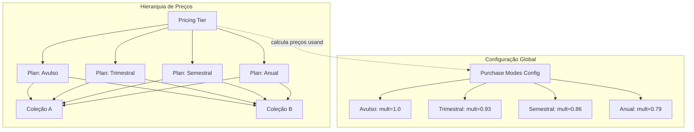
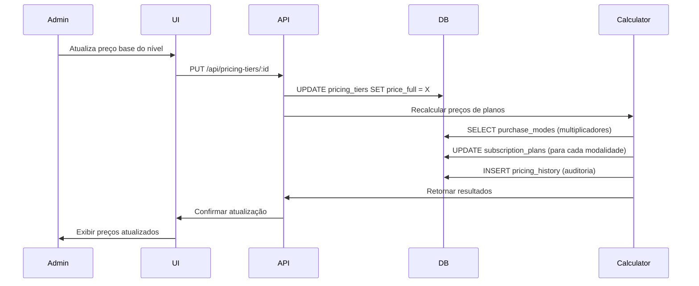

# Documento de Design: Reestruturação do Sistema de Preços

## Visão Geral

Este documento descreve o design técnico para reestruturar completamente o sistema de preços da plataforma, estabelecendo a hierarquia correta: **Níveis de Preço → Modalidades de Compra → Coleções**. A reestruturação corrige a arquitetura atual onde `subscription_plans` e `pricing_tiers` operam como sistemas paralelos e desconectados.

### Objetivos do Design

1. Estabelecer hierarquia clara: Pricing Tiers contêm múltiplos Subscription Plans
2. Unificar gerenciamento de preços em um único ponto (o nível)
3. Automatizar cálculo de preços de modalidades baseado em multiplicadores
4. Manter compatibilidade total com assinaturas ativas existentes
5. Eliminar duplicação de lógica de precificação
6. Fornecer interface unificada para gerenciamento de preços

### Tecnologias Utilizadas

- **Backend**: Supabase (PostgreSQL + Edge Functions)
- **Frontend**: React 18 + TypeScript + Vite
- **UI**: Radix UI + Tailwind CSS + shadcn/ui
- **State Management**: TanStack Query (React Query)
- **Validação**: Zod
- **Testes**: Vitest + fast-check (property-based testing)

## Arquitetura

### Diagrama de Arquitetura do Sistema




### Fluxo de Dados Principal



### Comparação: Antes vs Depois

**ANTES (Estrutura Atual - Incorreta):**
```
subscription_plans (independente)
├─ Trimestral: R$ 1.350
├─ Semestral: R$ 2.700
└─ Anual: R$ 3.600

pricing_tiers (independente)
├─ Nível 1: R$ 500
├─ Nível 2: R$ 700
└─ Nível 3: R$ 900

collections
├─ Coleção A → pricing_tier_id (apenas para avulso)
└─ Coleção B → pricing_tier_id (apenas para avulso)

❌ Problemas:
- Dois sistemas de preço paralelos
- Subscription plans não usam pricing tiers
- Impossível gerenciar preços de forma unificada
```

**DEPOIS (Estrutura Nova - Correta):**
```
pricing_tiers
└─ Nível 2 (preço base: R$ 700)
   ├─ subscription_plan: Avulso (mult=1.0) → R$ 700
   ├─ subscription_plan: Trimestral (mult=0.93) → R$ 651
   ├─ subscription_plan: Semestral (mult=0.86) → R$ 602
   └─ subscription_plan: Anual (mult=0.79) → R$ 553

collections
├─ Coleção A → tier_id (Nível 2)
└─ Coleção B → tier_id (Nível 2)

✅ Benefícios:
- Hierarquia clara e única
- Gerenciamento unificado
- Preços calculados automaticamente
- Consistência garantida
```


## Componentes e Interfaces

### 1. Modificações na Tabela subscription_plans

Adicionar campos para vincular planos aos níveis e modalidades:

```sql
-- Adicionar colunas para hierarquia
ALTER TABLE subscription_plans
ADD COLUMN IF NOT EXISTS tier_id UUID REFERENCES pricing_tiers(id) ON DELETE CASCADE,
ADD COLUMN IF NOT EXISTS plan_mode TEXT NOT NULL DEFAULT 'standalone' 
  CHECK (plan_mode IN ('standalone', 'trimestral', 'semestral', 'anual')),
ADD COLUMN IF NOT EXISTS price_multiplier NUMERIC(5,3) NOT NULL DEFAULT 1.000 
  CHECK (price_multiplier > 0 AND price_multiplier <= 2.0);

-- Garantir unicidade de combinação tier + mode
CREATE UNIQUE INDEX idx_subscription_plans_tier_mode 
ON subscription_plans(tier_id, plan_mode) 
WHERE tier_id IS NOT NULL;

-- Índices para performance
CREATE INDEX idx_subscription_plans_tier_id ON subscription_plans(tier_id);
CREATE INDEX idx_subscription_plans_plan_mode ON subscription_plans(plan_mode);

COMMENT ON COLUMN subscription_plans.tier_id IS 'Nível de preço ao qual este plano pertence';
COMMENT ON COLUMN subscription_plans.plan_mode IS 'Modalidade de compra: standalone (avulso), trimestral, semestral, anual';
COMMENT ON COLUMN subscription_plans.price_multiplier IS 'Multiplicador aplicado ao preço base do nível para calcular preço deste plano';
```

### 2. Nova Tabela: purchase_modes

Configuração global de modalidades de compra:

```sql
CREATE TABLE IF NOT EXISTS purchase_modes (
  id UUID PRIMARY KEY DEFAULT gen_random_uuid(),
  mode_key TEXT NOT NULL UNIQUE CHECK (mode_key IN ('standalone', 'trimestral', 'semestral', 'anual')),
  name TEXT NOT NULL,
  description TEXT,
  
  -- Configuração de preço
  price_multiplier NUMERIC(5,3) NOT NULL DEFAULT 1.000 CHECK (price_multiplier > 0 AND price_multiplier <= 2.0),
  
  -- Configuração de assinatura
  collections_count INTEGER NOT NULL DEFAULT 1 CHECK (collections_count > 0),
  deliveries_total INTEGER NOT NULL DEFAULT 1 CHECK (deliveries_total > 0),
  includes_bonus BOOLEAN NOT NULL DEFAULT false,
  
  -- Status
  is_active BOOLEAN NOT NULL DEFAULT true,
  display_order INTEGER NOT NULL DEFAULT 0,
  
  -- Auditoria
  created_at TIMESTAMPTZ NOT NULL DEFAULT NOW(),
  updated_at TIMESTAMPTZ NOT NULL DEFAULT NOW()
);

CREATE INDEX idx_purchase_modes_active ON purchase_modes(is_active) WHERE is_active = true;
CREATE INDEX idx_purchase_modes_display_order ON purchase_modes(display_order);

COMMENT ON TABLE purchase_modes IS 'Configuração global de modalidades de compra e seus multiplicadores';
COMMENT ON COLUMN purchase_modes.price_multiplier IS 'Multiplicador aplicado ao preço base do nível (ex: 0.93 para 7% de desconto)';
COMMENT ON COLUMN purchase_modes.collections_count IS 'Número de coleções incluídas nesta modalidade';
COMMENT ON COLUMN purchase_modes.deliveries_total IS 'Número total de entregas (ex: 3 para trimestral, 6 para semestral)';

-- Inserir configurações padrão
INSERT INTO purchase_modes (mode_key, name, description, price_multiplier, collections_count, deliveries_total, includes_bonus, display_order) VALUES
  ('standalone', 'Avulso', 'Compra avulsa de uma coleção', 1.000, 1, 1, false, 1),
  ('trimestral', 'Trimestral', 'Plano de 3 meses', 0.930, 3, 3, false, 2),
  ('semestral', 'Semestral', 'Plano de 6 meses com bônus', 0.860, 6, 6, true, 3),
  ('anual', 'Anual', 'Plano anual', 0.790, 12, 12, true, 4);
```


### 3. Tabela de Auditoria de Modalidades

Registrar mudanças em configurações de modalidades:

```sql
CREATE TABLE IF NOT EXISTS purchase_mode_history (
  id UUID PRIMARY KEY DEFAULT gen_random_uuid(),
  mode_key TEXT NOT NULL,
  field_name TEXT NOT NULL,
  old_value TEXT,
  new_value TEXT NOT NULL,
  changed_at TIMESTAMPTZ NOT NULL DEFAULT NOW(),
  changed_by UUID REFERENCES auth.users(id),
  metadata JSONB
);

CREATE INDEX idx_purchase_mode_history_mode ON purchase_mode_history(mode_key, changed_at DESC);
CREATE INDEX idx_purchase_mode_history_changed_at ON purchase_mode_history(changed_at DESC);

COMMENT ON TABLE purchase_mode_history IS 'Histórico de mudanças em configurações de modalidades de compra';
```

### 4. View: pricing_tiers_with_plans

View consolidada mostrando níveis com todos os seus planos:

```sql
CREATE OR REPLACE VIEW pricing_tiers_with_plans AS
SELECT
  pt.id as tier_id,
  pt.name as tier_name,
  pt.description as tier_description,
  pt.price_full as tier_price_base,
  pt.price_pix as tier_price_pix_base,
  pt.deposit_amount as tier_deposit,
  pt.is_active as tier_is_active,
  pt.is_default as tier_is_default,
  
  sp.id as plan_id,
  sp.plan_mode,
  sp.name as plan_name,
  sp.price_full as plan_price_full,
  sp.price_pix as plan_price_pix,
  sp.price_multiplier,
  sp.collections_count,
  sp.deliveries_total,
  sp.is_active as plan_is_active,
  
  pm.name as mode_name,
  pm.description as mode_description,
  pm.includes_bonus,
  
  (SELECT COUNT(*) FROM collection_tier_assignments WHERE tier_id = pt.id) as assigned_collections_count,
  (SELECT COUNT(*) FROM subscriptions WHERE plan_id = sp.id AND status = 'active') as active_subscriptions_count
  
FROM pricing_tiers pt
LEFT JOIN subscription_plans sp ON sp.tier_id = pt.id
LEFT JOIN purchase_modes pm ON pm.mode_key = sp.plan_mode
ORDER BY pt.display_order, pm.display_order;

GRANT SELECT ON pricing_tiers_with_plans TO authenticated, anon;
```


## Modelos de Dados

### TypeScript Interfaces

```typescript
// src/types/pricing-restructure.ts

/**
 * Modalidade de Compra (Purchase Mode)
 * Configuração global de uma modalidade
 */
export interface PurchaseMode {
  id: string;
  mode_key: 'standalone' | 'trimestral' | 'semestral' | 'anual';
  name: string;
  description: string | null;
  price_multiplier: number; // 0.1 a 2.0
  collections_count: number;
  deliveries_total: number;
  includes_bonus: boolean;
  is_active: boolean;
  display_order: number;
  created_at: string;
  updated_at: string;
}

/**
 * Plano de Assinatura Vinculado a Nível
 * Representa uma modalidade específica de um nível
 */
export interface SubscriptionPlanWithTier {
  id: string;
  tier_id: string;
  plan_mode: 'standalone' | 'trimestral' | 'semestral' | 'anual';
  plan_type: string; // Mantido para compatibilidade
  name: string;
  description: string | null;
  
  // Preços calculados automaticamente
  price_full: number;
  price_pix: number;
  price_multiplier: number;
  
  // Configuração
  collections_count: number;
  deliveries_total: number;
  includes_bonus: boolean;
  can_switch: boolean;
  switch_limit: number | null;
  switch_cutoff_days: number;
  max_installments: number;
  
  // Status
  is_active: boolean;
  display_order: number;
  
  // Auditoria
  created_at: string;
  updated_at: string;
}

/**
 * Nível de Preço com Planos
 * Inclui todos os planos (modalidades) do nível
 */
export interface PricingTierWithPlans {
  // Dados do nível
  tier_id: string;
  tier_name: string;
  tier_description: string | null;
  tier_price_base: number;
  tier_price_pix_base: number;
  tier_deposit: number;
  tier_is_active: boolean;
  tier_is_default: boolean;
  
  // Planos do nível
  plans: SubscriptionPlanWithTier[];
  
  // Estatísticas
  assigned_collections_count: number;
  total_active_subscriptions: number;
}

/**
 * Histórico de Mudanças de Modalidade
 */
export interface PurchaseModeHistory {
  id: string;
  mode_key: string;
  field_name: string;
  old_value: string | null;
  new_value: string;
  changed_at: string;
  changed_by: string | null;
  metadata: Record<string, any> | null;
}

/**
 * Input para Criar Nível com Planos
 */
export interface CreateTierWithPlansInput {
  name: string;
  description?: string;
  price_full: number;
  deposit_amount: number;
  pix_discount_percentage?: number;
  is_default?: boolean;
  display_order?: number;
}

/**
 * Input para Atualizar Modalidade
 */
export interface UpdatePurchaseModeInput {
  price_multiplier?: number;
  collections_count?: number;
  deliveries_total?: number;
  includes_bonus?: boolean;
  is_active?: boolean;
}

/**
 * Resultado de Cálculo de Preços
 */
export interface PriceCalculationResult {
  mode_key: string;
  base_price: number;
  multiplier: number;
  calculated_price_full: number;
  calculated_price_pix: number;
  pix_discount_percentage: number;
}

/**
 * Resultado de Migração
 */
export interface MigrationResult {
  tiers_created: number;
  plans_migrated: number;
  plans_created: number;
  subscriptions_preserved: number;
  errors: string[];
  warnings: string[];
}
```


### Schemas de Validação Zod

```typescript
// src/lib/validations/pricing-restructure.ts

import { z } from 'zod';

export const purchaseModeSchema = z.object({
  mode_key: z.enum(['standalone', 'trimestral', 'semestral', 'anual']),
  name: z.string().min(1, 'Nome é obrigatório').max(100),
  description: z.string().max(500).optional(),
  price_multiplier: z.number()
    .min(0.1, 'Multiplicador deve ser no mínimo 0.1')
    .max(2.0, 'Multiplicador deve ser no máximo 2.0'),
  collections_count: z.number().int().positive('Número de coleções deve ser positivo'),
  deliveries_total: z.number().int().positive('Número de entregas deve ser positivo'),
  includes_bonus: z.boolean().default(false),
  is_active: z.boolean().default(true),
});

export const updatePurchaseModeSchema = purchaseModeSchema.partial().omit({ mode_key: true });

export const createTierWithPlansSchema = z.object({
  name: z.string().min(1, 'Nome é obrigatório').max(100),
  description: z.string().max(500).optional(),
  price_full: z.number().positive('Preço cheio deve ser maior que zero'),
  deposit_amount: z.number().positive('Valor da entrada deve ser maior que zero'),
  pix_discount_percentage: z.number().min(0).max(100).default(5),
  is_default: z.boolean().default(false),
  display_order: z.number().int().min(0).default(0),
}).refine(
  (data) => data.deposit_amount < data.price_full,
  {
    message: 'Valor da entrada deve ser menor que o preço cheio',
    path: ['deposit_amount'],
  }
);

export type CreateTierWithPlansFormData = z.infer<typeof createTierWithPlansSchema>;
export type UpdatePurchaseModeFormData = z.infer<typeof updatePurchaseModeSchema>;
```


## Funções e Stored Procedures

### 1. Função: create_tier_with_plans

Cria um nível de preço e automaticamente cria planos para todas as modalidades ativas:

```sql
CREATE OR REPLACE FUNCTION create_tier_with_plans(
  p_name TEXT,
  p_description TEXT DEFAULT NULL,
  p_price_full NUMERIC DEFAULT 700.00,
  p_deposit_amount NUMERIC DEFAULT 100.00,
  p_pix_discount_percentage NUMERIC DEFAULT 5.00,
  p_is_default BOOLEAN DEFAULT false,
  p_display_order INTEGER DEFAULT 0,
  p_created_by UUID DEFAULT NULL
)
RETURNS TABLE (
  tier_id UUID,
  plans_created INTEGER
) AS $$
DECLARE
  v_tier_id UUID;
  v_price_pix NUMERIC;
  v_mode RECORD;
  v_plan_price_full NUMERIC;
  v_plan_price_pix NUMERIC;
  v_plans_created INTEGER := 0;
BEGIN
  -- Validações
  IF p_price_full <= 0 THEN
    RAISE EXCEPTION 'Preço cheio deve ser maior que zero';
  END IF;
  
  IF p_deposit_amount <= 0 THEN
    RAISE EXCEPTION 'Valor da entrada deve ser maior que zero';
  END IF;
  
  IF p_deposit_amount >= p_price_full THEN
    RAISE EXCEPTION 'Valor da entrada deve ser menor que o preço cheio';
  END IF;
  
  -- Criar nível usando função existente
  v_tier_id := create_pricing_tier(
    p_name, p_description, p_price_full, p_deposit_amount,
    p_pix_discount_percentage, p_is_default, p_display_order, p_created_by
  );
  
  -- Criar planos para cada modalidade ativa
  FOR v_mode IN
    SELECT * FROM purchase_modes WHERE is_active = true ORDER BY display_order
  LOOP
    -- Calcular preços do plano
    v_plan_price_full := ROUND(p_price_full * v_mode.price_multiplier, 2);
    v_plan_price_pix := ROUND(v_plan_price_full * (1 - p_pix_discount_percentage / 100), 2);
    
    -- Criar plano
    INSERT INTO subscription_plans (
      tier_id,
      plan_mode,
      plan_type,
      name,
      description,
      price_full,
      price_pix,
      price_multiplier,
      collections_count,
      deliveries_total,
      includes_bonus,
      is_active,
      display_order
    ) VALUES (
      v_tier_id,
      v_mode.mode_key,
      v_mode.mode_key, -- Manter plan_type para compatibilidade
      p_name || ' - ' || v_mode.name,
      v_mode.description,
      v_plan_price_full,
      v_plan_price_pix,
      v_mode.price_multiplier,
      v_mode.collections_count,
      v_mode.deliveries_total,
      v_mode.includes_bonus,
      true,
      v_mode.display_order
    );
    
    v_plans_created := v_plans_created + 1;
    
    -- Registrar no histórico
    INSERT INTO pricing_history (
      tier_id, change_type, new_price_full, new_price_pix,
      changed_by, metadata
    ) VALUES (
      v_tier_id, 'tier_created', v_plan_price_full, v_plan_price_pix,
      p_created_by,
      jsonb_build_object(
        'tier_name', p_name,
        'plan_mode', v_mode.mode_key,
        'multiplier', v_mode.price_multiplier
      )
    );
  END LOOP;
  
  RETURN QUERY SELECT v_tier_id, v_plans_created;
END;
$$ LANGUAGE plpgsql SECURITY DEFINER;

COMMENT ON FUNCTION create_tier_with_plans IS 'Cria nível de preço e automaticamente cria planos para todas as modalidades ativas';
```


### 2. Função: update_tier_and_recalculate_plans

Atualiza um nível e recalcula automaticamente os preços de todos os planos:

```sql
CREATE OR REPLACE FUNCTION update_tier_and_recalculate_plans(
  p_tier_id UUID,
  p_price_full NUMERIC DEFAULT NULL,
  p_deposit_amount NUMERIC DEFAULT NULL,
  p_pix_discount_percentage NUMERIC DEFAULT NULL,
  p_updated_by UUID DEFAULT NULL
)
RETURNS TABLE (
  plans_updated INTEGER,
  collections_updated INTEGER
) AS $$
DECLARE
  v_old_tier RECORD;
  v_new_price_full NUMERIC;
  v_new_pix_discount NUMERIC;
  v_plan RECORD;
  v_new_plan_price_full NUMERIC;
  v_new_plan_price_pix NUMERIC;
  v_plans_updated INTEGER := 0;
  v_collections_updated INTEGER := 0;
BEGIN
  -- Buscar dados atuais do nível
  SELECT * INTO v_old_tier FROM pricing_tiers WHERE id = p_tier_id;
  
  IF NOT FOUND THEN
    RAISE EXCEPTION 'Nível de preço não encontrado';
  END IF;
  
  -- Determinar novos valores
  v_new_price_full := COALESCE(p_price_full, v_old_tier.price_full);
  v_new_pix_discount := COALESCE(p_pix_discount_percentage, v_old_tier.pix_discount_percentage);
  
  -- Atualizar nível usando função existente
  PERFORM update_pricing_tier(
    p_tier_id,
    NULL, -- name
    NULL, -- description
    p_price_full,
    p_deposit_amount,
    p_pix_discount_percentage,
    NULL, -- is_active
    NULL, -- is_default
    NULL, -- display_order
    p_updated_by
  );
  
  -- Recalcular preços de todos os planos do nível
  FOR v_plan IN
    SELECT * FROM subscription_plans WHERE tier_id = p_tier_id
  LOOP
    -- Calcular novos preços
    v_new_plan_price_full := ROUND(v_new_price_full * v_plan.price_multiplier, 2);
    v_new_plan_price_pix := ROUND(v_new_plan_price_full * (1 - v_new_pix_discount / 100), 2);
    
    -- Atualizar plano
    UPDATE subscription_plans
    SET
      price_full = v_new_plan_price_full,
      price_pix = v_new_plan_price_pix,
      updated_at = NOW()
    WHERE id = v_plan.id;
    
    v_plans_updated := v_plans_updated + 1;
    
    -- Registrar no histórico
    INSERT INTO pricing_history (
      tier_id, change_type,
      old_price_full, new_price_full,
      old_price_pix, new_price_pix,
      changed_by, metadata
    ) VALUES (
      p_tier_id, 'price_propagated',
      v_plan.price_full, v_new_plan_price_full,
      v_plan.price_pix, v_new_plan_price_pix,
      p_updated_by,
      jsonb_build_object(
        'plan_id', v_plan.id,
        'plan_mode', v_plan.plan_mode,
        'multiplier', v_plan.price_multiplier,
        'reason', 'tier_price_updated'
      )
    );
  END LOOP;
  
  -- Propagar para coleções (usa função existente)
  SELECT COUNT(*) INTO v_collections_updated
  FROM propagate_tier_prices(p_tier_id, p_updated_by);
  
  RETURN QUERY SELECT v_plans_updated, v_collections_updated;
END;
$$ LANGUAGE plpgsql SECURITY DEFINER;

COMMENT ON FUNCTION update_tier_and_recalculate_plans IS 'Atualiza nível e recalcula automaticamente preços de todos os planos e coleções';
```


### 3. Função: update_purchase_mode_multiplier

Atualiza o multiplicador de uma modalidade e recalcula todos os planos dessa modalidade:

```sql
CREATE OR REPLACE FUNCTION update_purchase_mode_multiplier(
  p_mode_key TEXT,
  p_new_multiplier NUMERIC,
  p_updated_by UUID DEFAULT NULL
)
RETURNS TABLE (
  plans_updated INTEGER,
  tiers_affected INTEGER
) AS $$
DECLARE
  v_old_multiplier NUMERIC;
  v_plan RECORD;
  v_tier RECORD;
  v_new_price_full NUMERIC;
  v_new_price_pix NUMERIC;
  v_plans_updated INTEGER := 0;
  v_tiers_affected INTEGER := 0;
BEGIN
  -- Validar multiplicador
  IF p_new_multiplier <= 0 OR p_new_multiplier > 2.0 THEN
    RAISE EXCEPTION 'Multiplicador deve estar entre 0.1 e 2.0';
  END IF;
  
  -- Buscar multiplicador atual
  SELECT price_multiplier INTO v_old_multiplier
  FROM purchase_modes
  WHERE mode_key = p_mode_key;
  
  IF NOT FOUND THEN
    RAISE EXCEPTION 'Modalidade não encontrada';
  END IF;
  
  -- Atualizar modalidade
  UPDATE purchase_modes
  SET
    price_multiplier = p_new_multiplier,
    updated_at = NOW()
  WHERE mode_key = p_mode_key;
  
  -- Registrar mudança
  INSERT INTO purchase_mode_history (
    mode_key, field_name, old_value, new_value, changed_by
  ) VALUES (
    p_mode_key, 'price_multiplier', v_old_multiplier::TEXT, p_new_multiplier::TEXT, p_updated_by
  );
  
  -- Recalcular todos os planos desta modalidade
  FOR v_plan IN
    SELECT sp.*, pt.price_full as tier_price_full, pt.pix_discount_percentage
    FROM subscription_plans sp
    JOIN pricing_tiers pt ON pt.id = sp.tier_id
    WHERE sp.plan_mode = p_mode_key
  LOOP
    -- Calcular novos preços
    v_new_price_full := ROUND(v_plan.tier_price_full * p_new_multiplier, 2);
    v_new_price_pix := ROUND(v_new_price_full * (1 - v_plan.pix_discount_percentage / 100), 2);
    
    -- Atualizar plano
    UPDATE subscription_plans
    SET
      price_full = v_new_price_full,
      price_pix = v_new_price_pix,
      price_multiplier = p_new_multiplier,
      updated_at = NOW()
    WHERE id = v_plan.id;
    
    v_plans_updated := v_plans_updated + 1;
    
    -- Registrar no histórico
    INSERT INTO pricing_history (
      tier_id, change_type,
      old_price_full, new_price_full,
      old_price_pix, new_price_pix,
      changed_by, metadata
    ) VALUES (
      v_plan.tier_id, 'price_propagated',
      v_plan.price_full, v_new_price_full,
      v_plan.price_pix, v_new_price_pix,
      p_updated_by,
      jsonb_build_object(
        'plan_id', v_plan.id,
        'plan_mode', p_mode_key,
        'old_multiplier', v_old_multiplier,
        'new_multiplier', p_new_multiplier,
        'reason', 'mode_multiplier_updated'
      )
    );
  END LOOP;
  
  -- Contar níveis afetados
  SELECT COUNT(DISTINCT tier_id) INTO v_tiers_affected
  FROM subscription_plans
  WHERE plan_mode = p_mode_key;
  
  RETURN QUERY SELECT v_plans_updated, v_tiers_affected;
END;
$$ LANGUAGE plpgsql SECURITY DEFINER;

COMMENT ON FUNCTION update_purchase_mode_multiplier IS 'Atualiza multiplicador de modalidade e recalcula todos os planos dessa modalidade';
```


### 4. Função: migrate_plans_to_tiers

Migra planos existentes para a nova estrutura hierárquica:

```sql
CREATE OR REPLACE FUNCTION migrate_plans_to_tiers(
  p_dry_run BOOLEAN DEFAULT true,
  p_executed_by UUID DEFAULT NULL
)
RETURNS TABLE (
  dry_run BOOLEAN,
  tiers_to_create INTEGER,
  plans_to_migrate INTEGER,
  subscriptions_to_preserve INTEGER,
  migration_plan JSONB
) AS $$
DECLARE
  v_migration_id UUID;
  v_plan_group RECORD;
  v_tier_id UUID;
  v_tiers_created INTEGER := 0;
  v_plans_migrated INTEGER := 0;
  v_subscriptions_count INTEGER;
  v_migration_plan JSONB := '[]'::JSONB;
  v_group_plan JSONB;
BEGIN
  -- Contar assinaturas ativas
  SELECT COUNT(*) INTO v_subscriptions_count
  FROM subscriptions
  WHERE status = 'active';
  
  -- Agrupar planos por preços similares
  FOR v_plan_group IN
    SELECT
      plan_mode,
      ROUND(AVG(price_full), 2) as avg_price_full,
      ROUND(AVG(price_pix), 2) as avg_price_pix,
      COUNT(*) as plan_count,
      ARRAY_AGG(id) as plan_ids,
      ARRAY_AGG(name) as plan_names
    FROM subscription_plans
    WHERE tier_id IS NULL
    GROUP BY plan_mode
    ORDER BY plan_mode
  LOOP
    v_group_plan := jsonb_build_object(
      'mode', v_plan_group.plan_mode,
      'avg_price_full', v_plan_group.avg_price_full,
      'avg_price_pix', v_plan_group.avg_price_pix,
      'plan_count', v_plan_group.plan_count,
      'plan_ids', v_plan_group.plan_ids,
      'plan_names', v_plan_group.plan_names
    );
    
    v_migration_plan := v_migration_plan || v_group_plan;
    v_tiers_created := v_tiers_created + 1;
    v_plans_migrated := v_plans_migrated + v_plan_group.plan_count;
  END LOOP;
  
  -- Se não é dry run, executar migração
  IF NOT p_dry_run THEN
    -- Criar registro de auditoria
    INSERT INTO migration_audit (
      migration_type, collections_affected, tiers_created,
      status, executed_by, migration_data
    ) VALUES (
      'initial_migration', 0, v_tiers_created,
      'in_progress', p_executed_by, v_migration_plan
    ) RETURNING id INTO v_migration_id;
    
    -- TODO: Implementar lógica de migração real
    -- Por enquanto, apenas retornar o plano
    
    -- Atualizar status da migração
    UPDATE migration_audit
    SET
      status = 'completed',
      completed_at = NOW()
    WHERE id = v_migration_id;
  END IF;
  
  RETURN QUERY SELECT
    p_dry_run,
    v_tiers_created,
    v_plans_migrated,
    v_subscriptions_count,
    v_migration_plan;
END;
$$ LANGUAGE plpgsql SECURITY DEFINER;

COMMENT ON FUNCTION migrate_plans_to_tiers IS 'Migra planos existentes para estrutura hierárquica com níveis';
```


## Propriedades de Correção

*Uma propriedade é uma característica ou comportamento que deve ser verdadeiro em todas as execuções válidas de um sistema - essencialmente, uma declaração formal sobre o que o sistema deve fazer. As propriedades servem como ponte entre especificações legíveis por humanos e garantias de correção verificáveis por máquina.*

### Reflexão sobre Propriedades

Após análise dos critérios de aceitação, identificamos as seguintes redundâncias e consolidações:

**Redundâncias Identificadas:**

1. **Requisitos 1.2, 4.1 e 6.5** são sobre recálculo de preços quando o nível é atualizado - consolidar em uma propriedade
2. **Requisitos 1.6 e 8.4** são idênticos (desativar nível desativa planos) - consolidar
3. **Requisitos 4.7 e 6.6** são idênticos (validar preços positivos) - consolidar
4. **Requisitos 6.1 e 6.4** podem ser consolidados em uma propriedade geral de cálculo de preços
5. **Requisitos 9.1, 9.2, 9.3 e 9.4** são todos sobre auditoria - consolidar em propriedades mais abrangentes

**Propriedades Consolidadas:**

As propriedades abaixo representam o conjunto mínimo necessário para validar todos os requisitos testáveis, eliminando redundâncias.

### Propriedade 1: Criação Automática de Planos

*Para qualquer* nível de preço criado, o sistema deve criar automaticamente um plano para cada modalidade ativa, resultando em número de planos igual ao número de modalidades ativas.

**Valida: Requisitos 1.1, 8.1**

### Propriedade 2: Recálculo Automático de Preços de Planos

*Para qualquer* atualização de preço base de um nível, todos os planos associados devem ter seus preços recalculados usando a fórmula: `plan_price = tier_price * mode_multiplier`, arredondado para 2 casas decimais.

**Valida: Requisitos 1.2, 4.1, 6.5**

### Propriedade 3: Unicidade de Combinação Tier + Mode

*Para qualquer* tentativa de criar um segundo plano com a mesma combinação (tier_id, plan_mode), o sistema deve rejeitar a operação com erro de constraint de unicidade.

**Valida: Requisitos 1.5**

### Propriedade 4: Desativação em Cascata

*Para qualquer* nível de preço que é desativado, todos os planos associados (onde tier_id = nível) devem ser automaticamente desativados (is_active = false).

**Valida: Requisitos 1.6, 8.4**

### Propriedade 5: Cálculo Automático de Preços

*Para qualquer* plano, o preço calculado deve ser igual a `tier.price_full * plan.price_multiplier`, e o preço PIX deve ser `calculated_price * (1 - pix_discount / 100)`, ambos arredondados para 2 casas decimais.

**Valida: Requisitos 1.7, 6.1, 6.2, 6.3**

### Propriedade 6: Agrupamento de Planos por Preços Idênticos

*Para qualquer* conjunto de planos sem tier_id e com valores idênticos de price_full e plan_mode, a ferramenta de migração deve agrupá-los no mesmo nível sugerido.

**Valida: Requisitos 2.2**

### Propriedade 7: Migração Cria Níveis e Vincula Planos

*Para qualquer* execução de migração (dry_run=false), o sistema deve criar níveis conforme os agrupamentos e atualizar todos os planos para ter tier_id definido.

**Valida: Requisitos 2.3, 2.4**

### Propriedade 8: Preservação de Assinaturas Ativas

*Para qualquer* migração executada, o número de assinaturas ativas antes e depois deve ser idêntico, e nenhuma assinatura deve ter seu plan_id alterado.

**Valida: Requisitos 2.5, 7.3**

### Propriedade 9: Geração de Relatório de Migração

*Para qualquer* migração executada, o sistema deve gerar um registro em migration_audit contendo tiers_created, plans_migrated, status e migration_data.

**Valida: Requisitos 2.7**

### Propriedade 10: Recálculo por Mudança de Multiplicador

*Para qualquer* mudança no multiplicador de uma modalidade, todos os planos com plan_mode igual à modalidade devem ter seus preços recalculados usando o novo multiplicador.

**Valida: Requisitos 3.3**

### Propriedade 11: Validação de Multiplicador

*Para qualquer* tentativa de definir um multiplicador fora do intervalo [0.1, 2.0], o sistema deve rejeitar a operação com erro de validação.

**Valida: Requisitos 3.4**

### Propriedade 12: Auditoria de Mudanças de Configuração

*Para qualquer* mudança em purchase_modes (multiplicador, collections_count, deliveries_total), deve existir um registro correspondente em purchase_mode_history contendo old_value, new_value e changed_at.

**Valida: Requisitos 3.7, 9.2**

### Propriedade 13: Propagação para Coleções

*Para qualquer* atualização de nível, todas as coleções atribuídas ao nível (via collection_tier_assignments) devem ter seus preços atualizados para corresponder ao novo preço base do nível.

**Valida: Requisitos 4.4**

### Propriedade 14: Cálculo de Preço Efetivo

*Para qualquer* modalidade de um nível, o preço exibido deve ser igual a `tier.price_full * mode.price_multiplier`, arredondado para 2 casas decimais.

**Valida: Requisitos 4.5**

### Propriedade 15: Cálculo Automático de Preço PIX

*Para qualquer* plano, o price_pix deve ser calculado como `price_full * (1 - pix_discount_percentage / 100)`, arredondado para 2 casas decimais.

**Valida: Requisitos 4.6**

### Propriedade 16: Validação de Preços Positivos

*Para qualquer* preço calculado (price_full ou price_pix de um plano), o valor deve ser estritamente maior que zero.

**Valida: Requisitos 4.7, 6.6**

### Propriedade 17: Multiplicador Identidade

*Para qualquer* plano com price_multiplier = 1.0, o price_full do plano deve ser igual ao price_full do nível (dentro de tolerância de 0.01 para arredondamento).

**Valida: Requisitos 6.4**

### Propriedade 18: Ordem de Aplicação de Descontos

*Para qualquer* cálculo de preço PIX, o desconto PIX deve ser aplicado após o multiplicador de modalidade, ou seja: `(tier_price * multiplier) * (1 - pix_discount / 100)`.

**Valida: Requisitos 6.3**

### Propriedade 19: Registro de Fórmula de Cálculo

*Para qualquer* recálculo de preço de plano, deve existir um registro em pricing_history com metadata contendo o multiplicador usado e a razão do recálculo.

**Valida: Requisitos 6.7, 9.3**

### Propriedade 20: Compatibilidade com Assinaturas Ativas

*Para qualquer* assinatura ativa, as operações de consulta e atualização devem funcionar normalmente independente de o plano ter tier_id definido ou não.

**Valida: Requisitos 7.1**

### Propriedade 21: Preços Originais Mantidos

*Para qualquer* assinatura ativa, o preço cobrado deve permanecer o mesmo até a renovação, mesmo que o preço do nível seja atualizado.

**Valida: Requisitos 7.4**

### Propriedade 22: Renovação Usa Preços Atuais

*Para qualquer* renovação de assinatura, o novo preço deve ser o preço atual do plano (calculado a partir do nível), não o preço original da assinatura.

**Valida: Requisitos 7.5**

### Propriedade 23: Prevenção de Exclusão de Níveis com Coleções

*Para qualquer* tentativa de excluir um nível que tem coleções atribuídas (EXISTS em collection_tier_assignments), o sistema deve rejeitar a operação.

**Valida: Requisitos 8.2**

### Propriedade 24: Prevenção de Exclusão de Planos com Assinaturas

*Para qualquer* tentativa de excluir um plano que tem assinaturas ativas (EXISTS em subscriptions WHERE status='active'), o sistema deve rejeitar a operação.

**Valida: Requisitos 8.3**

### Propriedade 25: Validação de Preço Base vs Entrada

*Para qualquer* nível, o sistema deve validar que price_full > deposit_amount, rejeitando operações que violem esta regra.

**Valida: Requisitos 8.5**

### Propriedade 26: Validação de Multiplicadores Positivos

*Para qualquer* modalidade, o price_multiplier deve ser estritamente maior que zero.

**Valida: Requisitos 8.6**

### Propriedade 27: Prevenção de Criação Manual de Planos

*Para qualquer* tentativa de criar um plano sem tier_id definido (após a migração), o sistema deve rejeitar a operação.

**Valida: Requisitos 8.7**

### Propriedade 28: Auditoria de Criação de Nível

*Para qualquer* nível criado, deve existir um registro em pricing_history com change_type='tier_created' para cada plano criado automaticamente.

**Valida: Requisitos 9.1**

### Propriedade 29: Auditoria Completa de Mudanças de Preço

*Para qualquer* mudança de preço de plano, o registro em pricing_history deve conter old_price_full, new_price_full, old_price_pix, new_price_pix e metadata com a razão da mudança.

**Valida: Requisitos 9.4**

### Propriedade 30: Agregação de Receita por Nível

*Para qualquer* conjunto de vendas, o relatório de receita por nível deve calcular corretamente a soma de todas as vendas de todos os planos do nível.

**Valida: Requisitos 10.1**

### Propriedade 31: Agregação de Receita por Modalidade

*Para qualquer* conjunto de vendas, o relatório de receita por modalidade deve calcular corretamente a soma de todas as vendas de planos com o mesmo plan_mode.

**Valida: Requisitos 10.2**

### Propriedade 32: Cálculo de Taxa de Conversão

*Para qualquer* conjunto de dados com visualizações e compras, a taxa de conversão deve ser calculada como `(compras / visualizações) * 100` para cada combinação nível+modalidade.

**Valida: Requisitos 10.3**

### Propriedade 33: Contagem de Assinaturas Ativas

*Para qualquer* consulta de assinaturas ativas por nível+modalidade, a contagem deve ser igual ao número de registros em subscriptions WHERE plan_id IN (planos do nível+modalidade) AND status='active'.

**Valida: Requisitos 10.4**

### Propriedade 34: Criação de Nível via API

*Para qualquer* POST válido em /api/pricing-tiers, o sistema deve criar um nível e automaticamente criar planos para todas as modalidades ativas, retornando tier_id e lista de plan_ids.

**Valida: Requisitos 11.3**

### Propriedade 35: Atualização de Nível via API

*Para qualquer* PUT válido em /api/pricing-tiers/:id, o sistema deve atualizar o nível e recalcular todos os planos associados, retornando plans_updated e collections_updated.

**Valida: Requisitos 11.4**

### Propriedade 36: Atualização de Modalidade via API

*Para qualquer* PUT válido em /api/purchase-modes/:mode, o sistema deve atualizar a modalidade e recalcular todos os planos dessa modalidade em todos os níveis.

**Valida: Requisitos 11.6**

### Propriedade 37: Estrutura Hierárquica de JSON

*Para qualquer* resposta de API de níveis, o JSON deve ter estrutura hierárquica: `{ tier: {...}, plans: [{...}], collections: [{...}] }`.

**Valida: Requisitos 11.7**


## Tratamento de Erros

### Estratégia de Tratamento de Erros

O sistema implementará tratamento de erros em múltiplas camadas para garantir robustez durante a reestruturação:

#### 1. Camada de Banco de Dados

**Constraints e Validações:**
- UNIQUE constraint em (tier_id, plan_mode) garante um plano por modalidade por nível
- CHECK constraints garantem multiplicadores válidos (0.1 a 2.0)
- FOREIGN KEY com ON DELETE CASCADE garante integridade referencial
- CHECK constraints garantem preços positivos

**Tratamento de Erros:**
```sql
BEGIN
  -- Operação
  INSERT INTO subscription_plans (tier_id, plan_mode, ...) VALUES (...);
EXCEPTION
  WHEN unique_violation THEN
    RAISE EXCEPTION 'Já existe um plano % para este nível', plan_mode;
  WHEN foreign_key_violation THEN
    RAISE EXCEPTION 'Nível de preço não encontrado';
  WHEN check_violation THEN
    RAISE EXCEPTION 'Dados inválidos: %', SQLERRM;
END;
```

#### 2. Camada de Edge Functions

**Validação de Entrada:**
- Validar formato de UUIDs
- Validar tipos de dados
- Validar permissões de usuário
- Validar estado do sistema antes de operações críticas

**Tratamento de Erros:**
```typescript
try {
  const { data, error } = await supabaseClient.rpc("create_tier_with_plans", {
    p_name: tierData.name,
    p_price_full: tierData.price_full,
    // ...
  });
  
  if (error) throw error;
  
  return new Response(JSON.stringify({ ok: true, data }), { status: 200 });
} catch (error) {
  console.error("Erro ao criar nível:", error);
  
  return new Response(
    JSON.stringify({ 
      ok: false,
      error: error.message,
      code: error.code || "UNKNOWN_ERROR"
    }), 
    { status: 500 }
  );
}
```

#### 3. Camada de Frontend

**Validação de Formulários:**
- Validação client-side com Zod antes de enviar
- Feedback imediato ao usuário
- Prevenção de submissões inválidas
- Exibição de prévia de preços calculados

**Tratamento de Erros:**
```typescript
const createTierMutation = useMutation({
  mutationFn: async (tierData) => {
    // Validação client-side
    const validated = createTierWithPlansSchema.parse(tierData);
    
    // Chamada à API
    const { data, error } = await supabase.rpc("create_tier_with_plans", validated);
    
    if (error) {
      // Mapear erros do Supabase para mensagens amigáveis
      if (error.code === "23505") {
        throw new Error("Já existe um nível com este nome");
      }
      if (error.message.includes("modalidade")) {
        throw new Error("Erro ao criar planos: " + error.message);
      }
      throw error;
    }
    
    return data;
  },
  onError: (error: Error) => {
    toast({
      title: "Erro ao criar nível",
      description: error.message,
      variant: "destructive",
    });
  },
  onSuccess: (data) => {
    toast({
      title: "Nível criado",
      description: `Nível criado com ${data.plans_created} planos`,
    });
  },
});
```

### Cenários de Erro Específicos

#### Erro 1: Tentativa de Criar Plano Duplicado

**Detecção:** Constraint UNIQUE em (tier_id, plan_mode)
**Resposta:** Lançar exceção com mensagem clara
**Recuperação:** Sistema previne automaticamente, não requer ação do usuário

#### Erro 2: Falha Parcial na Criação de Planos

**Detecção:** Loop em create_tier_with_plans captura exceções individuais
**Resposta:** Continuar criando outros planos, acumular erros
**Recuperação:** Retornar lista de sucessos e falhas, permitir retry manual

#### Erro 3: Migração com Assinaturas Ativas

**Detecção:** Validação antes de migração
**Resposta:** Preservar plan_ids existentes, não modificar assinaturas ativas
**Recuperação:** Migração deve ser não-destrutiva por design

#### Erro 4: Multiplicador Inválido

**Detecção:** CHECK constraint e validação Zod
**Resposta:** Rejeitar operação antes de persistir
**Recuperação:** Usuário corrige valor e tenta novamente

#### Erro 5: Exclusão de Nível com Coleções

**Detecção:** Validação antes de DELETE
**Resposta:** Lançar exceção impedindo operação
**Recuperação:** Usuário deve primeiro reatribuir coleções ou desativar nível

### Logging e Monitoramento

**Eventos a Serem Logados:**
- Todas as criações de níveis e planos (via pricing_history)
- Todas as mudanças de multiplicadores (via purchase_mode_history)
- Todos os recálculos de preços (via pricing_history)
- Todas as migrações (via migration_audit)
- Erros em operações críticas

**Formato de Log:**
```typescript
{
  timestamp: "2024-01-15T10:30:00Z",
  level: "info",
  operation: "create_tier_with_plans",
  tier_id: "uuid",
  user_id: "uuid",
  plans_created: 4,
  metadata: {
    tier_name: "Nível 2",
    base_price: 700,
    modes: ["standalone", "trimestral", "semestral", "anual"]
  }
}
```


## Estratégia de Testes

### Abordagem Dual de Testes

O sistema utilizará uma combinação de testes unitários e testes baseados em propriedades:

**Testes Unitários:**
- Validam exemplos específicos e casos extremos
- Testam estrutura de banco de dados (campos, constraints)
- Verificam comportamento de UI
- Validam endpoints de API específicos

**Testes Baseados em Propriedades:**
- Validam propriedades universais através de múltiplas entradas geradas
- Garantem correção para ampla gama de cenários
- Detectam casos extremos não previstos
- Cada teste executa mínimo 100 iterações

### Biblioteca de Property-Based Testing

**Para TypeScript/JavaScript:** Utilizaremos **fast-check**

```bash
npm install --save-dev fast-check @types/fast-check
```

**Para SQL/PL/pgSQL:** Utilizaremos **pgTAP** para testes de banco de dados

```bash
# Instalar pgTAP no PostgreSQL
CREATE EXTENSION pgtap;
```

### Exemplos de Testes

#### Teste de Propriedade: Criação Automática de Planos

```typescript
// src/services/__tests__/tier-creation.property.test.ts
import { describe, it } from 'vitest';
import * as fc from 'fast-check';
import { createClient } from '@supabase/supabase-js';

describe('Propriedades de Criação de Níveis', () => {
  /**
   * Feature: pricing-system-restructure
   * Property 1: Criação Automática de Planos
   * 
   * Para qualquer nível de preço criado, o sistema deve criar automaticamente
   * um plano para cada modalidade ativa.
   */
  it('Propriedade 1: Criar nível cria planos para todas as modalidades ativas', async () => {
    await fc.assert(
      fc.asyncProperty(
        fc.record({
          name: fc.string({ minLength: 1, maxLength: 50 }),
          price_full: fc.float({ min: 100, max: 2000 }),
          deposit_amount: fc.float({ min: 50, max: 500 }),
        }),
        async ({ name, price_full, deposit_amount }) => {
          // Garantir que deposit < price_full
          if (deposit_amount >= price_full) return true;
          
          const supabase = createClient(
            process.env.VITE_SUPABASE_URL!,
            process.env.VITE_SUPABASE_SERVICE_ROLE_KEY!
          );
          
          // Contar modalidades ativas
          const { data: activeModes } = await supabase
            .from('purchase_modes')
            .select('mode_key')
            .eq('is_active', true);
          
          const expectedPlansCount = activeModes?.length || 0;
          
          // Criar nível
          const { data: result } = await supabase.rpc('create_tier_with_plans', {
            p_name: `Test-${name}-${Date.now()}`,
            p_price_full: price_full,
            p_deposit_amount: deposit_amount,
          });
          
          if (!result) return false;
          
          // Verificar que número de planos criados = número de modalidades ativas
          const plansCreated = result[0]?.plans_created || 0;
          const tierId = result[0]?.tier_id;
          
          // Cleanup
          if (tierId) {
            await supabase.from('pricing_tiers').delete().eq('id', tierId);
          }
          
          return plansCreated === expectedPlansCount;
        }
      ),
      { numRuns: 100 }
    );
  });
});
```

#### Teste de Propriedade: Recálculo de Preços

```typescript
/**
 * Feature: pricing-system-restructure
 * Property 2: Recálculo Automático de Preços de Planos
 * 
 * Para qualquer atualização de preço base de um nível, todos os planos
 * devem ter seus preços recalculados usando a fórmula correta.
 */
it('Propriedade 2: Atualizar nível recalcula preços de todos os planos', async () => {
  await fc.assert(
    fc.asyncProperty(
      fc.record({
        initialPrice: fc.float({ min: 500, max: 1000 }),
        updatedPrice: fc.float({ min: 500, max: 1000 }),
      }),
      async ({ initialPrice, updatedPrice }) => {
        const supabase = createClient(
          process.env.VITE_SUPABASE_URL!,
          process.env.VITE_SUPABASE_SERVICE_ROLE_KEY!
        );
        
        // Criar nível
        const { data: createResult } = await supabase.rpc('create_tier_with_plans', {
          p_name: `Test-${Date.now()}`,
          p_price_full: initialPrice,
          p_deposit_amount: 100,
        });
        
        const tierId = createResult?.[0]?.tier_id;
        if (!tierId) return false;
        
        // Buscar multiplicadores
        const { data: modes } = await supabase
          .from('purchase_modes')
          .select('mode_key, price_multiplier')
          .eq('is_active', true);
        
        // Atualizar preço do nível
        await supabase.rpc('update_tier_and_recalculate_plans', {
          p_tier_id: tierId,
          p_price_full: updatedPrice,
        });
        
        // Buscar planos atualizados
        const { data: plans } = await supabase
          .from('subscription_plans')
          .select('plan_mode, price_full, price_multiplier')
          .eq('tier_id', tierId);
        
        // Verificar que cada plano tem preço correto
        const allCorrect = plans?.every(plan => {
          const mode = modes?.find(m => m.mode_key === plan.plan_mode);
          if (!mode) return false;
          
          const expectedPrice = Math.round(updatedPrice * mode.price_multiplier * 100) / 100;
          return Math.abs(plan.price_full - expectedPrice) < 0.01;
        });
        
        // Cleanup
        await supabase.from('pricing_tiers').delete().eq('id', tierId);
        
        return allCorrect === true;
      }
    ),
    { numRuns: 100 }
  );
});
```

#### Teste Unitário: Estrutura de Banco de Dados

```typescript
// src/__tests__/database-structure.test.ts
import { describe, it, expect } from 'vitest';
import { createClient } from '@supabase/supabase-js';

describe('Estrutura de Banco de Dados', () => {
  /**
   * Feature: pricing-system-restructure
   * Requisito 1.3: Tabela subscription_plans deve ter coluna tier_id
   */
  it('subscription_plans deve ter coluna tier_id', async () => {
    const supabase = createClient(
      process.env.VITE_SUPABASE_URL!,
      process.env.VITE_SUPABASE_SERVICE_ROLE_KEY!
    );
    
    const { data, error } = await supabase
      .from('subscription_plans')
      .select('tier_id')
      .limit(1);
    
    expect(error).toBeNull();
    expect(data).toBeDefined();
  });
  
  /**
   * Feature: pricing-system-restructure
   * Requisito 1.4: Tabela subscription_plans deve ter coluna plan_mode
   */
  it('subscription_plans deve ter coluna plan_mode', async () => {
    const supabase = createClient(
      process.env.VITE_SUPABASE_URL!,
      process.env.VITE_SUPABASE_SERVICE_ROLE_KEY!
    );
    
    const { data, error } = await supabase
      .from('subscription_plans')
      .select('plan_mode')
      .limit(1);
    
    expect(error).toBeNull();
    expect(data).toBeDefined();
  });
});
```

### Cobertura de Testes

**Metas de Cobertura:**
- Funções de banco de dados: 100%
- Edge Functions: 90%
- Componentes React: 80%
- Utilitários: 95%

**Áreas Críticas (100% de cobertura obrigatória):**
- Cálculos de preço
- Criação automática de planos
- Recálculo de preços
- Migração de dados
- Validações de dados

### Execução de Testes

**Testes Unitários e de Propriedade:**
```bash
# Executar todos os testes
npm run test

# Executar com cobertura
npm run test:coverage

# Executar apenas testes de propriedade
npm run test -- --grep "Propriedade"

# Executar testes de reestruturação
npm run test -- pricing-restructure
```


## Considerações de Implementação

### Ordem de Implementação Recomendada

#### Fase 1: Preparação do Banco de Dados (Prioridade Alta)

1. Criar tabela `purchase_modes` com dados padrão
2. Adicionar colunas `tier_id`, `plan_mode`, `price_multiplier` em `subscription_plans`
3. Criar índices e constraints
4. Criar tabela `purchase_mode_history`
5. Criar view `pricing_tiers_with_plans`
6. Testar estrutura em ambiente de desenvolvimento

#### Fase 2: Funções de Negócio (Prioridade Alta)

1. Implementar função `create_tier_with_plans`
2. Implementar função `update_tier_and_recalculate_plans`
3. Implementar função `update_purchase_mode_multiplier`
4. Implementar triggers para auditoria automática
5. Testar funções isoladamente

#### Fase 3: Migração de Dados (Prioridade Alta)

1. Implementar função `migrate_plans_to_tiers` (dry run)
2. Executar dry run em staging e analisar resultados
3. Ajustar lógica de agrupamento se necessário
4. Implementar lógica de migração real
5. Implementar função de rollback
6. Testar migração completa em staging
7. Documentar processo de migração

#### Fase 4: Edge Functions (Prioridade Média)

1. Criar Edge Function `create-tier-with-plans`
2. Criar Edge Function `update-tier-and-recalculate`
3. Criar Edge Function `update-purchase-mode`
4. Criar Edge Function `migrate-to-tier-structure`
5. Adicionar autenticação e autorização
6. Testar todas as Edge Functions

#### Fase 5: Frontend - Tipos e Validações (Prioridade Média)

1. Criar tipos TypeScript em `pricing-restructure.ts`
2. Criar schemas Zod de validação
3. Atualizar tipos existentes para compatibilidade
4. Criar hooks customizados (`usePurchaseModes`, `useTierWithPlans`)

#### Fase 6: Frontend - Componentes (Prioridade Média)

1. Criar componente `PurchaseModesConfig` (configuração de modalidades)
2. Atualizar componente `PricingTiersManager` para mostrar planos
3. Criar componente `TierPlansView` (visualização hierárquica)
4. Criar componente `PriceCalculatorPreview` (prévia de cálculos)
5. Criar componente `MigrationWizardRestructure`
6. Integrar componentes na interface admin

#### Fase 7: Testes (Prioridade Alta)

1. Escrever testes de propriedade para cálculos
2. Escrever testes de propriedade para criação/atualização
3. Escrever testes unitários para estrutura de BD
4. Escrever testes de integração para migração
5. Executar todos os testes e atingir cobertura mínima

#### Fase 8: Migração em Produção (Prioridade Crítica)

1. Fazer backup completo do banco de dados
2. Executar dry run da migração em produção
3. Revisar resultados com stakeholders
4. Agendar janela de manutenção
5. Executar migração real
6. Verificar integridade dos dados
7. Monitorar sistema por 24h
8. Documentar resultados

#### Fase 9: Limpeza e Otimização (Prioridade Baixa)

1. Remover código legado não utilizado
2. Consolidar validações duplicadas
3. Otimizar queries e índices
4. Atualizar documentação
5. Treinar equipe na nova estrutura

### Migrações de Banco de Dados

**Migration 1: Criar Estrutura Base**
```sql
-- supabase/migrations/20260320000000_create_purchase_modes.sql

-- Criar tabela purchase_modes
CREATE TABLE IF NOT EXISTS purchase_modes (
  id UUID PRIMARY KEY DEFAULT gen_random_uuid(),
  mode_key TEXT NOT NULL UNIQUE CHECK (mode_key IN ('standalone', 'trimestral', 'semestral', 'anual')),
  name TEXT NOT NULL,
  description TEXT,
  price_multiplier NUMERIC(5,3) NOT NULL DEFAULT 1.000 CHECK (price_multiplier > 0 AND price_multiplier <= 2.0),
  collections_count INTEGER NOT NULL DEFAULT 1 CHECK (collections_count > 0),
  deliveries_total INTEGER NOT NULL DEFAULT 1 CHECK (deliveries_total > 0),
  includes_bonus BOOLEAN NOT NULL DEFAULT false,
  is_active BOOLEAN NOT NULL DEFAULT true,
  display_order INTEGER NOT NULL DEFAULT 0,
  created_at TIMESTAMPTZ NOT NULL DEFAULT NOW(),
  updated_at TIMESTAMPTZ NOT NULL DEFAULT NOW()
);

-- Inserir configurações padrão
INSERT INTO purchase_modes (mode_key, name, description, price_multiplier, collections_count, deliveries_total, includes_bonus, display_order) VALUES
  ('standalone', 'Avulso', 'Compra avulsa de uma coleção', 1.000, 1, 1, false, 1),
  ('trimestral', 'Trimestral', 'Plano de 3 meses', 0.930, 3, 3, false, 2),
  ('semestral', 'Semestral', 'Plano de 6 meses com bônus', 0.860, 6, 6, true, 3),
  ('anual', 'Anual', 'Plano anual', 0.790, 12, 12, true, 4);

-- Criar índices
CREATE INDEX idx_purchase_modes_active ON purchase_modes(is_active) WHERE is_active = true;
CREATE INDEX idx_purchase_modes_display_order ON purchase_modes(display_order);

-- Habilitar RLS
ALTER TABLE purchase_modes ENABLE ROW LEVEL SECURITY;

-- Políticas RLS
CREATE POLICY "Usuários autenticados podem visualizar modalidades ativas"
  ON purchase_modes FOR SELECT
  TO authenticated
  USING (is_active = true);

CREATE POLICY "Admins podem gerenciar modalidades"
  ON purchase_modes FOR ALL
  TO authenticated
  USING (
    EXISTS (
      SELECT 1 FROM user_roles
      WHERE user_roles.user_id = auth.uid()
      AND user_roles.role = 'admin'
    )
  );
```

**Migration 2: Modificar subscription_plans**
```sql
-- supabase/migrations/20260320000001_add_tier_hierarchy_to_plans.sql

-- Adicionar colunas para hierarquia
ALTER TABLE subscription_plans
ADD COLUMN IF NOT EXISTS tier_id UUID REFERENCES pricing_tiers(id) ON DELETE CASCADE,
ADD COLUMN IF NOT EXISTS plan_mode TEXT DEFAULT 'standalone' 
  CHECK (plan_mode IN ('standalone', 'trimestral', 'semestral', 'anual')),
ADD COLUMN IF NOT EXISTS price_multiplier NUMERIC(5,3) DEFAULT 1.000 
  CHECK (price_multiplier > 0 AND price_multiplier <= 2.0);

-- Atualizar plan_mode baseado em plan_type existente
UPDATE subscription_plans
SET plan_mode = plan_type
WHERE plan_mode IS NULL;

-- Tornar plan_mode NOT NULL após popular
ALTER TABLE subscription_plans
ALTER COLUMN plan_mode SET NOT NULL;

-- Criar constraint de unicidade
CREATE UNIQUE INDEX idx_subscription_plans_tier_mode 
ON subscription_plans(tier_id, plan_mode) 
WHERE tier_id IS NOT NULL;

-- Criar índices
CREATE INDEX idx_subscription_plans_tier_id ON subscription_plans(tier_id);
CREATE INDEX idx_subscription_plans_plan_mode ON subscription_plans(plan_mode);

-- Adicionar comentários
COMMENT ON COLUMN subscription_plans.tier_id IS 'Nível de preço ao qual este plano pertence';
COMMENT ON COLUMN subscription_plans.plan_mode IS 'Modalidade de compra: standalone, trimestral, semestral, anual';
COMMENT ON COLUMN subscription_plans.price_multiplier IS 'Multiplicador aplicado ao preço base do nível';
```

### Plano de Rollback

Em caso de problemas durante a migração:

**Rollback Imediato (< 1 hora):**
1. Restaurar backup do banco de dados
2. Reverter deployment do frontend
3. Verificar integridade dos dados
4. Comunicar status aos usuários

**Rollback Tardio (1-24 horas):**
1. Executar função de rollback específica
2. Remover vínculos tier_id de subscription_plans
3. Restaurar preços originais dos planos
4. Manter dados de auditoria para análise

**Função de Rollback:**
```sql
CREATE OR REPLACE FUNCTION rollback_tier_migration(
  p_migration_id UUID
)
RETURNS BOOLEAN AS $$
BEGIN
  -- Remover vínculos de planos a níveis
  UPDATE subscription_plans
  SET tier_id = NULL
  WHERE tier_id IS NOT NULL;
  
  -- Marcar migração como revertida
  UPDATE migration_audit
  SET status = 'rolled_back', completed_at = NOW()
  WHERE id = p_migration_id;
  
  RETURN true;
END;
$$ LANGUAGE plpgsql SECURITY DEFINER;
```

### Monitoramento Pós-Migração

**Métricas a Monitorar:**
- Número de assinaturas ativas (deve permanecer constante)
- Tempo de resposta de APIs de preços
- Erros em logs de aplicação
- Reclamações de usuários
- Integridade de dados (queries de validação)

**Queries de Validação:**
```sql
-- Verificar que todos os planos têm tier_id
SELECT COUNT(*) FROM subscription_plans WHERE tier_id IS NULL;

-- Verificar que cada nível tem planos para todas as modalidades ativas
SELECT 
  pt.id,
  pt.name,
  COUNT(sp.id) as plans_count,
  (SELECT COUNT(*) FROM purchase_modes WHERE is_active = true) as expected_count
FROM pricing_tiers pt
LEFT JOIN subscription_plans sp ON sp.tier_id = pt.id
WHERE pt.is_active = true
GROUP BY pt.id, pt.name
HAVING COUNT(sp.id) != (SELECT COUNT(*) FROM purchase_modes WHERE is_active = true);

-- Verificar que preços estão calculados corretamente
SELECT 
  sp.id,
  sp.name,
  sp.price_full as actual_price,
  ROUND(pt.price_full * sp.price_multiplier, 2) as expected_price,
  ABS(sp.price_full - ROUND(pt.price_full * sp.price_multiplier, 2)) as difference
FROM subscription_plans sp
JOIN pricing_tiers pt ON pt.id = sp.tier_id
WHERE ABS(sp.price_full - ROUND(pt.price_full * sp.price_multiplier, 2)) > 0.01;
```

### Documentação

**Documentos a Atualizar:**
1. README do projeto
2. Documentação de API
3. Guia de administrador
4. Diagramas de arquitetura
5. Changelog

**Documentação de API:**
- Atualizar endpoints existentes
- Documentar novos endpoints
- Adicionar exemplos de uso
- Documentar estrutura hierárquica de JSON
- Marcar endpoints deprecados

### Treinamento da Equipe

**Tópicos de Treinamento:**
1. Nova hierarquia: Níveis → Modalidades → Coleções
2. Como criar e gerenciar níveis com planos
3. Como configurar multiplicadores de modalidades
4. Como interpretar relatórios por nível e modalidade
5. Troubleshooting de problemas comuns

**Materiais de Treinamento:**
- Vídeo demonstrativo da nova interface
- Guia passo-a-passo com screenshots
- FAQ com perguntas comuns
- Sessão de Q&A ao vivo

