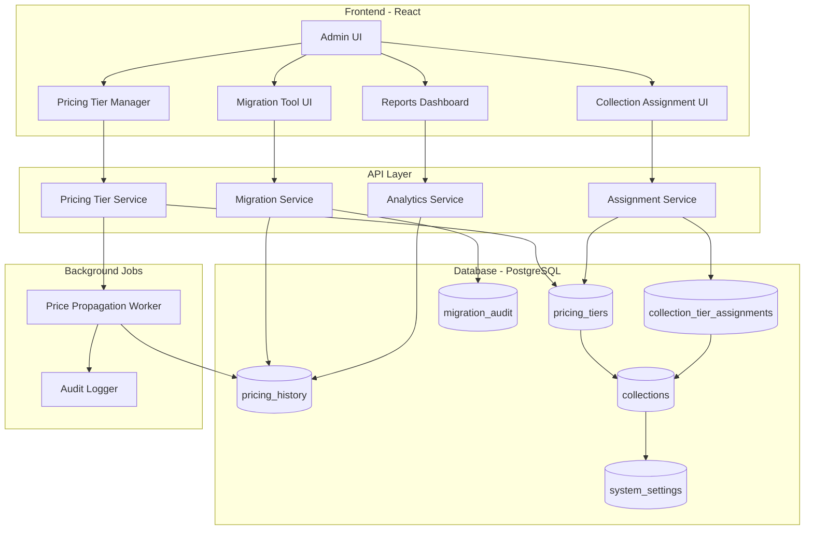
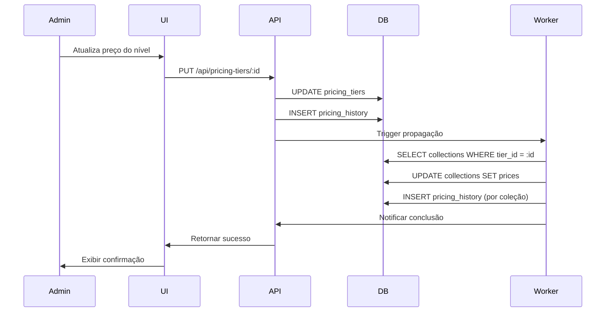

# Documento de Design: Sistema de Níveis de Preço

## Visão Geral

Este documento descreve o design técnico para implementar um sistema de níveis de preço (pricing tiers) que substituirá o modelo atual de precificação individual por coleção. O sistema permitirá que administradores definam níveis de preço reutilizáveis e atribuam múltiplas coleções a cada nível, com propagação automática de mudanças de preço.

### Objetivos do Design

1. Reduzir a complexidade administrativa de gerenciar preços individuais para cada coleção
2. Permitir atualizações de preço em massa através de níveis
3. Manter compatibilidade com o sistema de precificação customizada existente
4. Fornecer trilha de auditoria completa para mudanças de preço
5. Garantir performance adequada para operações em massa

### Tecnologias Utilizadas

- **Backend**: Supabase (PostgreSQL + Edge Functions)
- **Frontend**: React 18 + TypeScript + Vite
- **UI**: Radix UI + Tailwind CSS + shadcn/ui
- **State Management**: TanStack Query (React Query)
- **Validação**: Zod
- **Testes**: Vitest + fast-check (property-based testing)

## Arquitetura

### Diagrama de Arquitetura do Sistema



### Fluxo de Dados Principal




### Camadas da Aplicação

1. **Camada de Apresentação (Frontend)**
   - Componentes React para gerenciamento de níveis
   - Formulários de atribuição de coleções
   - Dashboards de relatórios e análises
   - Interface de migração

2. **Camada de Serviço (API)**
   - Edge Functions do Supabase para operações complexas
   - Validação de dados com Zod
   - Controle de acesso baseado em roles

3. **Camada de Dados (Database)**
   - Tabelas PostgreSQL com constraints
   - Triggers para automação
   - Views para consultas otimizadas
   - Índices para performance

4. **Camada de Background**
   - Workers para propagação de preços
   - Logging de auditoria
   - Notificações

## Componentes e Interfaces

### 1. Tabela: pricing_tiers

Armazena os níveis de preço definidos pelos administradores.

```sql
CREATE TABLE pricing_tiers (
  id UUID PRIMARY KEY DEFAULT gen_random_uuid(),
  name TEXT NOT NULL UNIQUE,
  description TEXT,
  price_full NUMERIC(10,2) NOT NULL CHECK (price_full > 0),
  deposit_amount NUMERIC(10,2) NOT NULL CHECK (deposit_amount > 0),
  pix_discount_percentage NUMERIC(5,2) NOT NULL DEFAULT 5.00 CHECK (pix_discount_percentage >= 0 AND pix_discount_percentage <= 100),
  price_pix NUMERIC(10,2) GENERATED ALWAYS AS (ROUND(price_full * (1 - pix_discount_percentage / 100), 2)) STORED,
  is_active BOOLEAN NOT NULL DEFAULT true,
  is_default BOOLEAN NOT NULL DEFAULT false,
  display_order INTEGER NOT NULL DEFAULT 0,
  created_at TIMESTAMPTZ NOT NULL DEFAULT NOW(),
  updated_at TIMESTAMPTZ NOT NULL DEFAULT NOW(),
  created_by UUID REFERENCES auth.users(id),
  updated_by UUID REFERENCES auth.users(id),
  
  CONSTRAINT check_deposit_less_than_full CHECK (deposit_amount < price_full),
  CONSTRAINT check_pix_less_than_full CHECK (price_pix < price_full),
  CONSTRAINT check_only_one_default CHECK (
    NOT is_default OR (
      SELECT COUNT(*) FROM pricing_tiers WHERE is_default = true AND id != pricing_tiers.id
    ) = 0
  )
);

CREATE INDEX idx_pricing_tiers_active ON pricing_tiers(is_active) WHERE is_active = true;
CREATE INDEX idx_pricing_tiers_default ON pricing_tiers(is_default) WHERE is_default = true;
CREATE INDEX idx_pricing_tiers_display_order ON pricing_tiers(display_order);

COMMENT ON TABLE pricing_tiers IS 'Níveis de preço reutilizáveis para coleções';
COMMENT ON COLUMN pricing_tiers.name IS 'Nome único do nível (ex: "Nível 1", "Premium")';
COMMENT ON COLUMN pricing_tiers.price_full IS 'Preço cheio sem desconto';
COMMENT ON COLUMN pricing_tiers.price_pix IS 'Preço com desconto PIX (calculado automaticamente)';
COMMENT ON COLUMN pricing_tiers.deposit_amount IS 'Valor da entrada';
COMMENT ON COLUMN pricing_tiers.pix_discount_percentage IS 'Percentual de desconto PIX (padrão 5%)';
COMMENT ON COLUMN pricing_tiers.is_default IS 'Se true, este é o nível padrão para novas coleções';
COMMENT ON COLUMN pricing_tiers.display_order IS 'Ordem de exibição na UI';
```

### 2. Tabela: collection_tier_assignments

Relaciona coleções aos seus níveis de preço.

```sql
CREATE TABLE collection_tier_assignments (
  id UUID PRIMARY KEY DEFAULT gen_random_uuid(),
  collection_id UUID NOT NULL REFERENCES collections(id) ON DELETE CASCADE,
  tier_id UUID NOT NULL REFERENCES pricing_tiers(id) ON DELETE RESTRICT,
  assigned_at TIMESTAMPTZ NOT NULL DEFAULT NOW(),
  assigned_by UUID REFERENCES auth.users(id),
  previous_tier_id UUID REFERENCES pricing_tiers(id),
  
  CONSTRAINT unique_collection_tier UNIQUE(collection_id)
);

CREATE INDEX idx_collection_tier_assignments_collection ON collection_tier_assignments(collection_id);
CREATE INDEX idx_collection_tier_assignments_tier ON collection_tier_assignments(tier_id);
CREATE INDEX idx_collection_tier_assignments_assigned_at ON collection_tier_assignments(assigned_at DESC);

COMMENT ON TABLE collection_tier_assignments IS 'Atribuições de coleções a níveis de preço';
COMMENT ON COLUMN collection_tier_assignments.previous_tier_id IS 'Nível anterior para histórico';
```

### 3. Tabela: pricing_history

Registra todas as mudanças de preço para auditoria.

```sql
CREATE TABLE pricing_history (
  id UUID PRIMARY KEY DEFAULT gen_random_uuid(),
  tier_id UUID REFERENCES pricing_tiers(id) ON DELETE SET NULL,
  collection_id UUID REFERENCES collections(id) ON DELETE SET NULL,
  change_type TEXT NOT NULL CHECK (change_type IN ('tier_created', 'tier_updated', 'tier_deleted', 'tier_assigned', 'tier_unassigned', 'price_propagated', 'custom_price_set')),
  old_price_full NUMERIC(10,2),
  new_price_full NUMERIC(10,2),
  old_price_pix NUMERIC(10,2),
  new_price_pix NUMERIC(10,2),
  old_deposit_amount NUMERIC(10,2),
  new_deposit_amount NUMERIC(10,2),
  changed_at TIMESTAMPTZ NOT NULL DEFAULT NOW(),
  changed_by UUID REFERENCES auth.users(id),
  metadata JSONB,
  
  CONSTRAINT check_tier_or_collection CHECK (tier_id IS NOT NULL OR collection_id IS NOT NULL)
);

CREATE INDEX idx_pricing_history_tier ON pricing_history(tier_id, changed_at DESC);
CREATE INDEX idx_pricing_history_collection ON pricing_history(collection_id, changed_at DESC);
CREATE INDEX idx_pricing_history_changed_at ON pricing_history(changed_at DESC);
CREATE INDEX idx_pricing_history_changed_by ON pricing_history(changed_by);
CREATE INDEX idx_pricing_history_change_type ON pricing_history(change_type);

COMMENT ON TABLE pricing_history IS 'Histórico completo de mudanças de preço';
COMMENT ON COLUMN pricing_history.change_type IS 'Tipo de mudança realizada';
COMMENT ON COLUMN pricing_history.metadata IS 'Dados adicionais sobre a mudança (JSON)';
```

### 4. Tabela: migration_audit

Registra operações de migração do sistema antigo para o novo.

```sql
CREATE TABLE migration_audit (
  id UUID PRIMARY KEY DEFAULT gen_random_uuid(),
  migration_type TEXT NOT NULL CHECK (migration_type IN ('initial_migration', 'bulk_assignment', 'rollback')),
  collections_affected INTEGER NOT NULL DEFAULT 0,
  tiers_created INTEGER NOT NULL DEFAULT 0,
  started_at TIMESTAMPTZ NOT NULL DEFAULT NOW(),
  completed_at TIMESTAMPTZ,
  status TEXT NOT NULL DEFAULT 'in_progress' CHECK (status IN ('in_progress', 'completed', 'failed', 'rolled_back')),
  executed_by UUID REFERENCES auth.users(id),
  error_message TEXT,
  migration_data JSONB,
  
  CONSTRAINT check_completed_at_when_done CHECK (
    (status = 'in_progress' AND completed_at IS NULL) OR
    (status != 'in_progress' AND completed_at IS NOT NULL)
  )
);

CREATE INDEX idx_migration_audit_status ON migration_audit(status);
CREATE INDEX idx_migration_audit_started_at ON migration_audit(started_at DESC);

COMMENT ON TABLE migration_audit IS 'Auditoria de operações de migração';
COMMENT ON COLUMN migration_audit.migration_data IS 'Snapshot dos dados antes da migração (JSON)';
```

### 5. Modificações na Tabela collections

Adicionar campos para suportar o sistema de níveis.

```sql
-- Adicionar coluna para indicar se usa nível ou preço customizado
ALTER TABLE collections
ADD COLUMN IF NOT EXISTS uses_tier_pricing BOOLEAN NOT NULL DEFAULT false;

-- Adicionar índice
CREATE INDEX idx_collections_uses_tier_pricing ON collections(uses_tier_pricing);

COMMENT ON COLUMN collections.uses_tier_pricing IS 'Se true, usa preço do nível. Se false, usa preço customizado (is_price_custom)';

-- Nota: Mantemos os campos existentes (price_full, price_pix, deposit_amount, is_price_custom)
-- para compatibilidade com o sistema atual
```

## Modelos de Dados

### TypeScript Interfaces

```typescript
// src/types/pricing-tiers.ts

export interface PricingTier {
  id: string;
  name: string;
  description: string | null;
  price_full: number;
  deposit_amount: number;
  pix_discount_percentage: number;
  price_pix: number; // Calculado automaticamente
  is_active: boolean;
  is_default: boolean;
  display_order: number;
  created_at: string;
  updated_at: string;
  created_by: string | null;
  updated_by: string | null;
}

export interface CollectionTierAssignment {
  id: string;
  collection_id: string;
  tier_id: string;
  assigned_at: string;
  assigned_by: string | null;
  previous_tier_id: string | null;
  
  // Relações expandidas
  tier?: PricingTier;
  collection?: {
    id: string;
    name: string;
    slug: string;
  };
}

export interface PricingHistory {
  id: string;
  tier_id: string | null;
  collection_id: string | null;
  change_type: 'tier_created' | 'tier_updated' | 'tier_deleted' | 
                'tier_assigned' | 'tier_unassigned' | 'price_propagated' | 
                'custom_price_set';
  old_price_full: number | null;
  new_price_full: number | null;
  old_price_pix: number | null;
  new_price_pix: number | null;
  old_deposit_amount: number | null;
  new_deposit_amount: number | null;
  changed_at: string;
  changed_by: string | null;
  metadata: Record<string, any> | null;
}

export interface MigrationAudit {
  id: string;
  migration_type: 'initial_migration' | 'bulk_assignment' | 'rollback';
  collections_affected: number;
  tiers_created: number;
  started_at: string;
  completed_at: string | null;
  status: 'in_progress' | 'completed' | 'failed' | 'rolled_back';
  executed_by: string | null;
  error_message: string | null;
  migration_data: Record<string, any> | null;
}

export interface CollectionWithPricing {
  id: string;
  name: string;
  slug: string;
  uses_tier_pricing: boolean;
  is_price_custom: boolean;
  price_full: number;
  price_pix: number;
  deposit_amount: number;
  tier_assignment?: CollectionTierAssignment;
}

// Tipos para formulários e validação
export interface CreatePricingTierInput {
  name: string;
  description?: string;
  price_full: number;
  deposit_amount: number;
  pix_discount_percentage?: number;
  is_default?: boolean;
  display_order?: number;
}

export interface UpdatePricingTierInput extends Partial<CreatePricingTierInput> {
  is_active?: boolean;
}

export interface AssignTierInput {
  collection_id: string;
  tier_id: string;
}

export interface BulkAssignTierInput {
  collection_ids: string[];
  tier_id: string;
}

export interface MigrationSuggestion {
  suggested_tier_name: string;
  price_full: number;
  price_pix: number;
  deposit_amount: number;
  collection_ids: string[];
  collection_count: number;
}
```

### Schemas de Validação Zod

```typescript
// src/lib/validations/pricing-tiers.ts

import { z } from 'zod';

export const pricingTierSchema = z.object({
  name: z.string()
    .min(1, 'Nome é obrigatório')
    .max(100, 'Nome deve ter no máximo 100 caracteres')
    .regex(/^[a-zA-Z0-9\s\-_]+$/, 'Nome deve conter apenas letras, números, espaços, hífens e underscores'),
  
  description: z.string()
    .max(500, 'Descrição deve ter no máximo 500 caracteres')
    .optional(),
  
  price_full: z.number()
    .positive('Preço cheio deve ser maior que zero')
    .max(999999.99, 'Preço cheio muito alto'),
  
  deposit_amount: z.number()
    .positive('Valor da entrada deve ser maior que zero')
    .max(999999.99, 'Valor da entrada muito alto'),
  
  pix_discount_percentage: z.number()
    .min(0, 'Desconto PIX não pode ser negativo')
    .max(100, 'Desconto PIX não pode ser maior que 100%')
    .default(5.00),
  
  is_default: z.boolean().default(false),
  
  display_order: z.number().int().min(0).default(0),
}).refine(
  (data) => data.deposit_amount < data.price_full,
  {
    message: 'Valor da entrada deve ser menor que o preço cheio',
    path: ['deposit_amount'],
  }
);

export const updatePricingTierSchema = pricingTierSchema.partial().extend({
  is_active: z.boolean().optional(),
});

export const assignTierSchema = z.object({
  collection_id: z.string().uuid('ID de coleção inválido'),
  tier_id: z.string().uuid('ID de nível inválido'),
});

export const bulkAssignTierSchema = z.object({
  collection_ids: z.array(z.string().uuid()).min(1, 'Selecione pelo menos uma coleção'),
  tier_id: z.string().uuid('ID de nível inválido'),
});

export type PricingTierFormData = z.infer<typeof pricingTierSchema>;
export type UpdatePricingTierFormData = z.infer<typeof updatePricingTierSchema>;
export type AssignTierFormData = z.infer<typeof assignTierSchema>;
export type BulkAssignTierFormData = z.infer<typeof bulkAssignTierSchema>;
```


## Funções e Stored Procedures

### 1. Função: create_pricing_tier

Cria um novo nível de preço com validações e logging.

```sql
CREATE OR REPLACE FUNCTION create_pricing_tier(
  p_name TEXT,
  p_description TEXT,
  p_price_full NUMERIC,
  p_deposit_amount NUMERIC,
  p_pix_discount_percentage NUMERIC DEFAULT 5.00,
  p_is_default BOOLEAN DEFAULT false,
  p_display_order INTEGER DEFAULT 0,
  p_created_by UUID DEFAULT NULL
)
RETURNS UUID AS $$
DECLARE
  v_tier_id UUID;
  v_price_pix NUMERIC;
BEGIN
  -- Validações
  IF p_price_full <= 0 THEN
    RAISE EXCEPTION 'Preço cheio deve ser maior que zero';
  END IF;
  
  IF p_deposit_amount <= 0 THEN
    RAISE EXCEPTION 'Valor da entrada deve ser maior que zero';
  END IF;
  
  IF p_deposit_amount >= p_price_full THEN
    RAISE EXCEPTION 'Valor da entrada deve ser menor que o preço cheio';
  END IF;
  
  IF p_pix_discount_percentage < 0 OR p_pix_discount_percentage > 100 THEN
    RAISE EXCEPTION 'Desconto PIX deve estar entre 0 e 100';
  END IF;
  
  -- Se é padrão, remover flag de outros níveis
  IF p_is_default THEN
    UPDATE pricing_tiers SET is_default = false WHERE is_default = true;
  END IF;
  
  -- Calcular preço PIX
  v_price_pix := ROUND(p_price_full * (1 - p_pix_discount_percentage / 100), 2);
  
  -- Inserir nível
  INSERT INTO pricing_tiers (
    name, description, price_full, deposit_amount, 
    pix_discount_percentage, is_default, display_order, created_by
  )
  VALUES (
    p_name, p_description, p_price_full, p_deposit_amount,
    p_pix_discount_percentage, p_is_default, p_display_order, p_created_by
  )
  RETURNING id INTO v_tier_id;
  
  -- Registrar no histórico
  INSERT INTO pricing_history (
    tier_id, change_type, new_price_full, new_price_pix, 
    new_deposit_amount, changed_by, metadata
  )
  VALUES (
    v_tier_id, 'tier_created', p_price_full, v_price_pix,
    p_deposit_amount, p_created_by, 
    jsonb_build_object('tier_name', p_name)
  );
  
  RETURN v_tier_id;
END;
$$ LANGUAGE plpgsql SECURITY DEFINER;

COMMENT ON FUNCTION create_pricing_tier IS 'Cria um novo nível de preço com validações';
```

### 2. Função: update_pricing_tier

Atualiza um nível de preço e propaga mudanças para coleções atribuídas.

```sql
CREATE OR REPLACE FUNCTION update_pricing_tier(
  p_tier_id UUID,
  p_name TEXT DEFAULT NULL,
  p_description TEXT DEFAULT NULL,
  p_price_full NUMERIC DEFAULT NULL,
  p_deposit_amount NUMERIC DEFAULT NULL,
  p_pix_discount_percentage NUMERIC DEFAULT NULL,
  p_is_active BOOLEAN DEFAULT NULL,
  p_is_default BOOLEAN DEFAULT NULL,
  p_display_order INTEGER DEFAULT NULL,
  p_updated_by UUID DEFAULT NULL
)
RETURNS BOOLEAN AS $$
DECLARE
  v_old_tier RECORD;
  v_new_price_pix NUMERIC;
  v_price_changed BOOLEAN := false;
BEGIN
  -- Buscar valores atuais
  SELECT * INTO v_old_tier FROM pricing_tiers WHERE id = p_tier_id;
  
  IF NOT FOUND THEN
    RAISE EXCEPTION 'Nível de preço não encontrado';
  END IF;
  
  -- Validações
  IF p_price_full IS NOT NULL AND p_price_full <= 0 THEN
    RAISE EXCEPTION 'Preço cheio deve ser maior que zero';
  END IF;
  
  IF p_deposit_amount IS NOT NULL AND p_deposit_amount <= 0 THEN
    RAISE EXCEPTION 'Valor da entrada deve ser maior que zero';
  END IF;
  
  IF p_price_full IS NOT NULL AND p_deposit_amount IS NOT NULL THEN
    IF p_deposit_amount >= p_price_full THEN
      RAISE EXCEPTION 'Valor da entrada deve ser menor que o preço cheio';
    END IF;
  ELSIF p_price_full IS NOT NULL AND p_deposit_amount IS NULL THEN
    IF v_old_tier.deposit_amount >= p_price_full THEN
      RAISE EXCEPTION 'Valor da entrada deve ser menor que o preço cheio';
    END IF;
  ELSIF p_deposit_amount IS NOT NULL AND p_price_full IS NULL THEN
    IF p_deposit_amount >= v_old_tier.price_full THEN
      RAISE EXCEPTION 'Valor da entrada deve ser menor que o preço cheio';
    END IF;
  END IF;
  
  -- Se é padrão, remover flag de outros níveis
  IF p_is_default = true THEN
    UPDATE pricing_tiers SET is_default = false WHERE is_default = true AND id != p_tier_id;
  END IF;
  
  -- Verificar se preços mudaram
  IF p_price_full IS NOT NULL AND p_price_full != v_old_tier.price_full THEN
    v_price_changed := true;
  END IF;
  
  IF p_deposit_amount IS NOT NULL AND p_deposit_amount != v_old_tier.deposit_amount THEN
    v_price_changed := true;
  END IF;
  
  IF p_pix_discount_percentage IS NOT NULL AND p_pix_discount_percentage != v_old_tier.pix_discount_percentage THEN
    v_price_changed := true;
  END IF;
  
  -- Atualizar nível
  UPDATE pricing_tiers
  SET
    name = COALESCE(p_name, name),
    description = COALESCE(p_description, description),
    price_full = COALESCE(p_price_full, price_full),
    deposit_amount = COALESCE(p_deposit_amount, deposit_amount),
    pix_discount_percentage = COALESCE(p_pix_discount_percentage, pix_discount_percentage),
    is_active = COALESCE(p_is_active, is_active),
    is_default = COALESCE(p_is_default, is_default),
    display_order = COALESCE(p_display_order, display_order),
    updated_at = NOW(),
    updated_by = p_updated_by
  WHERE id = p_tier_id;
  
  -- Registrar no histórico
  INSERT INTO pricing_history (
    tier_id, change_type, 
    old_price_full, new_price_full,
    old_price_pix, new_price_pix,
    old_deposit_amount, new_deposit_amount,
    changed_by, metadata
  )
  SELECT
    p_tier_id, 'tier_updated',
    v_old_tier.price_full, COALESCE(p_price_full, v_old_tier.price_full),
    v_old_tier.price_pix, (SELECT price_pix FROM pricing_tiers WHERE id = p_tier_id),
    v_old_tier.deposit_amount, COALESCE(p_deposit_amount, v_old_tier.deposit_amount),
    p_updated_by,
    jsonb_build_object(
      'tier_name', v_old_tier.name,
      'price_changed', v_price_changed
    );
  
  -- Se preços mudaram, propagar para coleções
  IF v_price_changed THEN
    PERFORM propagate_tier_prices(p_tier_id, p_updated_by);
  END IF;
  
  RETURN true;
END;
$$ LANGUAGE plpgsql SECURITY DEFINER;

COMMENT ON FUNCTION update_pricing_tier IS 'Atualiza nível de preço e propaga mudanças';
```

### 3. Função: propagate_tier_prices

Propaga mudanças de preço do nível para todas as coleções atribuídas.

```sql
CREATE OR REPLACE FUNCTION propagate_tier_prices(
  p_tier_id UUID,
  p_updated_by UUID DEFAULT NULL
)
RETURNS TABLE (
  collection_id UUID,
  old_price_full NUMERIC,
  new_price_full NUMERIC,
  success BOOLEAN,
  error_message TEXT
) AS $$
DECLARE
  v_tier RECORD;
  v_collection RECORD;
  v_updated_count INTEGER := 0;
  v_failed_count INTEGER := 0;
BEGIN
  -- Buscar dados do nível
  SELECT * INTO v_tier FROM pricing_tiers WHERE id = p_tier_id;
  
  IF NOT FOUND THEN
    RAISE EXCEPTION 'Nível de preço não encontrado';
  END IF;
  
  -- Iterar sobre coleções atribuídas
  FOR v_collection IN
    SELECT c.id, c.price_full, c.price_pix, c.deposit_amount
    FROM collections c
    INNER JOIN collection_tier_assignments cta ON c.id = cta.collection_id
    WHERE cta.tier_id = p_tier_id AND c.uses_tier_pricing = true
  LOOP
    BEGIN
      -- Atualizar preços da coleção
      UPDATE collections
      SET
        price_full = v_tier.price_full,
        price_pix = v_tier.price_pix,
        deposit_amount = v_tier.deposit_amount,
        updated_at = NOW()
      WHERE id = v_collection.id;
      
      -- Registrar no histórico
      INSERT INTO pricing_history (
        collection_id, tier_id, change_type,
        old_price_full, new_price_full,
        old_price_pix, new_price_pix,
        old_deposit_amount, new_deposit_amount,
        changed_by, metadata
      )
      VALUES (
        v_collection.id, p_tier_id, 'price_propagated',
        v_collection.price_full, v_tier.price_full,
        v_collection.price_pix, v_tier.price_pix,
        v_collection.deposit_amount, v_tier.deposit_amount,
        p_updated_by,
        jsonb_build_object('tier_name', v_tier.name)
      );
      
      v_updated_count := v_updated_count + 1;
      
      RETURN QUERY SELECT 
        v_collection.id,
        v_collection.price_full,
        v_tier.price_full,
        true,
        NULL::TEXT;
      
    EXCEPTION WHEN OTHERS THEN
      v_failed_count := v_failed_count + 1;
      
      RETURN QUERY SELECT 
        v_collection.id,
        v_collection.price_full,
        v_tier.price_full,
        false,
        SQLERRM;
    END;
  END LOOP;
  
  -- Log de conclusão
  RAISE NOTICE 'Propagação concluída: % atualizadas, % falharam', v_updated_count, v_failed_count;
  
  RETURN;
END;
$$ LANGUAGE plpgsql SECURITY DEFINER;

COMMENT ON FUNCTION propagate_tier_prices IS 'Propaga preços do nível para coleções atribuídas';
```

### 4. Função: assign_collection_to_tier

Atribui uma coleção a um nível de preço.

```sql
CREATE OR REPLACE FUNCTION assign_collection_to_tier(
  p_collection_id UUID,
  p_tier_id UUID,
  p_assigned_by UUID DEFAULT NULL
)
RETURNS UUID AS $$
DECLARE
  v_assignment_id UUID;
  v_previous_tier_id UUID;
  v_tier RECORD;
  v_collection RECORD;
BEGIN
  -- Validar que o nível existe e está ativo
  SELECT * INTO v_tier FROM pricing_tiers WHERE id = p_tier_id;
  
  IF NOT FOUND THEN
    RAISE EXCEPTION 'Nível de preço não encontrado';
  END IF;
  
  IF NOT v_tier.is_active THEN
    RAISE EXCEPTION 'Não é possível atribuir coleções a um nível inativo';
  END IF;
  
  -- Validar que a coleção existe
  SELECT * INTO v_collection FROM collections WHERE id = p_collection_id;
  
  IF NOT FOUND THEN
    RAISE EXCEPTION 'Coleção não encontrada';
  END IF;
  
  -- Buscar atribuição anterior (se existir)
  SELECT tier_id INTO v_previous_tier_id
  FROM collection_tier_assignments
  WHERE collection_id = p_collection_id;
  
  -- Remover atribuição anterior
  IF v_previous_tier_id IS NOT NULL THEN
    DELETE FROM collection_tier_assignments WHERE collection_id = p_collection_id;
    
    -- Registrar remoção no histórico
    INSERT INTO pricing_history (
      collection_id, tier_id, change_type, changed_by,
      old_price_full, old_price_pix, old_deposit_amount,
      metadata
    )
    VALUES (
      p_collection_id, v_previous_tier_id, 'tier_unassigned', p_assigned_by,
      v_collection.price_full, v_collection.price_pix, v_collection.deposit_amount,
      jsonb_build_object('previous_tier_id', v_previous_tier_id)
    );
  END IF;
  
  -- Criar nova atribuição
  INSERT INTO collection_tier_assignments (
    collection_id, tier_id, assigned_by, previous_tier_id
  )
  VALUES (
    p_collection_id, p_tier_id, p_assigned_by, v_previous_tier_id
  )
  RETURNING id INTO v_assignment_id;
  
  -- Atualizar coleção para usar preços do nível
  UPDATE collections
  SET
    uses_tier_pricing = true,
    is_price_custom = false,
    price_full = v_tier.price_full,
    price_pix = v_tier.price_pix,
    deposit_amount = v_tier.deposit_amount,
    updated_at = NOW()
  WHERE id = p_collection_id;
  
  -- Registrar atribuição no histórico
  INSERT INTO pricing_history (
    collection_id, tier_id, change_type, changed_by,
    old_price_full, new_price_full,
    old_price_pix, new_price_pix,
    old_deposit_amount, new_deposit_amount,
    metadata
  )
  VALUES (
    p_collection_id, p_tier_id, 'tier_assigned', p_assigned_by,
    v_collection.price_full, v_tier.price_full,
    v_collection.price_pix, v_tier.price_pix,
    v_collection.deposit_amount, v_tier.deposit_amount,
    jsonb_build_object(
      'tier_name', v_tier.name,
      'previous_tier_id', v_previous_tier_id
    )
  );
  
  RETURN v_assignment_id;
END;
$$ LANGUAGE plpgsql SECURITY DEFINER;

COMMENT ON FUNCTION assign_collection_to_tier IS 'Atribui coleção a um nível de preço';
```

### 5. Função: unassign_collection_from_tier

Remove a atribuição de nível de uma coleção e reverte para preços padrão.

```sql
CREATE OR REPLACE FUNCTION unassign_collection_from_tier(
  p_collection_id UUID,
  p_unassigned_by UUID DEFAULT NULL
)
RETURNS BOOLEAN AS $$
DECLARE
  v_assignment RECORD;
  v_default_price_full NUMERIC;
  v_default_price_pix NUMERIC;
  v_default_deposit NUMERIC;
  v_collection RECORD;
BEGIN
  -- Buscar atribuição atual
  SELECT * INTO v_assignment
  FROM collection_tier_assignments
  WHERE collection_id = p_collection_id;
  
  IF NOT FOUND THEN
    RAISE EXCEPTION 'Coleção não está atribuída a nenhum nível';
  END IF;
  
  -- Buscar dados atuais da coleção
  SELECT * INTO v_collection FROM collections WHERE id = p_collection_id;
  
  -- Buscar preços padrão do sistema
  SELECT value::NUMERIC INTO v_default_price_full 
  FROM system_settings WHERE key = 'default_price_full';
  
  SELECT value::NUMERIC INTO v_default_price_pix 
  FROM system_settings WHERE key = 'default_price_pix';
  
  SELECT value::NUMERIC INTO v_default_deposit 
  FROM system_settings WHERE key = 'default_deposit_amount';
  
  -- Remover atribuição
  DELETE FROM collection_tier_assignments WHERE collection_id = p_collection_id;
  
  -- Atualizar coleção para usar preços padrão
  UPDATE collections
  SET
    uses_tier_pricing = false,
    is_price_custom = false,
    price_full = v_default_price_full,
    price_pix = v_default_price_pix,
    deposit_amount = v_default_deposit,
    updated_at = NOW()
  WHERE id = p_collection_id;
  
  -- Registrar no histórico
  INSERT INTO pricing_history (
    collection_id, tier_id, change_type, changed_by,
    old_price_full, new_price_full,
    old_price_pix, new_price_pix,
    old_deposit_amount, new_deposit_amount,
    metadata
  )
  VALUES (
    p_collection_id, v_assignment.tier_id, 'tier_unassigned', p_unassigned_by,
    v_collection.price_full, v_default_price_full,
    v_collection.price_pix, v_default_price_pix,
    v_collection.deposit_amount, v_default_deposit,
    jsonb_build_object('reverted_to_default', true)
  );
  
  RETURN true;
END;
$$ LANGUAGE plpgsql SECURITY DEFINER;

COMMENT ON FUNCTION unassign_collection_from_tier IS 'Remove atribuição de nível e reverte para preços padrão';
```

### 6. Função: analyze_pricing_for_migration

Analisa preços existentes e sugere agrupamentos em níveis.

```sql
CREATE OR REPLACE FUNCTION analyze_pricing_for_migration()
RETURNS TABLE (
  price_full NUMERIC,
  price_pix NUMERIC,
  deposit_amount NUMERIC,
  collection_count BIGINT,
  collection_ids UUID[],
  suggested_tier_name TEXT
) AS $$
BEGIN
  RETURN QUERY
  SELECT
    c.price_full,
    c.price_pix,
    c.deposit_amount,
    COUNT(*)::BIGINT as collection_count,
    ARRAY_AGG(c.id) as collection_ids,
    'Nível ' || ROW_NUMBER() OVER (ORDER BY COUNT(*) DESC, c.price_full) as suggested_tier_name
  FROM collections c
  WHERE 
    c.is_active = true
    AND c.uses_tier_pricing = false
    AND c.is_price_custom = false
  GROUP BY c.price_full, c.price_pix, c.deposit_amount
  HAVING COUNT(*) > 0
  ORDER BY COUNT(*) DESC, c.price_full;
END;
$$ LANGUAGE plpgsql SECURITY DEFINER;

COMMENT ON FUNCTION analyze_pricing_for_migration IS 'Analisa preços e sugere agrupamentos para migração';
```


### 7. Views para Consultas Otimizadas

```sql
-- View: Coleções com informações de nível
CREATE OR REPLACE VIEW collections_with_tier_info AS
SELECT
  c.id,
  c.name,
  c.slug,
  c.price_full,
  c.price_pix,
  c.deposit_amount,
  c.uses_tier_pricing,
  c.is_price_custom,
  c.is_active,
  cta.tier_id,
  pt.name as tier_name,
  pt.is_default as is_default_tier,
  cta.assigned_at as tier_assigned_at
FROM collections c
LEFT JOIN collection_tier_assignments cta ON c.id = cta.collection_id
LEFT JOIN pricing_tiers pt ON cta.tier_id = pt.id;

COMMENT ON VIEW collections_with_tier_info IS 'Coleções com informações de nível atribuído';

-- View: Estatísticas de níveis
CREATE OR REPLACE VIEW pricing_tier_stats AS
SELECT
  pt.id,
  pt.name,
  pt.price_full,
  pt.price_pix,
  pt.deposit_amount,
  pt.is_active,
  pt.is_default,
  COUNT(cta.collection_id) as assigned_collections_count,
  COALESCE(SUM(CASE WHEN c.is_active THEN 1 ELSE 0 END), 0) as active_collections_count
FROM pricing_tiers pt
LEFT JOIN collection_tier_assignments cta ON pt.id = cta.tier_id
LEFT JOIN collections c ON cta.collection_id = c.id
GROUP BY pt.id, pt.name, pt.price_full, pt.price_pix, pt.deposit_amount, pt.is_active, pt.is_default;

COMMENT ON VIEW pricing_tier_stats IS 'Estatísticas de uso de cada nível';
```

### 8. Triggers

```sql
-- Trigger: Atualizar timestamp de updated_at
CREATE OR REPLACE FUNCTION update_pricing_tier_timestamp()
RETURNS TRIGGER AS $$
BEGIN
  NEW.updated_at = NOW();
  RETURN NEW;
END;
$$ LANGUAGE plpgsql;

DROP TRIGGER IF EXISTS trigger_update_pricing_tier_timestamp ON pricing_tiers;
CREATE TRIGGER trigger_update_pricing_tier_timestamp
  BEFORE UPDATE ON pricing_tiers
  FOR EACH ROW
  EXECUTE FUNCTION update_pricing_tier_timestamp();

-- Trigger: Validar apenas um nível padrão
CREATE OR REPLACE FUNCTION validate_single_default_tier()
RETURNS TRIGGER AS $$
DECLARE
  v_default_count INTEGER;
BEGIN
  IF NEW.is_default = true THEN
    SELECT COUNT(*) INTO v_default_count
    FROM pricing_tiers
    WHERE is_default = true AND id != NEW.id;
    
    IF v_default_count > 0 THEN
      UPDATE pricing_tiers SET is_default = false WHERE is_default = true AND id != NEW.id;
    END IF;
  END IF;
  
  RETURN NEW;
END;
$$ LANGUAGE plpgsql;

DROP TRIGGER IF EXISTS trigger_validate_single_default_tier ON pricing_tiers;
CREATE TRIGGER trigger_validate_single_default_tier
  BEFORE INSERT OR UPDATE ON pricing_tiers
  FOR EACH ROW
  EXECUTE FUNCTION validate_single_default_tier();

-- Trigger: Aplicar nível padrão em novas coleções
CREATE OR REPLACE FUNCTION apply_default_tier_to_new_collection()
RETURNS TRIGGER AS $$
DECLARE
  v_default_tier_id UUID;
  v_default_tier RECORD;
BEGIN
  -- Buscar nível padrão
  SELECT id INTO v_default_tier_id
  FROM pricing_tiers
  WHERE is_default = true AND is_active = true
  LIMIT 1;
  
  -- Se existe nível padrão, atribuir
  IF v_default_tier_id IS NOT NULL THEN
    SELECT * INTO v_default_tier FROM pricing_tiers WHERE id = v_default_tier_id;
    
    -- Criar atribuição
    INSERT INTO collection_tier_assignments (collection_id, tier_id)
    VALUES (NEW.id, v_default_tier_id);
    
    -- Atualizar preços da coleção
    NEW.uses_tier_pricing := true;
    NEW.is_price_custom := false;
    NEW.price_full := v_default_tier.price_full;
    NEW.price_pix := v_default_tier.price_pix;
    NEW.deposit_amount := v_default_tier.deposit_amount;
  END IF;
  
  RETURN NEW;
END;
$$ LANGUAGE plpgsql;

DROP TRIGGER IF EXISTS trigger_apply_default_tier_to_new_collection ON collections;
CREATE TRIGGER trigger_apply_default_tier_to_new_collection
  BEFORE INSERT ON collections
  FOR EACH ROW
  EXECUTE FUNCTION apply_default_tier_to_new_collection();
```

## API Endpoints

### REST API (Supabase Edge Functions)

#### 1. Gerenciamento de Níveis de Preço

```typescript
// supabase/functions/pricing-tiers/index.ts

import { serve } from "https://deno.land/std@0.168.0/http/server.ts";
import { createClient } from "https://esm.sh/@supabase/supabase-js@2";

const corsHeaders = {
  'Access-Control-Allow-Origin': '*',
  'Access-Control-Allow-Headers': 'authorization, x-client-info, apikey, content-type',
};

serve(async (req) => {
  if (req.method === 'OPTIONS') {
    return new Response('ok', { headers: corsHeaders });
  }

  try {
    const supabaseClient = createClient(
      Deno.env.get('SUPABASE_URL') ?? '',
      Deno.env.get('SUPABASE_ANON_KEY') ?? '',
      {
        global: {
          headers: { Authorization: req.headers.get('Authorization')! },
        },
      }
    );

    // Verificar autenticação e role de admin
    const {
      data: { user },
    } = await supabaseClient.auth.getUser();

    if (!user) {
      throw new Error('Não autenticado');
    }

    const { data: profile } = await supabaseClient
      .from('profiles')
      .select('role')
      .eq('id', user.id)
      .single();

    if (profile?.role !== 'admin') {
      throw new Error('Acesso negado: apenas administradores');
    }

    const url = new URL(req.url);
    const pathParts = url.pathname.split('/').filter(Boolean);
    const method = req.method;

    // GET /pricing-tiers - Listar todos os níveis
    if (method === 'GET' && pathParts.length === 2) {
      const { data, error } = await supabaseClient
        .from('pricing_tier_stats')
        .select('*')
        .order('display_order', { ascending: true });

      if (error) throw error;

      return new Response(JSON.stringify(data), {
        headers: { ...corsHeaders, 'Content-Type': 'application/json' },
        status: 200,
      });
    }

    // GET /pricing-tiers/:id - Buscar nível específico
    if (method === 'GET' && pathParts.length === 3) {
      const tierId = pathParts[2];

      const { data, error } = await supabaseClient
        .from('pricing_tiers')
        .select('*')
        .eq('id', tierId)
        .single();

      if (error) throw error;

      return new Response(JSON.stringify(data), {
        headers: { ...corsHeaders, 'Content-Type': 'application/json' },
        status: 200,
      });
    }

    // POST /pricing-tiers - Criar novo nível
    if (method === 'POST' && pathParts.length === 2) {
      const body = await req.json();

      const { data, error } = await supabaseClient.rpc('create_pricing_tier', {
        p_name: body.name,
        p_description: body.description || null,
        p_price_full: body.price_full,
        p_deposit_amount: body.deposit_amount,
        p_pix_discount_percentage: body.pix_discount_percentage || 5.0,
        p_is_default: body.is_default || false,
        p_display_order: body.display_order || 0,
        p_created_by: user.id,
      });

      if (error) throw error;

      return new Response(JSON.stringify({ id: data }), {
        headers: { ...corsHeaders, 'Content-Type': 'application/json' },
        status: 201,
      });
    }

    // PUT /pricing-tiers/:id - Atualizar nível
    if (method === 'PUT' && pathParts.length === 3) {
      const tierId = pathParts[2];
      const body = await req.json();

      const { data, error } = await supabaseClient.rpc('update_pricing_tier', {
        p_tier_id: tierId,
        p_name: body.name || null,
        p_description: body.description || null,
        p_price_full: body.price_full || null,
        p_deposit_amount: body.deposit_amount || null,
        p_pix_discount_percentage: body.pix_discount_percentage || null,
        p_is_active: body.is_active !== undefined ? body.is_active : null,
        p_is_default: body.is_default !== undefined ? body.is_default : null,
        p_display_order: body.display_order !== undefined ? body.display_order : null,
        p_updated_by: user.id,
      });

      if (error) throw error;

      return new Response(JSON.stringify({ success: true }), {
        headers: { ...corsHeaders, 'Content-Type': 'application/json' },
        status: 200,
      });
    }

    // DELETE /pricing-tiers/:id - Desativar nível
    if (method === 'DELETE' && pathParts.length === 3) {
      const tierId = pathParts[2];

      // Verificar se há coleções atribuídas
      const { count } = await supabaseClient
        .from('collection_tier_assignments')
        .select('*', { count: 'exact', head: true })
        .eq('tier_id', tierId);

      if (count && count > 0) {
        return new Response(
          JSON.stringify({ 
            error: `Não é possível desativar: ${count} coleção(ões) atribuída(s)` 
          }),
          {
            headers: { ...corsHeaders, 'Content-Type': 'application/json' },
            status: 400,
          }
        );
      }

      const { error } = await supabaseClient
        .from('pricing_tiers')
        .update({ is_active: false, updated_by: user.id })
        .eq('id', tierId);

      if (error) throw error;

      return new Response(JSON.stringify({ success: true }), {
        headers: { ...corsHeaders, 'Content-Type': 'application/json' },
        status: 200,
      });
    }

    return new Response(JSON.stringify({ error: 'Rota não encontrada' }), {
      headers: { ...corsHeaders, 'Content-Type': 'application/json' },
      status: 404,
    });

  } catch (error) {
    return new Response(JSON.stringify({ error: error.message }), {
      headers: { ...corsHeaders, 'Content-Type': 'application/json' },
      status: 400,
    });
  }
});
```

#### 2. Atribuição de Coleções

```typescript
// supabase/functions/collection-tier-assignments/index.ts

import { serve } from "https://deno.land/std@0.168.0/http/server.ts";
import { createClient } from "https://esm.sh/@supabase/supabase-js@2";

const corsHeaders = {
  'Access-Control-Allow-Origin': '*',
  'Access-Control-Allow-Headers': 'authorization, x-client-info, apikey, content-type',
};

serve(async (req) => {
  if (req.method === 'OPTIONS') {
    return new Response('ok', { headers: corsHeaders });
  }

  try {
    const supabaseClient = createClient(
      Deno.env.get('SUPABASE_URL') ?? '',
      Deno.env.get('SUPABASE_ANON_KEY') ?? '',
      {
        global: {
          headers: { Authorization: req.headers.get('Authorization')! },
        },
      }
    );

    const {
      data: { user },
    } = await supabaseClient.auth.getUser();

    if (!user) {
      throw new Error('Não autenticado');
    }

    const { data: profile } = await supabaseClient
      .from('profiles')
      .select('role')
      .eq('id', user.id)
      .single();

    if (profile?.role !== 'admin') {
      throw new Error('Acesso negado: apenas administradores');
    }

    const method = req.method;

    // POST /collection-tier-assignments - Atribuir coleção a nível
    if (method === 'POST') {
      const body = await req.json();

      const { data, error } = await supabaseClient.rpc('assign_collection_to_tier', {
        p_collection_id: body.collection_id,
        p_tier_id: body.tier_id,
        p_assigned_by: user.id,
      });

      if (error) throw error;

      return new Response(JSON.stringify({ id: data }), {
        headers: { ...corsHeaders, 'Content-Type': 'application/json' },
        status: 201,
      });
    }

    // DELETE /collection-tier-assignments/:collectionId - Remover atribuição
    if (method === 'DELETE') {
      const url = new URL(req.url);
      const pathParts = url.pathname.split('/').filter(Boolean);
      const collectionId = pathParts[2];

      const { data, error } = await supabaseClient.rpc('unassign_collection_from_tier', {
        p_collection_id: collectionId,
        p_unassigned_by: user.id,
      });

      if (error) throw error;

      return new Response(JSON.stringify({ success: true }), {
        headers: { ...corsHeaders, 'Content-Type': 'application/json' },
        status: 200,
      });
    }

    return new Response(JSON.stringify({ error: 'Método não permitido' }), {
      headers: { ...corsHeaders, 'Content-Type': 'application/json' },
      status: 405,
    });

  } catch (error) {
    return new Response(JSON.stringify({ error: error.message }), {
      headers: { ...corsHeaders, 'Content-Type': 'application/json' },
      status: 400,
    });
  }
});
```

#### 3. Atribuição em Massa

```typescript
// supabase/functions/bulk-assign-tier/index.ts

import { serve } from "https://deno.land/std@0.168.0/http/server.ts";
import { createClient } from "https://esm.sh/@supabase/supabase-js@2";

const corsHeaders = {
  'Access-Control-Allow-Origin': '*',
  'Access-Control-Allow-Headers': 'authorization, x-client-info, apikey, content-type',
};

serve(async (req) => {
  if (req.method === 'OPTIONS') {
    return new Response('ok', { headers: corsHeaders });
  }

  try {
    const supabaseClient = createClient(
      Deno.env.get('SUPABASE_URL') ?? '',
      Deno.env.get('SUPABASE_ANON_KEY') ?? '',
      {
        global: {
          headers: { Authorization: req.headers.get('Authorization')! },
        },
      }
    );

    const {
      data: { user },
    } = await supabaseClient.auth.getUser();

    if (!user) {
      throw new Error('Não autenticado');
    }

    const { data: profile } = await supabaseClient
      .from('profiles')
      .select('role')
      .eq('id', user.id)
      .single();

    if (profile?.role !== 'admin') {
      throw new Error('Acesso negado: apenas administradores');
    }

    const body = await req.json();
    const { collection_ids, tier_id } = body;

    if (!Array.isArray(collection_ids) || collection_ids.length === 0) {
      throw new Error('collection_ids deve ser um array não vazio');
    }

    if (!tier_id) {
      throw new Error('tier_id é obrigatório');
    }

    const results = {
      success: [],
      failed: [],
    };

    // Processar cada coleção
    for (const collectionId of collection_ids) {
      try {
        const { data, error } = await supabaseClient.rpc('assign_collection_to_tier', {
          p_collection_id: collectionId,
          p_tier_id: tier_id,
          p_assigned_by: user.id,
        });

        if (error) throw error;

        results.success.push({
          collection_id: collectionId,
          assignment_id: data,
        });
      } catch (error) {
        results.failed.push({
          collection_id: collectionId,
          error: error.message,
        });
      }
    }

    return new Response(JSON.stringify(results), {
      headers: { ...corsHeaders, 'Content-Type': 'application/json' },
      status: 200,
    });

  } catch (error) {
    return new Response(JSON.stringify({ error: error.message }), {
      headers: { ...corsHeaders, 'Content-Type': 'application/json' },
      status: 400,
    });
  }
});
```


## Componentes da Interface Admin

### 1. Hook: usePricingTiers

```typescript
// src/hooks/usePricingTiers.ts

import { useQuery, useMutation, useQueryClient } from '@tanstack/react-query';
import { supabase } from '@/integrations/supabase/client';
import type { PricingTier, CreatePricingTierInput, UpdatePricingTierInput } from '@/types/pricing-tiers';

export function usePricingTiers() {
  return useQuery({
    queryKey: ['pricing-tiers'],
    queryFn: async () => {
      const { data, error } = await supabase
        .from('pricing_tier_stats')
        .select('*')
        .order('display_order', { ascending: true });

      if (error) throw error;
      return data as (PricingTier & { assigned_collections_count: number })[];
    },
  });
}

export function usePricingTier(tierId: string | undefined) {
  return useQuery({
    queryKey: ['pricing-tier', tierId],
    queryFn: async () => {
      if (!tierId) throw new Error('Tier ID é obrigatório');

      const { data, error } = await supabase
        .from('pricing_tiers')
        .select('*')
        .eq('id', tierId)
        .single();

      if (error) throw error;
      return data as PricingTier;
    },
    enabled: !!tierId,
  });
}

export function useCreatePricingTier() {
  const queryClient = useQueryClient();

  return useMutation({
    mutationFn: async (input: CreatePricingTierInput) => {
      const { data, error } = await supabase.rpc('create_pricing_tier', {
        p_name: input.name,
        p_description: input.description || null,
        p_price_full: input.price_full,
        p_deposit_amount: input.deposit_amount,
        p_pix_discount_percentage: input.pix_discount_percentage || 5.0,
        p_is_default: input.is_default || false,
        p_display_order: input.display_order || 0,
        p_created_by: (await supabase.auth.getUser()).data.user?.id,
      });

      if (error) throw error;
      return data;
    },
    onSuccess: () => {
      queryClient.invalidateQueries({ queryKey: ['pricing-tiers'] });
    },
  });
}

export function useUpdatePricingTier() {
  const queryClient = useQueryClient();

  return useMutation({
    mutationFn: async ({ tierId, input }: { tierId: string; input: UpdatePricingTierInput }) => {
      const { data, error } = await supabase.rpc('update_pricing_tier', {
        p_tier_id: tierId,
        p_name: input.name || null,
        p_description: input.description || null,
        p_price_full: input.price_full || null,
        p_deposit_amount: input.deposit_amount || null,
        p_pix_discount_percentage: input.pix_discount_percentage || null,
        p_is_active: input.is_active !== undefined ? input.is_active : null,
        p_is_default: input.is_default !== undefined ? input.is_default : null,
        p_display_order: input.display_order !== undefined ? input.display_order : null,
        p_updated_by: (await supabase.auth.getUser()).data.user?.id,
      });

      if (error) throw error;
      return data;
    },
    onSuccess: (_, variables) => {
      queryClient.invalidateQueries({ queryKey: ['pricing-tiers'] });
      queryClient.invalidateQueries({ queryKey: ['pricing-tier', variables.tierId] });
      queryClient.invalidateQueries({ queryKey: ['collections-with-tier-info'] });
    },
  });
}

export function useDeactivatePricingTier() {
  const queryClient = useQueryClient();

  return useMutation({
    mutationFn: async (tierId: string) => {
      const { error } = await supabase
        .from('pricing_tiers')
        .update({ is_active: false })
        .eq('id', tierId);

      if (error) throw error;
    },
    onSuccess: () => {
      queryClient.invalidateQueries({ queryKey: ['pricing-tiers'] });
    },
  });
}
```

### 2. Hook: useCollectionTierAssignments

```typescript
// src/hooks/useCollectionTierAssignments.ts

import { useQuery, useMutation, useQueryClient } from '@tanstack/react-query';
import { supabase } from '@/integrations/supabase/client';
import type { AssignTierInput, BulkAssignTierInput } from '@/types/pricing-tiers';

export function useCollectionsWithTierInfo() {
  return useQuery({
    queryKey: ['collections-with-tier-info'],
    queryFn: async () => {
      const { data, error } = await supabase
        .from('collections_with_tier_info')
        .select('*')
        .order('name', { ascending: true });

      if (error) throw error;
      return data;
    },
  });
}

export function useAssignCollectionToTier() {
  const queryClient = useQueryClient();

  return useMutation({
    mutationFn: async (input: AssignTierInput) => {
      const { data, error } = await supabase.rpc('assign_collection_to_tier', {
        p_collection_id: input.collection_id,
        p_tier_id: input.tier_id,
        p_assigned_by: (await supabase.auth.getUser()).data.user?.id,
      });

      if (error) throw error;
      return data;
    },
    onSuccess: () => {
      queryClient.invalidateQueries({ queryKey: ['collections-with-tier-info'] });
      queryClient.invalidateQueries({ queryKey: ['pricing-tiers'] });
    },
  });
}

export function useUnassignCollectionFromTier() {
  const queryClient = useQueryClient();

  return useMutation({
    mutationFn: async (collectionId: string) => {
      const { data, error } = await supabase.rpc('unassign_collection_from_tier', {
        p_collection_id: collectionId,
        p_unassigned_by: (await supabase.auth.getUser()).data.user?.id,
      });

      if (error) throw error;
      return data;
    },
    onSuccess: () => {
      queryClient.invalidateQueries({ queryKey: ['collections-with-tier-info'] });
      queryClient.invalidateQueries({ queryKey: ['pricing-tiers'] });
    },
  });
}

export function useBulkAssignTier() {
  const queryClient = useQueryClient();

  return useMutation({
    mutationFn: async (input: BulkAssignTierInput) => {
      const results = {
        success: [] as string[],
        failed: [] as { collection_id: string; error: string }[],
      };

      for (const collectionId of input.collection_ids) {
        try {
          const { error } = await supabase.rpc('assign_collection_to_tier', {
            p_collection_id: collectionId,
            p_tier_id: input.tier_id,
            p_assigned_by: (await supabase.auth.getUser()).data.user?.id,
          });

          if (error) throw error;
          results.success.push(collectionId);
        } catch (error) {
          results.failed.push({
            collection_id: collectionId,
            error: error instanceof Error ? error.message : 'Erro desconhecido',
          });
        }
      }

      return results;
    },
    onSuccess: () => {
      queryClient.invalidateQueries({ queryKey: ['collections-with-tier-info'] });
      queryClient.invalidateQueries({ queryKey: ['pricing-tiers'] });
    },
  });
}
```

### 3. Componente: PricingTierList

```typescript
// src/components/admin/PricingTierList.tsx

import React from 'react';
import { Plus, Edit, Trash2, Star } from 'lucide-react';
import { Button } from '@/components/ui/button';
import { Card, CardContent, CardDescription, CardHeader, CardTitle } from '@/components/ui/card';
import { Badge } from '@/components/ui/badge';
import { usePricingTiers } from '@/hooks/usePricingTiers';
import { formatCurrency } from '@/lib/utils';

interface PricingTierListProps {
  onCreateClick: () => void;
  onEditClick: (tierId: string) => void;
  onDeleteClick: (tierId: string) => void;
}

export function PricingTierList({ onCreateClick, onEditClick, onDeleteClick }: PricingTierListProps) {
  const { data: tiers, isLoading } = usePricingTiers();

  if (isLoading) {
    return <div>Carregando níveis de preço...</div>;
  }

  return (
    <div className="space-y-4">
      <div className="flex justify-between items-center">
        <div>
          <h2 className="text-2xl font-bold">Níveis de Preço</h2>
          <p className="text-muted-foreground">
            Gerencie os níveis de preço para suas coleções
          </p>
        </div>
        <Button onClick={onCreateClick}>
          <Plus className="mr-2 h-4 w-4" />
          Novo Nível
        </Button>
      </div>

      <div className="grid gap-4 md:grid-cols-2 lg:grid-cols-3">
        {tiers?.map((tier) => (
          <Card key={tier.id} className={!tier.is_active ? 'opacity-60' : ''}>
            <CardHeader>
              <div className="flex items-start justify-between">
                <div className="flex items-center gap-2">
                  <CardTitle>{tier.name}</CardTitle>
                  {tier.is_default && (
                    <Badge variant="secondary">
                      <Star className="mr-1 h-3 w-3" />
                      Padrão
                    </Badge>
                  )}
                </div>
                <div className="flex gap-1">
                  <Button
                    variant="ghost"
                    size="icon"
                    onClick={() => onEditClick(tier.id)}
                  >
                    <Edit className="h-4 w-4" />
                  </Button>
                  <Button
                    variant="ghost"
                    size="icon"
                    onClick={() => onDeleteClick(tier.id)}
                    disabled={tier.assigned_collections_count > 0}
                  >
                    <Trash2 className="h-4 w-4" />
                  </Button>
                </div>
              </div>
              {tier.description && (
                <CardDescription>{tier.description}</CardDescription>
              )}
            </CardHeader>
            <CardContent>
              <div className="space-y-2">
                <div className="flex justify-between">
                  <span className="text-sm text-muted-foreground">Preço Cheio:</span>
                  <span className="font-semibold">{formatCurrency(tier.price_full)}</span>
                </div>
                <div className="flex justify-between">
                  <span className="text-sm text-muted-foreground">Preço PIX:</span>
                  <span className="font-semibold text-green-600">
                    {formatCurrency(tier.price_pix)}
                  </span>
                </div>
                <div className="flex justify-between">
                  <span className="text-sm text-muted-foreground">Entrada:</span>
                  <span className="font-semibold">{formatCurrency(tier.deposit_amount)}</span>
                </div>
                <div className="pt-2 border-t">
                  <div className="flex justify-between items-center">
                    <span className="text-sm text-muted-foreground">Coleções:</span>
                    <Badge variant="outline">
                      {tier.assigned_collections_count}
                    </Badge>
                  </div>
                </div>
              </div>
            </CardContent>
          </Card>
        ))}
      </div>
    </div>
  );
}
```

### 4. Componente: PricingTierForm

```typescript
// src/components/admin/PricingTierForm.tsx

import React from 'react';
import { useForm } from 'react-hook-form';
import { zodResolver } from '@hookform/resolvers/zod';
import { Button } from '@/components/ui/button';
import { Input } from '@/components/ui/input';
import { Textarea } from '@/components/ui/textarea';
import { Checkbox } from '@/components/ui/checkbox';
import { Form, FormControl, FormDescription, FormField, FormItem, FormLabel, FormMessage } from '@/components/ui/form';
import { pricingTierSchema, type PricingTierFormData } from '@/lib/validations/pricing-tiers';
import { useCreatePricingTier, useUpdatePricingTier } from '@/hooks/usePricingTiers';
import type { PricingTier } from '@/types/pricing-tiers';

interface PricingTierFormProps {
  tier?: PricingTier;
  onSuccess: () => void;
  onCancel: () => void;
}

export function PricingTierForm({ tier, onSuccess, onCancel }: PricingTierFormProps) {
  const createMutation = useCreatePricingTier();
  const updateMutation = useUpdatePricingTier();

  const form = useForm<PricingTierFormData>({
    resolver: zodResolver(pricingTierSchema),
    defaultValues: tier ? {
      name: tier.name,
      description: tier.description || '',
      price_full: tier.price_full,
      deposit_amount: tier.deposit_amount,
      pix_discount_percentage: tier.pix_discount_percentage,
      is_default: tier.is_default,
      display_order: tier.display_order,
    } : {
      name: '',
      description: '',
      price_full: 500,
      deposit_amount: 100,
      pix_discount_percentage: 5,
      is_default: false,
      display_order: 0,
    },
  });

  const onSubmit = async (data: PricingTierFormData) => {
    try {
      if (tier) {
        await updateMutation.mutateAsync({ tierId: tier.id, input: data });
      } else {
        await createMutation.mutateAsync(data);
      }
      onSuccess();
    } catch (error) {
      console.error('Erro ao salvar nível:', error);
    }
  };

  const priceFull = form.watch('price_full');
  const pixDiscount = form.watch('pix_discount_percentage');
  const calculatedPixPrice = priceFull * (1 - pixDiscount / 100);

  return (
    <Form {...form}>
      <form onSubmit={form.handleSubmit(onSubmit)} className="space-y-6">
        <FormField
          control={form.control}
          name="name"
          render={({ field }) => (
            <FormItem>
              <FormLabel>Nome do Nível</FormLabel>
              <FormControl>
                <Input placeholder="Ex: Nível 1, Premium" {...field} />
              </FormControl>
              <FormDescription>
                Nome único para identificar este nível de preço
              </FormDescription>
              <FormMessage />
            </FormItem>
          )}
        />

        <FormField
          control={form.control}
          name="description"
          render={({ field }) => (
            <FormItem>
              <FormLabel>Descrição (opcional)</FormLabel>
              <FormControl>
                <Textarea 
                  placeholder="Descrição do nível de preço"
                  {...field}
                />
              </FormControl>
              <FormMessage />
            </FormItem>
          )}
        />

        <div className="grid grid-cols-2 gap-4">
          <FormField
            control={form.control}
            name="price_full"
            render={({ field }) => (
              <FormItem>
                <FormLabel>Preço Cheio (R$)</FormLabel>
                <FormControl>
                  <Input
                    type="number"
                    step="0.01"
                    {...field}
                    onChange={(e) => field.onChange(parseFloat(e.target.value))}
                  />
                </FormControl>
                <FormMessage />
              </FormItem>
            )}
          />

          <FormField
            control={form.control}
            name="deposit_amount"
            render={({ field }) => (
              <FormItem>
                <FormLabel>Valor da Entrada (R$)</FormLabel>
                <FormControl>
                  <Input
                    type="number"
                    step="0.01"
                    {...field}
                    onChange={(e) => field.onChange(parseFloat(e.target.value))}
                  />
                </FormControl>
                <FormMessage />
              </FormItem>
            )}
          />
        </div>

        <FormField
          control={form.control}
          name="pix_discount_percentage"
          render={({ field }) => (
            <FormItem>
              <FormLabel>Desconto PIX (%)</FormLabel>
              <FormControl>
                <Input
                  type="number"
                  step="0.01"
                  min="0"
                  max="100"
                  {...field}
                  onChange={(e) => field.onChange(parseFloat(e.target.value))}
                />
              </FormControl>
              <FormDescription>
                Preço PIX calculado: R$ {calculatedPixPrice.toFixed(2)}
              </FormDescription>
              <FormMessage />
            </FormItem>
          )}
        />

        <FormField
          control={form.control}
          name="display_order"
          render={({ field }) => (
            <FormItem>
              <FormLabel>Ordem de Exibição</FormLabel>
              <FormControl>
                <Input
                  type="number"
                  {...field}
                  onChange={(e) => field.onChange(parseInt(e.target.value))}
                />
              </FormControl>
              <FormDescription>
                Ordem em que o nível aparece na lista (menor = primeiro)
              </FormDescription>
              <FormMessage />
            </FormItem>
          )}
        />

        <FormField
          control={form.control}
          name="is_default"
          render={({ field }) => (
            <FormItem className="flex flex-row items-start space-x-3 space-y-0">
              <FormControl>
                <Checkbox
                  checked={field.value}
                  onCheckedChange={field.onChange}
                />
              </FormControl>
              <div className="space-y-1 leading-none">
                <FormLabel>Definir como nível padrão</FormLabel>
                <FormDescription>
                  Novas coleções serão automaticamente atribuídas a este nível
                </FormDescription>
              </div>
            </FormItem>
          )}
        />

        <div className="flex justify-end gap-2">
          <Button type="button" variant="outline" onClick={onCancel}>
            Cancelar
          </Button>
          <Button 
            type="submit" 
            disabled={createMutation.isPending || updateMutation.isPending}
          >
            {tier ? 'Atualizar' : 'Criar'} Nível
          </Button>
        </div>
      </form>
    </Form>
  );
}
```

### 5. Componente: CollectionTierAssignment

```typescript
// src/components/admin/CollectionTierAssignment.tsx

import React, { useState } from 'react';
import { Check, X } from 'lucide-react';
import { Button } from '@/components/ui/button';
import { Select, SelectContent, SelectItem, SelectTrigger, SelectValue } from '@/components/ui/select';
import { Table, TableBody, TableCell, TableHead, TableHeader, TableRow } from '@/components/ui/table';
import { Badge } from '@/components/ui/badge';
import { Checkbox } from '@/components/ui/checkbox';
import { useCollectionsWithTierInfo } from '@/hooks/useCollectionTierAssignments';
import { usePricingTiers } from '@/hooks/usePricingTiers';
import { useAssignCollectionToTier, useUnassignCollectionFromTier, useBulkAssignTier } from '@/hooks/useCollectionTierAssignments';
import { formatCurrency } from '@/lib/utils';

export function CollectionTierAssignment() {
  const { data: collections, isLoading: collectionsLoading } = useCollectionsWithTierInfo();
  const { data: tiers, isLoading: tiersLoading } = usePricingTiers();
  const assignMutation = useAssignCollectionToTier();
  const unassignMutation = useUnassignCollectionFromTier();
  const bulkAssignMutation = useBulkAssignTier();

  const [selectedCollections, setSelectedCollections] = useState<string[]>([]);
  const [bulkTierId, setBulkTierId] = useState<string>('');

  const handleAssign = async (collectionId: string, tierId: string) => {
    await assignMutation.mutateAsync({ collection_id: collectionId, tier_id: tierId });
  };

  const handleUnassign = async (collectionId: string) => {
    await unassignMutation.mutateAsync(collectionId);
  };

  const handleBulkAssign = async () => {
    if (selectedCollections.length === 0 || !bulkTierId) return;

    await bulkAssignMutation.mutateAsync({
      collection_ids: selectedCollections,
      tier_id: bulkTierId,
    });

    setSelectedCollections([]);
    setBulkTierId('');
  };

  const toggleSelection = (collectionId: string) => {
    setSelectedCollections((prev) =>
      prev.includes(collectionId)
        ? prev.filter((id) => id !== collectionId)
        : [...prev, collectionId]
    );
  };

  const toggleSelectAll = () => {
    if (selectedCollections.length === collections?.length) {
      setSelectedCollections([]);
    } else {
      setSelectedCollections(collections?.map((c) => c.id) || []);
    }
  };

  if (collectionsLoading || tiersLoading) {
    return <div>Carregando...</div>;
  }

  return (
    <div className="space-y-4">
      <div className="flex justify-between items-center">
        <div>
          <h2 className="text-2xl font-bold">Atribuição de Níveis</h2>
          <p className="text-muted-foreground">
            Atribua coleções aos níveis de preço
          </p>
        </div>

        {selectedCollections.length > 0 && (
          <div className="flex items-center gap-2">
            <span className="text-sm text-muted-foreground">
              {selectedCollections.length} selecionada(s)
            </span>
            <Select value={bulkTierId} onValueChange={setBulkTierId}>
              <SelectTrigger className="w-[200px]">
                <SelectValue placeholder="Selecione um nível" />
              </SelectTrigger>
              <SelectContent>
                {tiers?.filter((t) => t.is_active).map((tier) => (
                  <SelectItem key={tier.id} value={tier.id}>
                    {tier.name}
                  </SelectItem>
                ))}
              </SelectContent>
            </Select>
            <Button onClick={handleBulkAssign} disabled={!bulkTierId}>
              Atribuir em Massa
            </Button>
          </div>
        )}
      </div>

      <Table>
        <TableHeader>
          <TableRow>
            <TableHead className="w-12">
              <Checkbox
                checked={selectedCollections.length === collections?.length}
                onCheckedChange={toggleSelectAll}
              />
            </TableHead>
            <TableHead>Coleção</TableHead>
            <TableHead>Nível Atual</TableHead>
            <TableHead>Preço Cheio</TableHead>
            <TableHead>Preço PIX</TableHead>
            <TableHead>Entrada</TableHead>
            <TableHead>Ações</TableHead>
          </TableRow>
        </TableHeader>
        <TableBody>
          {collections?.map((collection) => (
            <TableRow key={collection.id}>
              <TableCell>
                <Checkbox
                  checked={selectedCollections.includes(collection.id)}
                  onCheckedChange={() => toggleSelection(collection.id)}
                />
              </TableCell>
              <TableCell className="font-medium">{collection.name}</TableCell>
              <TableCell>
                {collection.tier_name ? (
                  <Badge>{collection.tier_name}</Badge>
                ) : collection.is_price_custom ? (
                  <Badge variant="secondary">Customizado</Badge>
                ) : (
                  <Badge variant="outline">Padrão</Badge>
                )}
              </TableCell>
              <TableCell>{formatCurrency(collection.price_full)}</TableCell>
              <TableCell className="text-green-600">
                {formatCurrency(collection.price_pix)}
              </TableCell>
              <TableCell>{formatCurrency(collection.deposit_amount)}</TableCell>
              <TableCell>
                <div className="flex items-center gap-2">
                  <Select
                    value={collection.tier_id || ''}
                    onValueChange={(value) => handleAssign(collection.id, value)}
                  >
                    <SelectTrigger className="w-[150px]">
                      <SelectValue placeholder="Atribuir nível" />
                    </SelectTrigger>
                    <SelectContent>
                      {tiers?.filter((t) => t.is_active).map((tier) => (
                        <SelectItem key={tier.id} value={tier.id}>
                          {tier.name}
                        </SelectItem>
                      ))}
                    </SelectContent>
                  </Select>
                  {collection.tier_id && (
                    <Button
                      variant="ghost"
                      size="icon"
                      onClick={() => handleUnassign(collection.id)}
                    >
                      <X className="h-4 w-4" />
                    </Button>
                  )}
                </div>
              </TableCell>
            </TableRow>
          ))}
        </TableBody>
      </Table>
    </div>
  );
}
```

