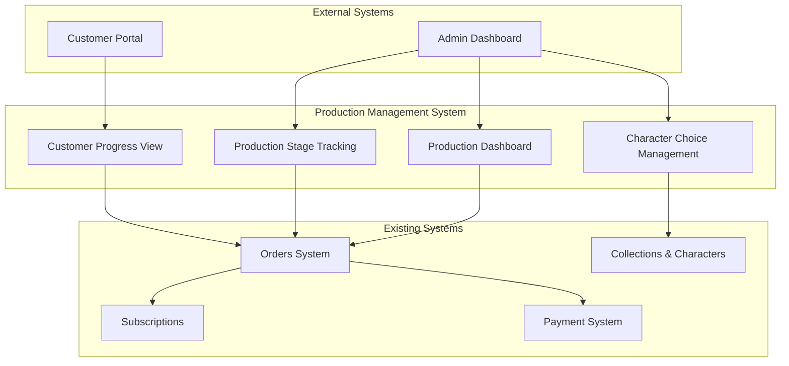
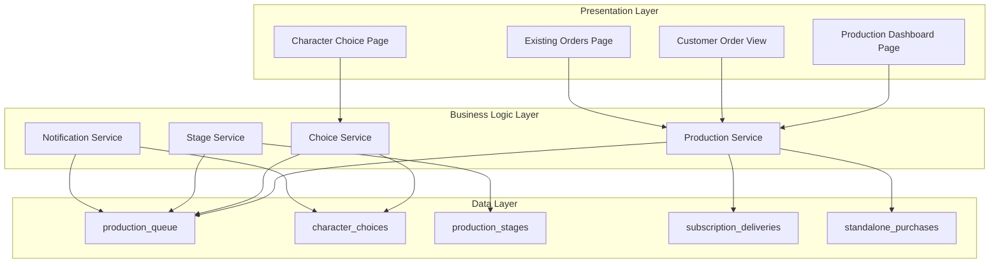
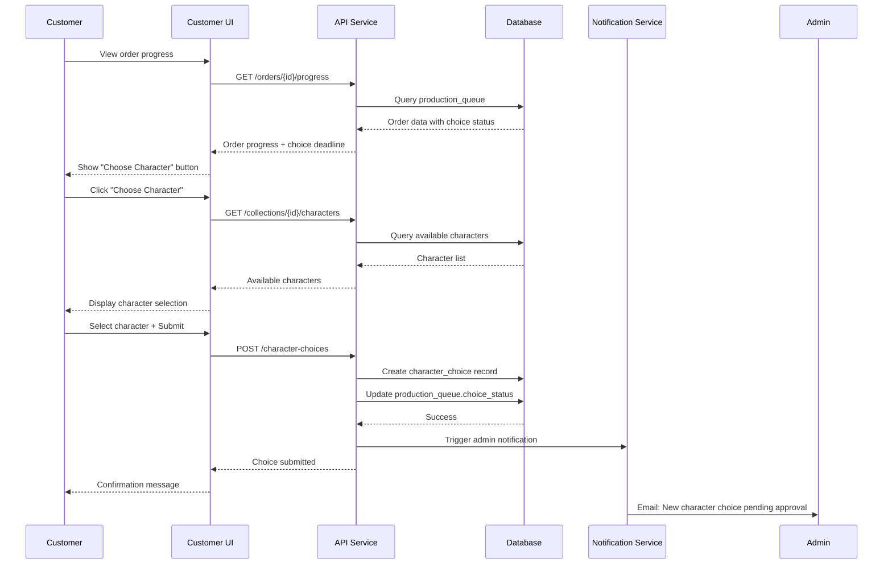
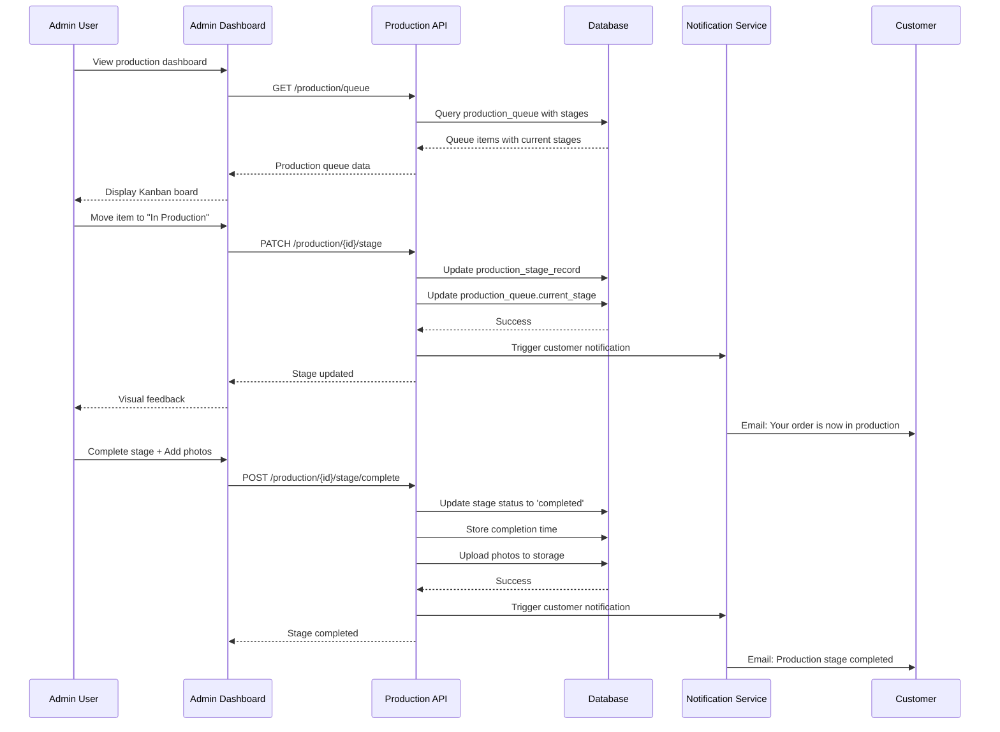

# Design Document: Production Management System

## Overview

The Production Management System is a comprehensive solution for managing the production lifecycle of collectible figures in an e-commerce platform with subscription-based deliveries. The system addresses critical operational gaps by providing a visual production dashboard (similar to a McDonald's kitchen display), character choice management with deadlines, production stage tracking, and customer-facing progress visibility. The design prioritizes simplicity, reuses existing components from the OrdersPage, and integrates seamlessly with the current subscription_deliveries and standalone_purchases tables.

## Architecture

### System Context



### High-Level Architecture



## Components and Interfaces

### Component 1: Production Dashboard

**Purpose**: Provides a visual "kitchen display" style interface showing what needs to be produced, organized by collection, character, and priority.

**Interface**:

```typescript
interface ProductionDashboardProps {
  // No props - fetches data internally
}

interface ProductionDashboardState {
  view: "kanban" | "list" | "calendar";
  filters: ProductionFilters;
  selectedItems: Set<string>;
}

interface ProductionFilters {
  collections: string[];
  priorities: Priority[];
  stages: ProductionStage[];
  dateRange: { from: Date; to: Date } | null;
}
```

**Responsibilities**:

- Display production queue in multiple views (Kanban, List, Calendar)
- Show urgent alerts (deadlines < 24h, missing choices, etc.)
- Allow filtering by collection, priority, stage, and date
- Enable bulk actions (assign, update stage, etc.)
- Display real-time metrics (items in production, avg time, etc.)

### Component 2: Character Choice Management

**Purpose**: Manages customer character selections with deadline tracking and approval workflows.

**Interface**:

```typescript
interface CharacterChoiceManagerProps {
  // No props - fetches data internally
}

interface CharacterChoice {
  id: string;
  orderId: string;
  orderType: "subscription_delivery" | "standalone_purchase";
  customerId: string;
  customerName: string;
  collectionId: string;
  collectionName: string;
  status: ChoiceStatus;
  deadline: Date | null;
  chosenCharacterId: string | null;
  chosenCharacterName: string | null;
  submittedAt: Date | null;
  approvedAt: Date | null;
  notes: string | null;
}

type ChoiceStatus =
  | "pending" // Customer hasn't chosen yet
  | "submitted" // Customer submitted choice
  | "approved" // Admin approved choice
  | "rejected" // Admin rejected choice (out of stock, etc.)
  | "locked"; // Choice locked (production started)
```

**Responsibilities**:

- Display all orders awaiting character choice
- Show deadline countdown with visual urgency indicators
- Allow admin to approve/reject choices
- Send reminders to customers approaching deadline
- Track choice history and changes
- Lock choices when production starts

### Component 3: Production Stage Tracker

**Purpose**: Tracks orders through production stages from choice to delivery.

**Interface**:

```typescript
interface ProductionStageTrackerProps {
  orderId: string;
  orderType: "subscription_delivery" | "standalone_purchase";
}

interface ProductionStage {
  id: string;
  name: StageType;
  status: StageStatus;
  startedAt: Date | null;
  completedAt: Date | null;
  assignedTo: string | null;
  assignedToName: string | null;
  estimatedDuration: number; // hours
  actualDuration: number | null; // hours
  notes: string | null;
  photos: string[];
}

type StageType =
  | "awaiting_choice"
  | "design"
  | "production"
  | "quality_check"
  | "packaging"
  | "shipped";

type StageStatus = "pending" | "in_progress" | "completed" | "blocked";
```

**Responsibilities**:

- Display current stage for each order
- Track time spent in each stage
- Allow stage transitions with validation
- Record stage completion with photos/notes
- Calculate estimated completion dates
- Identify bottlenecks and delays

### Component 4: Customer Progress View

**Purpose**: Provides customers with real-time visibility into their order's production status.

**Interface**:

```typescript
interface CustomerProgressViewProps {
  orderId: string;
  orderType: "subscription_delivery" | "standalone_purchase";
}

interface CustomerOrderProgress {
  orderId: string;
  orderNumber: string;
  collectionName: string;
  currentStage: StageType;
  stageProgress: number; // 0-100
  estimatedCompletion: Date | null;
  estimatedShipping: Date | null;
  estimatedDelivery: Date | null;
  canChooseCharacter: boolean;
  choiceDeadline: Date | null;
  chosenCharacter: {
    id: string;
    name: string;
    imageUrl: string;
  } | null;
  trackingCode: string | null;
  stages: CustomerStageInfo[];
}

interface CustomerStageInfo {
  name: string;
  displayName: string;
  status: "completed" | "current" | "upcoming";
  completedAt: Date | null;
}
```

**Responsibilities**:

- Show order progress with visual timeline
- Display current stage and estimated dates
- Allow character selection (if applicable)
- Show chosen character preview
- Provide tracking information when shipped
- Send notifications on stage changes

## Data Models

### Model 1: ProductionQueueItem

```typescript
interface ProductionQueueItem {
  id: string;
  orderId: string;
  orderType: "subscription_delivery" | "standalone_purchase";
  customerId: string;
  customerName: string;
  customerEmail: string;

  // Collection & Character
  collectionId: string;
  collectionName: string;
  characterId: string | null;
  characterName: string | null;

  // Production Status
  productionStatus: ProductionStatus;
  currentStage: StageType;

  // Choice Management
  choiceStatus: ChoiceStatus;
  choiceDeadline: Date | null;
  choiceMadeAt: Date | null;

  // Priority & Scheduling
  priority: Priority;
  priorityScore: number; // Calculated score for sorting
  scheduledProductionDate: Date | null;
  estimatedCompletionDate: Date | null;

  // Assignment
  assignedTo: string | null;
  assignedToName: string | null;
  assignedAt: Date | null;

  // Tracking
  productionStartedAt: Date | null;
  productionCompletedAt: Date | null;

  // Notes & Metadata
  productionNotes: string | null;
  customerNotes: string | null;
  internalFlags: string[];

  // Timestamps
  createdAt: Date;
  updatedAt: Date;
}

type ProductionStatus =
  | "awaiting_choice"
  | "ready_for_production"
  | "in_production"
  | "completed"
  | "on_hold"
  | "cancelled";

type Priority =
  | "critical" // Deadline < 24h
  | "high" // Subscriber orders
  | "normal" // Standalone purchases
  | "low"; // Future orders
```

**Validation Rules**:

- `orderId` must exist in either subscription_deliveries or standalone_purchases
- `customerId` must exist in profiles table
- `collectionId` must exist in collections table
- `characterId` (if set) must exist in collection_characters table
- `choiceDeadline` must be in the future when status is 'awaiting_choice'
- `priority` is auto-calculated based on order type and deadline
- `productionStartedAt` must be before `productionCompletedAt`

### Model 2: CharacterChoice

```typescript
interface CharacterChoice {
  id: string;
  orderId: string;
  orderType: "subscription_delivery" | "standalone_purchase";
  userId: string;
  collectionId: string;

  // Choice Details
  characterId: string | null;
  characterName: string | null;
  characterImageUrl: string | null;

  // Status & Workflow
  status: ChoiceStatus;
  submittedAt: Date | null;
  approvedAt: Date | null;
  approvedBy: string | null;
  approvedByName: string | null;
  rejectedAt: Date | null;
  rejectionReason: string | null;

  // Deadline Management
  deadline: Date;
  remindersSent: number;
  lastReminderAt: Date | null;

  // Change History
  previousChoiceId: string | null; // If customer changed their mind
  changeReason: string | null;
  changeCount: number;

  // Timestamps
  createdAt: Date;
  updatedAt: Date;
}
```

**Validation Rules**:

- `orderId` must exist and not already have an approved choice
- `userId` must match the order's customer
- `collectionId` must match the order's collection
- `characterId` (if set) must belong to the specified collection
- `deadline` must be in the future when status is 'pending'
- `status` transitions must follow valid workflow (pending → submitted → approved/rejected)
- `changeCount` cannot exceed 3 (business rule: max 3 changes allowed)

### Model 3: ProductionStageRecord

```typescript
interface ProductionStageRecord {
  id: string;
  productionQueueId: string;

  // Stage Details
  stageName: StageType;
  stageOrder: number; // 1-6 for sequential stages
  status: StageStatus;

  // Timing
  startedAt: Date | null;
  completedAt: Date | null;
  estimatedDuration: number; // hours
  actualDuration: number | null; // hours

  // Assignment
  assignedTo: string | null;
  assignedToName: string | null;
  assignedAt: Date | null;

  // Documentation
  notes: string | null;
  photos: string[]; // Array of storage URLs

  // Blocking Issues
  isBlocked: boolean;
  blockReason: string | null;
  blockedAt: Date | null;
  unblockedAt: Date | null;

  // Timestamps
  createdAt: Date;
  updatedAt: Date;
}
```

**Validation Rules**:

- `productionQueueId` must exist in production_queue table
- `stageOrder` must be 1-6 and unique per productionQueueId
- `startedAt` must be before `completedAt`
- `actualDuration` is auto-calculated from startedAt and completedAt
- `status` cannot be 'completed' without `completedAt`
- `isBlocked` must be true if `blockReason` is set

## Sequence Diagrams

### Customer Character Selection Flow



### Production Stage Progression Flow



## Error Handling

### Error Scenario 1: Character Choice Deadline Expired

**Condition**: Customer attempts to choose character after deadline has passed
**Response**:

- API returns 400 Bad Request with error code `CHOICE_DEADLINE_EXPIRED`
- UI displays message: "The deadline for character selection has passed. Please contact support."
- Admin receives notification to manually assign character
  **Recovery**:
- Admin can manually extend deadline or assign default character
- System logs the expired deadline event for analytics

### Error Scenario 2: Character Out of Stock

**Condition**: Customer selects a character that is no longer available
**Response**:

- API returns 409 Conflict with error code `CHARACTER_UNAVAILABLE`
- UI displays message: "This character is no longer available. Please choose another."
- System suggests alternative characters from same collection
  **Recovery**:
- Customer selects alternative character
- Admin can manually override if character becomes available

### Error Scenario 3: Production Stage Blocked

**Condition**: Production cannot proceed due to missing materials, equipment failure, etc.
**Response**:

- Admin marks stage as "blocked" with reason
- System calculates new estimated completion date
- Customer receives notification of delay with explanation
  **Recovery**:
- Admin resolves blocking issue
- Admin marks stage as "unblocked"
- Production resumes with updated timeline

### Error Scenario 4: Invalid Stage Transition

**Condition**: Admin attempts to skip stages or move backwards without proper authorization
**Response**:

- API returns 422 Unprocessable Entity with error code `INVALID_STAGE_TRANSITION`
- UI displays message: "Cannot skip stages. Please complete current stage first."
- System logs the attempted invalid transition
  **Recovery**:
- Admin completes stages in correct order
- Or admin with elevated permissions can override with justification

## Testing Strategy

### Unit Testing Approach

**Key Test Cases**:

1. **Priority Calculation**: Test that priority scores are correctly calculated based on order type, deadline, and subscriber status
2. **Stage Transitions**: Verify all valid and invalid stage transitions
3. **Deadline Calculations**: Test choice deadline calculation and expiration logic
4. **Character Availability**: Test character stock checking and reservation
5. **Notification Triggers**: Verify notifications are triggered at correct events

**Coverage Goals**: 80% code coverage for business logic, 100% for critical paths (payment, stage transitions, deadline management)

### Property-Based Testing Approach

**Property Test Library**: fast-check (TypeScript)

**Properties to Test**:

1. **Priority Invariant**: For any two orders, if order A has higher priority than order B, then A's priority score > B's priority score
2. **Stage Ordering**: For any production item, stages must be completed in sequential order (stage N cannot be completed before stage N-1)
3. **Deadline Consistency**: If a choice deadline is set, it must always be in the future when status is 'pending'
4. **Time Monotonicity**: For any stage, startedAt <= completedAt, and completedAt of stage N <= startedAt of stage N+1

### Integration Testing Approach

**Test Scenarios**:

1. **End-to-End Order Flow**: Create order → Choose character → Progress through stages → Complete delivery
2. **Deadline Expiration**: Create order → Wait for deadline → Verify auto-assignment
3. **Bulk Operations**: Select multiple orders → Update stages in bulk → Verify all updates
4. **Notification Flow**: Trigger stage change → Verify customer receives email → Verify email content
5. **Dashboard Performance**: Load dashboard with 1000+ items → Verify load time < 2s

## Performance Considerations

**Database Indexing**:

- Index on `production_queue.production_status` for dashboard filtering
- Index on `production_queue.priority_score` for sorting
- Index on `production_queue.choice_deadline` for deadline queries
- Composite index on `(collection_id, current_stage)` for collection-based views
- Index on `character_choices.deadline` for reminder job

**Query Optimization**:

- Use database views for complex joins (production queue with customer/collection data)
- Implement pagination for all list views (max 50 items per page)
- Cache collection and character data (rarely changes)
- Use Redis for real-time dashboard metrics

**Expected Load**:

- 100-500 concurrent admin users
- 10,000-50,000 active production items
- Dashboard refresh every 30 seconds
- Target response time: < 500ms for dashboard, < 200ms for individual queries

## Security Considerations

**Access Control**:

- Production dashboard: Admin role required
- Character choice management: Admin role required
- Customer progress view: Customer can only view their own orders
- Stage updates: Admin role required, with audit logging

**Data Protection**:

- Customer notes are encrypted at rest
- Production photos stored in private S3 bucket with signed URLs
- PII (customer name, email) masked in logs
- API rate limiting: 100 requests/minute per user

**Audit Trail**:

- Log all stage transitions with user ID and timestamp
- Log all character choice changes with reason
- Log all deadline extensions with justification
- Retain audit logs for 2 years

## Dependencies

**External Libraries**:

- `@tanstack/react-query` - Data fetching and caching
- `@dnd-kit/core` - Drag-and-drop for Kanban board
- `date-fns` - Date manipulation and formatting
- `recharts` - Dashboard metrics visualization
- `react-hook-form` - Form handling for character selection

**Internal Dependencies**:

- Existing OrdersPage components (OrdersTable, OrderFilters, OrderDetailPanel)
- Existing orders-service.ts for data fetching patterns
- Existing notification system for email/push notifications
- Existing authentication and authorization system

**Database Dependencies**:

- PostgreSQL 14+ (for JSON functions and indexing)
- Supabase Realtime (for live dashboard updates)
- Supabase Storage (for production photos)

**API Dependencies**:

- Existing Supabase API for database operations
- Existing authentication API
- Email service (SendGrid or similar) for notifications
