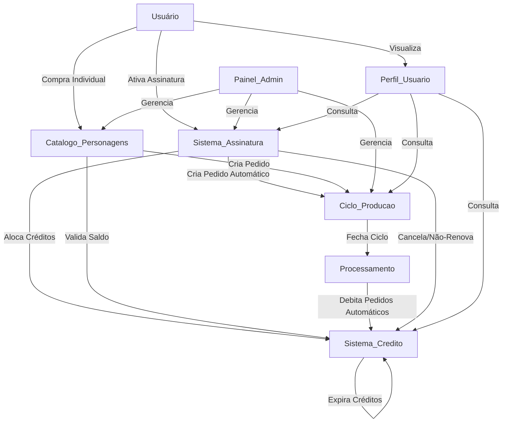
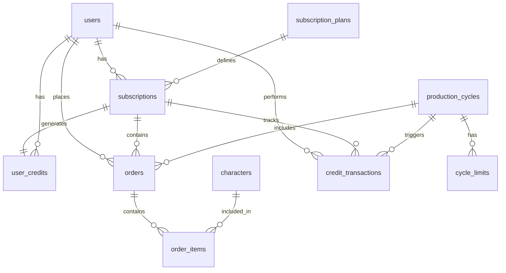
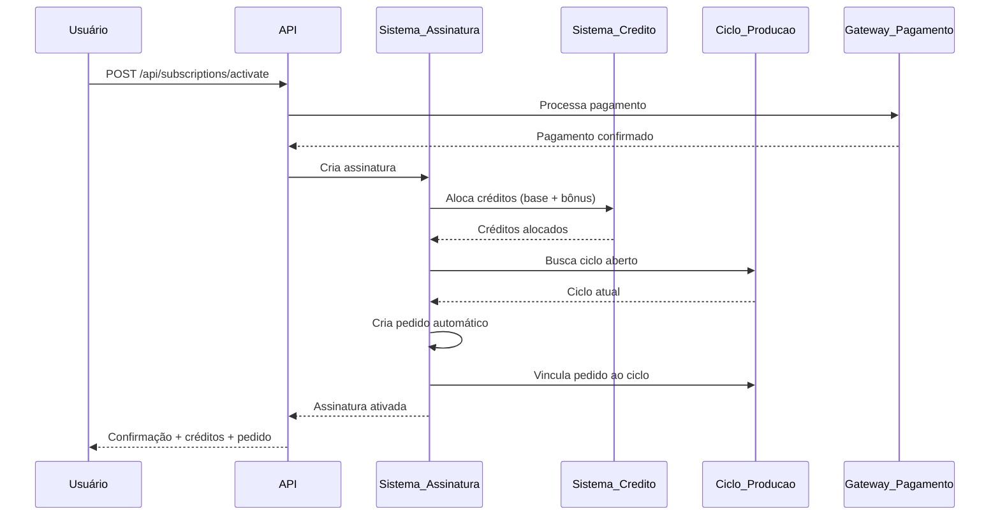
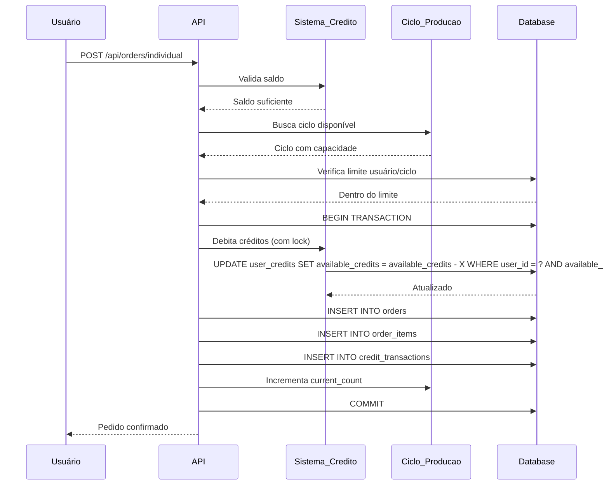
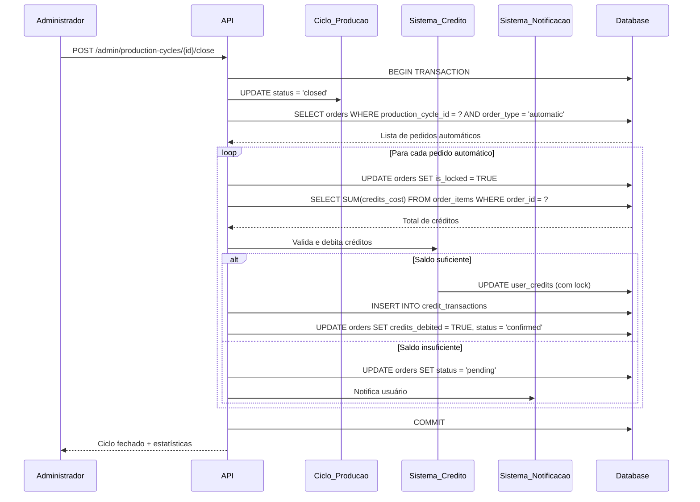
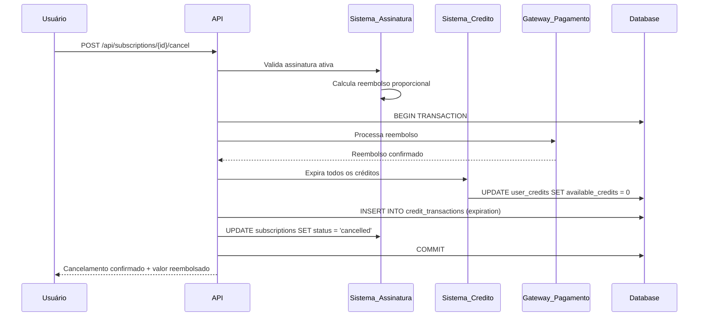
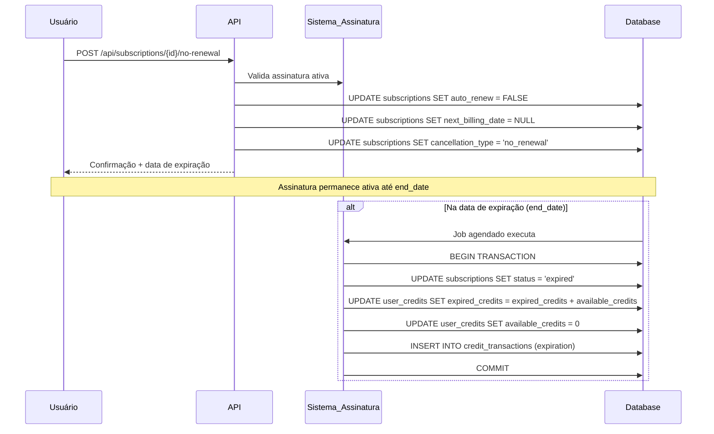
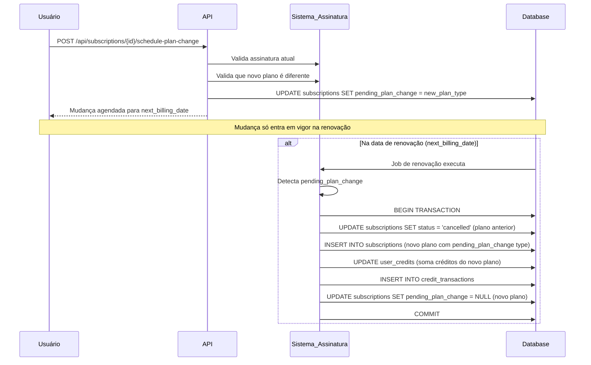
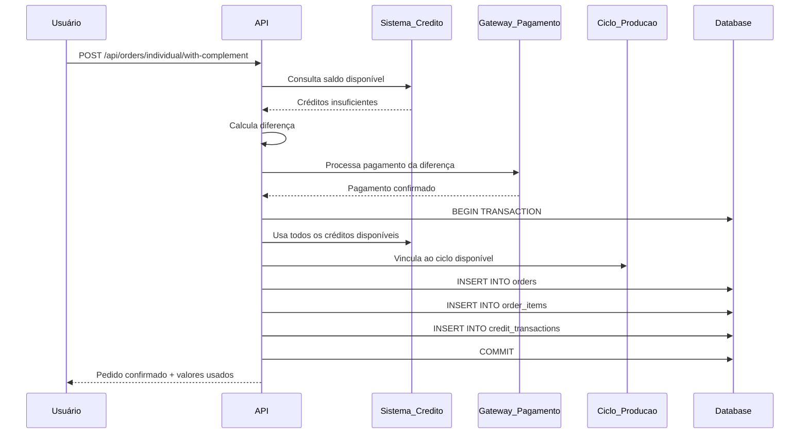

# Design Técnico: Sistema de Assinaturas com Créditos

## Visão Geral

Este documento especifica o design técnico completo para um sistema de assinaturas com créditos para uma plataforma de personagens colecionáveis. O sistema gerencia dois planos de assinatura (Trimestral e Semestral), controla saldos de créditos vinculados à assinatura ativa, permite compras individuais e automáticas de personagens, e integra ciclos de produção com capacidade limitada.

O sistema substitui ou complementa o modelo tradicional de vendas diretas, oferecendo aos clientes uma experiência baseada em créditos que incentiva engajamento contínuo através de assinaturas recorrentes.

## Arquitetura do Sistema

### Componentes Principais

O sistema é composto por quatro componentes principais que interagem para fornecer funcionalidade completa:

**1. Sistema de Assinaturas (Sistema_Assinatura)**
- Gerencia ciclo de vida de assinaturas (ativação, renovação, cancelamento)
- Controla tipos de planos (Trimestral e Semestral)
- Processa upgrades e downgrades
- Gerencia cancelamentos com extorno e não-renovação
- Coordena alocação inicial de créditos

**2. Sistema de Créditos (Sistema_Credito)**
- Mantém saldos de créditos por usuário
- Processa débitos e créditos
- Registra histórico de transações
- Controla expiração de créditos
- Valida saldo disponível antes de compras

**3. Catálogo de Personagens (Catalogo_Personagens)**
- Armazena informações de personagens disponíveis
- Gerencia precificação (dinheiro e créditos)
- Controla exclusividade por tipo de plano
- Filtra visualização baseada em tipo de assinatura

**4. Sistema de Ciclos de Produção (Ciclo_Producao)**
- Gerencia ciclos com capacidade limitada
- Controla datas de fechamento
- Vincula pedidos a ciclos específicos
- Processa débito de créditos no fechamento
- Gerencia prioridade de produção


### Fluxo de Dados



### Integrações Necessárias

**Gateway de Pagamento**
- Processamento de pagamentos de assinaturas
- Processamento de complementos de compra
- Processamento de reembolsos (cancelamento com extorno)
- Webhooks para confirmação de pagamento

**Sistema de Notificações**
- Email de confirmação de assinatura
- Email de renovação de assinatura
- Email de fechamento de ciclo
- Email de saldo insuficiente
- Email de cancelamento/não-renovação

**Sistema de Produção**
- Envio de pedidos confirmados
- Atualização de status de produção
- Notificação de envio


## Modelo de Dados

### Esquema de Banco de Dados

#### Tabela: subscriptions

Armazena informações de assinaturas de usuários.

```sql
CREATE TABLE subscriptions (
    id BIGINT PRIMARY KEY AUTO_INCREMENT,
    user_id BIGINT NOT NULL,
    plan_type ENUM('trimestral', 'semestral') NOT NULL,
    status ENUM('active', 'expired', 'cancelled') NOT NULL,
    start_date DATETIME NOT NULL,
    end_date DATETIME NOT NULL,
    next_billing_date DATETIME,
    auto_renew BOOLEAN DEFAULT TRUE,
    pending_plan_change ENUM('trimestral', 'semestral'),
    created_at DATETIME DEFAULT CURRENT_TIMESTAMP,
    updated_at DATETIME DEFAULT CURRENT_TIMESTAMP ON UPDATE CURRENT_TIMESTAMP,
    cancelled_at DATETIME,
    cancellation_type ENUM('with_refund', 'no_renewal'),
    
    INDEX idx_user_id (user_id),
    INDEX idx_status (status),
    INDEX idx_end_date (end_date),
    INDEX idx_next_billing_date (next_billing_date)
);
```

**Campos:**
- `id`: Identificador único da assinatura
- `user_id`: Referência ao usuário proprietário
- `plan_type`: Tipo de plano (trimestral ou semestral)
- `status`: Status atual (active, expired, cancelled)
- `start_date`: Data de início da assinatura
- `end_date`: Data de término da assinatura
- `next_billing_date`: Próxima data de cobrança (NULL se auto_renew = FALSE)
- `auto_renew`: Flag de renovação automática
- `pending_plan_change`: Tipo de plano agendado para próxima renovação (NULL se não há mudança agendada)
- `cancelled_at`: Data de cancelamento (se aplicável)
- `cancellation_type`: Tipo de cancelamento (with_refund ou no_renewal)


#### Tabela: user_credits

Armazena saldo de créditos de cada usuário.

```sql
CREATE TABLE user_credits (
    id BIGINT PRIMARY KEY AUTO_INCREMENT,
    user_id BIGINT NOT NULL UNIQUE,
    subscription_id BIGINT NOT NULL,
    total_credits INT NOT NULL DEFAULT 0,
    used_credits INT NOT NULL DEFAULT 0,
    available_credits INT NOT NULL DEFAULT 0,
    expired_credits INT NOT NULL DEFAULT 0,
    created_at DATETIME DEFAULT CURRENT_TIMESTAMP,
    updated_at DATETIME DEFAULT CURRENT_TIMESTAMP ON UPDATE CURRENT_TIMESTAMP,
    
    INDEX idx_user_id (user_id),
    INDEX idx_subscription_id (subscription_id),
    FOREIGN KEY (user_id) REFERENCES users(id),
    FOREIGN KEY (subscription_id) REFERENCES subscriptions(id),
    
    CONSTRAINT chk_available_credits CHECK (available_credits = total_credits - used_credits)
);
```

**Campos:**
- `id`: Identificador único do registro
- `user_id`: Referência ao usuário (único)
- `subscription_id`: Referência à assinatura ativa
- `total_credits`: Total de créditos alocados
- `used_credits`: Total de créditos já utilizados
- `available_credits`: Créditos disponíveis para uso
- `expired_credits`: Total de créditos expirados

**Invariante:** `available_credits = total_credits - used_credits`


#### Tabela: credit_transactions

Registra histórico completo de transações de créditos.

```sql
CREATE TABLE credit_transactions (
    id BIGINT PRIMARY KEY AUTO_INCREMENT,
    user_id BIGINT NOT NULL,
    subscription_id BIGINT NOT NULL,
    transaction_type ENUM('allocation', 'debit_immediate', 'debit_cycle_close', 'expiration', 'adjustment') NOT NULL,
    credits_amount INT NOT NULL,
    character_id BIGINT,
    order_id BIGINT,
    production_cycle_id BIGINT,
    description TEXT,
    created_at DATETIME DEFAULT CURRENT_TIMESTAMP,
    
    INDEX idx_user_id (user_id),
    INDEX idx_subscription_id (subscription_id),
    INDEX idx_transaction_type (transaction_type),
    INDEX idx_created_at (created_at),
    INDEX idx_production_cycle_id (production_cycle_id),
    FOREIGN KEY (user_id) REFERENCES users(id),
    FOREIGN KEY (subscription_id) REFERENCES subscriptions(id),
    FOREIGN KEY (character_id) REFERENCES characters(id),
    FOREIGN KEY (order_id) REFERENCES orders(id),
    FOREIGN KEY (production_cycle_id) REFERENCES production_cycles(id)
);
```

**Campos:**
- `id`: Identificador único da transação
- `user_id`: Referência ao usuário
- `subscription_id`: Referência à assinatura
- `transaction_type`: Tipo de transação
  - `allocation`: Alocação inicial de créditos
  - `debit_immediate`: Débito imediato (compra individual)
  - `debit_cycle_close`: Débito no fechamento de ciclo
  - `expiration`: Expiração de créditos
  - `adjustment`: Ajuste manual (admin)
- `credits_amount`: Quantidade de créditos (positivo para alocação, negativo para débito)
- `character_id`: Referência ao personagem (se aplicável)
- `order_id`: Referência ao pedido
- `production_cycle_id`: Referência ao ciclo de produção
- `description`: Descrição adicional


#### Tabela: characters

Armazena informações de personagens disponíveis no catálogo.

```sql
CREATE TABLE characters (
    id BIGINT PRIMARY KEY AUTO_INCREMENT,
    name VARCHAR(255) NOT NULL,
    description TEXT,
    price_cash DECIMAL(10, 2) NOT NULL,
    price_credits INT NOT NULL,
    is_exclusive_semestral BOOLEAN DEFAULT FALSE,
    is_active BOOLEAN DEFAULT TRUE,
    is_standard_collection BOOLEAN DEFAULT FALSE,
    image_url VARCHAR(500),
    created_at DATETIME DEFAULT CURRENT_TIMESTAMP,
    updated_at DATETIME DEFAULT CURRENT_TIMESTAMP ON UPDATE CURRENT_TIMESTAMP,
    
    INDEX idx_is_active (is_active),
    INDEX idx_is_exclusive_semestral (is_exclusive_semestral),
    INDEX idx_is_standard_collection (is_standard_collection)
);
```

**Campos:**
- `id`: Identificador único do personagem
- `name`: Nome do personagem
- `description`: Descrição do personagem
- `price_cash`: Preço em dinheiro
- `price_credits`: Preço em créditos
- `is_exclusive_semestral`: Flag de exclusividade para plano semestral
- `is_active`: Flag de ativação (controla visibilidade)
- `is_standard_collection`: Flag indicando se faz parte da coleção padrão
- `image_url`: URL da imagem do personagem


#### Tabela: orders

Armazena pedidos de personagens vinculados a ciclos de produção.

```sql
CREATE TABLE orders (
    id BIGINT PRIMARY KEY AUTO_INCREMENT,
    user_id BIGINT NOT NULL,
    subscription_id BIGINT NOT NULL,
    production_cycle_id BIGINT NOT NULL,
    order_type ENUM('individual', 'automatic') NOT NULL,
    status ENUM('pending', 'confirmed', 'in_production', 'shipped', 'cancelled') NOT NULL,
    is_priority BOOLEAN DEFAULT FALSE,
    is_locked BOOLEAN DEFAULT FALSE,
    total_credits INT NOT NULL DEFAULT 0,
    credits_debited BOOLEAN DEFAULT FALSE,
    created_at DATETIME DEFAULT CURRENT_TIMESTAMP,
    updated_at DATETIME DEFAULT CURRENT_TIMESTAMP ON UPDATE CURRENT_TIMESTAMP,
    locked_at DATETIME,
    
    INDEX idx_user_id (user_id),
    INDEX idx_subscription_id (subscription_id),
    INDEX idx_production_cycle_id (production_cycle_id),
    INDEX idx_order_type (order_type),
    INDEX idx_status (status),
    INDEX idx_is_priority (is_priority),
    FOREIGN KEY (user_id) REFERENCES users(id),
    FOREIGN KEY (subscription_id) REFERENCES subscriptions(id),
    FOREIGN KEY (production_cycle_id) REFERENCES production_cycles(id)
);
```

**Campos:**
- `id`: Identificador único do pedido
- `user_id`: Referência ao usuário
- `subscription_id`: Referência à assinatura
- `production_cycle_id`: Referência ao ciclo de produção
- `order_type`: Tipo de pedido (individual ou automatic)
- `status`: Status do pedido
- `is_priority`: Flag de prioridade (plano semestral)
- `is_locked`: Flag indicando se pedido está bloqueado para modificações
- `total_credits`: Total de créditos do pedido
- `credits_debited`: Flag indicando se créditos já foram debitados
- `locked_at`: Data/hora do bloqueio


#### Tabela: order_items

Armazena itens individuais de cada pedido.

```sql
CREATE TABLE order_items (
    id BIGINT PRIMARY KEY AUTO_INCREMENT,
    order_id BIGINT NOT NULL,
    character_id BIGINT NOT NULL,
    credits_cost INT NOT NULL,
    created_at DATETIME DEFAULT CURRENT_TIMESTAMP,
    
    INDEX idx_order_id (order_id),
    INDEX idx_character_id (character_id),
    FOREIGN KEY (order_id) REFERENCES orders(id) ON DELETE CASCADE,
    FOREIGN KEY (character_id) REFERENCES characters(id),
    
    UNIQUE KEY unique_order_character (order_id, character_id)
);
```

**Campos:**
- `id`: Identificador único do item
- `order_id`: Referência ao pedido
- `character_id`: Referência ao personagem
- `credits_cost`: Custo em créditos do personagem no momento da compra

**Constraint:** Um pedido não pode ter o mesmo personagem duplicado


#### Tabela: production_cycles

Armazena ciclos de produção com capacidade limitada.

```sql
CREATE TABLE production_cycles (
    id BIGINT PRIMARY KEY AUTO_INCREMENT,
    name VARCHAR(255) NOT NULL,
    capacity_limit INT NOT NULL,
    current_count INT NOT NULL DEFAULT 0,
    status ENUM('open', 'full', 'closed') NOT NULL DEFAULT 'open',
    close_date DATETIME NOT NULL,
    created_at DATETIME DEFAULT CURRENT_TIMESTAMP,
    updated_at DATETIME DEFAULT CURRENT_TIMESTAMP ON UPDATE CURRENT_TIMESTAMP,
    closed_at DATETIME,
    
    INDEX idx_status (status),
    INDEX idx_close_date (close_date),
    
    CONSTRAINT chk_current_count CHECK (current_count <= capacity_limit)
);
```

**Campos:**
- `id`: Identificador único do ciclo
- `name`: Nome do ciclo (ex: "Ciclo Janeiro 2024")
- `capacity_limit`: Limite máximo de personagens no ciclo
- `current_count`: Contagem atual de personagens vinculados
- `status`: Status do ciclo (open, full, closed)
- `close_date`: Data programada de fechamento
- `closed_at`: Data/hora efetiva de fechamento

**Invariante:** `current_count <= capacity_limit`


#### Tabela: cycle_limits

Armazena limites de personagens por usuário por ciclo.

```sql
CREATE TABLE cycle_limits (
    id BIGINT PRIMARY KEY AUTO_INCREMENT,
    production_cycle_id BIGINT NOT NULL,
    plan_type ENUM('trimestral', 'semestral', 'global'),
    character_limit INT NOT NULL,
    created_at DATETIME DEFAULT CURRENT_TIMESTAMP,
    updated_at DATETIME DEFAULT CURRENT_TIMESTAMP ON UPDATE CURRENT_TIMESTAMP,
    
    INDEX idx_production_cycle_id (production_cycle_id),
    INDEX idx_plan_type (plan_type),
    FOREIGN KEY (production_cycle_id) REFERENCES production_cycles(id),
    
    UNIQUE KEY unique_cycle_plan (production_cycle_id, plan_type)
);
```

**Campos:**
- `id`: Identificador único
- `production_cycle_id`: Referência ao ciclo de produção
- `plan_type`: Tipo de plano (ou 'global' para limite geral)
- `character_limit`: Limite de personagens permitidos


#### Tabela: subscription_plans

Armazena configuração de planos de assinatura.

```sql
CREATE TABLE subscription_plans (
    id BIGINT PRIMARY KEY AUTO_INCREMENT,
    plan_type ENUM('trimestral', 'semestral') NOT NULL UNIQUE,
    name VARCHAR(255) NOT NULL,
    duration_months INT NOT NULL,
    price DECIMAL(10, 2) NOT NULL,
    base_credits INT NOT NULL,
    bonus_credits INT NOT NULL DEFAULT 0,
    is_active BOOLEAN DEFAULT TRUE,
    created_at DATETIME DEFAULT CURRENT_TIMESTAMP,
    updated_at DATETIME DEFAULT CURRENT_TIMESTAMP ON UPDATE CURRENT_TIMESTAMP,
    
    INDEX idx_plan_type (plan_type),
    INDEX idx_is_active (is_active)
);
```

**Campos:**
- `id`: Identificador único
- `plan_type`: Tipo de plano (trimestral ou semestral)
- `name`: Nome do plano
- `duration_months`: Duração em meses
- `price`: Preço do plano
- `base_credits`: Créditos base do plano
- `bonus_credits`: Créditos bônus (ex: 200 para semestral)
- `is_active`: Flag de ativação

**Dados Iniciais:**
```sql
INSERT INTO subscription_plans (plan_type, name, duration_months, price, base_credits, bonus_credits) VALUES
('trimestral', 'Plano Trimestral', 3, 99.90, 600, 0),
('semestral', 'Plano Semestral', 6, 189.90, 1200, 200);
```


### Relacionamentos



### Índices de Performance

**Índices Críticos para Performance:**

1. **user_credits.user_id** - Consultas frequentes de saldo por usuário
2. **credit_transactions.user_id + created_at** - Histórico de transações ordenado
3. **orders.production_cycle_id + is_priority** - Listagem de pedidos por ciclo com prioridade
4. **orders.user_id + production_cycle_id** - Contagem de personagens por usuário por ciclo
5. **characters.is_active + is_exclusive_semestral** - Filtragem de catálogo
6. **production_cycles.status + close_date** - Identificação de ciclo aberto atual


## Componentes e Interfaces

### API Endpoints

#### Assinaturas

**POST /api/subscriptions/activate**
- Ativa nova assinatura para usuário
- Body: `{ user_id, plan_type, payment_method_id }`
- Response: `{ subscription_id, credits_allocated, order_id }`
- Ações:
  1. Valida pagamento
  2. Cria registro de assinatura
  3. Aloca créditos (base + bônus se semestral)
  4. Cria pedido automático com coleção padrão
  5. Vincula pedido ao ciclo aberto

**POST /api/subscriptions/{id}/schedule-plan-change**
- Agenda upgrade ou downgrade de plano para próxima renovação
- Body: `{ new_plan_type }`
- Response: `{ pending_plan_change, effective_date }`
- Ações:
  1. Valida que novo plano é diferente do atual
  2. Marca assinatura com pending_plan_change = new_plan_type
  3. Retorna data em que mudança entrará em vigor (next_billing_date)
  4. Envia notificação ao usuário confirmando agendamento

**POST /api/subscriptions/{id}/cancel**
- Cancela assinatura com extorno
- Body: `{ cancellation_type: 'with_refund' }`
- Response: `{ refund_amount, credits_expired }`
- Ações:
  1. Calcula reembolso proporcional baseado em TEMPO RESTANTE: (preço * dias_restantes) / dias_totais
  2. Processa reembolso via gateway
  3. Expira todos os créditos imediatamente
  4. Marca assinatura como cancelada

**POST /api/subscriptions/{id}/no-renewal**
- Desativa renovação automática
- Body: `{ cancellation_type: 'no_renewal' }`
- Response: `{ end_date, credits_valid_until }`
- Ações:
  1. Define auto_renew = FALSE
  2. Remove next_billing_date
  3. Mantém assinatura ativa até end_date


#### Créditos

**GET /api/credits/balance**
- Consulta saldo de créditos do usuário
- Response: `{ total_credits, used_credits, available_credits, subscription_status }`

**GET /api/credits/transactions**
- Lista histórico de transações
- Query params: `page, limit, transaction_type`
- Response: `{ transactions: [], pagination: {} }`

**POST /api/credits/validate**
- Valida se usuário tem créditos suficientes
- Body: `{ credits_required }`
- Response: `{ has_sufficient_credits, available_credits, shortfall }`

#### Personagens

**GET /api/characters**
- Lista personagens do catálogo
- Query params: `page, limit, plan_type`
- Response: `{ characters: [], pagination: {} }`
- Filtragem:
  - Se não autenticado: todos os personagens ativos
  - Se plano trimestral: personagens não exclusivos
  - Se plano semestral: todos os personagens

**GET /api/characters/{id}**
- Detalhes de personagem específico
- Response: `{ id, name, description, price_cash, price_credits, is_exclusive_semestral }`

**GET /api/characters/standard-collection**
- Lista personagens da coleção padrão
- Response: `{ characters: [] }`


#### Pedidos

**POST /api/orders/individual**
- Cria pedido de compra individual
- Body: `{ character_id, use_credits }`
- Response: `{ order_id, credits_debited, production_cycle_id }`
- Ações:
  1. Valida saldo de créditos
  2. Identifica ciclo aberto com capacidade
  3. Verifica limite de personagens do usuário no ciclo
  4. Debita créditos imediatamente
  5. Cria pedido confirmado e bloqueado
  6. Registra transação de crédito

**POST /api/orders/individual/with-complement**
- Compra individual com complemento em dinheiro
- Body: `{ character_id, payment_method_id }`
- Response: `{ order_id, credits_used, cash_paid, production_cycle_id }`
- Ações:
  1. Calcula diferença entre créditos disponíveis e preço
  2. Processa pagamento da diferença
  3. Usa todos os créditos disponíveis
  4. Cria pedido confirmado
  5. Registra transação de crédito

**GET /api/orders/automatic/{id}**
- Consulta pedido automático
- Response: `{ order_id, characters: [], total_credits, is_locked, cycle_close_date }`

**PUT /api/orders/automatic/{id}**
- Modifica pedido automático (apenas se ciclo aberto)
- Body: `{ character_ids: [] }`
- Response: `{ order_id, characters: [], total_credits }`
- Validações:
  - Ciclo deve estar aberto (is_locked = FALSE)
  - Personagens devem estar na coleção padrão

**GET /api/orders/user-cycle-count**
- Conta personagens do usuário no ciclo atual
- Response: `{ current_count, limit, cycle_id }`


#### Ciclos de Produção

**GET /api/production-cycles/current**
- Retorna ciclo aberto atual
- Response: `{ id, name, capacity_limit, current_count, close_date, status }`

**GET /api/production-cycles/{id}/orders**
- Lista pedidos de um ciclo
- Query params: `page, limit, priority_only`
- Response: `{ orders: [], pagination: {} }`

#### Admin - Assinaturas

**GET /admin/subscriptions**
- Lista todas as assinaturas
- Query params: `page, limit, status, plan_type`
- Response: `{ subscriptions: [], pagination: {} }`

**GET /admin/subscriptions/{id}**
- Detalhes completos de assinatura
- Response: `{ subscription, user, credits, orders: [] }`

**POST /admin/subscriptions/{id}/adjust-credits**
- Ajusta manualmente saldo de créditos
- Body: `{ credits_adjustment, reason }`
- Response: `{ new_balance }`

**POST /admin/subscriptions/{id}/force-cancel**
- Cancela assinatura administrativamente
- Body: `{ reason, refund_amount }`
- Response: `{ cancelled_at, refund_processed }`


#### Admin - Personagens

**POST /admin/characters**
- Cria novo personagem
- Body: `{ name, description, price_cash, price_credits, is_exclusive_semestral, is_standard_collection }`
- Response: `{ character_id }`

**PUT /admin/characters/{id}**
- Atualiza personagem
- Body: `{ name, description, price_cash, price_credits, is_exclusive_semestral, is_active }`
- Response: `{ character }`

**DELETE /admin/characters/{id}**
- Desativa personagem (soft delete)
- Response: `{ success }`

#### Admin - Ciclos de Produção

**POST /admin/production-cycles**
- Cria novo ciclo de produção
- Body: `{ name, capacity_limit, close_date }`
- Response: `{ cycle_id }`

**POST /admin/production-cycles/{id}/close**
- Fecha ciclo manualmente
- Response: `{ closed_at, orders_processed, credits_debited }`
- Ações:
  1. Marca ciclo como fechado
  2. Bloqueia todos os pedidos do ciclo
  3. Processa débito de pedidos automáticos
  4. Registra transações de crédito
  5. Notifica usuários com saldo insuficiente

**GET /admin/production-cycles/{id}/statistics**
- Estatísticas do ciclo
- Response: `{ total_orders, priority_orders, total_characters, capacity_used_percent }`

**POST /admin/production-cycles/{id}/limits**
- Define limites de personagens por usuário
- Body: `{ plan_type, character_limit }`
- Response: `{ limit_id }`


#### Admin - Planos

**PUT /admin/subscription-plans/{plan_type}**
- Atualiza configuração de plano
- Body: `{ price, base_credits, bonus_credits }`
- Response: `{ plan }`

### Interfaces de Usuário

#### Painel do Usuário (Perfil_Usuario)

**Seção: Minha Assinatura**
- Badge visual do tipo de plano (Trimestral/Semestral)
- Status da assinatura (Ativa/Expira em X dias)
- Próxima data de cobrança (ou "Não renovará" se aplicável)
- Botões de ação:
  - Upgrade para Semestral (se trimestral)
  - Cancelar com Extorno
  - Não Renovar
  - Reativar Renovação (se não-renovação ativa)

**Seção: Meus Créditos**
- Barra visual de créditos:
  - Total de créditos
  - Créditos usados (em cor diferente)
  - Créditos disponíveis (destacado)
- Números exatos: "450 de 600 créditos disponíveis"
- Link para histórico completo de transações

**Seção: Histórico de Transações**
- Tabela paginada com:
  - Data/hora
  - Tipo (Alocação/Compra Individual/Débito Automático/Expiração)
  - Personagem (se aplicável)
  - Créditos (+ ou -)
  - Saldo após transação
- Filtros: tipo de transação, período

**Seção: Meu Pedido Automático**
- Lista de personagens da coleção padrão
- Total de créditos necessários
- Data de fechamento do ciclo
- Botão "Modificar Seleção" (apenas se ciclo aberto)
- Aviso se saldo insuficiente

**Seção: Limite de Personagens**
- "Você adicionou X de Y personagens neste ciclo"
- Barra de progresso visual
- Data de fechamento do ciclo atual


#### Catálogo de Personagens (Catalogo_Personagens)

**Visualização para Não-Assinantes**
- Grid de personagens com imagem, nome e preço em dinheiro
- Botão "Comprar com Dinheiro"
- Call-to-action: "Assine e ganhe créditos para comprar"

**Visualização para Assinantes**
- Grid de personagens com:
  - Imagem e nome
  - Preço em dinheiro
  - Preço em créditos (destacado)
  - Badge "Exclusivo Semestral" (se aplicável)
  - Comparação: "Economize X% usando créditos"
- Saldo de créditos sempre visível no topo
- Botões:
  - "Comprar com Créditos" (se saldo suficiente)
  - "Comprar com Complemento" (se saldo insuficiente)
  - "Comprar com Dinheiro"
- Filtros:
  - Todos os personagens
  - Disponíveis com meus créditos
  - Exclusivos (apenas semestral)

**Filtros de Visibilidade**
- Plano Trimestral: oculta personagens com `is_exclusive_semestral = TRUE`
- Plano Semestral: exibe todos os personagens
- Todos: oculta personagens com `is_active = FALSE`

#### Painel Administrativo (Painel_Admin)

**Dashboard Principal**
- Métricas:
  - Total de assinaturas ativas
  - Receita mensal recorrente
  - Créditos em circulação
  - Taxa de conversão de créditos
  - Ciclo atual: capacidade usada

**Gestão de Assinaturas**
- Tabela de assinaturas com filtros
- Ações em massa: exportar, notificar
- Detalhes por assinatura:
  - Informações do usuário
  - Histórico de planos
  - Saldo de créditos
  - Histórico de transações
  - Pedidos vinculados
- Ações: ajustar créditos, cancelar, upgrade/downgrade

**Gestão de Personagens**
- Tabela de personagens com filtros
- Formulário de criação/edição
- Preview de como aparece no catálogo
- Ações: ativar/desativar, editar preços

**Gestão de Ciclos**
- Lista de ciclos (abertos, cheios, fechados)
- Criação de novo ciclo
- Detalhes por ciclo:
  - Pedidos vinculados (com prioridade destacada)
  - Estatísticas de capacidade
  - Lista de usuários com saldo insuficiente
- Ações: fechar ciclo, ajustar limites

**Gestão de Planos**
- Configuração de planos trimestral e semestral
- Ajuste de preços, créditos base e bônus
- Histórico de alterações


## Fluxos Críticos

### Fluxo 1: Ativação de Assinatura



**Passos Detalhados:**

1. Usuário seleciona plano e fornece método de pagamento
2. Sistema valida dados e processa pagamento via gateway
3. Após confirmação, cria registro em `subscriptions`:
   - `status = 'active'`
   - `start_date = NOW()`
   - `end_date = NOW() + duration_months`
   - `next_billing_date = end_date`
   - `auto_renew = TRUE`
4. Calcula créditos totais:
   - Trimestral: 600
   - Semestral: 1200 + 200 = 1400
5. Cria/atualiza registro em `user_credits`:
   - `total_credits = créditos calculados`
   - `available_credits = créditos calculados`
6. Registra transação em `credit_transactions`:
   - `transaction_type = 'allocation'`
   - `credits_amount = créditos calculados`
7. Busca personagens com `is_standard_collection = TRUE`
8. Identifica ciclo com `status = 'open'` e capacidade disponível
9. Cria registro em `orders`:
   - `order_type = 'automatic'`
   - `status = 'pending'`
   - `is_priority = TRUE` (se semestral)
   - `is_locked = FALSE`
   - `credits_debited = FALSE`
10. Cria registros em `order_items` para cada personagem da coleção
11. Calcula `total_credits` do pedido
12. Envia email de confirmação ao usuário


### Fluxo 2: Compra Individual com Débito Imediato



**Passos Detalhados:**

1. Usuário seleciona personagem do catálogo
2. Sistema valida:
   - Usuário tem assinatura ativa
   - Personagem está ativo (`is_active = TRUE`)
   - Se personagem é exclusivo, usuário tem plano semestral
3. Consulta saldo em `user_credits`
4. Se `available_credits < price_credits`:
   - Retorna erro ou oferece complemento
5. Identifica ciclo aberto com capacidade:
   - `status = 'open'`
   - `current_count < capacity_limit`
6. Verifica limite de personagens do usuário no ciclo:
   - Consulta `cycle_limits` para o ciclo e plano do usuário
   - Conta personagens já adicionados pelo usuário no ciclo
   - Se atingiu limite, vincula ao próximo ciclo
7. Inicia transação de banco de dados
8. Debita créditos com lock pessimista:
   ```sql
   UPDATE user_credits 
   SET used_credits = used_credits + ?, 
       available_credits = available_credits - ?
   WHERE user_id = ? 
   AND available_credits >= ?
   FOR UPDATE
   ```
9. Cria pedido:
   - `order_type = 'individual'`
   - `status = 'confirmed'`
   - `is_locked = TRUE`
   - `credits_debited = TRUE`
   - `is_priority = TRUE` (se semestral)
10. Cria item do pedido em `order_items`
11. Registra transação:
    - `transaction_type = 'debit_immediate'`
    - `credits_amount = -price_credits`
12. Incrementa `current_count` do ciclo
13. Commit da transação
14. Retorna confirmação ao usuário


### Fluxo 3: Fechamento de Ciclo com Débito de Pedidos Automáticos



**Passos Detalhados:**

1. Administrador aciona fechamento manual ou sistema fecha automaticamente na `close_date`
2. Inicia transação de banco de dados
3. Atualiza ciclo:
   ```sql
   UPDATE production_cycles 
   SET status = 'closed', closed_at = NOW() 
   WHERE id = ?
   ```
4. Busca todos os pedidos automáticos do ciclo:
   ```sql
   SELECT * FROM orders 
   WHERE production_cycle_id = ? 
   AND order_type = 'automatic'
   ```
5. Para cada pedido automático:
   a. Bloqueia pedido: `UPDATE orders SET is_locked = TRUE`
   b. Calcula total de créditos:
      ```sql
      SELECT SUM(credits_cost) as total 
      FROM order_items 
      WHERE order_id = ?
      ```
   c. Valida saldo do usuário
   d. Se saldo suficiente:
      - Debita créditos com lock:
        ```sql
        UPDATE user_credits 
        SET used_credits = used_credits + ?, 
            available_credits = available_credits - ?
        WHERE user_id = ? 
        AND available_credits >= ?
        FOR UPDATE
        ```
      - Registra transações para cada item:
        ```sql
        INSERT INTO credit_transactions 
        (user_id, transaction_type, credits_amount, character_id, order_id, production_cycle_id)
        VALUES (?, 'debit_cycle_close', -?, ?, ?, ?)
        ```
      - Atualiza pedido: `UPDATE orders SET credits_debited = TRUE, status = 'confirmed'`
   e. Se saldo insuficiente:
      - Mantém pedido como `status = 'pending'`
      - Envia notificação ao usuário
      - Registra em log para acompanhamento admin
6. Commit da transação
7. Envia email de confirmação para usuários com pedidos processados
8. Retorna estatísticas: pedidos processados, créditos debitados, pendências


### Fluxo 4: Cancelamento com Extorno



**Passos Detalhados:**

1. Usuário solicita cancelamento com extorno
2. Sistema valida que assinatura está ativa
3. Calcula reembolso proporcional:
   ```
   dias_restantes = (end_date - NOW()) em dias
   dias_totais = (end_date - start_date) em dias
   percentual_restante = dias_restantes / dias_totais
   reembolso = price * percentual_restante
   ```
4. Inicia transação de banco de dados
5. Processa reembolso via gateway de pagamento
6. Expira créditos:
   ```sql
   UPDATE user_credits 
   SET expired_credits = expired_credits + available_credits,
       available_credits = 0
   WHERE user_id = ?
   ```
7. Registra transação de expiração:
   ```sql
   INSERT INTO credit_transactions 
   (user_id, subscription_id, transaction_type, credits_amount, description)
   VALUES (?, ?, 'expiration', -available_credits, 'Cancelamento com extorno')
   ```
8. Atualiza assinatura:
   ```sql
   UPDATE subscriptions 
   SET status = 'cancelled',
       cancelled_at = NOW(),
       cancellation_type = 'with_refund',
       auto_renew = FALSE,
       next_billing_date = NULL
   WHERE id = ?
   ```
9. Commit da transação
10. Envia email de confirmação com valor reembolsado
11. Retorna confirmação ao usuário


### Fluxo 5: Não-Renovação



**Passos Detalhados:**

**Fase 1: Solicitação de Não-Renovação**

1. Usuário solicita não-renovação
2. Sistema valida que assinatura está ativa
3. Atualiza assinatura:
   ```sql
   UPDATE subscriptions 
   SET auto_renew = FALSE,
       next_billing_date = NULL,
       cancellation_type = 'no_renewal'
   WHERE id = ? AND status = 'active'
   ```
4. Retorna confirmação:
   - Data de expiração (`end_date`)
   - Créditos permanecem válidos até essa data
   - Sem reembolso
5. Envia email de confirmação

**Fase 2: Expiração Natural (Job Agendado)**

1. Job agendado executa diariamente buscando assinaturas expiradas:
   ```sql
   SELECT * FROM subscriptions 
   WHERE status = 'active' 
   AND end_date <= NOW()
   AND auto_renew = FALSE
   ```
2. Para cada assinatura encontrada:
   a. Inicia transação
   b. Atualiza status:
      ```sql
      UPDATE subscriptions 
      SET status = 'expired'
      WHERE id = ?
      ```
   c. Expira créditos:
      ```sql
      UPDATE user_credits 
      SET expired_credits = expired_credits + available_credits,
          available_credits = 0
      WHERE user_id = ?
      ```
   d. Registra transação:
      ```sql
      INSERT INTO credit_transactions 
      (user_id, subscription_id, transaction_type, credits_amount, description)
      VALUES (?, ?, 'expiration', -available_credits, 'Expiração natural - não-renovação')
      ```
   e. Commit da transação
3. Envia email informando expiração


### Fluxo 6: Agendamento de Mudança de Plano (Upgrade/Downgrade)



**Passos Detalhados:**

**Fase 1: Agendamento da Mudança**

1. Usuário solicita mudança de plano (upgrade ou downgrade)
2. Sistema valida que assinatura está ativa
3. Sistema valida que novo plano é diferente do atual
4. Marca mudança agendada:
   ```sql
   UPDATE subscriptions 
   SET pending_plan_change = ?
   WHERE id = ? AND status = 'active'
   ```
5. Retorna confirmação:
   - Plano atual permanece ativo
   - Mudança entrará em vigor em `next_billing_date`
   - Créditos atuais permanecem disponíveis
6. Envia email de confirmação com data efetiva

**Fase 2: Execução da Mudança (Job de Renovação)**

1. Job de renovação detecta `pending_plan_change` não-nulo
2. Inicia transação de banco de dados
3. Encerra assinatura anterior:
   ```sql
   UPDATE subscriptions 
   SET status = 'cancelled',
       cancelled_at = NOW(),
       auto_renew = FALSE
   WHERE id = ?
   ```
4. Cria nova assinatura com o tipo do `pending_plan_change`:
   ```sql
   INSERT INTO subscriptions 
   (user_id, plan_type, status, start_date, end_date, next_billing_date, auto_renew, pending_plan_change)
   VALUES (?, pending_plan_change_value, 'active', NOW(), NOW() + INTERVAL X MONTH, NOW() + INTERVAL X MONTH, TRUE, NULL)
   ```
5. Calcula créditos do novo plano:
   - Trimestral: 600
   - Semestral: 1200 + 200 = 1400
6. Soma créditos ao saldo existente:
   ```sql
   UPDATE user_credits 
   SET total_credits = total_credits + new_credits,
       available_credits = available_credits + new_credits,
       subscription_id = new_subscription_id
   WHERE user_id = ?
   ```
7. Registra transação:
   ```sql
   INSERT INTO credit_transactions 
   (user_id, subscription_id, transaction_type, credits_amount, description)
   VALUES (?, ?, 'allocation', new_credits, 'Mudança de plano para [tipo]')
   ```
8. Se upgrade para semestral: atualiza flag de prioridade em pedidos futuros
9. Se downgrade para trimestral: remove acesso a personagens exclusivos
10. Commit da transação
11. Envia email de confirmação da mudança efetivada
12. Retorna confirmação com novos créditos adicionados

**Importante:** Esta abordagem previne o exploit financeiro onde usuário poderia:
- Comprar plano barato
- Usar todos os créditos
- Fazer upgrade e receber créditos cheios do plano caro

Com agendamento, o upgrade só ocorre na renovação, quando o usuário paga o valor cheio do novo plano.


### Fluxo 7: Compra com Complemento



**Passos Detalhados:**

1. Usuário seleciona personagem com preço maior que saldo disponível
2. Sistema detecta saldo insuficiente
3. Calcula complemento necessário:
   ```
   creditos_disponiveis = user_credits.available_credits
   preco_personagem = character.price_credits
   diferenca_creditos = preco_personagem - creditos_disponiveis
   valor_complemento = (diferenca_creditos / preco_personagem) * character.price_cash
   ```
4. Apresenta opção ao usuário:
   - "Você tem X créditos disponíveis"
   - "Este personagem custa Y créditos"
   - "Pague R$ Z para completar a compra"
5. Usuário confirma e fornece método de pagamento
6. Processa pagamento do complemento via gateway
7. Inicia transação de banco de dados
8. Usa todos os créditos disponíveis:
   ```sql
   UPDATE user_credits 
   SET used_credits = used_credits + available_credits,
       available_credits = 0
   WHERE user_id = ?
   FOR UPDATE
   ```
9. Identifica ciclo disponível
10. Cria pedido:
    - `order_type = 'individual'`
    - `status = 'confirmed'`
    - `is_locked = TRUE`
    - `credits_debited = TRUE`
11. Cria item do pedido
12. Registra transação:
    ```sql
    INSERT INTO credit_transactions 
    (user_id, subscription_id, transaction_type, credits_amount, character_id, order_id, description)
    VALUES (?, ?, 'debit_immediate', -creditos_disponiveis, ?, ?, 'Compra com complemento em dinheiro')
    ```
13. Commit da transação
14. Retorna confirmação:
    - Créditos usados
    - Valor pago em dinheiro
    - Pedido confirmado

**Importante:** Este fluxo NÃO adiciona créditos à conta. O pagamento em dinheiro é apenas para completar esta compra específica.


## Regras de Negócio

### Cálculo de Créditos

**Alocação Inicial:**
- Plano Trimestral: 600 créditos
- Plano Semestral: 1200 créditos base + 200 créditos bônus = 1400 créditos

**Renovação:**
- Créditos novos são SOMADOS ao saldo existente
- Não há reset de saldo na renovação
- Exemplo: usuário com 200 créditos restantes renova plano trimestral → novo saldo = 800 créditos

**Upgrade:**
- Créditos do novo plano são SOMADOS ao saldo existente
- Exemplo: usuário trimestral com 100 créditos faz upgrade para semestral → novo saldo = 1500 créditos

**Downgrade:**
- Créditos do novo plano são SOMADOS ao saldo existente
- Créditos anteriores são MANTIDOS
- Exemplo: usuário semestral com 500 créditos faz downgrade para trimestral → novo saldo = 1100 créditos

### Validação de Saldo

**Compra Individual:**
- Sistema valida saldo ANTES de criar pedido
- Débito é IMEDIATO e ATÔMICO
- Se saldo insuficiente durante transação, operação é revertida

**Pedido Automático:**
- Validação ocorre no FECHAMENTO do ciclo
- Se saldo insuficiente, pedido fica pendente
- Usuário é notificado para resolver pendência

**Proteção contra Condições de Corrida:**
```sql
-- Lock pessimista para garantir consistência
UPDATE user_credits 
SET used_credits = used_credits + ?,
    available_credits = available_credits - ?
WHERE user_id = ? 
AND available_credits >= ?
FOR UPDATE
```

### Controle de Expiração

**Assinatura Ativa:**
- Créditos permanecem válidos indefinidamente
- Não há expiração por tempo enquanto assinatura ativa

**Cancelamento com Extorno:**
- Todos os créditos expiram IMEDIATAMENTE
- `available_credits` vai para 0
- `expired_credits` é incrementado

**Não-Renovação:**
- Créditos permanecem válidos até `end_date`
- Na data de expiração, créditos expiram automaticamente
- Job agendado processa expirações diariamente

**Renovação Após Expiração:**
- Se usuário deixa assinatura expirar e depois renova
- Créditos expirados NÃO são restaurados
- Nova alocação de créditos é feita normalmente


### Limite de Personagens por Ciclo

**Configuração:**
- Administrador define limite global ou por tipo de plano
- Limite é por usuário por ciclo
- Exemplo: máximo 5 personagens por usuário no Ciclo Janeiro 2024

**Aplicação:**
- Contagem inclui personagens de pedidos individuais E automáticos
- Quando limite atingido, novos pedidos vão para próximo ciclo
- Limite NÃO impede modificação de pedido automático (apenas substitui personagens)

**Consulta de Limite:**
```sql
-- Conta personagens do usuário no ciclo
SELECT COUNT(*) as character_count
FROM order_items oi
JOIN orders o ON oi.order_id = o.id
WHERE o.user_id = ?
AND o.production_cycle_id = ?
```

**Validação:**
```sql
-- Busca limite aplicável
SELECT character_limit 
FROM cycle_limits
WHERE production_cycle_id = ?
AND (plan_type = ? OR plan_type = 'global')
ORDER BY plan_type DESC -- prioriza limite específico sobre global
LIMIT 1
```

### Prioridade de Produção

**Regra:**
- Pedidos de assinantes do plano semestral têm prioridade
- Flag `is_priority = TRUE` em todos os pedidos

**Aplicação:**
- Painel admin exibe pedidos prioritários destacados
- Sistema de produção processa pedidos prioritários primeiro
- Ordenação: `ORDER BY is_priority DESC, created_at ASC`

**Manutenção:**
- Flag é definida na criação do pedido baseada no plano atual
- Downgrade NÃO remove prioridade de pedidos já criados
- Upgrade adiciona prioridade a pedidos futuros


### Exclusividade de Personagens

**Regra:**
- Personagens com `is_exclusive_semestral = TRUE` são visíveis apenas para plano semestral
- Personagens não exclusivos são visíveis para ambos os planos

**Filtragem no Catálogo:**
```sql
-- Para plano trimestral
SELECT * FROM characters 
WHERE is_active = TRUE 
AND is_exclusive_semestral = FALSE

-- Para plano semestral
SELECT * FROM characters 
WHERE is_active = TRUE
```

**Validação na Compra:**
```sql
-- Valida se usuário pode comprar personagem
SELECT c.*, s.plan_type
FROM characters c
CROSS JOIN subscriptions s
WHERE c.id = ?
AND s.user_id = ?
AND s.status = 'active'
AND (c.is_exclusive_semestral = FALSE OR s.plan_type = 'semestral')
```

### Coleção Padrão

**Definição:**
- Personagens com `is_standard_collection = TRUE`
- Entregues automaticamente ao ativar assinatura

**Criação de Pedido Automático:**
```sql
-- Busca personagens da coleção padrão
SELECT * FROM characters 
WHERE is_standard_collection = TRUE 
AND is_active = TRUE
```

**Modificação:**
- Usuário pode modificar seleção enquanto ciclo está aberto
- Apenas personagens da coleção padrão podem ser selecionados
- Total de créditos é recalculado a cada modificação


## Segurança e Concorrência

### Controle de Transações Concorrentes

**Problema:** Múltiplos usuários ou múltiplas requisições do mesmo usuário podem tentar debitar créditos simultaneamente, causando condições de corrida.

**Solução: Lock Pessimista**

```sql
BEGIN TRANSACTION;

-- Adquire lock exclusivo na linha do usuário
SELECT * FROM user_credits 
WHERE user_id = ? 
FOR UPDATE;

-- Valida saldo
IF available_credits >= credits_required THEN
    -- Atualiza saldo
    UPDATE user_credits 
    SET used_credits = used_credits + credits_required,
        available_credits = available_credits - credits_required
    WHERE user_id = ?;
    
    -- Cria pedido e transação
    INSERT INTO orders (...);
    INSERT INTO credit_transactions (...);
    
    COMMIT;
ELSE
    ROLLBACK;
    RETURN ERROR;
END IF;
```

**Nível de Isolamento:**
- `READ COMMITTED` para consultas gerais
- `SERIALIZABLE` para operações críticas de débito de créditos

### Validações de Integridade

**Constraint de Saldo:**
```sql
ALTER TABLE user_credits 
ADD CONSTRAINT chk_available_credits 
CHECK (available_credits = total_credits - used_credits);
```

**Constraint de Capacidade:**
```sql
ALTER TABLE production_cycles 
ADD CONSTRAINT chk_current_count 
CHECK (current_count <= capacity_limit);
```

**Unique Constraints:**
```sql
-- Um usuário não pode ter o mesmo personagem duplicado em um pedido
ALTER TABLE order_items 
ADD CONSTRAINT unique_order_character 
UNIQUE (order_id, character_id);

-- Um usuário tem apenas um registro de créditos
ALTER TABLE user_credits 
ADD CONSTRAINT unique_user_credits 
UNIQUE (user_id);
```

### Proteção contra Manipulação

**Validação de Propriedade:**
- Sempre validar que usuário autenticado é dono do recurso
- Exemplo: ao modificar pedido, verificar `order.user_id = authenticated_user_id`

**Validação de Estado:**
- Verificar que recurso está em estado válido para operação
- Exemplo: só permitir modificação de pedido se `is_locked = FALSE`

**Validação de Permissões:**
- Endpoints admin requerem role de administrador
- Endpoints de usuário requerem autenticação
- Catálogo público não requer autenticação

**Rate Limiting:**
- Limitar requisições por usuário por minuto
- Especialmente importante para endpoints de compra
- Exemplo: máximo 10 compras por minuto por usuário


### Auditoria e Rastreabilidade

**Log de Transações:**
- Toda operação de crédito é registrada em `credit_transactions`
- Campos obrigatórios: user_id, subscription_id, transaction_type, credits_amount, created_at
- Histórico completo e imutável

**Log de Alterações de Assinatura:**
- Manter histórico de status de assinatura
- Registrar quem fez alterações (usuário ou admin)
- Timestamp de todas as operações

**Tabela de Auditoria (Opcional):**
```sql
CREATE TABLE audit_log (
    id BIGINT PRIMARY KEY AUTO_INCREMENT,
    table_name VARCHAR(100) NOT NULL,
    record_id BIGINT NOT NULL,
    action ENUM('INSERT', 'UPDATE', 'DELETE') NOT NULL,
    old_values JSON,
    new_values JSON,
    user_id BIGINT,
    admin_id BIGINT,
    ip_address VARCHAR(45),
    created_at DATETIME DEFAULT CURRENT_TIMESTAMP,
    
    INDEX idx_table_record (table_name, record_id),
    INDEX idx_created_at (created_at)
);
```

### Proteção de Dados Sensíveis

**Dados de Pagamento:**
- NUNCA armazenar dados completos de cartão
- Usar tokens do gateway de pagamento
- Armazenar apenas últimos 4 dígitos para referência

**Dados Pessoais:**
- Criptografar dados sensíveis em repouso
- Usar HTTPS para todas as comunicações
- Implementar LGPD/GDPR compliance

**Acesso a Dados:**
- Logs de acesso a dados sensíveis
- Princípio do menor privilégio
- Separação de ambientes (dev/staging/prod)


## Escalabilidade

### Índices de Performance

**Índices Compostos Críticos:**

```sql
-- Consulta de saldo por usuário (muito frequente)
CREATE INDEX idx_user_credits_user_id ON user_credits(user_id);

-- Histórico de transações por usuário ordenado por data
CREATE INDEX idx_credit_transactions_user_date ON credit_transactions(user_id, created_at DESC);

-- Pedidos por ciclo com prioridade
CREATE INDEX idx_orders_cycle_priority ON orders(production_cycle_id, is_priority DESC, created_at);

-- Contagem de personagens por usuário por ciclo
CREATE INDEX idx_orders_user_cycle ON orders(user_id, production_cycle_id);

-- Busca de ciclo aberto atual
CREATE INDEX idx_production_cycles_status_date ON production_cycles(status, close_date);

-- Filtragem de catálogo
CREATE INDEX idx_characters_active_exclusive ON characters(is_active, is_exclusive_semestral);

-- Busca de assinaturas ativas por usuário
CREATE INDEX idx_subscriptions_user_status ON subscriptions(user_id, status);

-- Job de expiração de assinaturas
CREATE INDEX idx_subscriptions_expiration ON subscriptions(status, end_date, auto_renew);
```

### Paginação

**Listagens Grandes:**
- Todas as listagens devem suportar paginação
- Parâmetros padrão: `page=1, limit=20`
- Máximo: `limit=100`

**Exemplo de Implementação:**
```sql
-- Listagem de personagens com paginação
SELECT * FROM characters 
WHERE is_active = TRUE
ORDER BY created_at DESC
LIMIT ? OFFSET ?;

-- Contagem total para paginação
SELECT COUNT(*) as total FROM characters WHERE is_active = TRUE;
```

**Response Format:**
```json
{
  "data": [...],
  "pagination": {
    "current_page": 1,
    "per_page": 20,
    "total": 150,
    "total_pages": 8,
    "has_next": true,
    "has_prev": false
  }
}
```


### Cache

**Dados Candidatos a Cache:**

1. **Configuração de Planos** (TTL: 1 hora)
   - Raramente muda
   - Consultado em toda ativação de assinatura
   ```
   Key: subscription_plans:all
   Value: JSON com todos os planos
   ```

2. **Personagens Ativos** (TTL: 15 minutos)
   - Catálogo consultado frequentemente
   - Invalidar ao criar/atualizar personagem
   ```
   Key: characters:active:{plan_type}
   Value: JSON com personagens filtrados
   ```

3. **Ciclo Aberto Atual** (TTL: 5 minutos)
   - Consultado em toda compra
   - Invalidar ao fechar ciclo
   ```
   Key: production_cycle:current
   Value: JSON com dados do ciclo
   ```

4. **Saldo de Créditos** (TTL: 1 minuto)
   - Consultado frequentemente
   - Invalidar após qualquer transação
   ```
   Key: user_credits:{user_id}
   Value: JSON com saldo
   ```

**Estratégia de Invalidação:**
- Cache-aside pattern
- Invalidação explícita após writes
- TTL como fallback

**Implementação:**
```python
# Exemplo em Python
def get_user_credits(user_id):
    cache_key = f"user_credits:{user_id}"
    
    # Tenta buscar do cache
    cached = redis.get(cache_key)
    if cached:
        return json.loads(cached)
    
    # Se não está em cache, busca do banco
    credits = db.query("SELECT * FROM user_credits WHERE user_id = ?", user_id)
    
    # Armazena em cache
    redis.setex(cache_key, 60, json.dumps(credits))
    
    return credits

def debit_credits(user_id, amount):
    # Realiza operação no banco
    db.execute("UPDATE user_credits SET available_credits = available_credits - ? WHERE user_id = ?", amount, user_id)
    
    # Invalida cache
    redis.delete(f"user_credits:{user_id}")
```

### Otimizações de Query

**Evitar N+1 Queries:**
```sql
-- Ruim: buscar pedidos e depois iterar buscando itens
SELECT * FROM orders WHERE production_cycle_id = ?;
-- Para cada pedido: SELECT * FROM order_items WHERE order_id = ?;

-- Bom: usar JOIN
SELECT o.*, oi.*, c.name as character_name
FROM orders o
LEFT JOIN order_items oi ON o.id = oi.order_id
LEFT JOIN characters c ON oi.character_id = c.id
WHERE o.production_cycle_id = ?;
```

**Projeção de Colunas:**
```sql
-- Ruim: buscar todas as colunas quando só precisa de algumas
SELECT * FROM characters;

-- Bom: buscar apenas colunas necessárias
SELECT id, name, price_credits FROM characters WHERE is_active = TRUE;
```

**Agregações Eficientes:**
```sql
-- Contagem de personagens por usuário por ciclo
SELECT o.user_id, COUNT(oi.id) as character_count
FROM orders o
JOIN order_items oi ON o.id = oi.order_id
WHERE o.production_cycle_id = ?
GROUP BY o.user_id;
```


### Capacidade e Limites

**Limites do Sistema:**
- Máximo 10.000 pedidos por ciclo de produção
- Máximo 100 personagens por pedido automático
- Máximo 1.000 transações de crédito por usuário por dia
- Máximo 50 personagens no catálogo ativo simultaneamente

**Monitoramento:**
- Alertas quando ciclo atinge 80% da capacidade
- Alertas quando banco de dados atinge 70% de uso
- Métricas de performance de queries (> 1s)
- Taxa de erro em transações de crédito

**Escalabilidade Horizontal:**
- API stateless permite múltiplas instâncias
- Load balancer distribui requisições
- Sessões armazenadas em Redis (não em memória da aplicação)
- Jobs de background em fila (não em cron local)

**Escalabilidade Vertical:**
- Banco de dados pode ser escalado verticalmente
- Read replicas para consultas pesadas
- Write master para operações de escrita

### Jobs Agendados

**Job 1: Expiração de Assinaturas**
- Frequência: Diariamente às 00:00
- Função: Expirar assinaturas com `end_date <= NOW()` e `auto_renew = FALSE`
- Ações:
  1. Buscar assinaturas elegíveis
  2. Atualizar status para 'expired'
  3. Expirar créditos
  4. Registrar transações
  5. Enviar notificações

**Job 2: Renovação Automática**
- Frequência: Diariamente às 01:00
- Função: Renovar assinaturas com `next_billing_date <= NOW()` e `auto_renew = TRUE`
- Ações:
  1. Buscar assinaturas elegíveis
  2. Processar pagamento
  3. Criar nova assinatura
  4. Alocar créditos
  5. Criar pedido automático
  6. Enviar confirmação

**Job 3: Fechamento Automático de Ciclos**
- Frequência: A cada hora
- Função: Fechar ciclos com `close_date <= NOW()` e `status = 'open'`
- Ações:
  1. Buscar ciclos elegíveis
  2. Executar fluxo de fechamento
  3. Processar débitos de pedidos automáticos
  4. Enviar notificações

**Job 4: Limpeza de Dados Antigos**
- Frequência: Semanalmente
- Função: Arquivar dados antigos
- Ações:
  1. Mover transações > 2 anos para tabela de arquivo
  2. Mover pedidos finalizados > 1 ano para arquivo
  3. Limpar logs > 90 dias


## Tratamento de Erros

### Erros de Validação

**Saldo Insuficiente:**
- Código: `INSUFFICIENT_CREDITS`
- HTTP Status: 400 Bad Request
- Mensagem: "Saldo de créditos insuficiente. Disponível: X, Necessário: Y"
- Ação: Oferecer complemento de compra (se aplicável)

**Assinatura Inativa:**
- Código: `INACTIVE_SUBSCRIPTION`
- HTTP Status: 403 Forbidden
- Mensagem: "Assinatura inativa. Renove sua assinatura para usar créditos"
- Ação: Redirecionar para página de renovação

**Personagem Exclusivo:**
- Código: `EXCLUSIVE_CHARACTER`
- HTTP Status: 403 Forbidden
- Mensagem: "Este personagem é exclusivo para assinantes do plano semestral"
- Ação: Oferecer upgrade de plano

**Ciclo Fechado:**
- Código: `CYCLE_CLOSED`
- HTTP Status: 400 Bad Request
- Mensagem: "Ciclo de produção fechado. Pedido vinculado ao próximo ciclo disponível"
- Ação: Informar data de fechamento do próximo ciclo

**Limite de Personagens Atingido:**
- Código: `CHARACTER_LIMIT_REACHED`
- HTTP Status: 400 Bad Request
- Mensagem: "Limite de personagens atingido para este ciclo (X/Y). Pedido vinculado ao próximo ciclo"
- Ação: Informar data de fechamento do próximo ciclo

**Pedido Bloqueado:**
- Código: `ORDER_LOCKED`
- HTTP Status: 400 Bad Request
- Mensagem: "Pedido bloqueado para modificações. Ciclo já foi fechado"
- Ação: Informar que modificações não são mais possíveis

### Erros de Sistema

**Falha de Pagamento:**
- Código: `PAYMENT_FAILED`
- HTTP Status: 402 Payment Required
- Mensagem: "Falha ao processar pagamento. Verifique seus dados e tente novamente"
- Ação: Permitir nova tentativa

**Condição de Corrida:**
- Código: `CONCURRENT_MODIFICATION`
- HTTP Status: 409 Conflict
- Mensagem: "Recurso foi modificado por outra operação. Tente novamente"
- Ação: Retry automático (até 3 tentativas)

**Recurso Não Encontrado:**
- Código: `NOT_FOUND`
- HTTP Status: 404 Not Found
- Mensagem: "Recurso não encontrado"
- Ação: Verificar ID do recurso

**Erro Interno:**
- Código: `INTERNAL_ERROR`
- HTTP Status: 500 Internal Server Error
- Mensagem: "Erro interno do servidor. Tente novamente mais tarde"
- Ação: Registrar em log, notificar equipe técnica

### Estratégias de Recuperação

**Transações Atômicas:**
- Todas as operações críticas usam transações de banco
- Rollback automático em caso de erro
- Garantia de consistência

**Retry com Backoff:**
- Operações idempotentes podem ser retentadas
- Backoff exponencial: 1s, 2s, 4s
- Máximo 3 tentativas

**Circuit Breaker:**
- Para integrações externas (gateway de pagamento)
- Após 5 falhas consecutivas, abre circuito por 60s
- Retorna erro imediato durante período de abertura

**Compensação:**
- Se débito de créditos falha após pagamento processado
- Sistema registra pendência para resolução manual
- Notifica equipe de suporte


## Propriedades de Correção

Uma propriedade é uma característica ou comportamento que deve ser verdadeiro em todas as execuções válidas de um sistema - essencialmente, uma declaração formal sobre o que o sistema deve fazer. Propriedades servem como ponte entre especificações legíveis por humanos e garantias de correção verificáveis por máquina.

### Propriedade 1: Alocação de Créditos por Tipo de Plano

Para qualquer ativação de assinatura, os créditos alocados devem corresponder exatamente ao tipo de plano: 600 créditos para plano trimestral e 1400 créditos (1200 base + 200 bônus) para plano semestral.

**Valida: Requisitos 1.2, 1.3, 1.4, 1.5**

### Propriedade 2: Filtragem de Personagens por Tipo de Plano

Para qualquer consulta ao catálogo de personagens, usuários com plano trimestral devem ver apenas personagens não exclusivos, enquanto usuários com plano semestral devem ver todos os personagens incluindo exclusivos.

**Valida: Requisitos 1.6, 1.7, 4.5**

### Propriedade 3: Prioridade de Produção para Plano Semestral

Para qualquer pedido criado por usuário com plano semestral, a flag `is_priority` deve ser `TRUE`.

**Valida: Requisito 1.8**

### Propriedade 4: Invariante de Saldo de Créditos

Para qualquer estado do sistema de créditos, a seguinte invariante deve ser mantida: `available_credits = total_credits - used_credits`.

**Valida: Requisito 3.4**

### Propriedade 5: Expiração de Créditos ao Cancelar ou Expirar

Para qualquer assinatura que é cancelada com extorno ou expira naturalmente, todos os créditos disponíveis devem ser marcados como expirados imediatamente, resultando em `available_credits = 0`.

**Valida: Requisitos 2.2, 2.1.2, 2.2.5**

### Propriedade 6: Acumulação de Créditos na Renovação e Upgrade

Para qualquer renovação de assinatura ou upgrade de plano, os novos créditos devem ser somados ao saldo existente, não resetados. Formalmente: `total_credits_novo = total_credits_antigo + créditos_do_plano`.

**Valida: Requisitos 2.4, 2.5, 8.3, 8.4**

### Propriedade 7: Preservação de Créditos no Downgrade

Para qualquer downgrade de plano, os créditos não utilizados do plano anterior devem ser mantidos, e os créditos do novo plano devem ser somados ao saldo existente.

**Valida: Requisito 8.7**

### Propriedade 8: Débito Imediato em Compras Individuais

Para qualquer compra individual confirmada, os créditos devem ser debitados imediatamente e atomicamente, com `available_credits` reduzido por `price_credits` e um registro de transação criado com `transaction_type = 'debit_immediate'`.

**Valida: Requisitos 5.3, 5.7**

### Propriedade 9: Débito Diferido em Pedidos Automáticos

Para qualquer pedido automático criado na ativação de assinatura, os créditos NÃO devem ser debitados imediatamente. O campo `credits_debited` deve ser `FALSE` até o fechamento do ciclo.

**Valida: Requisito 6.3**

### Propriedade 10: Débito no Fechamento de Ciclo

Para qualquer fechamento de ciclo de produção, todos os pedidos automáticos vinculados devem ter seus créditos debitados, com registros de transação criados com `transaction_type = 'debit_cycle_close'` para cada personagem.

**Valida: Requisitos 6.6, 6.7, 6.8**

### Propriedade 11: Validação de Saldo Antes de Compra

Para qualquer tentativa de compra individual, o sistema deve validar que `available_credits >= price_credits`. Se a condição não for satisfeita, a compra deve ser rejeitada.

**Valida: Requisitos 5.1, 5.2**

### Propriedade 12: Bloqueio de Pedidos ao Fechar Ciclo

Para qualquer ciclo de produção que é fechado, todos os pedidos vinculados devem ter `is_locked = TRUE`, impedindo modificações futuras.

**Valida: Requisitos 6.5, 7.7**

### Propriedade 13: Vinculação a Ciclo Disponível

Para qualquer pedido criado (individual ou automático), ele deve ser vinculado ao ciclo aberto com capacidade disponível. Se o ciclo atual está cheio (`current_count >= capacity_limit`), o pedido deve ser vinculado ao próximo ciclo disponível.

**Valida: Requisitos 5.5, 5.6, 6.2**

### Propriedade 14: Limite de Personagens por Usuário por Ciclo

Para qualquer usuário em um ciclo de produção, o número total de personagens (somando pedidos individuais e automáticos) não deve exceder o limite configurado para seu tipo de plano. Tentativas de adicionar personagens além do limite devem ser redirecionadas ao próximo ciclo.

**Valida: Requisitos 7.1.2, 7.1.4, 7.1.5**

### Propriedade 15: Contagem Precisa de Capacidade de Ciclo

Para qualquer ciclo de produção, o campo `current_count` deve ser igual ao número total de itens em `order_items` de todos os pedidos vinculados ao ciclo.

**Valida: Requisito 7.2**

### Propriedade 16: Marcação de Ciclo Cheio

Para qualquer ciclo de produção, quando `current_count >= capacity_limit`, o status deve ser atualizado para `'full'`.

**Valida: Requisito 7.3**

### Propriedade 17: Rejeição de Vinculação a Ciclo Fechado

Para qualquer tentativa de vincular um pedido a um ciclo com `status = 'closed'`, a operação deve ser rejeitada.

**Valida: Requisito 7.6**

### Propriedade 18: Não-Renovação Mantém Assinatura Ativa

Para qualquer assinatura com não-renovação processada (`auto_renew = FALSE`), o status deve permanecer `'active'` e os créditos devem permanecer disponíveis até `end_date`.

**Valida: Requisitos 2.2.2, 2.2.3**

### Propriedade 19: Encerramento na Data de Expiração

Para qualquer assinatura com `end_date <= NOW()` e `auto_renew = FALSE`, o sistema deve encerrar a assinatura (status = 'expired') e expirar todos os créditos.

**Valida: Requisito 2.2.4**

### Propriedade 20: Sem Reembolso em Não-Renovação

Para qualquer não-renovação processada, nenhuma transação de reembolso deve ser criada.

**Valida: Requisito 2.2.6**

### Propriedade 21: Cálculo de Reembolso Proporcional

Para qualquer cancelamento com extorno, o valor do reembolso deve ser proporcional ao período não utilizado: `reembolso = price * (dias_restantes / dias_totais)`.

**Valida: Requisito 2.1.1**

### Propriedade 22: Transição de Status em Upgrade/Downgrade

Para qualquer upgrade ou downgrade de plano, a assinatura anterior deve ter `status = 'cancelled'` e uma nova assinatura deve ser criada com `status = 'active'`.

**Valida: Requisitos 8.1, 8.2, 8.5, 8.6**

### Propriedade 23: Criação de Pedido Automático na Ativação

Para qualquer ativação de assinatura, um pedido automático deve ser criado com `order_type = 'automatic'` contendo todos os personagens com `is_standard_collection = TRUE`.

**Valida: Requisito 6.1**

### Propriedade 24: Modificabilidade de Pedido Automático

Para qualquer pedido automático com `is_locked = FALSE`, modificações devem ser permitidas. Para pedidos com `is_locked = TRUE`, modificações devem ser rejeitadas.

**Valida: Requisito 6.4**

### Propriedade 25: Pedido Individual Bloqueado na Criação

Para qualquer pedido individual criado, ele deve ter `status = 'confirmed'` e `is_locked = TRUE` imediatamente após criação.

**Valida: Requisito 5.8**

### Propriedade 26: Registro de Todas as Transações

Para qualquer operação que altera créditos (alocação, débito, expiração), um registro correspondente deve ser criado em `credit_transactions` com os campos apropriados preenchidos.

**Valida: Requisitos 3.5, 3.6**

### Propriedade 27: Atualização de Campos em Alocação

Para qualquer alocação de créditos, os campos `total_credits` e `available_credits` devem ser incrementados pela quantidade alocada.

**Valida: Requisito 3.2**

### Propriedade 28: Atualização de Campos em Débito

Para qualquer débito de créditos, `used_credits` deve ser incrementado e `available_credits` deve ser decrementado pela quantidade debitada.

**Valida: Requisito 3.3**

### Propriedade 29: Visibilidade de Preço em Dinheiro

Para qualquer consulta ao catálogo de personagens (autenticada ou não), o campo `price_cash` deve estar presente na resposta.

**Valida: Requisito 4.2**

### Propriedade 30: Visibilidade de Preço em Créditos para Assinantes

Para qualquer consulta ao catálogo por usuário autenticado com assinatura ativa, o campo `price_credits` deve estar presente na resposta.

**Valida: Requisito 4.3**

### Propriedade 31: Filtragem de Personagens Inativos

Para qualquer consulta ao catálogo de personagens, personagens com `is_active = FALSE` não devem aparecer nos resultados.

**Valida: Requisito 4.6**

### Propriedade 32: Cálculo de Complemento de Compra

Para qualquer compra com complemento, o valor calculado deve ser exatamente `price_credit - available_credits` (em créditos) convertido proporcionalmente para dinheiro.

**Valida: Requisito 11.2**

### Propriedade 33: Complemento Não Adiciona Créditos

Para qualquer compra com complemento processada, o campo `total_credits` não deve ser incrementado.

**Valida: Requisito 11.4**

### Propriedade 34: Complemento Usa Todos os Créditos Disponíveis

Para qualquer compra com complemento processada, `available_credits` deve ser reduzido a zero.

**Valida: Requisito 11.6**

### Propriedade 35: Complemento Completa a Compra

Para qualquer compra com complemento processada, um pedido confirmado deve ser criado com o personagem especificado.

**Valida: Requisito 11.5**

### Propriedade 36: Proibição de Transferência de Créditos

Para qualquer operação no sistema, não deve existir funcionalidade que permita transferir créditos de um usuário para outro.

**Valida: Requisito 12.1**

### Propriedade 37: Proibição de Conversão de Créditos

Para qualquer operação no sistema, não deve existir funcionalidade que permita converter créditos em dinheiro.

**Valida: Requisito 12.2**

### Propriedade 38: Reembolso Apenas com Cancelamento

Para qualquer operação de reembolso, ela deve estar vinculada a um cancelamento de assinatura com `cancellation_type = 'with_refund'`.

**Valida: Requisito 12.3**

### Propriedade 39: Consistência em Transações Concorrentes

Para quaisquer transações concorrentes de débito de créditos do mesmo usuário, a invariante de saldo (Propriedade 4) deve ser mantida, e o saldo final deve refletir todas as operações de forma isolada e consistente.

**Valida: Requisitos 13.3, 13.7**

### Propriedade 40: Tratamento de Saldo Insuficiente no Fechamento

Para qualquer pedido automático no fechamento de ciclo onde `available_credits < total_credits_pedido`, o pedido deve permanecer com `status = 'pending'` e `credits_debited = FALSE`.

**Valida: Requisito 6.10**


## Estratégia de Testes

### Abordagem Dual de Testes

O sistema utilizará uma abordagem complementar combinando testes unitários e testes baseados em propriedades:

**Testes Unitários:**
- Validam exemplos específicos e casos extremos
- Testam pontos de integração entre componentes
- Verificam tratamento de erros específicos
- Validam lógica de negócio em cenários conhecidos

**Testes Baseados em Propriedades:**
- Validam propriedades universais através de múltiplas entradas geradas
- Garantem correção geral do sistema
- Descobrem casos extremos não previstos
- Complementam testes unitários com cobertura abrangente

Ambos os tipos são necessários para cobertura completa: testes unitários capturam bugs concretos, testes de propriedade verificam correção geral.

### Biblioteca de Property-Based Testing

**Para Python:** Hypothesis
**Para JavaScript/TypeScript:** fast-check
**Para Java:** jqwik
**Para C#:** FsCheck

### Configuração de Testes de Propriedade

Cada teste de propriedade deve:
- Executar mínimo 100 iterações (devido à randomização)
- Incluir tag de referência ao documento de design
- Formato da tag: `Feature: subscription-credit-system, Property {número}: {texto da propriedade}`

Exemplo em Python com Hypothesis:
```python
from hypothesis import given, strategies as st

@given(
    plan_type=st.sampled_from(['trimestral', 'semestral']),
    user_id=st.integers(min_value=1)
)
def test_property_1_credit_allocation_by_plan_type(plan_type, user_id):
    """
    Feature: subscription-credit-system
    Property 1: Alocação de Créditos por Tipo de Plano
    
    Para qualquer ativação de assinatura, os créditos alocados devem 
    corresponder exatamente ao tipo de plano.
    """
    subscription = activate_subscription(user_id, plan_type)
    credits = get_user_credits(user_id)
    
    expected_credits = 600 if plan_type == 'trimestral' else 1400
    assert credits.total_credits == expected_credits
    assert credits.available_credits == expected_credits
```

Exemplo em TypeScript com fast-check:
```typescript
import fc from 'fast-check';

describe('Property 1: Credit Allocation by Plan Type', () => {
  it('should allocate correct credits for any plan activation', () => {
    fc.assert(
      fc.property(
        fc.constantFrom('trimestral', 'semestral'),
        fc.integer({ min: 1 }),
        (planType, userId) => {
          // Feature: subscription-credit-system
          // Property 1: Alocação de Créditos por Tipo de Plano
          
          const subscription = activateSubscription(userId, planType);
          const credits = getUserCredits(userId);
          
          const expectedCredits = planType === 'trimestral' ? 600 : 1400;
          expect(credits.totalCredits).toBe(expectedCredits);
          expect(credits.availableCredits).toBe(expectedCredits);
        }
      ),
      { numRuns: 100 }
    );
  });
});
```


### Testes Unitários

**Módulo: Sistema de Assinaturas**
- Ativação de assinatura trimestral
- Ativação de assinatura semestral
- Renovação de assinatura
- Upgrade de trimestral para semestral
- Downgrade de semestral para trimestral
- Cancelamento com extorno
- Não-renovação
- Cálculo de reembolso proporcional
- Validação de tipo de plano inválido

**Módulo: Sistema de Créditos**
- Alocação inicial de créditos
- Débito de créditos (compra individual)
- Débito de créditos (fechamento de ciclo)
- Expiração de créditos
- Validação de saldo insuficiente
- Registro de transações
- Manutenção da invariante de saldo
- Ajuste manual de créditos (admin)

**Módulo: Catálogo de Personagens**
- Filtragem por tipo de plano (trimestral)
- Filtragem por tipo de plano (semestral)
- Filtragem de personagens inativos
- Busca de personagens da coleção padrão
- Validação de personagem exclusivo
- Criação e atualização de personagens (admin)

**Módulo: Ciclos de Produção**
- Criação de ciclo
- Vinculação de pedido a ciclo aberto
- Vinculação de pedido a próximo ciclo (capacidade cheia)
- Fechamento de ciclo
- Bloqueio de pedidos ao fechar ciclo
- Débito de pedidos automáticos no fechamento
- Tratamento de saldo insuficiente no fechamento
- Atualização de contagem de capacidade
- Marcação de ciclo cheio
- Validação de limite de personagens por usuário

**Módulo: Pedidos**
- Criação de pedido individual
- Criação de pedido automático
- Modificação de pedido automático (ciclo aberto)
- Rejeição de modificação (ciclo fechado)
- Compra com complemento
- Validação de propriedade do pedido
- Cálculo de total de créditos do pedido

**Testes de Integração**
- Fluxo completo: ativação → compra individual → fechamento de ciclo
- Fluxo completo: ativação → modificação de pedido automático → fechamento
- Fluxo completo: ativação → upgrade → compra → cancelamento
- Fluxo completo: ativação → não-renovação → expiração
- Concorrência: múltiplas compras simultâneas do mesmo usuário
- Concorrência: múltiplos usuários comprando simultaneamente
- Limite de personagens: atingir limite e redirecionar para próximo ciclo

**Testes de API**
- Autenticação e autorização
- Validação de entrada
- Tratamento de erros
- Formato de resposta
- Paginação
- Rate limiting


### Geradores para Property-Based Testing

Para testes baseados em propriedades, os seguintes geradores devem ser implementados:

**Gerador de Usuários:**
```python
@st.composite
def user_generator(draw):
    return {
        'id': draw(st.integers(min_value=1, max_value=10000)),
        'email': draw(st.emails()),
        'name': draw(st.text(min_size=3, max_size=50))
    }
```

**Gerador de Assinaturas:**
```python
@st.composite
def subscription_generator(draw, user_id=None):
    if user_id is None:
        user_id = draw(st.integers(min_value=1))
    
    plan_type = draw(st.sampled_from(['trimestral', 'semestral']))
    start_date = draw(st.datetimes(
        min_value=datetime(2024, 1, 1),
        max_value=datetime.now()
    ))
    
    duration_months = 3 if plan_type == 'trimestral' else 6
    end_date = start_date + timedelta(days=duration_months * 30)
    
    return {
        'user_id': user_id,
        'plan_type': plan_type,
        'status': draw(st.sampled_from(['active', 'expired', 'cancelled'])),
        'start_date': start_date,
        'end_date': end_date,
        'auto_renew': draw(st.booleans())
    }
```

**Gerador de Personagens:**
```python
@st.composite
def character_generator(draw):
    price_cash = draw(st.decimals(min_value=10, max_value=500, places=2))
    price_credits = draw(st.integers(min_value=50, max_value=1000))
    
    return {
        'name': draw(st.text(min_size=3, max_size=100)),
        'price_cash': price_cash,
        'price_credits': price_credits,
        'is_exclusive_semestral': draw(st.booleans()),
        'is_active': draw(st.booleans()),
        'is_standard_collection': draw(st.booleans())
    }
```

**Gerador de Ciclos de Produção:**
```python
@st.composite
def production_cycle_generator(draw):
    return {
        'name': draw(st.text(min_size=5, max_size=50)),
        'capacity_limit': draw(st.integers(min_value=100, max_value=10000)),
        'current_count': 0,
        'status': 'open',
        'close_date': draw(st.datetimes(
            min_value=datetime.now(),
            max_value=datetime.now() + timedelta(days=30)
        ))
    }
```

**Gerador de Saldo de Créditos:**
```python
@st.composite
def user_credits_generator(draw, user_id=None):
    if user_id is None:
        user_id = draw(st.integers(min_value=1))
    
    total_credits = draw(st.integers(min_value=0, max_value=5000))
    used_credits = draw(st.integers(min_value=0, max_value=total_credits))
    
    return {
        'user_id': user_id,
        'total_credits': total_credits,
        'used_credits': used_credits,
        'available_credits': total_credits - used_credits,
        'expired_credits': draw(st.integers(min_value=0, max_value=1000))
    }
```

### Cobertura de Testes

**Metas de Cobertura:**
- Cobertura de código: mínimo 80%
- Cobertura de branches: mínimo 75%
- Todas as 40 propriedades devem ter testes implementados
- Todos os fluxos críticos devem ter testes de integração

**Métricas de Qualidade:**
- Tempo de execução de testes: máximo 5 minutos
- Taxa de falsos positivos: máximo 1%
- Cobertura de mutação: mínimo 70%

**Ferramentas:**
- Coverage.py (Python) ou Istanbul (JavaScript) para cobertura
- Mutation testing: mutmut (Python) ou Stryker (JavaScript)
- CI/CD: executar todos os testes em cada commit


### Ambientes de Teste

**Desenvolvimento (Dev):**
- Banco de dados local ou containerizado
- Dados de teste sintéticos
- Gateway de pagamento em modo sandbox
- Logs detalhados habilitados

**Staging:**
- Réplica do ambiente de produção
- Dados anonimizados de produção
- Gateway de pagamento em modo teste
- Testes de carga e performance

**Produção:**
- Monitoramento contínuo
- Alertas automáticos
- Testes de smoke após deploy
- Rollback automático em caso de falha

### Testes de Performance

**Cenários de Carga:**
1. 100 usuários simultâneos navegando no catálogo
2. 50 usuários simultâneos realizando compras
3. 10 administradores simultâneos gerenciando sistema
4. Fechamento de ciclo com 5.000 pedidos

**Métricas Esperadas:**
- Tempo de resposta médio: < 200ms
- Tempo de resposta p95: < 500ms
- Tempo de resposta p99: < 1s
- Taxa de erro: < 0.1%
- Throughput: mínimo 100 req/s

**Testes de Stress:**
- Capacidade máxima: 10.000 pedidos por ciclo
- Transações concorrentes: 100 débitos simultâneos
- Pico de tráfego: 500 req/s por 5 minutos

### Testes de Segurança

**Validações:**
- Injeção SQL em todos os endpoints
- XSS em campos de entrada
- CSRF em operações de mudança de estado
- Autenticação e autorização
- Rate limiting
- Exposição de dados sensíveis

**Ferramentas:**
- OWASP ZAP para testes automatizados
- Burp Suite para testes manuais
- Dependabot para vulnerabilidades de dependências

### Monitoramento e Observabilidade

**Métricas de Negócio:**
- Taxa de conversão de assinaturas
- Taxa de cancelamento (churn)
- Uso médio de créditos por usuário
- Taxa de compras com complemento
- Capacidade média de ciclos

**Métricas Técnicas:**
- Latência de endpoints
- Taxa de erro por endpoint
- Uso de CPU e memória
- Conexões de banco de dados
- Tamanho de filas de jobs

**Logs:**
- Estruturados em JSON
- Níveis: DEBUG, INFO, WARN, ERROR
- Contexto: user_id, subscription_id, request_id
- Retenção: 90 dias

**Alertas:**
- Taxa de erro > 1% por 5 minutos
- Latência p95 > 1s por 5 minutos
- Falhas de pagamento > 10% por 10 minutos
- Ciclo atingindo 90% de capacidade
- Saldo de créditos negativo (violação de invariante)

---

## Conclusão

Este documento de design técnico especifica a arquitetura completa do sistema de assinaturas com créditos, incluindo modelo de dados, componentes, fluxos críticos, regras de negócio, segurança, escalabilidade e estratégia de testes.

O sistema foi projetado para:
- Garantir consistência de dados através de transações atômicas e locks
- Escalar horizontalmente através de arquitetura stateless
- Manter alta disponibilidade através de redundância e circuit breakers
- Garantir correção através de 40 propriedades formalmente especificadas
- Facilitar manutenção através de separação clara de responsabilidades

A implementação deve seguir as especificações deste documento, com atenção especial às propriedades de correção que devem ser validadas através de testes baseados em propriedades.

