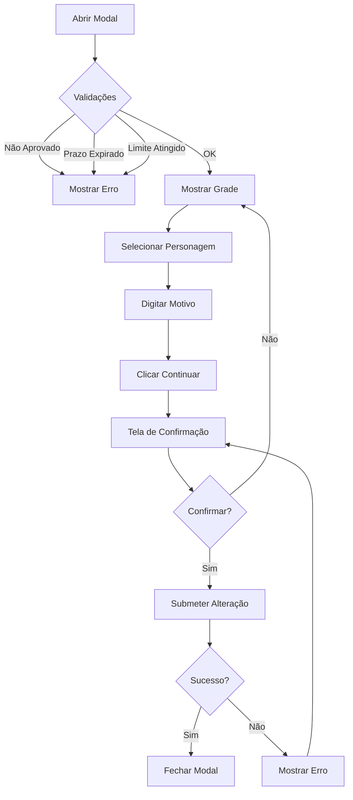

# ChoiceChangeModal Component

## Visão Geral

O componente `ChoiceChangeModal` permite que clientes alterem sua escolha de personagem previamente aprovada. O componente exibe a escolha atual, permite selecionar um novo personagem, requer um motivo para a alteração, mostra o contador de alterações restantes (máximo 3), e valida se a escolha já foi aprovada e se o prazo não expirou.

## Requisitos

- **Requirements**: 2.2.5 (Choice Change Handling)
- **Task**: 3.2.3 Create ChoiceChangeModal component

## Funcionalidades

### 1. Exibição da Escolha Atual
- Mostra o personagem atualmente escolhido com imagem e nome
- Destaca visualmente a escolha atual na grade de personagens
- Impede a seleção do mesmo personagem

### 2. Seleção de Novo Personagem
- Grade de personagens disponíveis similar ao CharacterSelectionModal
- Indicadores visuais de disponibilidade (estoque baixo, indisponível)
- Marca o personagem atual como "Escolha Atual"
- Feedback visual ao selecionar um novo personagem

### 3. Motivo da Alteração
- Campo de texto obrigatório para explicar a mudança
- Validação de mínimo 10 caracteres
- Exibido na tela de confirmação

### 4. Contador de Alterações
- Mostra quantas alterações restam (máximo 3)
- Alerta visual quando resta apenas 1 alteração
- Bloqueia alterações quando o limite é atingido

### 5. Validações
- Verifica se a escolha foi aprovada
- Valida se o prazo não expirou
- Confirma que o limite de alterações não foi atingido
- Impede alterações se qualquer validação falhar

### 6. Fluxo de Confirmação
- Tela de seleção com personagens e motivo
- Tela de confirmação mostrando nova escolha e motivo
- Possibilidade de voltar e alterar a seleção
- Submissão com feedback de loading

## Props

```typescript
interface ChoiceChangeModalProps {
  open: boolean;                      // Controla visibilidade do modal
  onOpenChange: (open: boolean) => void; // Callback para mudanças de estado
  choiceId: string;                   // ID da escolha a ser alterada
  orderId: string;                    // ID do pedido
  collectionId: string;               // ID da coleção
  currentCharacterId: string;         // ID do personagem atual
  currentCharacterName: string;       // Nome do personagem atual
  currentCharacterImageUrl: string | null; // URL da imagem do personagem atual
  deadline: string | null;            // Prazo para alterações (ISO string)
  changesCount: number;               // Número de alterações já feitas
  isApproved: boolean;                // Se a escolha foi aprovada
  onSuccess?: () => void;             // Callback após alteração bem-sucedida
}
```

## Uso

### Exemplo Básico

```tsx
import { ChoiceChangeModal } from "@/components/customer/ChoiceChangeModal";

function MyComponent() {
  const [showModal, setShowModal] = useState(false);

  return (
    <>
      <Button onClick={() => setShowModal(true)}>
        Alterar Escolha
      </Button>

      <ChoiceChangeModal
        open={showModal}
        onOpenChange={setShowModal}
        choiceId="choice-123"
        orderId="order-456"
        collectionId="col-789"
        currentCharacterId="char-1"
        currentCharacterName="Personagem Atual"
        currentCharacterImageUrl="https://example.com/char1.jpg"
        deadline="2024-12-31T23:59:59Z"
        changesCount={1}
        isApproved={true}
        onSuccess={() => {
          console.log("Escolha alterada com sucesso!");
          // Atualizar dados, mostrar notificação, etc.
        }}
      />
    </>
  );
}
```

### Integração com CharacterChoiceCard

```tsx
import { CharacterChoiceCard } from "@/components/customer/CharacterChoiceCard";
import { ChoiceChangeModal } from "@/components/customer/ChoiceChangeModal";

function OrderProgress() {
  const [showChangeModal, setShowChangeModal] = useState(false);
  const { data: orderProgress } = useOrderProgress(orderId);

  return (
    <>
      <CharacterChoiceCard
        orderId={orderProgress.orderId}
        orderType={orderProgress.orderType}
        collectionId={orderProgress.collectionId}
        choiceStatus={orderProgress.choiceStatus}
        choiceDeadline={orderProgress.choiceDeadline}
        characterName={orderProgress.chosenCharacter?.name}
        characterImageUrl={orderProgress.chosenCharacter?.imageUrl}
        changesCount={orderProgress.changesCount}
        onChangeClick={() => setShowChangeModal(true)}
      />

      {showChangeModal && (
        <ChoiceChangeModal
          open={showChangeModal}
          onOpenChange={setShowChangeModal}
          choiceId={orderProgress.choiceId}
          orderId={orderProgress.orderId}
          collectionId={orderProgress.collectionId}
          currentCharacterId={orderProgress.chosenCharacter.id}
          currentCharacterName={orderProgress.chosenCharacter.name}
          currentCharacterImageUrl={orderProgress.chosenCharacter.imageUrl}
          deadline={orderProgress.choiceDeadline}
          changesCount={orderProgress.changesCount}
          isApproved={orderProgress.choiceStatus === "approved"}
          onSuccess={() => {
            // Atualizar dados do pedido
            queryClient.invalidateQueries(["order-progress", orderId]);
          }}
        />
      )}
    </>
  );
}
```

## Estrutura do Componente

### Sub-Componentes

#### CurrentChoiceDisplay
Exibe a escolha atual do cliente com imagem e nome.

```tsx
<CurrentChoiceDisplay
  name="Personagem Atual"
  imageUrl="https://example.com/char.jpg"
/>
```

#### RemainingChangesAlert
Mostra o contador de alterações restantes com alerta visual.

```tsx
<RemainingChangesAlert remaining={2} />
```

#### CharacterCard
Card individual de personagem com estados visuais (selecionado, atual, indisponível).

```tsx
<CharacterCard
  character={character}
  selected={selectedId === character.id}
  isCurrent={currentId === character.id}
  onSelect={() => handleSelect(character.id)}
/>
```

## Estados e Validações

### Estados do Modal

1. **Seleção** - Grade de personagens e campo de motivo
2. **Confirmação** - Revisão da nova escolha e motivo
3. **Loading** - Durante submissão da alteração
4. **Erro** - Quando validações falham ou API retorna erro

### Validações

#### Pré-requisitos para Alteração
- ✅ Escolha deve estar aprovada (`isApproved === true`)
- ✅ Prazo não deve ter expirado (`deadline > now`)
- ✅ Limite de alterações não atingido (`changesCount < 3`)

#### Validações de Submissão
- ✅ Novo personagem selecionado
- ✅ Novo personagem diferente do atual
- ✅ Motivo com mínimo 10 caracteres
- ✅ Personagem disponível em estoque

### Mensagens de Erro

```typescript
// Escolha não aprovada
"Sua escolha ainda não foi aprovada. Aguarde a aprovação antes de solicitar alterações."

// Prazo expirado
"O prazo para alterar a escolha expirou. Entre em contato com o suporte."

// Limite atingido
"Você já atingiu o limite de 3 alterações. Entre em contato com o suporte para mais informações."

// Nenhum personagem selecionado
"Por favor, selecione um novo personagem."

// Motivo muito curto
"Por favor, informe o motivo da alteração."
```

## Integração com Backend

### API Calls

O componente utiliza o serviço `choice-service.ts`:

```typescript
// Buscar personagens disponíveis
const characters = await getAvailableCharacters(collectionId);

// Alterar escolha
const updatedChoice = await changeCharacterChoice(
  choiceId,
  newCharacterId,
  reason
);
```

### Invalidação de Cache

Após alteração bem-sucedida, o componente invalida as queries:

```typescript
queryClient.invalidateQueries({ queryKey: ["customer-order-progress"] });
queryClient.invalidateQueries({ queryKey: ["character-choice"] });
```

## Acessibilidade

- ✅ Labels descritivos em todos os campos
- ✅ Indicadores visuais de estado (selecionado, desabilitado)
- ✅ Feedback de loading durante operações
- ✅ Mensagens de erro claras e descritivas
- ✅ Navegação por teclado suportada
- ✅ Focus management adequado

## Responsividade

- **Mobile**: Grade 2 colunas, scroll vertical
- **Tablet**: Grade 3 colunas
- **Desktop**: Grade 3 colunas, modal max-width 4xl

## Testes

### Cobertura de Testes

- ✅ Renderização de elementos principais
- ✅ Exibição da escolha atual
- ✅ Contador de alterações restantes
- ✅ Validações (aprovação, prazo, limite)
- ✅ Seleção de personagens
- ✅ Campo de motivo
- ✅ Fluxo de confirmação
- ✅ Submissão e callbacks
- ✅ Tratamento de erros
- ✅ Controles do modal

### Executar Testes

```bash
npm run test src/components/customer/ChoiceChangeModal.test.tsx
```

## Estilização

O componente utiliza:
- **Tailwind CSS** para estilos utilitários
- **shadcn/ui** para componentes base (Dialog, Button, Alert, etc.)
- **Lucide React** para ícones
- **date-fns** para formatação de datas

### Classes Principais

```css
/* Card de personagem selecionado */
.border-primary.bg-primary/5.shadow-md

/* Card de personagem atual */
.opacity-50.cursor-not-allowed

/* Alerta de última alteração */
.bg-red-50.border-red-200

/* Alerta de alterações restantes */
.bg-green-50.border-green-200
```

## Fluxo de Usuário



## Notas de Implementação

### Regras de Negócio

1. **Limite de Alterações**: Máximo 3 alterações por pedido
2. **Motivo Obrigatório**: Mínimo 10 caracteres
3. **Prazo**: Alterações só permitidas antes do prazo
4. **Aprovação**: Só pode alterar escolhas aprovadas
5. **Personagem Atual**: Não pode selecionar o mesmo personagem

### Performance

- Lazy loading de personagens (só carrega quando modal abre)
- Otimistic updates não implementados (aguarda confirmação do servidor)
- Cache de personagens por coleção
- Debounce não necessário (seleção por clique)

### Segurança

- Validações no frontend E backend
- RLS policies garantem que usuário só altera suas próprias escolhas
- Limite de alterações validado no banco de dados
- Prazo validado no servidor

## Troubleshooting

### Modal não abre
- Verificar prop `open={true}`
- Verificar se Dialog está renderizado

### Personagens não carregam
- Verificar `collectionId` válido
- Verificar permissões RLS
- Verificar console para erros de API

### Submissão falha
- Verificar validações (aprovação, prazo, limite)
- Verificar motivo com mínimo 10 caracteres
- Verificar personagem disponível
- Verificar console para erros de API

### Contador de alterações incorreto
- Verificar prop `changesCount` atualizada
- Verificar invalidação de queries após alteração

## Changelog

### v1.0.0 (2024)
- ✅ Implementação inicial
- ✅ Exibição de escolha atual
- ✅ Seleção de novo personagem
- ✅ Campo de motivo obrigatório
- ✅ Contador de alterações restantes
- ✅ Validações completas
- ✅ Fluxo de confirmação
- ✅ Testes abrangentes
- ✅ Documentação completa

## Referências

- [CharacterSelectionModal](./CharacterSelectionModal.README.md) - Modal de seleção inicial
- [CharacterChoiceCard](./CharacterChoiceCard.README.md) - Card de status da escolha
- [choice-service.ts](../../services/customer/choice-service.ts) - Serviço de API
- [Requirements 2.2.5](../../../.kiro/specs/production-management-system/requirements.md) - Requisitos de negócio
