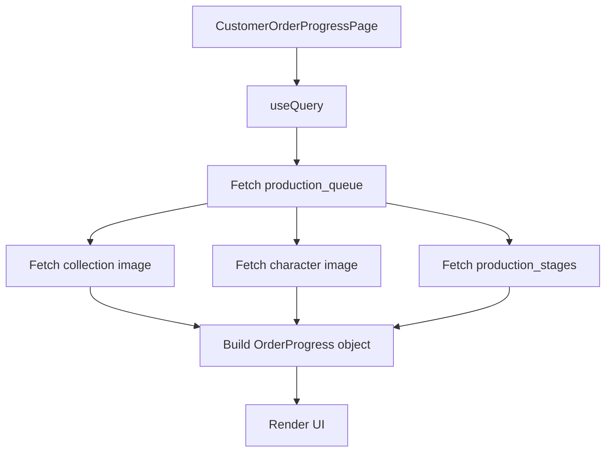

# CustomerOrderProgressPage

## Overview

The `CustomerOrderProgressPage` is a customer-facing page that displays real-time production progress for their orders. It provides a visual timeline, estimated dates, character selection status, and tracking information.

## Features

- ✅ **Visual Progress Timeline**: Horizontal timeline showing all 6 production stages
- ✅ **Order Summary**: Collection name, order number, and collection image
- ✅ **Estimated Dates**: Production completion, shipping, and delivery dates
- ✅ **Character Selection**: Integration with CharacterChoiceStatus component
- ✅ **Tracking Information**: Tracking code with copy button and carrier link
- ✅ **Real-time Updates**: Automatically refreshes every 30 seconds
- ✅ **On Track/Delayed Status**: Visual indicator for production status
- ✅ **Responsive Design**: Works on desktop and mobile devices
- ✅ **Support Access**: Quick link to contact support

## Requirements

This component implements the following requirements from the spec:

- **Requirement 2.4.1**: Visual Progress Timeline
- **Requirement 2.4.2**: Estimated Dates
- **Requirement 2.4.3**: Character Selection Interface
- **Requirement 2.4.4**: Order Tracking

## Task

**Task 5.1.1**: Create CustomerOrderProgressPage component

Sub-tasks implemented:
- ✅ Display order summary (collection, order number)
- ✅ Show visual progress timeline
- ✅ Display estimated dates
- ✅ Add character selection section (if applicable)
- ✅ Show tracking information (if shipped)

## Route

The page is accessible at:

```
/pedido/:orderType/:orderId/progresso
```

**Parameters**:
- `orderType`: Either "subscription_delivery" or "standalone_purchase"
- `orderId`: The UUID of the order

**Example**:
```
/pedido/subscription_delivery/123e4567-e89b-12d3-a456-426614174000/progresso
```

## Usage

### Accessing the Page

Customers can access this page by:
1. Clicking on an order in their dashboard
2. Following a link from an email notification
3. Direct URL navigation with order ID

### Navigation Example

```tsx
import { useNavigate } from "react-router-dom";

function OrderCard({ order }) {
  const navigate = useNavigate();
  
  const handleViewProgress = () => {
    navigate(`/pedido/${order.type}/${order.id}/progresso`);
  };
  
  return (
    <Card>
      <CardHeader>
        <CardTitle>Pedido #{order.id.slice(0, 8)}</CardTitle>
      </CardHeader>
      <CardContent>
        <Button onClick={handleViewProgress}>
          Ver Progresso
        </Button>
      </CardContent>
    </Card>
  );
}
```

## Component Structure

### Main Sections

1. **Header**
   - Order number
   - On Track/Delayed badge

2. **Progress Timeline**
   - Visual horizontal timeline
   - 6 production stages
   - Current stage highlighted
   - Completed stages with checkmarks
   - Completion dates

3. **Estimated Dates Card**
   - Production completion date
   - Estimated shipping date
   - Estimated delivery date
   - On hold alert (if applicable)

4. **Tracking Card** (when available)
   - Tracking code with copy button
   - Carrier name
   - Link to carrier tracking page

5. **Sidebar**
   - Order summary with collection image
   - Character choice status
   - Support contact button

## Data Flow

### Query Flow



### Data Sources

1. **production_queue table**
   - Order details
   - Current stage
   - Production status
   - Choice status
   - Estimated dates
   - Tracking information

2. **collections table**
   - Collection image

3. **collection_characters table**
   - Character image (if selected)

4. **production_stages table**
   - Stage completion dates
   - Stage status

## Production Stages

The page displays 6 sequential production stages:

1. **Aguardando Escolha** (Awaiting Choice) - Customer needs to choose a character
2. **Design** - Design phase for the collectible figure
3. **Produção** (Production) - Manufacturing the figure
4. **Controle de Qualidade** (Quality Check) - Quality assurance
5. **Embalagem** (Packaging) - Packaging the product
6. **Enviado** (Shipped) - Item has been shipped to customer

## Status Indicators

### On Track Badge
- Green badge with checkmark
- Shown when `production_status !== "on_hold"`

### Delayed Badge
- Red badge with alert icon
- Shown when `production_status === "on_hold"`

### Stage Status
- **Completed**: Green circle with checkmark + completion date
- **Current**: Blue circle with clock icon + "Em Progresso" badge
- **Upcoming**: Gray circle with stage number

## Estimated Dates Calculation

### Production Completion Date
- Fetched from `production_queue.estimated_completion_date`

### Shipping Date
- Production completion date + 2 days

### Delivery Date
- Shipping date + 7 days

## Tracking Integration

When a tracking code is available:

1. **Display tracking code** in a copyable format
2. **Show carrier name** (e.g., "Correios")
3. **Provide tracking link** to carrier's website
4. **Copy button** to copy tracking code to clipboard

### Tracking URL Format

```typescript
const trackingUrl = `https://rastreamento.correios.com.br/app/index.php?codigo=${trackingCode}`;
```

## Character Selection Integration

The page integrates with the `CharacterChoiceStatus` component to show:

- "Choose Character" button (if pending)
- Deadline countdown
- Chosen character preview (if selected)
- Approval status
- "Change Choice" button (if allowed)

See `CharacterChoiceStatus.tsx` for more details.

## Real-time Updates

The page automatically refreshes data every 30 seconds using React Query:

```typescript
refetchInterval: 30000, // 30 seconds
```

This ensures customers see the latest production status without manual refresh.

## Error Handling

### Order Not Found
- Shows error message
- Provides "Voltar ao Dashboard" button

### Loading State
- Shows skeleton loaders
- Maintains layout structure

### Network Errors
- Displays error message
- Allows retry via navigation

## Responsive Design

The page uses a responsive grid layout:

- **Desktop**: Two-column layout (main content + sidebar)
- **Mobile**: Single-column stacked layout

```tsx
<div className="grid gap-6 lg:grid-cols-[1fr_350px]">
  {/* Main content */}
  {/* Sidebar */}
</div>
```

## Accessibility

- Semantic HTML elements
- Clear visual indicators for stage status
- Descriptive button text
- Loading state with skeleton loaders
- Error messages are clearly displayed
- Keyboard navigation support

## Testing

The component includes comprehensive tests covering:

- ✅ Loading state
- ✅ Error state (order not found)
- ✅ Order progress display
- ✅ Tracking information display
- ✅ On hold alert display

Run tests with:
```bash
npm test -- CustomerOrderProgressPage.test.tsx --run
```

## Dependencies

- `react-router-dom` - Routing and navigation
- `@tanstack/react-query` - Data fetching and caching
- `date-fns` - Date formatting and manipulation
- `lucide-react` - Icons
- `@/components/ui/*` - shadcn/ui components
- `@/components/customer/CharacterChoiceStatus` - Character selection component

## Related Components

- `CharacterChoiceStatus` - Character selection status display
- `ProductionStageTracker` - Admin version of stage tracker
- `PreorderTracking` - Similar tracking page for quotes

## Future Enhancements

Potential improvements for future versions:

- [ ] Add photo gallery for production updates
- [ ] Add push notifications for stage changes
- [ ] Add estimated time remaining per stage
- [ ] Add production notes visible to customer
- [ ] Add ability to rate/review after delivery
- [ ] Add delivery confirmation button
- [ ] Add social sharing of order progress
- [ ] Add order history timeline

## Support

For issues or questions, please refer to:
- Design document: `.kiro/specs/production-management-system/design.md`
- Requirements: `.kiro/specs/production-management-system/requirements.md`
- Tasks: `.kiro/specs/production-management-system/tasks.md`
