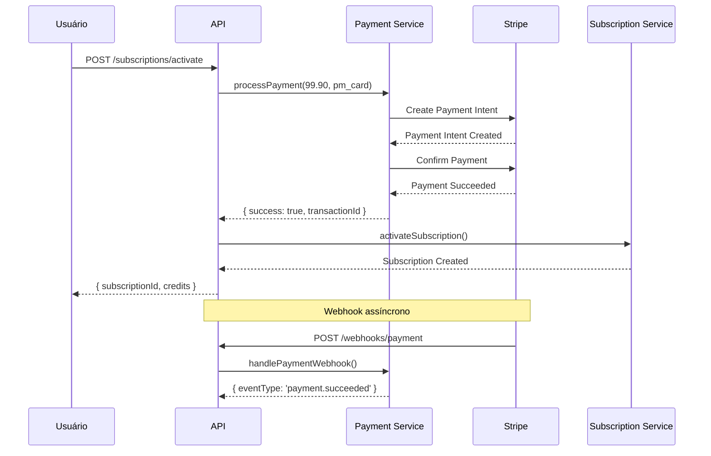
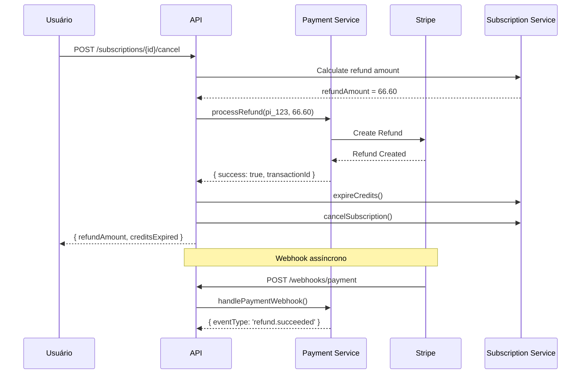
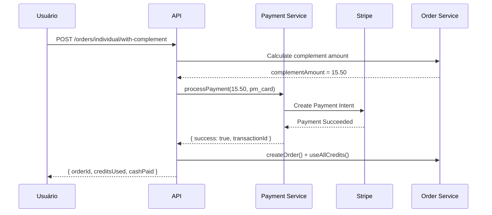

# Integração com Gateway de Pagamento

Este documento descreve a integração com gateways de pagamento implementada no sistema de assinaturas.

## Visão Geral

O sistema suporta integração com múltiplos gateways de pagamento através de uma interface unificada. Atualmente implementado:

- **Stripe**: Gateway principal (implementado)
- **Mercado Pago**: Planejado (não implementado)
- **Stub**: Modo de desenvolvimento/testes (implementado)

## Configuração

### Variáveis de Ambiente

Configure as seguintes variáveis de ambiente no arquivo `.env`:

```bash
# Gateway de pagamento a usar: 'stripe' | 'mercadopago' | 'stub'
PAYMENT_GATEWAY_PROVIDER=stub

# Configuração do Stripe (se PAYMENT_GATEWAY_PROVIDER=stripe)
STRIPE_SECRET_KEY=sk_test_...
STRIPE_WEBHOOK_SECRET=whsec_...

# Configuração do Mercado Pago (futuro)
# MERCADOPAGO_ACCESS_TOKEN=...
```

### Modo Stub (Desenvolvimento)

Por padrão, o sistema usa o modo `stub` que simula pagamentos sem integração real. Ideal para:
- Desenvolvimento local
- Testes automatizados
- Demonstrações

```bash
PAYMENT_GATEWAY_PROVIDER=stub
```

### Modo Stripe (Produção)

Para usar o Stripe em produção:

1. Crie uma conta no [Stripe](https://stripe.com)
2. Obtenha suas chaves de API no Dashboard
3. Configure as variáveis de ambiente:

```bash
PAYMENT_GATEWAY_PROVIDER=stripe
STRIPE_SECRET_KEY=sk_live_...
STRIPE_WEBHOOK_SECRET=whsec_...
```

4. Configure o webhook no Stripe Dashboard:
   - URL: `https://seu-dominio.com/api/webhooks/payment`
   - Eventos: `payment_intent.succeeded`, `payment_intent.payment_failed`, `charge.refunded`

## Uso da API

### Processar Pagamento

```typescript
import { processPayment } from './services/payment.service';

// Processar pagamento de assinatura
const result = await processPayment(99.90, 'pm_card_visa', {
  description: 'Assinatura Trimestral',
  metadata: {
    userId: '123',
    planType: 'trimestral',
    action: 'activation'
  }
});

if (result.success) {
  console.log('Pagamento aprovado:', result.transactionId);
  // Ativar assinatura
} else {
  console.error('Pagamento falhou:', result.error);
  // Notificar usuário
}
```

### Processar Reembolso

```typescript
import { processRefund } from './services/payment.service';

// Processar reembolso proporcional
const result = await processRefund('pi_1234567890', 66.60, {
  reason: 'Cancelamento com extorno',
  metadata: {
    userId: '123',
    subscriptionId: '456',
    daysRemaining: '60',
    totalDays: '90'
  }
});

if (result.success) {
  console.log('Reembolso processado:', result.transactionId);
  // Cancelar assinatura e expirar créditos
} else {
  console.error('Reembolso falhou:', result.error);
  // Alertar administrador
}
```

### Webhook Handler

```typescript
import { handlePaymentWebhook } from './services/payment.service';

// Em uma rota Express
app.post('/webhooks/payment', 
  express.raw({ type: 'application/json' }), 
  async (req, res) => {
    const signature = req.headers['stripe-signature'] as string;
    
    try {
      const result = await handlePaymentWebhook(req.body, signature);
      
      if (result.success) {
        // Processar evento baseado no tipo
        switch (result.eventType) {
          case 'payment.succeeded':
            // Confirmar ativação de assinatura
            break;
          case 'payment.failed':
            // Notificar usuário sobre falha
            break;
          case 'refund.succeeded':
            // Confirmar cancelamento
            break;
        }
      }
      
      res.json({ received: true });
    } catch (error) {
      res.status(400).send('Webhook validation failed');
    }
  }
);
```

## Fluxos de Pagamento

### 1. Ativação de Assinatura



### 2. Cancelamento com Extorno



### 3. Complemento de Compra



## Tipos de Eventos de Webhook

### payment.succeeded
Pagamento foi aprovado com sucesso.

**Ações:**
- Confirmar ativação de assinatura
- Confirmar renovação de assinatura
- Confirmar complemento de compra
- Enviar email de confirmação

### payment.failed
Pagamento falhou.

**Ações:**
- Notificar usuário sobre falha
- Sugerir outro método de pagamento
- Cancelar pedido pendente

### refund.succeeded
Reembolso foi processado com sucesso.

**Ações:**
- Confirmar cancelamento de assinatura
- Enviar email de confirmação de reembolso
- Atualizar registros financeiros

### refund.failed
Reembolso falhou.

**Ações:**
- Alertar administrador
- Tentar reembolso manual
- Notificar usuário sobre atraso

## Segurança

### Validação de Webhooks

O sistema valida a assinatura de todos os webhooks recebidos para garantir que vieram do gateway legítimo:

```typescript
// Stripe valida usando HMAC SHA256
const event = stripe.webhooks.constructEvent(
  rawBody,
  signature,
  webhookSecret
);
```

**Importante:**
- Nunca exponha suas chaves secretas
- Use HTTPS em produção
- Valide sempre a assinatura do webhook
- Use o corpo bruto (raw body) para validação

### Tratamento de Erros

O sistema trata diversos tipos de erros:

```typescript
try {
  const result = await processPayment(amount, paymentMethodId);
  
  if (!result.success) {
    // Pagamento recusado pelo gateway
    // result.error contém a mensagem
  }
} catch (error) {
  // Erro de comunicação ou configuração
  // Verificar logs e configuração
}
```

## Testes

### Testes Unitários

Execute os testes do payment service:

```bash
npm test payment.service.test.ts
```

### Testes com Stripe Test Mode

Use cartões de teste do Stripe:

```typescript
// Cartão de sucesso
const paymentMethodId = 'pm_card_visa';

// Cartão que falha
const paymentMethodId = 'pm_card_chargeDeclined';
```

Veja mais em: [Stripe Testing](https://stripe.com/docs/testing)

### Teste de Webhooks Localmente

Use o Stripe CLI para testar webhooks localmente:

```bash
# Instalar Stripe CLI
# https://stripe.com/docs/stripe-cli

# Login
stripe login

# Encaminhar webhooks para localhost
stripe listen --forward-to localhost:3000/api/webhooks/payment

# Disparar evento de teste
stripe trigger payment_intent.succeeded
```

## Monitoramento

### Logs

O sistema registra todos os eventos de pagamento:

```
[Payment Service] Processing payment: { amount: 99.90, paymentMethodId: 'pm_card_visa' }
[Payment Service] Payment succeeded: pi_1234567890
[Payment Service] Webhook event processed: { type: 'payment.succeeded', transactionId: 'pi_1234567890' }
```

### Métricas Recomendadas

- Taxa de sucesso de pagamentos
- Tempo médio de processamento
- Taxa de reembolsos
- Falhas de webhook
- Erros de validação

## Migração de Stub para Stripe

Para migrar do modo stub para Stripe em produção:

1. **Configurar Stripe:**
   ```bash
   PAYMENT_GATEWAY_PROVIDER=stripe
   STRIPE_SECRET_KEY=sk_live_...
   STRIPE_WEBHOOK_SECRET=whsec_...
   ```

2. **Testar em Test Mode:**
   - Use `sk_test_...` primeiro
   - Teste todos os fluxos
   - Valide webhooks

3. **Configurar Webhooks:**
   - Adicione endpoint no Stripe Dashboard
   - Selecione eventos necessários
   - Teste com Stripe CLI

4. **Deploy:**
   - Use chaves de produção `sk_live_...`
   - Monitore logs
   - Configure alertas

5. **Rollback Plan:**
   - Mantenha modo stub como fallback
   - Documente procedimento de rollback
   - Monitore métricas de erro

## Troubleshooting

### Erro: "Stripe API key not configured"

**Solução:** Configure `STRIPE_SECRET_KEY` no `.env`

### Erro: "Webhook validation failed"

**Solução:** 
- Verifique `STRIPE_WEBHOOK_SECRET`
- Use corpo bruto (raw body) na rota
- Valide assinatura do header

### Pagamentos não são processados

**Solução:**
- Verifique logs do serviço
- Valide chaves de API
- Teste conectividade com Stripe
- Verifique modo (test vs live)

### Webhooks não são recebidos

**Solução:**
- Verifique URL do webhook no Stripe Dashboard
- Valide que endpoint está acessível publicamente
- Teste com Stripe CLI localmente
- Verifique logs de erro do webhook

## Referências

- [Stripe API Documentation](https://stripe.com/docs/api)
- [Stripe Webhooks Guide](https://stripe.com/docs/webhooks)
- [Stripe Testing](https://stripe.com/docs/testing)
- [Mercado Pago API](https://www.mercadopago.com.br/developers/pt/docs) (futuro)

## Próximos Passos

- [ ] Implementar integração com Mercado Pago
- [ ] Adicionar suporte a PIX
- [ ] Implementar retry automático para webhooks
- [ ] Adicionar dashboard de métricas de pagamento
- [ ] Implementar notificações de falha de pagamento
- [ ] Adicionar suporte a múltiplas moedas
